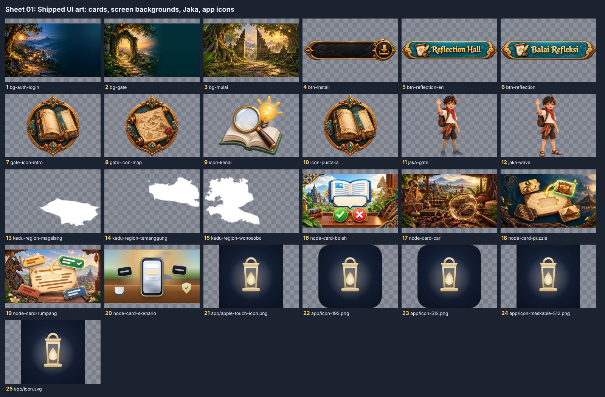
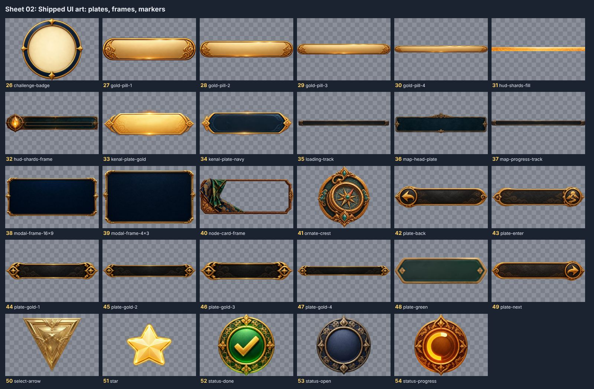
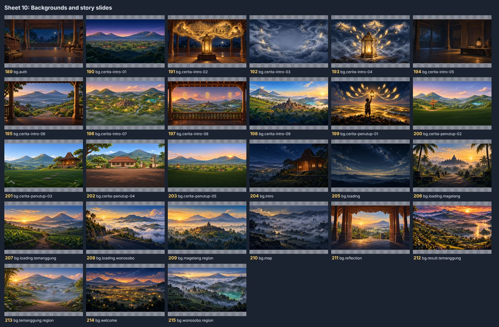
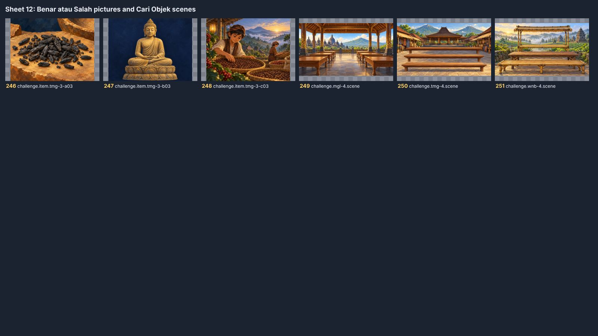
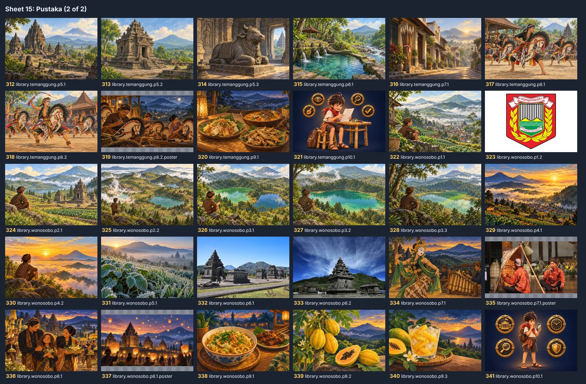
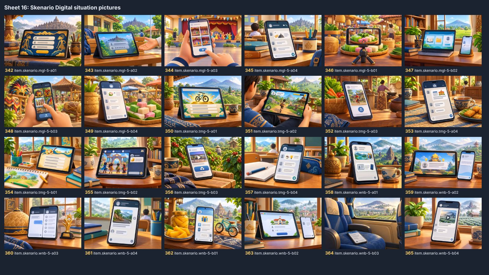
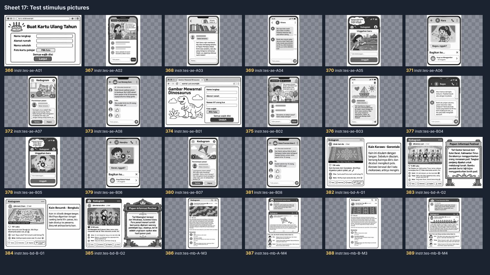
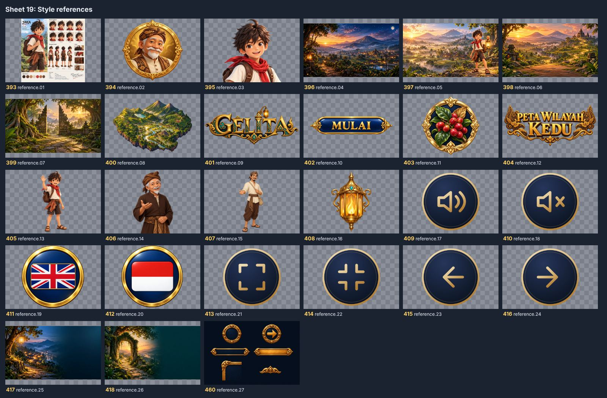
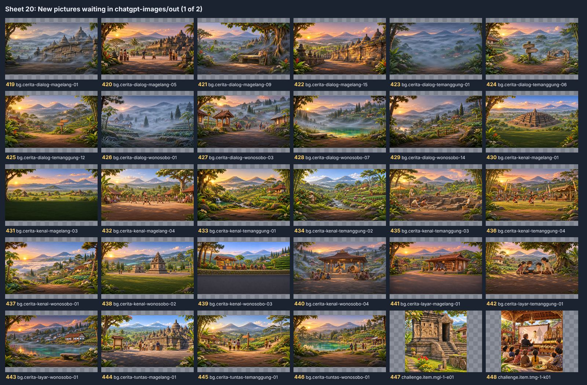

# Picture review (owner, started 15 November 2026)

The work list of this folder, like `TASKS.md` in `../chatgpt-images/`. One row is one picture; the number under each thumbnail on a sheet is the row's **No**. The owner reviews every picture against the game as it is today, and decides what stays, what is redrawn and what goes. A Claude Code session then acts on the marks (see `docs/PROGRESS.md` → *Asset catalogue audit and picture review*).

400 rows on 17 sheets since 17 November 2026, when the three avatar expressions R-31 to R-33 got rows 457 to 459 on sheet 06. 397 rows from 16 November 2026, when the owner accepted the pictures waiting in `../chatgpt-images/out/` and a Claude session installed them: a picture that replaced a file in place took over that file's row (nos. 447 and 449 to 452 were removed, and sheet 18 with the interim bridge backgrounds 390 to 392, and sheet 21); the new story backgrounds stay on sheet 20, linked to their new place, and W-K4 (no. 440) still waits there for its redo. Before that: 403 rows on 19 sheets (no. 453, the round-2 post photo, added that day; no. 456, the Isi Rumpang plate, too), at first 452 on 21; rows 129 to 178, the 50 vector icons of sheets 07 and 08, were dropped and removed; the other rows keep their numbers.

## How to mark

Fill the **Status** cell, and **Notes** when there is something to say:

| Status | Meaning |
|---|---|
| *(empty)* | Not reviewed yet |
| `keep` | Fits the current game and the look; nothing to do |
| `redo: reason` | The slot stays, the picture is made again; the reason becomes part of the new prompt |
| `drop: reason` | The game no longer needs it; the file and its list entry are removed |
| `fixed: what` | The owner asked for a fix that needed no new picture, and a session did it (15 November 2026: a caption, two swapped files) |
| `redo later: reason` | The picture is not right, and redoing it is not a priority now (owner, 15 November 2026). No row in `TASKS.md` yet |

Marking a whole sheet in chat works too ("sheet 13: keep all except 262 and 270, redo: …"); a session writes it into the cells. Notes that start with *Fact:* were filled in from the code and the question bank on 15 November 2026; they are not a judgement of the picture.

## What to look at

The first two questions are the owner's. The others come from the validators' instruments of the research (`docs/revisi-10-analitik/dokumen-pdf/`), so that a picture marked `keep` is ready to be shown to them.

| Question | Source |
|---|---|
| Is the picture still used, and does it show what the current story, question bank and screen say? | owner; *Used in the game* column, `docs/naskah-cerita.md`, `docs/bank-soal/` |
| Is it one look with the newest UI art (sheets 01 to 03): navy and gold, carved plates, round gold buttons? | owner; media instrument v1.1, A4 |
| Is the stylized 3D art of good quality, the same from screen to screen, and are Jaka and Mbah Kedu always recognisable? | media instrument v1.1, A7 |
| Is an icon or round button understood by a child without explanation? | media instrument v1.1, A6 |
| Does text over the picture stay readable (calm area where the text sits, dark layer behind it)? | media instrument v1.1, A3 |
| Is colour never the only marker (right or wrong, status, selected)? | media instrument v1.1, A8, F3 |
| Does the picture, or its file name, give away an answer or point at the right choice? | media instrument v1.1, H3, H5; `08` → Susun Gambar caption check |
| Are costume, props and make-up of an art form as in real life? | cultural observer instrument v2.1, B1 |
| Is the architecture of a site correct, with nothing mixed in from another site? | cultural observer instrument v2.1, B2 |
| Does the stylized look keep what makes the cultural object itself, clear enough to be recognised? | cultural observer instrument v2.1, B6, I3 |
| Is it free of stereotypes or a belittling portrayal? | cultural observer instrument v2.1, C2 |
| Does a picture made from someone else's photo have its source and permission recorded? | cultural observer instrument v2.1, H2 |

This review is the developer's own check. It is not expert validation, its marks are never counted as such, and it is not shown to the validators before they rate (`docs/revisi-10-analitik/01_REVISI_10_ANALITIK.md` → *Peran pengembang, peneliti, dan ahli*).

## First look by the developer (15 November 2026)

All 21 sheets are looked at now: 03, 07 and 10 by the session that built the list, the others by a second session on the same day. These are questions for the owner, not marks.

**How it was done.** Every sheet at thumbnail size. Looked at enlarged: the 30 Susun Gambar pictures, the 24 Skenario Digital pictures, the 24 test pictures (every word read), the new maps, and single pictures named below. Compared with `docs/naskah-cerita.md`, the question bank (`docs/bank-soal/data/`), the test items (`app/Database/Seeds/data/instrumen/tes.php`) and the Pustaka captions (`docs/pustaka/data/`).

**Not done.** Only frame 1 of each character pose. Most Pustaka pictures only as thumbnails. No picture was compared with a reference photo of the real object: that stays the researcher's and the cultural observer's check. A line that says *looks like* is an impression, not a finding.

### The eight questions I would answer first

1. **No. 271 `challenge.item.wnb-4-a02` (Buah carica, a target of Cari Objek Wonosobo) shows star fruit (belimbing):** ridged yellow fruit and a star-shaped slice. The clue says "buah pegunungan yang mirip pepaya, tetapi ukurannya kecil", and the distractor no. 274 (Pepaya biasa) is the one picture that looks like a papaya. The picture works against the right answer. Redo from the carica tree of no. 241?
2. **Nos. 382 and 384 (test, culture posts G1) point at an answer.** The button "Kirim pesan ke galeri" has a heavier outline than "Suka", "Komentar" and "Bagikan". Items `tes-bd-A03` and `tes-bd-B03` ask what to do first, and the key is asking the gallery for permission.
3. **Three test pictures have wrong letters** (they are drawn by the image model, so each one has to be read):
   - no. 374 `instr.tes-ae-B01`: button "Piih foto" (should be "Pilih foto", as in no. 366);
   - no. 387 `instr.tes-mb-A-M4`: account "@panitia.kaghaianak" (`tes.php`: `@panitia.kaghatianak`);
   - no. 383 `instr.tes-bd-A-G2`: the emoji after "menangkap ikan" is a pair of headphones (`tes.php` and option C of `tes-bd-A08`: 🎣).
   - Smaller: no. 377 `instr.tes-ae-B04` has a stray stroke under "untuk" and after "kodenya".
4. **No. 384 `instr.tes-bd-B-G1` (kain besurek): the motif is drawn as Arabic-looking calligraphy that may be readable.** Someone who reads Arabic should confirm it is not a real word or a sacred phrase before the picture goes to the validators.
5. **Nos. 213 and 215 look swapped or wrong.** `bg.temanggung.region` (213, "Di Antara Dua Gunung") shows one mountain, a temple group and a turquoise lake, which reads as Dieng (Candi Arjuna, Telaga Warna). `bg.wonosobo.region` (215, "Negeri di Atas Awan") shows two pairs of peaks over a lit plain, without lake or temple.
6. **Pustaka: the caption no longer describes the picture.** The importer replaces a medium's picture and credit and keeps the caption of the Wikimedia photo it replaced (`CatalogImporter::installLibrary`). Seen so far:

   | No | Caption in `docs/pustaka/data/` | The picture shows |
   |---|---|---|
   | 283 | Lambang Kabupaten Magelang | Borobudur stupas with a Buddha statue |
   | 288 | Bagian relief Karmawibhangga yang dibuka di kaki candi | Borobudur drawn in three floating levels |
   | 290 | Stupa induk di puncak Borobudur | a boy with his hand on a perforated stupa (the main stupa has no holes) |
   | 299 | Petilasan di Gunung Tidar yang banyak dikunjungi peziarah | a boy looking at a green hill |
   | 308 | Lambang Kabupaten Temanggung | an elder telling a story to children |
   | 322 | Suasana malam di Kota Wonosobo | a town in a valley by day |
   | 323 | Lambang Kabupaten Wonosobo | a boy with a basket of fruit by a lake |
   | 325 | Peta kawasan Dataran Tinggi Dieng | a landscape with a crater and a lake, no map |

   Change the captions, or redo these pictures to fit them? The other Pustaka captions were not compared one by one.
7. **"Tips Jaka" does not show Jaka.** Nos. 302, 321 and 341 show a boy in Javanese dress (iket, lurik or vest, batik cloth), in three different outfits, without the red scarf, white shirt and backpack. The same lurik boy stands in about a dozen other Pustaka pictures (290, 292, 294, 299, 301, 322 to 328, 330). Is he meant to be Jaka? No. 302 is on cream, 321 and 341 on navy.
8. **How many looks may the game have?** I count these:
   - the benchmark: carved gold, dark stone, 3D (sheets 01 to 03);
   - a smooth polished navy and gold: result screen 90 to 94, badges 82 to 84, pins 101 to 103, avatars 114 to 123, flags 126 and 127, references 409 to 416;
   - thin flat lines: icons 129 to 178, placeholder 89, `app.icon.svg` 113 and the shipped app icons 21 to 25;
   - content art in four styles: dense, saturated landscapes (Susun Gambar, backgrounds, new story pictures), smooth cartoon 3D (Skenario Digital), brush-stroke painting (Pustaka), grey line art (test).

   Which of these are one look on purpose? My guess: the grey test pictures are deliberate (a neutral instrument); the Pustaka painting is the visible outlier among what a student sees in the game. Of its 60 list entries, 12 ask for the 3D look ("no painted brush or paper texture") and 48 ask for a licensed photo to be found, not for a generated picture; the files are painted illustrations either way.

### About sheet 01: cards, screen backgrounds, Jaka, app icons

- **No. 20 `node-card-skenario`** is flat and pale beside cards 16 to 19. Its replacement no. 452 is waiting and fits the four.
- **No. 11 `jaka-gate`:** Jaka wears closed grey shoes and his legs fade out; in no. 12 and in every pose of sheet 09 he wears sandals.
- **Nos. 7 and 10** are almost the same open book in the same ring, for two meanings (the story on the start screen, Pustaka). **No. 9 `icon-kenali`** has no ring and a brighter, flatter finish.
- **Nos. 21 to 25** (shipped app icons) are a flat lantern; **nos. 108 to 112** in the list are a 3D lantern, and only the favicon (109) is installed. The browser tab and the home-screen icon show two different lanterns. Which is the app icon?
- Text inside pictures: 5 and 6 (Balai Refleksi), 85 and 86 (MULAI, START). Each has both languages. Their teal plate is a third plate colour next to navy and gold.

### About sheet 02: plates, frames, markers

- **No. 48 `plate-green`** looks soft and flat beside the carved plates.
- **No. 53 `status-open`** carries no symbol; "done" has a tick and "in progress" an arc. Is the empty navy disc enough, or is colour the only marker here?
- **No. 51 `star` and no. 96 `ui.result-star`** are nearly the same star. The game uses 96 when installed, otherwise 51 (`star_src()`). Keep one.

### About sheet 03 (addition)

- **No. 62 `round-lang-en` shows the flag of England** (red cross on white). No. 126 `icon.language-en` shows the Union Jack, and the slot text in `ImageSlots` asks for the Union Jack. The game shows 62 and 63 first (`hud-menu.php`), so 126 and 127 are never seen while the round ones exist: candidates for `drop`, once the flag question is settled.

### About sheet 04: logo, start buttons, result screen, badges

- **No. 84 `reward.badge.wonosobo`** shows a split gate (candi bentar) around a water drop. The Dieng temples (no. 239) are not split gates; the pin no. 103 shows a Dieng-like temple instead.
- **No. 83 and pin no. 102 (Temanggung):** which leaf is it meant to be, tobacco or coffee?
- **Nos. 90 to 94 (result screen)** are smooth glossy pills; the plates of sheet 02 (27 to 30, 44 to 47) are carved. Redo them, or use the shipped plates on the result screen?
- **Nos. 89 and 95** are not installed: candidates for `drop`.

### About sheet 05: maps, pins, lanterns

- **No. 107 `diorama.kedu-pulau`** is what Peta Kedu shows (`map-kedu.php`); no. 97 `map.kedu` is only the fallback. No. 107 is an island in the sea, and the story (`intro-01`) describes a plain ringed by mountains. It is the owner's picture of 20 October; the question is only whether the story line or the picture gives way (see also no. 199, a veranda by the sea).
- **Nos. 104 to 106** have four stops; no. 105 has props painted on its stops, 104 and 106 do not. All three are replaced by 449 to 451: `drop` after the install.
- **One Lentera Kedu, several lantern designs:** 87 (logo), 98 to 100 (the three region lanterns), 108 (app icon), 114 (avatar), 124 (HUD) and the flat one of no. 21. The story has one old lantern. Should one design be the lantern, with the others redrawn from it?

### About sheet 06: app icons, avatars, language flags

- **No. 121 `avatar.7` (buah carica)** looks like an ordinary papaya (large, black seeds), the same as the distractor no. 274.
- The avatars (114 to 123) are one family with `challenge-badge` (no. 26).

### About sheets 07 and 08: vector icons

- **A different visual language** (thin flat gold lines). The game installs none of the 52; its buttons are the round ones of sheet 03. Candidates for `drop`.

### About sheet 09: characters

- **Jaka** is the same boy in all six poses, red scarf every time. He holds the lantern in four poses (179, 181, 182, 184) and not in `bow` (180) and `idle` (183), so it appears and disappears between two lines of one scene. Intended?
- **Mbah Kedu** is the same in all four poses and matches his avatar no. 394.

### About sheet 10: backgrounds and story slides

- **One family** (stylized 3D landscapes at dusk, navy and gold) that sits well with the benchmark.
- **No. 199 `bg.cerita-penutup-01`** shows a veranda by the sea, and Kedu has no coast. **No. 202 `bg.cerita-penutup-04`** shows a child as a dark silhouette, so Jaka's red scarf cannot be seen.
- **No. 212:** only Temanggung has a result background; the slot `bg.result.*` exists for all three regions.

### About sheet 11: Susun Gambar

- **No letters in any of the 30** (the signs in 221 and 240 carry pictograms or nothing).
- **The study uses variants a and b:** 234 and 454 (Temanggung), 218 and 220 → 447 (Magelang), 239 and 244 (Wonosobo). These six matter most.
- **No. 219 (Relief Borobudur):** the adult's hand reaches the relief. The caption ends "Pengunjung boleh melihat, tetapi tidak boleh menyentuhnya."
- **No. 228 (Kuda Lumping):** the horse is painted flat; no weave can be seen. The caption says "anyaman bambu", and the same picture is the photo of the post in Cari Objek Temanggung, round 2, where the caption claims teak wood and the board says woven bamboo. Should the weave be visible (as in no. 235)?
- **No. 217 (Topeng Ireng):** the caption names small bells on the legs; I could not make them out.
- **Nos. 220, 227 and 447** share one composition (small temple, garden, a bicycle at the lower right). In no. 447 the roof is cut off, which removes the stupa that looked like the Cari Objek target, and also the roof that identifies Candi Pawon. Accepted by the owner; noted for the cultural observer.
- **No. 241 shows carica on its tree correctly:** a reference for redoing 271 and 121.
- **No. 242 (Bundengan)** has no angklung in it, which the post of Cari Objek Wonosobo needs (its caption wrongly says angklung).

### About sheet 12: Benar atau Salah pictures and Cari Objek scenes

- **No. 246** is used by item `tmg-3-a04` (true). Black grains on earth: read as burnt rice by a child?
- **Nos. 247 and 248** have no item. Item `tmg-3-b04` needs "Arca lembu duduk" and had no picture (installed 16 November 2026 as no. 455, `TASKS.md` R-23). The cut-out no. 265 (Arca Nandi) would fit, but it is a target of Cari Objek in the same region.
- **Missing as well:** `challenge.post.tmg-4-b` ("Uceng goreng di piring", the post of Cari Objek Temanggung, round 2, variant b). Not in the list. (Made as `R-13` and added as no. 453, 16 November 2026.)
- The three scenes (249 to 251) are empty tables without letters.

### About sheet 13: Cari Objek objects

- **No. 271:** see question 1.
- **No. 255 "Kendil gerabah"** shows a kendi (a jug with spout and handle). The bank and the caption of no. 223 say kendil, a cooking pot. The clue ("benda dari tanah liat") still works.
- **Nos. 256 and 263 are both "Kuda kepang bambu"** and are two different objects: 256 (distractor in Magelang) is a horse head on a stick, 263 (target in Temanggung) a flat woven horse. Use 263 for both, as the other shared objects do.
- **No. 276 (mi ongklok)** is the only object with a square background; the other 29 are cut-outs. It will stand out in the scene.
- **Shared objects are the same picture in every region** (262 and 279, 259, 266 and 277, 269 and 278, 253 and 280, 254 and 281), so a picture gives no hint of its region. No letters anywhere.

### About sheets 14 and 15: Pustaka

- See questions 6, 7 and 8.
- **No. 290:** apart from the caption, a child with a hand on a stupa contradicts "tidak boleh menyentuh" of no. 219.
- **Nos. 286, 297, 318, 334 and 336** are the pictures of video entries, which the importer skips: candidates for `drop`. Their covers (287, 298, 319, 335, 337) are installed; the *Used in the game* cells of these ten rows were corrected.
- **Nos. 309 to 311 and badge no. 83** show tobacco. It is in the Pustaka text; whether a children's game shows it this prominently is a question for the researcher.

### About sheet 16: Skenario Digital

- **All 24 fit their scenario**, none has letters, and none marks a choice as right. The screens inside the pictures show icons and grey bars only.
- **Nos. 344 and 348:** a finger is on the send or upload button, so the picture shows the risky action being taken.
- **No. 351** (Temanggung) has a stepped temple like Borobudur on the hill.

### About sheet 17: test pictures

- See questions 2, 3 and 4.
- **I found no other difference between the words in the 24 pictures and `tes.php`.**
- **Nos. 383 and 385:** the line "Video: Sanggar …" is the evidence for items `tes-bd-A05` and `tes-bd-B05`, and it is far smaller than "Foto: Galeri …" in 382 and 384. On a small screen the item may measure eyesight.
- **Forms A and B are not always drawn alike:** 369 has a light header and 377 a dark one; 382 has initials in the comment avatars and 384 has none. The label "Bukan temanmu" (368, 372, 376, 380) is not in the item text.
- **No. 367** (cooking channel) has a laboratory flask on the counter, which belongs to its twin no. 375.
- **No. 387:** the kaghati is drawn as an ordinary diamond kite; the text says it is made of leaves.

### About sheet 18: interim bridge-story backgrounds

- Dark crops of the old maps, replaced by 441 to 443: `drop` after the install.

### About sheet 19: style references

- **Still attached to prompts:** 398 and 399 (`TASKS.md`), 393 and 401 (named in the list's own prompts). **Installed:** 394 (Mbah Kedu's avatar).
- **These contradict the benchmark and should not be attached again:** 409, 410 and 413 to 416 (flat round buttons), 402 (navy MULAI; the game's is teal), 406 (Mbah Kedu in another outfit), 407 (a village guard who is not in the story), 400, 403.
- **Look like copies of other rows:** 411 and 412 (126, 127), 399 (3), 417 and 418 (1, 2), 405 (12).
- Keep 393, 394, 398, 399 and 401, drop the rest?

### About sheets 20 and 21: new pictures waiting

- **One family with sheet 10**, with a calm lower third for the text.
- **Story fit is good:** 420 (two men arguing), 424 (a signpost with blank boards, for "tulisan memudar"), 444 (blank information board, people at the relief), 441 (rumah baca), 442 (children with a tablet under a tree), 443 (the lake). No letters seen.
- **People are painted into about half of them** (420, 427, 432, 435, 436, 439, 440, 442, 444 to 446), and Jaka and Mbah Kedu stand in front as sprites: two figure styles and sizes in one frame. Acceptable?
- **No. 445 `bg.cerita-tuntas-temanggung-01`:** the line says the signpost can be read again, and its boards are as blank as in no. 425, because a picture may not carry letters. Is a blank board right here?
- **Nos. 449 to 451 (maps, five stops):** each stop carries a prop (frame with puzzle pieces, blank board, a green and a red disc, magnifier), and the fifth stop matches the bridge story (rumah baca, a bench with a tablet under a tree, a jetty at the lake). Two questions: the two discs are told apart by colour only, where card no. 16 uses a tick and a cross; and will the challenge cards cover the props or sit beside them?

## Sheets

The sheets are in `review/`, built from this file by `node ai-studio/game-images/review/build-sheets.mjs` (run it again after a picture was replaced). A picture name in the table opens the full-size file. This file and `review/` are removed when the review is done.

## Part 1: the benchmark (newest UI art, shipped with the game)

These pictures were never in the picture list. They are the look the owner wants everything else to match. Mark one `redo` only if the benchmark itself has to change.

### Sheet 01: Shipped UI art: cards, screen backgrounds, Jaka, app icons

| No | Picture | Shows | Used in the game | Status | Notes |
|---|---|---|---|---|---|
| 1 | [`bg-auth-login`](../../public/assets/ui/bg-auth-login.webp) | Screen background: auth-login | Ships with the game in `public/assets/ui/`; never in the picture list |  |  |
| 2 | [`bg-gate`](../../public/assets/ui/bg-gate.webp) | Screen background: gate | Ships with the game in `public/assets/ui/`; never in the picture list |  |  |
| 3 | [`bg-mulai`](../../public/assets/ui/bg-mulai.webp) | Screen background: mulai | Ships with the game in `public/assets/ui/`; never in the picture list |  |  |
| 4 | [`btn-install`](../../public/assets/ui/btn-install.webp) | Button with text: install | Ships with the game in `public/assets/ui/`; never in the picture list |  |  |
| 5 | [`btn-reflection-en`](../../public/assets/ui/btn-reflection-en.webp) | Button with text: reflection-en | Ships with the game in `public/assets/ui/`; never in the picture list |  |  |
| 6 | [`btn-reflection`](../../public/assets/ui/btn-reflection.webp) | Button with text: reflection | Ships with the game in `public/assets/ui/`; never in the picture list |  |  |
| 7 | [`gate-icon-intro`](../../public/assets/ui/gate-icon-intro.webp) | Icon on the gate screen: icon-intro | Ships with the game in `public/assets/ui/`; never in the picture list |  |  |
| 8 | [`gate-icon-map`](../../public/assets/ui/gate-icon-map.webp) | Icon on the gate screen: icon-map | Ships with the game in `public/assets/ui/`; never in the picture list |  |  |
| 9 | [`icon-kenali`](../../public/assets/ui/icon-kenali.webp) | Icon: kenali | Ships with the game in `public/assets/ui/`; never in the picture list |  |  |
| 10 | [`icon-pustaka`](../../public/assets/ui/icon-pustaka.webp) | Icon: pustaka | Ships with the game in `public/assets/ui/`; never in the picture list |  |  |
| 11 | [`jaka-gate`](../../public/assets/ui/jaka-gate.webp) | Jaka picture: gate | Ships with the game in `public/assets/ui/`; never in the picture list |  |  |
| 12 | [`jaka-wave`](../../public/assets/ui/jaka-wave.webp) | Jaka picture: wave | Ships with the game in `public/assets/ui/`; never in the picture list |  |  |
| 13 | [`kedu-region-magelang`](../../public/assets/ui/kedu-region-magelang.webp) | Mask that darkens a locked region on Peta Kedu: region-magelang | Ships with the game in `public/assets/ui/`; never in the picture list |  |  |
| 14 | [`kedu-region-temanggung`](../../public/assets/ui/kedu-region-temanggung.webp) | Mask that darkens a locked region on Peta Kedu: region-temanggung | Ships with the game in `public/assets/ui/`; never in the picture list |  |  |
| 15 | [`kedu-region-wonosobo`](../../public/assets/ui/kedu-region-wonosobo.webp) | Mask that darkens a locked region on Peta Kedu: region-wonosobo | Ships with the game in `public/assets/ui/`; never in the picture list |  |  |
| 16 | [`node-card-boleh`](../../public/assets/ui/node-card-boleh.webp) | Challenge card on the region map: card-boleh | Ships with the game in `public/assets/ui/`; never in the picture list |  |  |
| 17 | [`node-card-cari`](../../public/assets/ui/node-card-cari.webp) | Challenge card on the region map: card-cari | Ships with the game in `public/assets/ui/`; never in the picture list |  |  |
| 18 | [`node-card-puzzle`](../../public/assets/ui/node-card-puzzle.webp) | Challenge card on the region map: card-puzzle | Ships with the game in `public/assets/ui/`; never in the picture list |  |  |
| 19 | [`node-card-rumpang`](../../public/assets/ui/node-card-rumpang.webp) | Challenge card on the region map: card-rumpang | Ships with the game in `public/assets/ui/`; never in the picture list |  |  |
| 20 | [`node-card-skenario`](../../public/assets/ui/node-card-skenario.webp) | Challenge card on the region map: card-skenario | Ships with the game in `public/assets/ui/`; never in the picture list | `keep: new picture K-S (five-stop look, sheet 21 no. 452 before), accepted by the owner and installed 16 November 2026` | `../chatgpt-images/TASKS.md` row K-S; the file here is the new picture since 16 November 2026. |
| 21 | [`app/apple-touch-icon.png`](../../public/assets/app/apple-touch-icon.png) | App icon | Ships with the game in `public/assets/app/` (the importer can replace it from `app.*` of the list) |  |  |
| 22 | [`app/icon-192.png`](../../public/assets/app/icon-192.png) | App icon | Ships with the game in `public/assets/app/` (the importer can replace it from `app.*` of the list) |  |  |
| 23 | [`app/icon-512.png`](../../public/assets/app/icon-512.png) | App icon | Ships with the game in `public/assets/app/` (the importer can replace it from `app.*` of the list) |  |  |
| 24 | [`app/icon-maskable-512.png`](../../public/assets/app/icon-maskable-512.png) | App icon | Ships with the game in `public/assets/app/` (the importer can replace it from `app.*` of the list) |  |  |
| 25 | [`app/icon.svg`](../../public/assets/app/icon.svg) | App icon | Ships with the game in `public/assets/app/` (the importer can replace it from `app.*` of the list) |  |  |

## Part 1: the benchmark (newest UI art, shipped with the game)

These pictures were never in the picture list. They are the look the owner wants everything else to match. Mark one `redo` only if the benchmark itself has to change.

### Sheet 02: Shipped UI art: plates, frames, markers

| No | Picture | Shows | Used in the game | Status | Notes |
|---|---|---|---|---|---|
| 26 | [`challenge-badge`](../../public/assets/ui/challenge-badge.webp) | UI part: badge | Ships with the game in `public/assets/ui/`; never in the picture list |  |  |
| 27 | [`gold-pill-1`](../../public/assets/ui/gold-pill-1.webp) | Gold pill plate (main buttons): pill-1 | Ships with the game in `public/assets/ui/`; never in the picture list |  |  |
| 28 | [`gold-pill-2`](../../public/assets/ui/gold-pill-2.webp) | Gold pill plate (main buttons): pill-2 | Ships with the game in `public/assets/ui/`; never in the picture list |  |  |
| 29 | [`gold-pill-3`](../../public/assets/ui/gold-pill-3.webp) | Gold pill plate (main buttons): pill-3 | Ships with the game in `public/assets/ui/`; never in the picture list |  |  |
| 30 | [`gold-pill-4`](../../public/assets/ui/gold-pill-4.webp) | Gold pill plate (main buttons): pill-4 | Ships with the game in `public/assets/ui/`; never in the picture list |  |  |
| 31 | [`hud-shards-fill`](../../public/assets/ui/hud-shards-fill.webp) | Shard counter in the HUD: shards-fill | Ships with the game in `public/assets/ui/`; never in the picture list |  |  |
| 32 | [`hud-shards-frame`](../../public/assets/ui/hud-shards-frame.webp) | Shard counter in the HUD: shards-frame | Ships with the game in `public/assets/ui/`; never in the picture list |  |  |
| 33 | [`kenal-plate-gold`](../../public/assets/ui/kenal-plate-gold.webp) | Button plate, Kenali screen: plate-gold | Ships with the game in `public/assets/ui/`; never in the picture list |  |  |
| 34 | [`kenal-plate-navy`](../../public/assets/ui/kenal-plate-navy.webp) | Button plate, Kenali screen: plate-navy | Ships with the game in `public/assets/ui/`; never in the picture list |  |  |
| 35 | [`loading-track`](../../public/assets/ui/loading-track.webp) | UI part: track | Ships with the game in `public/assets/ui/`; never in the picture list |  |  |
| 36 | [`map-head-plate`](../../public/assets/ui/map-head-plate.webp) | UI part: head-plate | Ships with the game in `public/assets/ui/`; never in the picture list |  |  |
| 37 | [`map-progress-track`](../../public/assets/ui/map-progress-track.webp) | UI part: progress-track | Ships with the game in `public/assets/ui/`; never in the picture list |  |  |
| 38 | [`modal-frame-16x9`](../../public/assets/ui/modal-frame-16x9.webp) | Dialog frame: frame-16x9 | Ships with the game in `public/assets/ui/`; never in the picture list |  |  |
| 39 | [`modal-frame-4x3`](../../public/assets/ui/modal-frame-4x3.webp) | Dialog frame: frame-4x3 | Ships with the game in `public/assets/ui/`; never in the picture list |  |  |
| 40 | [`node-card-frame`](../../public/assets/ui/node-card-frame.webp) | Frame of a challenge card: card-frame | Ships with the game in `public/assets/ui/`; never in the picture list |  |  |
| 41 | [`ornate-crest`](../../public/assets/ui/ornate-crest.webp) | UI part: crest | Ships with the game in `public/assets/ui/`; never in the picture list |  |  |
| 42 | [`plate-back`](../../public/assets/ui/plate-back.webp) | Button plate: back | Ships with the game in `public/assets/ui/`; never in the picture list |  |  |
| 43 | [`plate-enter`](../../public/assets/ui/plate-enter.webp) | Button plate: enter | Ships with the game in `public/assets/ui/`; never in the picture list |  |  |
| 44 | [`plate-gold-1`](../../public/assets/ui/plate-gold-1.webp) | Gold button plate: gold-1 | Ships with the game in `public/assets/ui/`; never in the picture list |  |  |
| 45 | [`plate-gold-2`](../../public/assets/ui/plate-gold-2.webp) | Gold button plate: gold-2 | Ships with the game in `public/assets/ui/`; never in the picture list |  |  |
| 46 | [`plate-gold-3`](../../public/assets/ui/plate-gold-3.webp) | Gold button plate: gold-3 | Ships with the game in `public/assets/ui/`; never in the picture list |  |  |
| 47 | [`plate-gold-4`](../../public/assets/ui/plate-gold-4.webp) | Gold button plate: gold-4 | Ships with the game in `public/assets/ui/`; never in the picture list |  |  |
| 48 | [`plate-green`](../../public/assets/ui/plate-green.webp) | Button plate: green | Ships with the game in `public/assets/ui/`; never in the picture list |  |  |
| 49 | [`plate-next`](../../public/assets/ui/plate-next.webp) | Button plate: next | Ships with the game in `public/assets/ui/`; never in the picture list |  |  |
| 50 | [`select-arrow`](../../public/assets/ui/select-arrow.webp) | UI part: arrow | Ships with the game in `public/assets/ui/`; never in the picture list |  |  |
| 51 | [`star`](../../public/assets/ui/star.webp) | UI part | Ships with the game in `public/assets/ui/`; never in the picture list |  |  |
| 52 | [`status-done`](../../public/assets/ui/status-done.webp) | Challenge status marker: done | Ships with the game in `public/assets/ui/`; never in the picture list |  |  |
| 53 | [`status-open`](../../public/assets/ui/status-open.webp) | Challenge status marker: open | Ships with the game in `public/assets/ui/`; never in the picture list |  |  |
| 54 | [`status-progress`](../../public/assets/ui/status-progress.webp) | Challenge status marker: progress | Ships with the game in `public/assets/ui/`; never in the picture list |  |  |
| 456 | [`rumpang-instruction-plate`](../../public/assets/ui/rumpang-instruction-plate.webp) | Calm instruction plate of Isi Rumpang: carved-gold ends, plain navy middle that stretches | Ships with the game in `public/assets/ui/`; the Isi Rumpang instruction card (`--rumpang-plate`, border image) | `keep: accepted by the owner and installed 16 November 2026` | `../chatgpt-images/TASKS.md` row R-26 (new file, 16 November 2026). |

## Part 1: the benchmark (newest UI art, shipped with the game)

These pictures were never in the picture list. They are the look the owner wants everything else to match. Mark one `redo` only if the benchmark itself has to change.

### Sheet 03: Shipped UI art: round gold buttons

| No | Picture | Shows | Used in the game | Status | Notes |
|---|---|---|---|---|---|
| 55 | [`round-back`](../../public/assets/ui/round-back.webp) | Round gold button: back | Ships with the game in `public/assets/ui/`; never in the picture list |  |  |
| 56 | [`round-blank`](../../public/assets/ui/round-blank.webp) | Round gold button: blank | Ships with the game in `public/assets/ui/`; never in the picture list |  |  |
| 57 | [`round-clock`](../../public/assets/ui/round-clock.webp) | Round gold button: clock | Ships with the game in `public/assets/ui/`; never in the picture list |  |  |
| 58 | [`round-close`](../../public/assets/ui/round-close.webp) | Round gold button: close | Ships with the game in `public/assets/ui/`; never in the picture list |  |  |
| 59 | [`round-eye`](../../public/assets/ui/round-eye.webp) | Round gold button: eye | Ships with the game in `public/assets/ui/`; never in the picture list |  |  |
| 60 | [`round-help`](../../public/assets/ui/round-help.webp) | Round gold button: help | Ships with the game in `public/assets/ui/`; never in the picture list |  |  |
| 61 | [`round-info`](../../public/assets/ui/round-info.webp) | Round gold button: info | Ships with the game in `public/assets/ui/`; never in the picture list |  |  |
| 62 | [`round-lang-en`](../../public/assets/ui/round-lang-en.webp) | Round gold button: lang-en | Ships with the game in `public/assets/ui/`; never in the picture list | `keep: new picture R-25 (Union Jack, ring unchanged), accepted by the owner and installed 16 November 2026` | Owner, 16 Nov 2026: task `R-25`. `../chatgpt-images/TASKS.md` row R-25; the file here is the new picture since 16 November 2026. |
| 63 | [`round-lang-id`](../../public/assets/ui/round-lang-id.webp) | Round gold button: lang-id | Ships with the game in `public/assets/ui/`; never in the picture list |  |  |
| 64 | [`round-loading`](../../public/assets/ui/round-loading.webp) | Round gold button: loading | Ships with the game in `public/assets/ui/`; never in the picture list |  |  |
| 65 | [`round-lock`](../../public/assets/ui/round-lock.webp) | Round gold button: lock | Ships with the game in `public/assets/ui/`; never in the picture list |  |  |
| 66 | [`round-login`](../../public/assets/ui/round-login.webp) | Round gold button: login | Ships with the game in `public/assets/ui/`; never in the picture list |  |  |
| 67 | [`round-logout`](../../public/assets/ui/round-logout.webp) | Round gold button: logout | Ships with the game in `public/assets/ui/`; never in the picture list |  |  |
| 68 | [`round-map`](../../public/assets/ui/round-map.webp) | Round gold button: map | Ships with the game in `public/assets/ui/`; never in the picture list |  |  |
| 69 | [`round-menu`](../../public/assets/ui/round-menu.webp) | Round gold button: menu | Ships with the game in `public/assets/ui/`; never in the picture list |  |  |
| 70 | [`round-mute`](../../public/assets/ui/round-mute.webp) | Round gold button: mute | Ships with the game in `public/assets/ui/`; never in the picture list |  |  |
| 71 | [`round-neutral`](../../public/assets/ui/round-neutral.webp) | Round gold button: neutral | Ships with the game in `public/assets/ui/`; never in the picture list |  |  |
| 72 | [`round-next`](../../public/assets/ui/round-next.webp) | Round gold button: next | Ships with the game in `public/assets/ui/`; never in the picture list |  |  |
| 73 | [`round-pause`](../../public/assets/ui/round-pause.webp) | Round gold button: pause | Ships with the game in `public/assets/ui/`; never in the picture list |  |  |
| 74 | [`round-play`](../../public/assets/ui/round-play.webp) | Round gold button: play | Ships with the game in `public/assets/ui/`; never in the picture list |  |  |
| 75 | [`round-profile`](../../public/assets/ui/round-profile.webp) | Round gold button: profile | Ships with the game in `public/assets/ui/`; never in the picture list |  |  |
| 76 | [`round-register`](../../public/assets/ui/round-register.webp) | Round gold button: register | Ships with the game in `public/assets/ui/`; never in the picture list |  |  |
| 77 | [`round-replay`](../../public/assets/ui/round-replay.webp) | Round gold button: replay | Ships with the game in `public/assets/ui/`; never in the picture list |  |  |
| 78 | [`round-right`](../../public/assets/ui/round-right.webp) | Round gold button: right | Ships with the game in `public/assets/ui/`; never in the picture list |  |  |
| 79 | [`round-ring-green`](../../public/assets/ui/round-ring-green.webp) | Round gold button: ring-green | Ships with the game in `public/assets/ui/`; never in the picture list |  |  |
| 80 | [`round-sound`](../../public/assets/ui/round-sound.webp) | Round gold button: sound | Ships with the game in `public/assets/ui/`; never in the picture list |  |  |
| 81 | [`round-wrong`](../../public/assets/ui/round-wrong.webp) | Round gold button: wrong | Ships with the game in `public/assets/ui/`; never in the picture list |  |  |

## Part 2: the pictures of the list (`data.json`) and of the mock-up folders

These are what `php spark gelita:katalog:impor` installs.

### Sheet 04: Logo, start buttons, result screen, badges

| No | Picture | Shows | Used in the game | Status | Notes |
|---|---|---|---|---|---|
| 82 | [`reward.badge.magelang`](assets/lencana/reward.badge.magelang.webp) | Lencana Magelang | Lencana wilayah Magelang (Profil siswa, sesudah wilayah tuntas) |  |  |
| 83 | [`reward.badge.temanggung`](assets/lencana/reward.badge.temanggung.webp) | Lencana Temanggung | Lencana wilayah Temanggung (Profil siswa, sesudah wilayah tuntas) |  |  |
| 84 | [`reward.badge.wonosobo`](assets/lencana/reward.badge.wonosobo.webp) | Lencana Wonosobo | Lencana wilayah Wonosobo (Profil siswa, sesudah wilayah tuntas) | `redo: Candi Arjuna-style temple (as on pin 103) instead of the split gate` | Owner, 16 Nov 2026: drawn with the other badges in the interface overhaul, no task row yet. |
| 85 | [`ui.btn-start`](assets/antarmuka/ui.btn-start.webp) | Tombol MULAI | Tombol MULAI bergambar (bahasa Indonesia) (Halaman awal, tombol utama (bahasa Indonesia)) |  |  |
| 86 | [`ui.btn-start.en`](assets/antarmuka/ui.btn-start.en.webp) | Tombol START | Tombol START bergambar (bahasa Inggris) (Halaman awal saat bahasa permainan diganti ke bahasa itu) |  |  |
| 87 | [`ui.logo`](assets/logo/ui.logo.webp) | Emblem panel tanpa tulisan | Emblem logo (tanpa tulisan) (Pita atas layar akun (di tengah, di samping tombol Kembali); Pita atas langkah daftar) |  |  |
| 88 | [`ui.logo-hero`](assets/logo/ui.logo-hero.webp) | Logo utama tanpa tagline | Logo GELITA besar (landscape) (Halaman awal (logo besar di atas tombol Mulai); Halaman masuk panel staf (logo di tengah, di atas formulir)) |  |  |
| 89 | [`ui.placeholder`](assets/antarmuka/ui.placeholder.svg) | Gambar pengganti | Not installed by the game |  |  |
| 90 | [`ui.result-button-detail`](assets/antarmuka/ui.result-button-detail.webp) | Tombol Detail hasil — permukaan navy | Tombol Detail hasil (Tantangan selesai, tombol tengah bawah) |  |  |
| 91 | [`ui.result-button-primary`](assets/antarmuka/ui.result-button-primary.webp) | Tombol Berikutnya — permukaan emas | Tombol utama (Berikutnya) (Tantangan selesai, tombol kanan bawah) |  |  |
| 92 | [`ui.result-button-secondary`](assets/antarmuka/ui.result-button-secondary.webp) | Tombol peta — permukaan navy | Tombol peta wilayah (Tantangan selesai, tombol kiri bawah) |  |  |
| 93 | [`ui.result-hud-control`](assets/antarmuka/ui.result-hud-control.webp) | Kontrol HUD — permukaan lingkaran | Alas tombol bundar HUD (Tantangan selesai, tombol suara dan menu di kanan atas) |  |  |
| 94 | [`ui.result-panel`](assets/antarmuka/ui.result-panel.webp) | Panel hasil bergambar — navy emas | Panel hasil tantangan (Tantangan selesai, panel tengah) |  |  |
| 95 | [`ui.result-shard-effects`](assets/antarmuka/ui.result-shard-effects.svg) | Efek medali serpihan — glow dan partikel | Not installed by the game |  | Fact: not a game slot |
| 96 | [`ui.result-star`](assets/antarmuka/ui.result-star.webp) | Bintang hasil — emas bercahaya | Bintang permainan (Tantangan selesai, bintang di bawah judul; Peta Kedu, panel wilayah yang dipilih) |  |  |

### Sheet 05: Maps, pins, lanterns

| No | Picture | Shows | Used in the game | Status | Notes |
|---|---|---|---|---|---|
| 97 | [`map.kedu`](assets/peta/map.kedu.webp) | Peta utama Kedu | Peta Karesidenan Kedu (Peta Kedu (tiga pin wilayah di atas gambar)) |  |  |
| 98 | [`map.lantern.magelang`](assets/ikon/map.lantern.magelang.webp) | map.lantern.magelang | Lentera Kenali Magelang |  |  |
| 99 | [`map.lantern.temanggung`](assets/ikon/map.lantern.temanggung.webp) | map.lantern.temanggung | Lentera Kenali Temanggung |  |  |
| 100 | [`map.lantern.wonosobo`](assets/ikon/map.lantern.wonosobo.webp) | map.lantern.wonosobo | Lentera Kenali Wonosobo |  |  |
| 101 | [`map.pin.magelang`](assets/ikon/map.pin.magelang.webp) | map.pin.magelang | Pin peta Magelang (Peta Kedu) |  |  |
| 102 | [`map.pin.temanggung`](assets/ikon/map.pin.temanggung.webp) | map.pin.temanggung | Pin peta Temanggung (Peta Kedu) |  |  |
| 103 | [`map.pin.wonosobo`](assets/ikon/map.pin.wonosobo.webp) | map.pin.wonosobo | Pin peta Wonosobo (Peta Kedu) |  |  |
| 104 | [`map.region.magelang`](assets/peta/map.region.magelang.webp) | Peta wilayah Magelang | Peta wilayah Magelang (Peta wilayah (lima tombol tantangan di atas gambar)) | `keep: new five-stop map P-M, accepted by the owner and installed 16 November 2026` | Fact: four stops measured, the game has five challenges; five-stop maps are rows P-T, P-M, P-W of `../chatgpt-images/TASKS.md` `../chatgpt-images/TASKS.md` row P-M; the file here is the new picture since 16 November 2026. |
| 105 | [`map.region.temanggung`](assets/peta/map.region.temanggung.webp) | Peta wilayah Temanggung | Peta wilayah Temanggung (Peta wilayah (lima tombol tantangan di atas gambar)) | `keep: new five-stop map P-T, accepted by the owner and installed 16 November 2026` | Fact: four stops measured, the game has five challenges; five-stop maps are rows P-T, P-M, P-W of `../chatgpt-images/TASKS.md` `../chatgpt-images/TASKS.md` row P-T; the file here is the new picture since 16 November 2026. |
| 106 | [`map.region.wonosobo`](assets/peta/map.region.wonosobo.webp) | Peta wilayah Wonosobo | Peta wilayah Wonosobo (Peta wilayah (lima tombol tantangan di atas gambar)) | `keep: new five-stop map P-W, accepted by the owner and installed 16 November 2026` | Fact: four stops measured, the game has five challenges; five-stop maps are rows P-T, P-M, P-W of `../chatgpt-images/TASKS.md` `../chatgpt-images/TASKS.md` row P-W; the file here is the new picture since 16 November 2026. |
| 107 | [`diorama.kedu-pulau`](mockup/gambar-mockup/peta-kedu/revisi-05/aset/diorama.kedu-pulau.webp) | Peta Kedu island map (owner, 20 October 2026) | Peta pulau Dataran Kedu (Peta Kedu) · slot `map.kedu-diorama` |  |  |

### Sheet 06: App icons, avatars, language flags

| No | Picture | Shows | Used in the game | Status | Notes |
|---|---|---|---|---|---|
| 108 | [`app.apple-touch-icon.png`](assets/ikon/app.apple-touch-icon.webp) | Ikon aplikasi apple-touch-icon.png | Not installed by the game |  |  |
| 109 | [`app.favicon.ico`](assets/ikon/app.favicon.webp) | Ikon aplikasi favicon.ico | Ikon tab peramban (favicon) (Tab peramban di semua halaman permainan dan panel) · slot `app.favicon` |  |  |
| 110 | [`app.icon-192.png`](assets/ikon/app.icon-192.webp) | Ikon aplikasi icon-192.png | Not installed by the game |  |  |
| 111 | [`app.icon-512.png`](assets/ikon/app.icon-512.webp) | Ikon aplikasi icon-512.png | Not installed by the game |  |  |
| 112 | [`app.icon-maskable-512.png`](assets/ikon/app.icon-maskable-512.webp) | Ikon aplikasi icon-maskable-512.png | Not installed by the game |  |  |
| 113 | [`app.icon.svg`](assets/ikon/app.icon.svg) | Ikon aplikasi icon.svg | Not installed by the game |  |  |
| 114 | [`avatar.1`](assets/ikon/avatar.1.webp) | Avatar Lentera Kedu | Avatar 1 (Pilihan avatar di pendaftaran; Profil (Ganti avatar)) |  |  |
| 115 | [`avatar.10`](assets/ikon/avatar.10.webp) | Avatar bundengan | Avatar 10 (Pilihan avatar di pendaftaran; Profil (Ganti avatar)) | `keep` | Checked against the researcher's bundengan photos on 16 November 2026: drawn like the Cari Objek object (no. 270), a woven hood lying on its back like a sled with strings over the top; the real kowangan stands upright, pointed at the top, strings inside, a long bamboo pole along one edge. For the owner to judge. 16 November 2026: new emblem from `TASKS.md` row R-19: an upright bundengan, pointed at the top with its tuft, the long pole past the top, the cord grid on the back and the strings inside the hollow. Drawn by the owner outside ChatGPT and fitted into the old medallion by a Claude session (ring and diamond points unchanged). Owner: accepted; installed the same day. |
| 116 | [`avatar.2`](assets/ikon/avatar.2.webp) | Avatar Serpihan Cahaya | Medali Serpihan Cahaya (Tantangan selesai, medali di kiri panel) · slot `ui.result-medal` |  |  |
| 117 | [`avatar.3`](assets/ikon/avatar.3.webp) | Avatar gunung kembar Sindoro–Sumbing | Avatar 3 (Pilihan avatar di pendaftaran; Profil (Ganti avatar)) |  |  |
| 118 | [`avatar.4`](assets/ikon/avatar.4.webp) | Avatar stupa Borobudur | Avatar 4 (Pilihan avatar di pendaftaran; Profil (Ganti avatar)) |  |  |
| 119 | [`avatar.5`](assets/ikon/avatar.5.webp) | Avatar kuda lumping | Avatar 5 (Pilihan avatar di pendaftaran; Profil (Ganti avatar)) |  |  |
| 120 | [`avatar.6`](assets/ikon/avatar.6.webp) | Avatar kuluk Topeng Ireng | Avatar 6 (Pilihan avatar di pendaftaran; Profil (Ganti avatar)) |  |  |
| 121 | [`avatar.7`](assets/ikon/avatar.7.webp) | Avatar buah carica | Avatar 7 (Pilihan avatar di pendaftaran; Profil (Ganti avatar)) |  |  |
| 122 | [`avatar.8`](assets/ikon/avatar.8.webp) | Avatar Telaga Warna | Avatar 8 (Pilihan avatar di pendaftaran; Profil (Ganti avatar)) |  |  |
| 123 | [`avatar.9`](assets/ikon/avatar.9.webp) | Avatar kendang | Avatar 9 (Pilihan avatar di pendaftaran; Profil (Ganti avatar)) |  |  |
| 124 | [`ui.lantern`](assets/ikon/ui.lantern.webp) | ui.lantern | Lentera (HUD dan tirai peta) (HUD (lentera serpihan); Tirai "Membuka Peta Kedu") |  |  |
| 125 | [`ui.pin`](assets/ikon/ui.pin.webp) | ui.pin | Pin wilayah (semua kota) (Peta Kedu) |  |  |
| 126 | [`icon.language-en`](assets/ikon/icon.language-en.webp) | English — bendera UK | Ikon bahasa Inggris (EN) (Pita atas semua layar, pemilih bahasa di kanan atas; Pita atas layar akun) · slot `ui.lang.en` | `drop: never shown; the round button 62 is the language button` | Owner, 16 Nov 2026 (with `R-25`). |
| 127 | [`icon.language-id`](assets/ikon/icon.language-id.webp) | Bahasa Indonesia — bendera merah putih | Ikon bahasa Indonesia (ID) (Pita atas semua layar, pemilih bahasa di kanan atas; Pita atas layar akun) · slot `ui.lang.id` | `drop: never shown; the round button 63 is the language button` | Owner, 16 Nov 2026 (with `R-25`). |
| 128 | [`ui.jaka-avatar`](mockup/gambar-mockup/kenali/aset/ui.jaka-avatar.webp) | Jaka's avatar in a gold ring (owner, 19 October 2026) | Avatar Jaka (potret cerita Peta Kedu dan layar Kenali) (Pita cerita Jaka di bawah Peta Kedu; Layar Mengenal wilayah, baris yang diucapkan Jaka) |  |  |
| 457 | [`ui.jaka-avatar.determined`](assets/ikon/ui.jaka-avatar.determined.webp) | Jaka's avatar, determined (R-31) | Avatar Jaka per ekspresi (cerita pembuka dan penutup) (Cerita pembuka, slide yang diucapkan Jaka) · pose `determined` (`intro-06`) | `keep` | New slot of 16 November 2026 (`ui.jaka-avatar.*`); edit of no. 128 by ChatGPT as `../chatgpt-images/TASKS.md` row R-31. Owner: accepted through ChatGPT, including the changed ring, background and alpha and colour specks outside the ring (exception); installed by a Claude session on 17 November 2026. The ring is a little smaller than in no. 128. |
| 458 | [`ui.jaka-avatar.bow`](assets/ikon/ui.jaka-avatar.bow.webp) | Jaka's avatar, thankful (R-32) | Avatar Jaka per ekspresi (cerita pembuka dan penutup) (Cerita penutup) · pose `bow` | `keep` | New slot of 16 November 2026 (`ui.jaka-avatar.*`); edit of no. 128 by ChatGPT as `../chatgpt-images/TASKS.md` row R-32. Owner: accepted through ChatGPT, including the changed ring, background and alpha and colour specks outside the ring (exception); installed by a Claude session on 17 November 2026. The ring is a little smaller than in no. 128. |
| 459 | [`ui.kedu-avatar.weak`](assets/ikon/ui.kedu-avatar.weak.webp) | Mbah Kedu's avatar, weak (R-33) | Avatar Mbah Kedu per ekspresi (cerita pembuka dan penutup) (Cerita pembuka, slide yang diucapkan Mbah Kedu) · pose `weak` (`intro-05`) | `keep` | New slot of 16 November 2026 (`ui.kedu-avatar.*`); edit of no. 394 (`reference.02`) by ChatGPT as `../chatgpt-images/TASKS.md` row R-33. Owner: accepted through ChatGPT, including the changed ring, background and alpha and colour specks outside the ring (exception); installed by a Claude session on 17 November 2026. |

### Sheets 07 and 08: Vector icons (removed)

Rows 129 to 178, the 50 vector icons `icon.*.svg`. Owner, 15 November 2026: `drop` all. Their files and list entries were removed on that day; the game never installed them (its buttons are the round ones of sheet 03). The two language icons `icon.language-*` are rows 126 and 127 on sheet 06 and stay.

### Sheet 09: Characters (frame 1 of each pose)

| No | Picture | Shows | Used in the game | Status | Notes |
|---|---|---|---|---|---|
| 179 | [`char.jaka.afraid.1`](assets/karakter/char.jaka.afraid.1.webp) | Jaka · afraid · frame 1 | Jaka · pose takut · gambar 1 (Baris cerita yang memakai pose ini: cerita pembuka, dialog dan wilayah tuntas, penutup (rinciannya di halaman detail)) |  | Fact: 24 frames in this pose; the verdict covers all of them |
| 180 | [`char.jaka.bow.1`](assets/karakter/char.jaka.bow.1.webp) | Jaka · bow · frame 1 | Jaka · pose membungkuk hormat · gambar 1 (Baris cerita yang memakai pose ini: cerita pembuka, dialog dan wilayah tuntas, penutup (rinciannya di hal… |  | Fact: 24 frames in this pose; the verdict covers all of them |
| 181 | [`char.jaka.determined.1`](assets/karakter/char.jaka.determined.1.webp) | Jaka · determined · frame 1 | Jaka · pose bertekad · gambar 1 (Baris cerita yang memakai pose ini: cerita pembuka, dialog dan wilayah tuntas, penutup (rinciannya di halaman deta… |  | Fact: 24 frames in this pose; the verdict covers all of them |
| 182 | [`char.jaka.happy.1`](assets/karakter/char.jaka.happy.1.webp) | Jaka · happy · frame 1 | Jaka · pose senang · gambar 1 (Baris cerita yang memakai pose ini: cerita pembuka, dialog dan wilayah tuntas, penutup (rinciannya di halaman detail)) |  | Fact: 24 frames in this pose; the verdict covers all of them |
| 183 | [`char.jaka.idle.1`](assets/karakter/char.jaka.idle.1.webp) | Jaka · idle · frame 1 | Jaka · pose diam · gambar 1 (Baris cerita yang memakai pose ini: cerita pembuka, dialog dan wilayah tuntas, penutup (rinciannya di halaman detail)) |  | Fact: 24 frames in this pose; the verdict covers all of them |
| 184 | [`char.jaka.sad.1`](assets/karakter/char.jaka.sad.1.webp) | Jaka · sad · frame 1 | Jaka · pose sedih · gambar 1 (Baris cerita yang memakai pose ini: cerita pembuka, dialog dan wilayah tuntas, penutup (rinciannya di halaman detail)) |  | Fact: 24 frames in this pose; the verdict covers all of them |
| 185 | [`char.kedu.idle.1`](assets/karakter/char.kedu.idle.1.webp) | Mbah Kedu · idle · frame 1 | Mbah Kedu · pose diam · gambar 1 (Baris cerita yang memakai pose ini: cerita pembuka, dialog dan wilayah tuntas, penutup (rinciannya di halaman det… |  | Fact: 24 frames in this pose; the verdict covers all of them |
| 186 | [`char.kedu.smile.1`](assets/karakter/char.kedu.smile.1.webp) | Mbah Kedu · smile · frame 1 | Mbah Kedu · pose tersenyum · gambar 1 (Baris cerita yang memakai pose ini: cerita pembuka, dialog dan wilayah tuntas, penutup (rinciannya di halama… |  | Fact: 24 frames in this pose; the verdict covers all of them |
| 187 | [`char.kedu.weak.1`](assets/karakter/char.kedu.weak.1.webp) | Mbah Kedu · weak · frame 1 | Mbah Kedu · pose lemah · gambar 1 (Baris cerita yang memakai pose ini: cerita pembuka, dialog dan wilayah tuntas, penutup (rinciannya di halaman de… |  | Fact: 24 frames in this pose; the verdict covers all of them |
| 188 | [`char.kedu.worried.1`](assets/karakter/char.kedu.worried.1.webp) | Mbah Kedu · worried · frame 1 | Mbah Kedu · pose cemas · gambar 1 (Baris cerita yang memakai pose ini: cerita pembuka, dialog dan wilayah tuntas, penutup (rinciannya di halaman de… |  | Fact: 24 frames in this pose; the verdict covers all of them |

### Sheet 10: Backgrounds and story slides

| No | Picture | Shows | Used in the game | Status | Notes |
|---|---|---|---|---|---|
| 189 | [`bg.auth`](assets/latar/bg.auth.webp) | bg.auth | Latar masuk, daftar, dan ganti kata sandi |  |  |
| 190 | [`bg.cerita-intro-01`](assets/latar/bg.cerita-intro-01.webp) | Dataran yang Bercahaya | Story slide background: Cerita pembuka, slide 1 | `keep` | 17 November 2026: replaced in place by the new picture of `../chatgpt-images/TASKS.md` row R-27 (document 39), made from the researcher's licensed Kedu photos: the Kedu plain at blue hour from the Menoreh slope, villages with golden lights, Sumbing and Sindoro on the left, Merbabu and Merapi on the right; no people, no rays. Owner: accepted (in this session); installed by a Claude session the same day. |
| 191 | [`bg.cerita-intro-02`](assets/latar/bg.cerita-intro-02.webp) | Cahaya dari Ilmu dan Budaya | Story slide background: Cerita pembuka, slide 2 |  |  |
| 192 | [`bg.cerita-intro-03`](assets/latar/bg.cerita-intro-03.webp) | Kabut Lupa | Story slide background: Cerita pembuka, slide 3 |  |  |
| 193 | [`bg.cerita-intro-04`](assets/latar/bg.cerita-intro-04.webp) | Malam Lentera Retak | Story slide background: Cerita pembuka, slide 4 |  |  |
| 194 | [`bg.cerita-intro-05`](assets/latar/bg.cerita-intro-05.webp) | Penjaga yang Menua | Story slide background: Cerita pembuka, slide 5 |  |  |
| 195 | [`bg.cerita-intro-06`](assets/latar/bg.cerita-intro-06.webp) | Jaka, Pembawa Lentera | Story slide background: Cerita pembuka, slide 6 | `keep` | 17 November 2026: replaced in place by the new picture of `../chatgpt-images/TASKS.md` row R-28 (document 39), made from the researcher's licensed Kedu photos: dawn from the veranda of the keeper's joglo, a stone path down to the misty valley, Sumbing and Sindoro, three far glints; no people, no rays. Owner: accepted (through ChatGPT; the details in the lower third accepted as an exception); installed by a Claude session the same day. |
| 196 | [`bg.cerita-intro-07`](assets/latar/bg.cerita-intro-07.webp) | Cara Mengumpulkan Serpihan | Story slide background: Cerita pembuka, slide 7 | `keep` | 17 November 2026: replaced in place by the new picture of `../chatgpt-images/TASKS.md` row R-29 (document 39), made from the researcher's licensed Kedu photos: bird's-eye view of Temanggung, Magelang (Borobudur) and Wonosobo (Telaga Warna) side by side, shards of light in each land; no people, no rays. Owner: accepted (through ChatGPT; the details in the lower third accepted as an exception); installed by a Claude session the same day. |
| 197 | [`bg.cerita-intro-08`](assets/latar/bg.cerita-intro-08.webp) | Tiga Kunci Cahaya | Story slide background: Cerita pembuka, slide 8 | `keep` | 17 November 2026: replaced in place by the new picture of `../chatgpt-images/TASKS.md` row R-30 (document 39), made from the researcher's licensed Kedu photos: golden hour from the keeper's porch with a carved railing, the three lands beyond, one brass key over each; no people, no rays. Owner: accepted (in this session); installed by a Claude session the same day. |
| 198 | [`bg.cerita-intro-09`](assets/latar/bg.cerita-intro-09.webp) | Perjalanan Dimulai | Story slide background: Cerita pembuka, slide 9 |  |  |
| 199 | [`bg.cerita-penutup-01`](assets/latar/bg.cerita-penutup-01.webp) | Lentera Menyala Kembali | Story slide background: Cerita penutup, slide 1 |  |  |
| 200 | [`bg.cerita-penutup-02`](assets/latar/bg.cerita-penutup-02.webp) | Kabut Tersibak | Story slide background: Cerita penutup, slide 2 |  |  |
| 201 | [`bg.cerita-penutup-03`](assets/latar/bg.cerita-penutup-03.webp) | Mbah Kedu Pulih | Story slide background: Cerita penutup, slide 3 |  |  |
| 202 | [`bg.cerita-penutup-04`](assets/latar/bg.cerita-penutup-04.webp) | Janji Jaka | Story slide background: Cerita penutup, slide 4 |  |  |
| 203 | [`bg.cerita-penutup-05`](assets/latar/bg.cerita-penutup-05.webp) | Penjaga Lentera | Story slide background: Cerita penutup, slide 5 |  |  |
| 204 | [`bg.intro`](assets/latar/bg.intro.webp) | bg.intro | Latar cerita pembuka & penutup (Cerita pembuka (slide tanpa latar sendiri); Cerita penutup) |  |  |
| 205 | [`bg.loading`](assets/latar/bg.loading.webp) | bg.loading | Latar tirai "Membuka Peta Kedu" (Tirai pemuatan sesudah cerita pembuka, sebelum Peta Kedu) |  |  |
| 206 | [`bg.loading.magelang`](assets/latar/bg.loading.magelang.webp) | bg.loading.magelang | Latar tirai menuju Magelang (Tirai menuju wilayah (dari peta Kedu)) |  |  |
| 207 | [`bg.loading.temanggung`](assets/latar/bg.loading.temanggung.webp) | bg.loading.temanggung | Latar tirai menuju Temanggung (Tirai menuju wilayah (dari peta Kedu)) |  |  |
| 208 | [`bg.loading.wonosobo`](assets/latar/bg.loading.wonosobo.webp) | bg.loading.wonosobo | Latar tirai menuju Wonosobo (Tirai menuju wilayah (dari peta Kedu)) |  |  |
| 209 | [`bg.magelang.region`](assets/latar/bg.magelang.region.webp) | fajar berkabut tipis, "Tanah Candi Agung" | Latar wilayah Magelang (Dialog masuk wilayah; Peta wilayah) |  |  |
| 210 | [`bg.map`](assets/latar/bg.map.webp) | bg.map | Latar Peta Kedu, Profil, dan rak Pustaka (Peta Kedu; Rak Pustaka) |  |  |
| 211 | [`bg.reflection`](assets/latar/bg.reflection.webp) | bg.reflection | Latar Balai Refleksi (Balai Refleksi) |  |  |
| 212 | [`bg.result.temanggung`](assets/latar/bg.result.temanggung.webp) | Latar hasil Temanggung — senja 3D | Latar tantangan selesai Temanggung (Tantangan selesai di wilayah ini) |  |  |
| 213 | [`bg.temanggung.region`](assets/latar/bg.temanggung.region.webp) | pagi, "Di Antara Dua Gunung" | Latar wilayah Temanggung (Dialog masuk wilayah; Peta wilayah) | `keep: new picture R-01, accepted by the owner and installed 16 November 2026` | Fact: until 15 November 2026 this file held the Dieng picture of no. 215 (the two files were swapped). The picture here now is the dusk view of the Kedu plain that stood at no. 215, kept only until the new one arrives. `TASKS.md` row R-01. Was `redo: must show Temanggung between Sindoro and Sumbing in the morning`. |
| 214 | [`bg.welcome`](assets/latar/bg.welcome.webp) | bg.welcome | Latar halaman awal & akun (Halaman awal; Pilih masuk atau daftar) |  |  |
| 215 | [`bg.wonosobo.region`](assets/latar/bg.wonosobo.region.webp) | fajar dingin, "Negeri di Atas Awan" | Latar wilayah Wonosobo (Dialog masuk wilayah; Peta wilayah) | `fixed: the two files were swapped` | Fact: now the Dieng picture its list entry describes (Arjuna temples, turquoise lake, sea of clouds), moved here from no. 213 on 15 November 2026 |

### Sheet 11: Susun Gambar pictures

| No | Picture | Shows | Used in the game | Status | Notes |
|---|---|---|---|---|---|
| 216 | [`challenge.item.mgl-1-01`](assets/tantangan/challenge.item.mgl-1-01.webp) | Stupa Borobudur | Gambar Susun Gambar Magelang (Tantangan Susun Gambar Magelang) |  |  |
| 217 | [`challenge.item.mgl-1-02`](assets/tantangan/challenge.item.mgl-1-02.webp) | Penari Topeng Ireng | Gambar Susun Gambar Magelang (Tantangan Susun Gambar Magelang) |  |  |
| 218 | [`challenge.item.mgl-1-03`](assets/tantangan/challenge.item.mgl-1-03.webp) | Candi Mendut | Gambar Susun Gambar Magelang (Tantangan Susun Gambar Magelang) |  |  |
| 219 | [`challenge.item.mgl-1-d01`](assets/tantangan/challenge.item.mgl-1-d01.webp) | Relief Borobudur | Gambar Susun Gambar Magelang (Tantangan Susun Gambar Magelang) |  |  |
| 220 | [`challenge.item.mgl-1-e01`](assets/tantangan/challenge.item.mgl-1-e01.webp) | Candi Pawon | Gambar Susun Gambar Magelang (Tantangan Susun Gambar Magelang) | `keep: new picture MGL-P05R, accepted by the owner and installed 16 November 2026` | Fact: replacement MGL-P05R is in `../chatgpt-images/out/` `../chatgpt-images/TASKS.md` row MGL-P05R; the file here is the new picture since 16 November 2026. |
| 221 | [`challenge.item.mgl-1-f01`](assets/tantangan/challenge.item.mgl-1-f01.webp) | Gunung Tidar | Gambar Susun Gambar Magelang (Tantangan Susun Gambar Magelang) |  |  |
| 222 | [`challenge.item.mgl-1-g01`](assets/tantangan/challenge.item.mgl-1-g01.webp) | Getuk Magelang | Gambar Susun Gambar Magelang (Tantangan Susun Gambar Magelang) |  |  |
| 223 | [`challenge.item.mgl-1-h01`](assets/tantangan/challenge.item.mgl-1-h01.webp) | Gerabah Klipoh | Gambar Susun Gambar Magelang (Tantangan Susun Gambar Magelang) |  |  |
| 224 | [`challenge.item.mgl-1-i01`](assets/tantangan/challenge.item.mgl-1-i01.webp) | Perjalanan Waisak | Gambar Susun Gambar Magelang (Tantangan Susun Gambar Magelang) |  |  |
| 225 | [`challenge.item.mgl-1-j01`](assets/tantangan/challenge.item.mgl-1-j01.webp) | Borobudur di Antara Dua Pasang Gunung Kembar | Gambar Susun Gambar Magelang (Tantangan Susun Gambar Magelang) |  |  |
| 226 | [`challenge.item.tmg-1-01`](assets/tantangan/challenge.item.tmg-1-01.webp) | Gunung Sindoro dan Sumbing | Gambar Susun Gambar Temanggung (Tantangan Susun Gambar Temanggung) |  |  |
| 227 | [`challenge.item.tmg-1-03`](assets/tantangan/challenge.item.tmg-1-03.webp) | Candi Pringapus | Gambar Susun Gambar Temanggung (Tantangan Susun Gambar Temanggung) |  |  |
| 228 | [`challenge.item.tmg-1-04`](assets/tantangan/challenge.item.tmg-1-04.webp) | Kuda Lumping | Gambar Susun Gambar Temanggung (Tantangan Susun Gambar Temanggung) |  |  |
| 229 | [`challenge.item.tmg-1-d01`](assets/tantangan/challenge.item.tmg-1-d01.webp) | Situs Liyangan | Gambar Susun Gambar Temanggung (Tantangan Susun Gambar Temanggung) |  |  |
| 230 | [`challenge.item.tmg-1-e01`](assets/tantangan/challenge.item.tmg-1-e01.webp) | Prasasti Gondosuli | Gambar Susun Gambar Temanggung (Tantangan Susun Gambar Temanggung) |  |  |
| 231 | [`challenge.item.tmg-1-f01`](assets/tantangan/challenge.item.tmg-1-f01.webp) | Umbul Jumprit | Gambar Susun Gambar Temanggung (Tantangan Susun Gambar Temanggung) |  |  |
| 232 | [`challenge.item.tmg-1-g01`](assets/tantangan/challenge.item.tmg-1-g01.webp) | Panen Kopi di Lereng Sindoro–Sumbing | Gambar Susun Gambar Temanggung (Tantangan Susun Gambar Temanggung) |  |  |
| 233 | [`challenge.item.tmg-1-h01`](assets/tantangan/challenge.item.tmg-1-h01.webp) | Ikan Uceng dan Sungai Jernih | Gambar Susun Gambar Temanggung (Tantangan Susun Gambar Temanggung) |  |  |
| 454 | [`challenge.item.tmg-1-k01`](assets/tantangan/challenge.item.tmg-1-k01.webp) | Wayang Kedu | Gambar Susun Gambar Temanggung, variasi b (Tantangan Susun Gambar Temanggung) | `keep` | `TASKS.md` row TMG-P11 (was no. 448 while it waited in `chatgpt-images/out/`). Approved by the researcher; installed 16 November 2026. Tile check (`cek_keping.py`, 3 × 3): LULUS DENGAN CATATAN, pieces 8 and 9 similar in texture but different in content (snack tray, mother with child). The two-person assembly test is still to be done before data collection. |
| 234 | [`challenge.item.tmg-1-i01`](assets/tantangan/challenge.item.tmg-1-i01.webp) | Pasar Papringan | Gambar Susun Gambar Temanggung (Tantangan Susun Gambar Temanggung) |  |  |
| 235 | [`challenge.item.tmg-1-j01`](assets/tantangan/challenge.item.tmg-1-j01.webp) | Perajin Kuda Kepang | Gambar Susun Gambar Temanggung (Tantangan Susun Gambar Temanggung) |  |  |
| 236 | [`challenge.item.wnb-1-05`](assets/tantangan/challenge.item.wnb-1-05.webp) | Telaga Warna | Gambar Susun Gambar Wonosobo (Tantangan Susun Gambar Wonosobo) |  |  |
| 237 | [`challenge.item.wnb-1-06`](assets/tantangan/challenge.item.wnb-1-06.webp) | Matahari Terbit di Sikunir | Gambar Susun Gambar Wonosobo (Tantangan Susun Gambar Wonosobo) |  |  |
| 238 | [`challenge.item.wnb-1-07`](assets/tantangan/challenge.item.wnb-1-07.webp) | Mi Ongklok | Gambar Susun Gambar Wonosobo (Tantangan Susun Gambar Wonosobo) |  |  |
| 239 | [`challenge.item.wnb-1-d01`](assets/tantangan/challenge.item.wnb-1-d01.webp) | Kompleks Candi Arjuna | Gambar Susun Gambar Wonosobo (Tantangan Susun Gambar Wonosobo) |  | Checked against the researcher's photos on 16 November 2026: the closest of the Arjuna pictures (a row of temples, a long low hall like Candi Semar); the temples stand in grass among visitors instead of on the gravel yard. For the owner to judge |
| 240 | [`challenge.item.wnb-1-e01`](assets/tantangan/challenge.item.wnb-1-e01.webp) | Kawah di Dieng: Tetap di Balik Pagar | Gambar Susun Gambar Wonosobo (Tantangan Susun Gambar Wonosobo) |  |  |
| 241 | [`challenge.item.wnb-1-f01`](assets/tantangan/challenge.item.wnb-1-f01.webp) | Carica, Pepaya Gunung | Gambar Susun Gambar Wonosobo (Tantangan Susun Gambar Wonosobo) |  |  |
| 242 | [`challenge.item.wnb-1-g01`](assets/tantangan/challenge.item.wnb-1-g01.webp) | Bundengan | Gambar Susun Gambar Wonosobo (Tantangan Susun Gambar Wonosobo) | `keep: new picture R-18, accepted by the owner and installed 16 November 2026` | Checked against the researcher's bundengan photos on 16 November 2026: the closest of the bundengan pictures (an upright curved woven shell played seated), but it has no long bamboo pole, no ijuk tuft or grid of the outer layer, and the strings run outside like a harp, not inside the shell. For the owner to judge `../chatgpt-images/TASKS.md` row R-18; the file here is the new picture since 16 November 2026. |
| 243 | [`challenge.item.wnb-1-h01`](assets/tantangan/challenge.item.wnb-1-h01.webp) | Kebun Teh Tambi | Gambar Susun Gambar Wonosobo (Tantangan Susun Gambar Wonosobo) |  |  |
| 244 | [`challenge.item.wnb-1-i01`](assets/tantangan/challenge.item.wnb-1-i01.webp) | Tari Topeng Lengger | Gambar Susun Gambar Wonosobo (Tantangan Susun Gambar Wonosobo) |  |  |
| 245 | [`challenge.item.wnb-1-j01`](assets/tantangan/challenge.item.wnb-1-j01.webp) | Embun Upas | Gambar Susun Gambar Wonosobo (Tantangan Susun Gambar Wonosobo) |  |  |

### Sheet 12: Benar atau Salah pictures and Cari Objek scenes

| No | Picture | Shows | Used in the game | Status | Notes |
|---|---|---|---|---|---|
| 246 | [`challenge.item.tmg-3-a03`](assets/tantangan/challenge.item.tmg-3-a03.webp) | Butir padi hangus | Gambar pernyataan Benar atau Salah Temanggung (Tantangan Benar atau Salah Temanggung) |  |  |
| 247 | [`challenge.item.tmg-3-b03`](assets/tantangan/challenge.item.tmg-3-b03.webp) | Arca Buddha duduk | Gambar pernyataan Benar atau Salah Temanggung (Tantangan Benar atau Salah Temanggung) | `drop: no item uses it` | Fact: no item of the current question bank uses this code Owner, 16 Nov 2026. Item `tmg-3-b04` gets its own picture, task `R-23`. |
| 248 | [`challenge.item.tmg-3-c03`](assets/tantangan/challenge.item.tmg-3-c03.webp) | Biji kopi sangrai | Gambar pernyataan Benar atau Salah Temanggung (Tantangan Benar atau Salah Temanggung) | `drop: no item uses it` | Fact: no item of the current question bank uses this code Owner, 16 Nov 2026. |
| 455 | [`challenge.item.tmg-3-b04`](assets/tantangan/challenge.item.tmg-3-b04.webp) | Arca Nandi di bilik Candi Pringapus | Gambar pernyataan Benar atau Salah Temanggung, butir `tmg-3-b04` (Tantangan Benar atau Salah Temanggung) | `keep` | `TASKS.md` row R-23: a 3D Nandi in the game look from the researcher's photos, inside the stone chamber (the item's key is true). Approved by the researcher; installed 16 November 2026. Replaces the sample picture this item had. |
| 249 | [`challenge.mgl-4.scene`](assets/tantangan/challenge.mgl-4.scene.webp) | Galeri Budaya Magelang | Adegan Cari Objek Magelang (Tantangan Cari Objek Magelang) |  |  |
| 250 | [`challenge.tmg-4.scene`](assets/tantangan/challenge.tmg-4.scene.webp) | Pasar Budaya Temanggung | Adegan Cari Objek Temanggung (Tantangan Cari Objek Temanggung) |  |  |
| 251 | [`challenge.wnb-4.scene`](assets/tantangan/challenge.wnb-4.scene.webp) | Pasar Oleh-oleh Dieng | Adegan Cari Objek Wonosobo (Tantangan Cari Objek Wonosobo) |  |  |
| 453 | [`challenge.post.tmg-4-b`](assets/tantangan/challenge.post.tmg-4-b.webp) | Uceng goreng di piring | Foto unggahan Cari Objek Temanggung, babak 2, variasi b (Tantangan Cari Objek Temanggung) | `keep` | New slot of 16 November 2026 (`challenge.post.*`); made by ChatGPT as `TASKS.md` row R-13, checked against its prompt, accepted by the owner and installed the same day. Small fried uceng, no sea or river (item `tmg-4-b02`); the lower left stays plain table for the credit strip. |

### Sheet 13: Cari Objek objects

| No | Picture | Shows | Used in the game | Status | Notes |
|---|---|---|---|---|---|
| 252 | [`challenge.item.mgl-4-a01`](assets/tantangan/challenge.item.mgl-4-a01.webp) | Stupa berlubang | Benda Cari Objek Magelang (Tantangan Cari Objek Magelang) |  |  |
| 253 | [`challenge.item.mgl-4-a02`](assets/tantangan/challenge.item.mgl-4-a02.webp) | Kuluk Topeng Ireng | Benda Cari Objek Magelang (Tantangan Cari Objek Magelang) |  |  |
| 254 | [`challenge.item.mgl-4-a03`](assets/tantangan/challenge.item.mgl-4-a03.webp) | Getuk | Benda Cari Objek Magelang (Tantangan Cari Objek Magelang) |  |  |
| 255 | [`challenge.item.mgl-4-a04`](assets/tantangan/challenge.item.mgl-4-a04.webp) | Kendil gerabah | Benda Cari Objek Magelang (Tantangan Cari Objek Magelang) | `keep: new picture R-22 (kendil), accepted by the owner and installed 16 November 2026` | Compared with three kendi photos from the researcher on 16 November 2026 (`../chatgpt-images/inbox/reference-kendi-researcher-*`; 02 looks generated): the picture is neither a kendi (tall narrow neck, short spout on the shoulder, no handle) nor a kendil (round cooking pot, wide mouth, no spout). The bank, the Klipoh info card, item `mgl-2-c06` and the fact check (25, MGL-40) say kendil; owner: follow the bank. Task `R-22` of `../chatgpt-images/TASKS.md`. The owner then sent two kendil photos (a round reddish-brown pot with a knobbed clay lid), the prompt follows them, and they are attached to `R-22` (`../chatgpt-images/inbox/reference-kendil-researcher-*`). `../chatgpt-images/TASKS.md` row R-22; the file here is the new picture since 16 November 2026. |
| 256 | [`challenge.item.mgl-4-a05`](assets/tantangan/challenge.item.mgl-4-a05.webp) | Kuda kepang bambu | Benda Cari Objek Magelang (Tantangan Cari Objek Magelang) | `keep: new picture R-21, accepted by the owner and installed 16 November 2026` | Compared with the researcher's Kuda Lumping photos on 16 November 2026 (`../chatgpt-images/inbox/reference-Kuda-Lumping-researcher-craftspeople-painting-01.jpg`, `-kuda-kepang-close-watermarked-04.jpg`): wrong form. This is a rounded 3D horse head on a stick, a Western hobby horse. A kuda kepang is a FLAT cut-out of woven bamboo showing the whole horse in profile (head on a curved neck and the body), painted with ornaments, edged with rattan, ridden between the legs without a stick. Redo candidate; owner to decide. Task `R-21` of `../chatgpt-images/TASKS.md`. `../chatgpt-images/TASKS.md` row R-21; the file here is the new picture since 16 November 2026. |
| 257 | [`challenge.item.mgl-4-a06`](assets/tantangan/challenge.item.mgl-4-a06.webp) | Manisan carica dalam stoples | Benda Cari Objek Magelang (Tantangan Cari Objek Magelang) |  |  |
| 258 | [`challenge.item.mgl-4-a07`](assets/tantangan/challenge.item.mgl-4-a07.webp) | Dadak merak Reog | Benda Cari Objek Magelang (Tantangan Cari Objek Magelang) |  |  |
| 259 | [`challenge.item.mgl-4-a08`](assets/tantangan/challenge.item.mgl-4-a08.webp) | Angklung | Benda Cari Objek Magelang (Tantangan Cari Objek Magelang) |  |  |
| 260 | [`challenge.item.mgl-4-a09`](assets/tantangan/challenge.item.mgl-4-a09.webp) | Bakpia | Benda Cari Objek Magelang (Tantangan Cari Objek Magelang) |  |  |
| 261 | [`challenge.item.mgl-4-a10`](assets/tantangan/challenge.item.mgl-4-a10.webp) | Panci logam | Benda Cari Objek Magelang (Tantangan Cari Objek Magelang) |  |  |
| 262 | [`challenge.item.tmg-4-02`](assets/tantangan/challenge.item.tmg-4-02.webp) | Biji kopi | Benda Cari Objek Temanggung (Tantangan Cari Objek Temanggung) |  |  |
| 263 | [`challenge.item.tmg-4-03`](assets/tantangan/challenge.item.tmg-4-03.webp) | Kuda kepang bambu | Benda Cari Objek Temanggung (Tantangan Cari Objek Temanggung) | `keep: new picture R-20, accepted by the owner and installed 16 November 2026` | Compared with the same photos: close. A flat woven horse in profile with painted ornament, mane and tail. Smaller differences: a saddle cloth with gold tassels and a rocking-horse belly; the photos show a plain flat panel edged with rattan. Owner to judge (keep, or redo together with 256 so the two match). Task `R-20` of `../chatgpt-images/TASKS.md`. `../chatgpt-images/TASKS.md` row R-20; the file here is the new picture since 16 November 2026. |
| 264 | [`challenge.item.tmg-4-04`](assets/tantangan/challenge.item.tmg-4-04.webp) | Ikan uceng | Benda Cari Objek Temanggung (Tantangan Cari Objek Temanggung) |  |  |
| 265 | [`challenge.item.tmg-4-06`](assets/tantangan/challenge.item.tmg-4-06.webp) | Arca Nandi | Benda Cari Objek Temanggung (Tantangan Cari Objek Temanggung) |  |  |
| 266 | [`challenge.item.tmg-4-09`](assets/tantangan/challenge.item.tmg-4-09.webp) | Angklung | Benda Cari Objek Temanggung (Tantangan Cari Objek Temanggung) |  |  |
| 267 | [`challenge.item.tmg-4-10`](assets/tantangan/challenge.item.tmg-4-10.webp) | Ondel-ondel | Benda Cari Objek Temanggung (Tantangan Cari Objek Temanggung) |  |  |
| 268 | [`challenge.item.tmg-4-11`](assets/tantangan/challenge.item.tmg-4-11.webp) | Perahu pinisi | Benda Cari Objek Temanggung (Tantangan Cari Objek Temanggung) |  |  |
| 269 | [`challenge.item.tmg-4-12`](assets/tantangan/challenge.item.tmg-4-12.webp) | Sasando | Benda Cari Objek Temanggung (Tantangan Cari Objek Temanggung) |  |  |
| 270 | [`challenge.item.wnb-4-a01`](assets/tantangan/challenge.item.wnb-4-a01.webp) | Bundengan | Benda Cari Objek Wonosobo (Tantangan Cari Objek Wonosobo) | `keep: new picture R-17, accepted by the owner and installed 16 November 2026` | Checked against the researcher's bundengan photos on 16 November 2026: a woven hood lying on its back like a sled with strings over the top; the real kowangan stands upright, pointed at the top, strings inside, a long bamboo pole along one edge. For the owner to judge (it is a Cari Objek target, so its shape matters) `../chatgpt-images/TASKS.md` row R-17; the file here is the new picture since 16 November 2026. |
| 271 | [`challenge.item.wnb-4-a02`](assets/tantangan/challenge.item.wnb-4-a02.webp) | Buah carica | Benda Cari Objek Wonosobo (Tantangan Cari Objek Wonosobo) | `keep` | `TASKS.md` row R-02. Reference inside the repository: no. 241. 16 November 2026: the new picture of `TASKS.md` row R-02 is in `ai-studio/chatgpt-images/out/`; checked by a Claude session against its prompt: four small golden carica with five rounded ribs and a green tip on one, clearly not star fruit and not the big papaya decoy no. 274; real transparency. Owner: accepted; installed the same day from `TASKS.md` row R-02. |
| 272 | [`challenge.item.wnb-4-a03`](assets/tantangan/challenge.item.wnb-4-a03.webp) | Keranjang ongklok | Benda Cari Objek Wonosobo (Tantangan Cari Objek Wonosobo) |  |  |
| 273 | [`challenge.item.wnb-4-a04`](assets/tantangan/challenge.item.wnb-4-a04.webp) | Daun teh | Benda Cari Objek Wonosobo (Tantangan Cari Objek Wonosobo) |  |  |
| 274 | [`challenge.item.wnb-4-a05`](assets/tantangan/challenge.item.wnb-4-a05.webp) | Pepaya biasa | Benda Cari Objek Wonosobo (Tantangan Cari Objek Wonosobo) |  |  |
| 275 | [`challenge.item.wnb-4-a06`](assets/tantangan/challenge.item.wnb-4-a06.webp) | Rigen | Benda Cari Objek Wonosobo (Tantangan Cari Objek Wonosobo) |  |  |
| 276 | [`challenge.item.wnb-4-a07`](assets/tantangan/challenge.item.wnb-4-a07.webp) | Semangkuk mi ongklok | Benda Cari Objek Wonosobo (Tantangan Cari Objek Wonosobo) | `keep: new picture R-24 (cut-out), accepted by the owner and installed 16 November 2026` | Owner, 16 Nov 2026: task `R-24`. `../chatgpt-images/TASKS.md` row R-24; the file here is the new picture since 16 November 2026. |
| 277 | [`challenge.item.wnb-4-a08`](assets/tantangan/challenge.item.wnb-4-a08.webp) | Angklung | Benda Cari Objek Wonosobo (Tantangan Cari Objek Wonosobo) |  |  |
| 278 | [`challenge.item.wnb-4-a09`](assets/tantangan/challenge.item.wnb-4-a09.webp) | Sasando | Benda Cari Objek Wonosobo (Tantangan Cari Objek Wonosobo) |  |  |
| 279 | [`challenge.item.wnb-4-a10`](assets/tantangan/challenge.item.wnb-4-a10.webp) | Biji kopi | Benda Cari Objek Wonosobo (Tantangan Cari Objek Wonosobo) |  |  |
| 280 | [`challenge.item.wnb-4-a11`](assets/tantangan/challenge.item.wnb-4-a11.webp) | Kuluk Topeng Ireng | Benda Cari Objek Wonosobo (Tantangan Cari Objek Wonosobo) |  |  |
| 281 | [`challenge.item.wnb-4-a12`](assets/tantangan/challenge.item.wnb-4-a12.webp) | Getuk | Benda Cari Objek Wonosobo (Tantangan Cari Objek Wonosobo) |  |  |

### Sheet 14: Pustaka (1 of 2)

| No | Picture | Shows | Used in the game | Status | Notes |
|---|---|---|---|---|---|
| 282 | [`library.magelang.p1.1`](assets/pustaka/library.magelang.p1.1.webp) | Selamat Datang di Magelang | Gambar Pustaka (Pustaka Kedu) |  |  |
| 283 | [`library.magelang.p1.2`](assets/pustaka/library.magelang.p1.2.webp) | Stupa dan arca Buddha di teras Candi Borobudur | Gambar Pustaka (Pustaka Kedu) | `fixed: the official coat of arms of Kabupaten Magelang (file from the researcher, licensed) placed whole on a white 960 × 640 canvas, 16 November 2026` | Caption "Lambang Kabupaten Magelang" and credit "Lambang resmi Pemerintah Kabupaten Magelang" in `data.json`. Was `redo later: the page needs the coat of arms of Kabupaten Magelang, a real file the owner sends, not an illustration`. |
| 284 | [`library.magelang.p2.1`](assets/pustaka/library.magelang.p2.1.webp) | Teras atas Candi Borobudur dengan stupa-stupanya | Gambar Pustaka (Pustaka Kedu) | `redo later: Borobudur stands in the picture twice (a terrace in front, the whole temple behind)` | Caption replaced on 15 November 2026 (`caption` in `data.json`): "Teras atas Candi Borobudur dengan stupa-stupanya" |
| 285 | [`library.magelang.p2.2`](assets/pustaka/library.magelang.p2.2.webp) | Borobudur_stupas_on_upper_terrace.jpg | Gambar Pustaka (Pustaka Kedu) |  |  |
| 286 | [`library.magelang.p2.3`](assets/pustaka/library.magelang.p2.3.webp) | youtube.com/watch?v=txujqGtB_6g | Not installed by the game |  | Fact: this Pustaka medium is a video; the importer skips its picture and installs only the cover (`.poster`) |
| 287 | [`library.magelang.p2.3.poster`](assets/pustaka/library.magelang.p2.3.poster.webp) | library.magelang.p2.3.poster | Sampul video Pustaka (Pustaka Kedu) |  | Fact: installed as the cover of this page's video |
| 288 | [`library.magelang.p3.1`](assets/pustaka/library.magelang.p3.1.webp) | Tiga tingkat Candi Borobudur yang melambangkan tiga alam | Gambar Pustaka (Pustaka Kedu) | `fixed: caption` | Caption replaced on 15 November 2026 (`caption` in `data.json`): "Tiga tingkat Candi Borobudur yang melambangkan tiga alam" |
| 289 | [`library.magelang.p3.2`](assets/pustaka/library.magelang.p3.2.webp) | Relief_Di_Candi_Borobudur.jpg | Gambar Pustaka (Pustaka Kedu) | `fixed: a real photo of a gallery relief from the researcher (licensed) installed as it is, 16 November 2026` | Caption "Relief cerita di lorong Borobudur", credit "Foto relief Candi Borobudur (berizin, dari peneliti)" in `data.json`. Was `redo later: the relief panel is invented; needs a photo of a real panel as reference`. |
| 290 | [`library.magelang.p3.3`](assets/pustaka/library.magelang.p3.3.webp) | Stupa berlubang di teras bundar Borobudur | Gambar Pustaka (Pustaka Kedu) | `redo later: a child puts a hand on the stupa, which visitors may not do` | Caption replaced on 15 November 2026 (`caption` in `data.json`): "Stupa berlubang di teras bundar Borobudur" |
| 291 | [`library.magelang.p4.1`](assets/pustaka/library.magelang.p4.1.webp) | Petugas membersihkan batu candi saat pemugaran Borobudur | Gambar Pustaka (Pustaka Kedu) | `fixed: caption` | Caption replaced on 15 November 2026 (`caption` in `data.json`): "Petugas membersihkan batu candi saat pemugaran Borobudur" |
| 292 | [`library.magelang.p5.1`](assets/pustaka/library.magelang.p5.1.webp) | Iring-iringan Waisak di dekat Candi Mendut | Gambar Pustaka (Pustaka Kedu) | `fixed: caption` | Caption replaced on 15 November 2026 (`caption` in `data.json`): "Iring-iringan Waisak di dekat Candi Mendut" |
| 293 | [`library.magelang.p5.2`](assets/pustaka/library.magelang.p5.2.webp) | Arca Buddha di dalam Candi Mendut | Gambar Pustaka (Pustaka Kedu) | `keep` | Checked against the photos on 16 November 2026: the Buddha sits cross-legged, the two flanking statues stand (they sit), two lions in front that the chamber does not have, a child worshipping. Task `R-12` of `../chatgpt-images/TASKS.md`. 16 November 2026: the new picture of `TASKS.md` row R-12 is in `ai-studio/chatgpt-images/out/`; checked by a Claude session against its prompt: three seated statues, the Buddha with both feet on the lotus footstool and hands in front of the chest, no lions, offerings or people. Owner: accepted; installed the same day from `TASKS.md` row R-12. |
| 294 | [`library.magelang.p5.3`](assets/pustaka/library.magelang.p5.3.webp) | Candi_Pawon_6.jpg | Gambar Pustaka (Pustaka Kedu) | `fixed: a real photo of Candi Pawon from the researcher (licensed) installed as it is, 16 November 2026` | Caption "Candi Pawon, candi kecil di antara Mendut dan Borobudur", credit "Foto Candi Pawon (berizin, dari peneliti)" in `data.json`. The old picture was a painted tall tower with a stupa top, Borobudur behind and a child in front; the real temple is small and squat. |
| 295 | [`library.magelang.p6.1`](assets/pustaka/library.magelang.p6.1.webp) | Penari Topeng Ireng dengan kuluk bulu warna-warni | Gambar Pustaka (Pustaka Kedu) | `fixed: real photo installed` | Compared with the researcher's Topeng Ireng photos on 16 November 2026: a painting, not a photo; the kuluk, fringes and ankle bells are close, but the face has no make-up (the page: black stripes over white powder) and Balinese-style split gates and temple towers stand behind. No photo of one dancer fits yet: no. 03 has a watermark, no. 02 is a filtered phone still, no. 01 is portrait (a 3:2 crop cuts the crown or the face) and its costume may not be Topeng Ireng (`../chatgpt-images/inbox/reference-Topeng-Ireng-researcher-*`). Waiting for a landscape photo of one dancer without a watermark. Later the same day the researcher sent three landscape photos: the night photo of a dancer with white face make-up and black stripes under a feather kuluk (`inbox/reference-Topeng-Ireng-researcher-night-face-paint-08.webp`) installed as it is, cropped to 3:2 and scaled to 960 × 640, with caption and credit "Foto penari Topeng Ireng (berizin, dari peneliti)" in `data.json`. |
| 296 | [`library.magelang.p6.2`](assets/pustaka/library.magelang.p6.2.webp) | Barisan penari Topeng Ireng | Gambar Pustaka (Pustaka Kedu) | `fixed: real photo installed` | The old picture was a painting with temple towers like Bali's behind the dancers. 16 November 2026: the researcher's photo of a row of Topeng Ireng dancers (licensed) installed as it is, cropped to 3:2 and scaled from 502 × 335 to 960 × 640 (soft, but clear); caption "Barisan penari Topeng Ireng" and credit "Foto penari Topeng Ireng (berizin, dari peneliti)" in `data.json`. |
| 297 | [`library.magelang.p6.3`](assets/pustaka/library.magelang.p6.3.webp) | youtube.com/watch?v=CicQwPmwCWQ | Not installed by the game |  | Fact: this Pustaka medium is a video; the importer skips its picture and installs only the cover (`.poster`) |
| 298 | [`library.magelang.p6.3.poster`](assets/pustaka/library.magelang.p6.3.poster.webp) | library.magelang.p6.3.poster | Sampul video Pustaka (Pustaka Kedu) |  | Fact: installed as the cover of this page's video |
| 299 | [`library.magelang.p7.1`](assets/pustaka/library.magelang.p7.1.webp) | Gunung Tidar, bukit hijau di tengah Kota Magelang | Gambar Pustaka (Pustaka Kedu) | `fixed: caption` | Caption replaced on 15 November 2026 (`caption` in `data.json`): "Gunung Tidar, bukit hijau di tengah Kota Magelang" |
| 300 | [`library.magelang.p8.1`](assets/pustaka/library.magelang.p8.1.webp) | Prasasti Canggal dan Awal Mataram Kuno | Gambar Pustaka (Pustaka Kedu) |  |  |
| 301 | [`library.magelang.p9.1`](assets/pustaka/library.magelang.p9.1.webp) | Rasa dan Karya Magelang | Gambar Pustaka (Pustaka Kedu) |  |  |
| 302 | [`library.magelang.p10.1`](assets/pustaka/library.magelang.p10.1.webp) | Tips Jaka: Fakta, Pendapat, dan Menghubungkan Informasi | Gambar Pustaka (Pustaka Kedu) | `keep: new picture R-03, accepted by the owner and installed 16 November 2026` | `TASKS.md` row R-03. Was `redo: must show Jaka (red scarf, white shirt, backpack), on the same navy ground as 321 and 341`. |
| 303 | [`library.temanggung.p1.1`](assets/pustaka/library.temanggung.p1.1.webp) | Gunung Sindoro dan Gunung Sumbing dilihat dari sebuah desa di Temanggung | Gambar Pustaka (Pustaka Kedu) | `fixed: caption` | Caption replaced on 15 November 2026 (`caption` in `data.json`): "Gunung Sindoro dan Gunung Sumbing dilihat dari sebuah desa di Temanggung" |
| 304 | [`library.temanggung.p1.2`](assets/pustaka/library.temanggung.p1.2.webp) | Kabut_Tipis_Temanggung.jpg | Gambar Pustaka (Pustaka Kedu) |  |  |
| 305 | [`library.temanggung.p2.1`](assets/pustaka/library.temanggung.p2.1.webp) | Si Kembar Sindoro dan Sumbing | Gambar Pustaka (Pustaka Kedu) |  |  |
| 306 | [`library.temanggung.p2.2`](assets/pustaka/library.temanggung.p2.2.webp) | Gunung_Sindoro_dari_puncak_Gunung_Sumbing.jpg | Gambar Pustaka (Pustaka Kedu) |  |  |
| 307 | [`library.temanggung.p2.3`](assets/pustaka/library.temanggung.p2.3.webp) | Gunung_Sumbing_Temanggung.jpg | Gambar Pustaka (Pustaka Kedu) |  |  |
| 308 | [`library.temanggung.p3.1`](assets/pustaka/library.temanggung.p3.1.webp) | Seorang kakek bercerita tentang masa lalu Temanggung | Gambar Pustaka (Pustaka Kedu) | `fixed: the official coat of arms of Kabupaten Temanggung (file from the researcher, licensed) placed whole on a white 960 × 640 canvas, 16 November 2026` | Caption "Lambang Kabupaten Temanggung" and credit "Lambang resmi Pemerintah Kabupaten Temanggung" in `data.json`. Was `redo later: the page needs the coat of arms of Kabupaten Temanggung, a real file the owner sends`. |
| 309 | [`library.temanggung.p4.1`](assets/pustaka/library.temanggung.p4.1.webp) | Daun tembakau dan buah kopi dari lereng gunung Temanggung | Gambar Pustaka (Pustaka Kedu) | `fixed: caption` | Caption replaced on 15 November 2026 (`caption` in `data.json`): "Daun tembakau dan buah kopi dari lereng gunung Temanggung" |
| 310 | [`library.temanggung.p4.2`](assets/pustaka/library.temanggung.p4.2.webp) | Petani_Tembakau_memeriksa_daun_Tembakau_yang_akan_dipanen.jpg | Gambar Pustaka (Pustaka Kedu) |  |  |
| 311 | [`library.temanggung.p4.3`](assets/pustaka/library.temanggung.p4.3.webp) | Tobacco_Fields_on_the_slopes_of_Mt._Sumbing.jpg | Gambar Pustaka (Pustaka Kedu) |  |  |

### Sheet 15: Pustaka (2 of 2)

| No | Picture | Shows | Used in the game | Status | Notes |
|---|---|---|---|---|---|
| 312 | [`library.temanggung.p5.1`](assets/pustaka/library.temanggung.p5.1.webp) | Situs Liyangan di lereng Gunung Sindoro | Gambar Pustaka (Pustaka Kedu) | `keep` | Caption replaced on 15 November 2026 (`caption` in `data.json`): "Ilustrasi bangunan batu peninggalan Mataram Kuno". Task `R-16` of `../chatgpt-images/TASKS.md`. 16 November 2026: the new picture of `TASKS.md` row R-16 is in `ai-studio/chatgpt-images/out/`; checked by a Claude session against its prompt: walled terraces, a stone road, one small shrine with a stepped roof, a yoni on its base, one Sindoro cone; no towers, no people. Owner: accepted; installed the same day from `TASKS.md` row R-16. |
| 313 | [`library.temanggung.p5.2`](assets/pustaka/library.temanggung.p5.2.webp) | Candi Pringapus, candi Hindu abad ke-9 | Gambar Pustaka (Pustaka Kedu) | `fixed: real photo installed` | Compared with five Candi Pringapus photos from the researcher on 16 November 2026 (sent as chat pictures only; no file yet): wrong form. The painting shows a broad temple with many pinnacles, two doorways and statues in niches on a wide stepped platform. The real temple is one slender square cella on a high plain base with a stairway in front, ONE doorway under a kala head with makara at its foot, a flat stepped roof edged with small teeth (no pinnacles), foliage and kalpataru reliefs on the walls, in a grass yard with low hedges, Sindoro or Sumbing behind. Candidate to install as it is once it arrives as a file: the frontal photo in the garden (1200 × 800, already 3:2, no watermark seen). The photo with the "@benny_istant" mark is a reference only. The photos then came as files (`inbox/reference-Pringapus-researcher-*-05` to `-09`): the frontal garden photo installed as it is (scaled from 1200 × 800 to 960 × 640), with caption and credit "Foto Candi Pringapus (berizin, dari peneliti)" in `data.json`. |
| 314 | [`library.temanggung.p5.3`](assets/pustaka/library.temanggung.p5.3.webp) | Arca Nandi di dalam bilik Candi Pringapus | Gambar Pustaka (Pustaka Kedu) | `fixed: real photo installed` | Compared with the researcher's Pringapus photos on 16 November 2026 (chat pictures only): the painting puts the Nandi in a large open hall with columns, a goddess relief and flowers, with a Prambanan-like tower outside. In the real temple the Nandi lies inside the small, dark cella behind the single doorway (seen in the doorway photo, which also shows a "Batas pengunjung" sign). No photo shows the Nandi clearly enough to install; needs a clear photo of the Nandi itself. Later the same day the researcher's Nandi photos came as files: the clear photo of the Nandi in the cella installed as it is (`inbox/reference-Pringapus-researcher-Nandi-in-chamber-01.jpg`, cropped to 3:2 without its name label, 960 × 640), with caption and credit "Foto arca Nandi Candi Pringapus (berizin, dari peneliti)" in `data.json`. The close-up with a carved collar (03) may be a Nandi of another temple. |
| 315 | [`library.temanggung.p6.1`](assets/pustaka/library.temanggung.p6.1.webp) | Mata air Umbul Jumprit di lereng Gunung Sindoro | Gambar Pustaka (Pustaka Kedu) | `fixed: caption` | Caption replaced on 15 November 2026 (`caption` in `data.json`): "Mata air Umbul Jumprit di lereng Gunung Sindoro" |
| 316 | [`library.temanggung.p7.1`](assets/pustaka/library.temanggung.p7.1.webp) | Parakan, Kota Bambu Runcing | Gambar Pustaka (Pustaka Kedu) |  |  |
| 317 | [`library.temanggung.p8.1`](assets/pustaka/library.temanggung.p8.1.webp) | Pertunjukan kuda lumping di Temanggung | Gambar Pustaka (Pustaka Kedu) | `fixed: real photo installed` | Compared with five Kuda Lumping photos from the researcher on 16 November 2026 (`../chatgpt-images/inbox/reference-Kuda-Lumping-researcher-*`): a painting, with a Balinese-style temple tower behind again, and dancers in plain headcloths; the Temanggung style in the photos has large curly wigs, crowns, moustaches and beaded costumes. No photo fits as it is: the performance photos 02 and 05 carry a photographer's mark, 03 is portrait and small. Waiting for a landscape performance photo without a mark. The researcher then sent four more photos: the mass performance with the kuda kepang clearly visible (`inbox/reference-Kuda-Lumping-researcher-mass-dance-men-09.jpg`) installed as it is, cropped to 3:2 and scaled from 608 × 405 to 960 × 640 (soft), with caption and credit "Foto pertunjukan kuda lumping (berizin, dari peneliti)" in `data.json`. Second choice: 07, the curly-wig Temanggung costume, but no horse clearly visible. |
| 318 | [`library.temanggung.p8.2`](assets/pustaka/library.temanggung.p8.2.webp) | youtube.com/watch?v=IXDk03NgHqQ | Not installed by the game |  | Fact: this Pustaka medium is a video; the importer skips its picture and installs only the cover (`.poster`) |
| 319 | [`library.temanggung.p8.2.poster`](assets/pustaka/library.temanggung.p8.2.poster.webp) | Perajin kuda-kudaan jaran kepang | Sampul video Pustaka (Pustaka Kedu) | `fixed: real photo installed` | Fact: installed as the cover of this page's video. 16 November 2026: the researcher's photo of two craftspeople painting kuda kepang in a workshop (`inbox/reference-Kuda-Lumping-researcher-craftspeople-painting-01.jpg`) fits this video exactly and would replace the painted night scene, but a paint tin in front carries a readable brand label; owner to decide. Owner: install it, brand label and all; installed the same day, cropped to 16:9 (800 × 450) and scaled to 1280 × 720 (a video cover takes no caption or credit of its own). |
| 320 | [`library.temanggung.p9.1`](assets/pustaka/library.temanggung.p9.1.webp) | Rasa Temanggung | Gambar Pustaka (Pustaka Kedu) |  |  |
| 321 | [`library.temanggung.p10.1`](assets/pustaka/library.temanggung.p10.1.webp) | Tips Jaka: Membaca Informasi Tersurat | Gambar Pustaka (Pustaka Kedu) | `keep: new picture R-04, accepted by the owner and installed 16 November 2026` | `TASKS.md` row R-04. Was `redo: must show Jaka (red scarf, white shirt, backpack)`. |
| 322 | [`library.wonosobo.p1.1`](assets/pustaka/library.wonosobo.p1.1.webp) | Kota Wonosobo di antara bukit-bukit berkabut | Gambar Pustaka (Pustaka Kedu) | `fixed: caption` | Caption replaced on 15 November 2026 (`caption` in `data.json`): "Kota Wonosobo di antara bukit-bukit berkabut" |
| 323 | [`library.wonosobo.p1.2`](assets/pustaka/library.wonosobo.p1.2.webp) | Sekeranjang buah di tepi sebuah telaga di Wonosobo | Gambar Pustaka (Pustaka Kedu) | `fixed: the official coat of arms of Kabupaten Wonosobo (file from the researcher, licensed) placed whole on a white 960 × 640 canvas, 16 November 2026` | Caption "Lambang Kabupaten Wonosobo" and credit "Lambang resmi Pemerintah Kabupaten Wonosobo" in `data.json`. Was `redo later: the page needs the coat of arms of Kabupaten Wonosobo, a real file the owner sends; the fruit in the basket looks like ordinary papaya`. |
| 324 | [`library.wonosobo.p2.1`](assets/pustaka/library.wonosobo.p2.1.webp) | Dieng, Tempat Para Dewa | Gambar Pustaka (Pustaka Kedu) |  |  |
| 325 | [`library.wonosobo.p2.2`](assets/pustaka/library.wonosobo.p2.2.webp) | Peta kawasan Dataran Tinggi Dieng | Gambar Pustaka (Pustaka Kedu) | `keep` | Caption replaced on 15 November 2026 (`caption` in `data.json`): "Dataran Tinggi Dieng dilihat dari ketinggian: kawah, telaga, dan ladang". Task `R-14` of `../chatgpt-images/TASKS.md`. 16 November 2026: the new picture of `TASKS.md` row R-14 is in `ai-studio/chatgpt-images/out/`; checked by a Claude session against its prompt: a relief map of the three regencies; all eleven words match *All text*; Dieng Kulon, Candi Arjuna and Kawah Sikidang in Banjarnegara, Dieng Wetan, Telaga Warna and Sikunir in Wonosobo. Owner: accepted; installed the same day from `TASKS.md` row R-14. |
| 326 | [`library.wonosobo.p3.1`](assets/pustaka/library.wonosobo.p3.1.webp) | Telaga Warna dan Telaga Pengilon | Gambar Pustaka (Pustaka Kedu) |  |  |
| 327 | [`library.wonosobo.p3.2`](assets/pustaka/library.wonosobo.p3.2.webp) | Telaga_Warna_in_The_Dieng_Plateau.jpg | Gambar Pustaka (Pustaka Kedu) |  |  |
| 328 | [`library.wonosobo.p3.3`](assets/pustaka/library.wonosobo.p3.3.webp) | Telaga_Warna_Dieng_02.jpg | Gambar Pustaka (Pustaka Kedu) |  |  |
| 329 | [`library.wonosobo.p4.1`](assets/pustaka/library.wonosobo.p4.1.webp) | Sembungan dan Sikunir | Gambar Pustaka (Pustaka Kedu) |  |  |
| 330 | [`library.wonosobo.p4.2`](assets/pustaka/library.wonosobo.p4.2.webp) | The_Golden_Sunrise_Sikunir.jpg | Gambar Pustaka (Pustaka Kedu) |  |  |
| 331 | [`library.wonosobo.p5.1`](assets/pustaka/library.wonosobo.p5.1.webp) | Embun Upas, Es di Pulau Tropis | Gambar Pustaka (Pustaka Kedu) |  |  |
| 332 | [`library.wonosobo.p6.1`](assets/pustaka/library.wonosobo.p6.1.webp) | Candi-candi Dieng | Gambar Pustaka (Pustaka Kedu) | `fixed: a real photo of the Arjuna group from the researcher (licensed) installed as it is, 16 November 2026` | Caption "Kompleks Candi Arjuna di Dieng", credit "Foto Kompleks Candi Arjuna (berizin, dari peneliti)" in `data.json`. The old picture showed three temples scattered over a misty meadow full of rubble; the real complex is one row of small temples on a flat gravel yard, with Candi Semar facing Candi Arjuna. |
| 333 | [`library.wonosobo.p6.2`](assets/pustaka/library.wonosobo.p6.2.webp) | Pagi_Candi_Arjuna_Dieng.jpg | Gambar Pustaka (Pustaka Kedu) | `fixed: a real photo of Candi Arjuna from the researcher (licensed) installed as it is, 16 November 2026` | Caption replaced (`caption` in `data.json`): "Candi Arjuna, bangunan utama kompleksnya" (was "Pagi berkabut di Candi Arjuna"; none of the photos is misty); credit "Foto Candi Arjuna (berizin, dari peneliti)". The old picture showed a tall, ornate tower in tall grass. |
| 334 | [`library.wonosobo.p7.1`](assets/pustaka/library.wonosobo.p7.1.webp) | Tari Topeng Lengger dan Bundengan | Not installed by the game |  | Fact: this Pustaka medium is a video; the importer skips its picture and installs only the cover (`.poster`) |
| 335 | [`library.wonosobo.p7.1.poster`](assets/pustaka/library.wonosobo.p7.1.poster.webp) | library.wonosobo.p7.1.poster | Sampul video Pustaka (Pustaka Kedu) | `fixed: a real photo of a bundengan played on stage from the researcher (licensed) installed as it is, 16 November 2026` | Fact: installed as the cover of this page's video "Bundengan, alat musik unik dari Wonosobo". The old cover showed a lute with a neck and tuning pegs, at night. A cover has no caption or credit of its own; the video's credit stays. |
| 336 | [`library.wonosobo.p8.1`](assets/pustaka/library.wonosobo.p8.1.webp) | Tradisi Rambut Gimbal Dieng | Not installed by the game |  | Fact: this Pustaka medium is a video; the importer skips its picture and installs only the cover (`.poster`) |
| 337 | [`library.wonosobo.p8.1.poster`](assets/pustaka/library.wonosobo.p8.1.poster.webp) | library.wonosobo.p8.1.poster | Sampul video Pustaka (Pustaka Kedu) |  | Fact: installed as the cover of this page's video |
| 338 | [`library.wonosobo.p9.1`](assets/pustaka/library.wonosobo.p9.1.webp) | Rasa Wonosobo | Gambar Pustaka (Pustaka Kedu) |  |  |
| 339 | [`library.wonosobo.p9.2`](assets/pustaka/library.wonosobo.p9.2.webp) | Buah carica atau pepaya gunung | Gambar Pustaka (Pustaka Kedu) | `keep` | Checked against the photos on 16 November 2026: thick orange flesh and big black seeds (carica: thin cream flesh, white pulp with many small seeds); painted, not 3D. Task `R-15` of `../chatgpt-images/TASKS.md`. 16 November 2026: the new picture of `TASKS.md` row R-15 is in `ai-studio/chatgpt-images/out/`; checked by a Claude session against its prompt: thin cream flesh and white pulp with many small seeds, ribbed fruit on the trunk; 3D, not painted. Owner: accepted; installed the same day from `TASKS.md` row R-15. |
| 340 | [`library.wonosobo.p9.3`](assets/pustaka/library.wonosobo.p9.3.webp) | Es_carica_dieng_wonosobo.jpg | Gambar Pustaka (Pustaka Kedu) |  |  |
| 341 | [`library.wonosobo.p10.1`](assets/pustaka/library.wonosobo.p10.1.webp) | Tips Jaka: Cek Dulu Sebelum Percaya dan Berbagi | Gambar Pustaka (Pustaka Kedu) | `keep: new picture R-05, accepted by the owner and installed 16 November 2026` | `TASKS.md` row R-05. Was `redo: must show Jaka (red scarf, white shirt, backpack)`. |

### Sheet 16: Skenario Digital situation pictures

| No | Picture | Shows | Used in the game | Status | Notes |
|---|---|---|---|---|---|
| 342 | [`item.skenario.mgl-5-a01`](mockup/gambar-mockup/skenario/aset/item.skenario.mgl-5-a01.webp) | Situation picture | Gambar situasi Skenario Digital Magelang (Tantangan Skenario Digital Magelang) |  |  |
| 343 | [`item.skenario.mgl-5-a02`](mockup/gambar-mockup/skenario/aset/item.skenario.mgl-5-a02.webp) | Situation picture | Gambar situasi Skenario Digital Magelang (Tantangan Skenario Digital Magelang) |  |  |
| 344 | [`item.skenario.mgl-5-a03`](mockup/gambar-mockup/skenario/aset/item.skenario.mgl-5-a03.webp) | Situation picture | Gambar situasi Skenario Digital Magelang (Tantangan Skenario Digital Magelang) |  |  |
| 345 | [`item.skenario.mgl-5-a04`](mockup/gambar-mockup/skenario/aset/item.skenario.mgl-5-a04.webp) | Situation picture | Gambar situasi Skenario Digital Magelang (Tantangan Skenario Digital Magelang) |  |  |
| 346 | [`item.skenario.mgl-5-b01`](mockup/gambar-mockup/skenario/aset/item.skenario.mgl-5-b01.webp) | Situation picture | Gambar situasi Skenario Digital Magelang (Tantangan Skenario Digital Magelang) |  |  |
| 347 | [`item.skenario.mgl-5-b02`](mockup/gambar-mockup/skenario/aset/item.skenario.mgl-5-b02.webp) | Situation picture | Gambar situasi Skenario Digital Magelang (Tantangan Skenario Digital Magelang) |  |  |
| 348 | [`item.skenario.mgl-5-b03`](mockup/gambar-mockup/skenario/aset/item.skenario.mgl-5-b03.webp) | Situation picture | Gambar situasi Skenario Digital Magelang (Tantangan Skenario Digital Magelang) |  |  |
| 349 | [`item.skenario.mgl-5-b04`](mockup/gambar-mockup/skenario/aset/item.skenario.mgl-5-b04.webp) | Situation picture | Gambar situasi Skenario Digital Magelang (Tantangan Skenario Digital Magelang) |  |  |
| 350 | [`item.skenario.tmg-5-a01`](mockup/gambar-mockup/skenario/aset/item.skenario.tmg-5-a01.webp) | Situation picture | Gambar situasi Skenario Digital Temanggung (Tantangan Skenario Digital Temanggung) |  |  |
| 351 | [`item.skenario.tmg-5-a02`](mockup/gambar-mockup/skenario/aset/item.skenario.tmg-5-a02.webp) | Situation picture | Gambar situasi Skenario Digital Temanggung (Tantangan Skenario Digital Temanggung) |  |  |
| 352 | [`item.skenario.tmg-5-a03`](mockup/gambar-mockup/skenario/aset/item.skenario.tmg-5-a03.webp) | Situation picture | Gambar situasi Skenario Digital Temanggung (Tantangan Skenario Digital Temanggung) |  |  |
| 353 | [`item.skenario.tmg-5-a04`](mockup/gambar-mockup/skenario/aset/item.skenario.tmg-5-a04.webp) | Situation picture | Gambar situasi Skenario Digital Temanggung (Tantangan Skenario Digital Temanggung) |  |  |
| 354 | [`item.skenario.tmg-5-b01`](mockup/gambar-mockup/skenario/aset/item.skenario.tmg-5-b01.webp) | Situation picture | Gambar situasi Skenario Digital Temanggung (Tantangan Skenario Digital Temanggung) |  |  |
| 355 | [`item.skenario.tmg-5-b02`](mockup/gambar-mockup/skenario/aset/item.skenario.tmg-5-b02.webp) | Situation picture | Gambar situasi Skenario Digital Temanggung (Tantangan Skenario Digital Temanggung) |  |  |
| 356 | [`item.skenario.tmg-5-b03`](mockup/gambar-mockup/skenario/aset/item.skenario.tmg-5-b03.webp) | Situation picture | Gambar situasi Skenario Digital Temanggung (Tantangan Skenario Digital Temanggung) |  |  |
| 357 | [`item.skenario.tmg-5-b04`](mockup/gambar-mockup/skenario/aset/item.skenario.tmg-5-b04.webp) | Situation picture | Gambar situasi Skenario Digital Temanggung (Tantangan Skenario Digital Temanggung) |  |  |
| 358 | [`item.skenario.wnb-5-a01`](mockup/gambar-mockup/skenario/aset/item.skenario.wnb-5-a01.webp) | Situation picture | Gambar situasi Skenario Digital Wonosobo (Tantangan Skenario Digital Wonosobo) |  |  |
| 359 | [`item.skenario.wnb-5-a02`](mockup/gambar-mockup/skenario/aset/item.skenario.wnb-5-a02.webp) | Situation picture | Gambar situasi Skenario Digital Wonosobo (Tantangan Skenario Digital Wonosobo) |  |  |
| 360 | [`item.skenario.wnb-5-a03`](mockup/gambar-mockup/skenario/aset/item.skenario.wnb-5-a03.webp) | Situation picture | Gambar situasi Skenario Digital Wonosobo (Tantangan Skenario Digital Wonosobo) |  |  |
| 361 | [`item.skenario.wnb-5-a04`](mockup/gambar-mockup/skenario/aset/item.skenario.wnb-5-a04.webp) | Situation picture | Gambar situasi Skenario Digital Wonosobo (Tantangan Skenario Digital Wonosobo) |  |  |
| 362 | [`item.skenario.wnb-5-b01`](mockup/gambar-mockup/skenario/aset/item.skenario.wnb-5-b01.webp) | Situation picture | Gambar situasi Skenario Digital Wonosobo (Tantangan Skenario Digital Wonosobo) |  |  |
| 363 | [`item.skenario.wnb-5-b02`](mockup/gambar-mockup/skenario/aset/item.skenario.wnb-5-b02.webp) | Situation picture | Gambar situasi Skenario Digital Wonosobo (Tantangan Skenario Digital Wonosobo) |  |  |
| 364 | [`item.skenario.wnb-5-b03`](mockup/gambar-mockup/skenario/aset/item.skenario.wnb-5-b03.webp) | Situation picture | Gambar situasi Skenario Digital Wonosobo (Tantangan Skenario Digital Wonosobo) |  |  |
| 365 | [`item.skenario.wnb-5-b04`](mockup/gambar-mockup/skenario/aset/item.skenario.wnb-5-b04.webp) | Situation picture | Gambar situasi Skenario Digital Wonosobo (Tantangan Skenario Digital Wonosobo) |  |  |

### Sheet 17: Test stimulus pictures

| No | Picture | Shows | Used in the game | Status | Notes |
|---|---|---|---|---|---|
| 366 | [`instr.tes-ae-A01`](mockup/gambar-mockup/instrumen/aset/instr.tes-ae-A01.webp) | Test stimulus | Gambar tes awal–akhir (Modul tes) |  |  |
| 367 | [`instr.tes-ae-A02`](mockup/gambar-mockup/instrumen/aset/instr.tes-ae-A02.webp) | Test stimulus | Gambar tes awal–akhir (Modul tes) |  |  |
| 368 | [`instr.tes-ae-A03`](mockup/gambar-mockup/instrumen/aset/instr.tes-ae-A03.webp) | Test stimulus | Gambar tes awal–akhir (Modul tes) |  |  |
| 369 | [`instr.tes-ae-A04`](mockup/gambar-mockup/instrumen/aset/instr.tes-ae-A04.webp) | Test stimulus | Gambar tes awal–akhir (Modul tes) |  |  |
| 370 | [`instr.tes-ae-A05`](mockup/gambar-mockup/instrumen/aset/instr.tes-ae-A05.webp) | Test stimulus | Gambar tes awal–akhir (Modul tes) |  |  |
| 371 | [`instr.tes-ae-A06`](mockup/gambar-mockup/instrumen/aset/instr.tes-ae-A06.webp) | Test stimulus | Gambar tes awal–akhir (Modul tes) |  |  |
| 372 | [`instr.tes-ae-A07`](mockup/gambar-mockup/instrumen/aset/instr.tes-ae-A07.webp) | Test stimulus | Gambar tes awal–akhir (Modul tes) |  |  |
| 373 | [`instr.tes-ae-A08`](mockup/gambar-mockup/instrumen/aset/instr.tes-ae-A08.webp) | Test stimulus | Gambar tes awal–akhir (Modul tes) |  |  |
| 374 | [`instr.tes-ae-B01`](mockup/gambar-mockup/instrumen/aset/instr.tes-ae-B01.webp) | Test stimulus | Gambar tes awal–akhir (Modul tes) | `keep: new picture R-06, accepted by the owner and installed 16 November 2026` | `TASKS.md` row R-06. Was `redo: the button reads "Piih foto"; must read "Pilih foto"`. |
| 375 | [`instr.tes-ae-B02`](mockup/gambar-mockup/instrumen/aset/instr.tes-ae-B02.webp) | Test stimulus | Gambar tes awal–akhir (Modul tes) |  |  |
| 376 | [`instr.tes-ae-B03`](mockup/gambar-mockup/instrumen/aset/instr.tes-ae-B03.webp) | Test stimulus | Gambar tes awal–akhir (Modul tes) |  |  |
| 377 | [`instr.tes-ae-B04`](mockup/gambar-mockup/instrumen/aset/instr.tes-ae-B04.webp) | Test stimulus | Gambar tes awal–akhir (Modul tes) |  |  |
| 378 | [`instr.tes-ae-B05`](mockup/gambar-mockup/instrumen/aset/instr.tes-ae-B05.webp) | Test stimulus | Gambar tes awal–akhir (Modul tes) |  |  |
| 379 | [`instr.tes-ae-B06`](mockup/gambar-mockup/instrumen/aset/instr.tes-ae-B06.webp) | Test stimulus | Gambar tes awal–akhir (Modul tes) |  |  |
| 380 | [`instr.tes-ae-B07`](mockup/gambar-mockup/instrumen/aset/instr.tes-ae-B07.webp) | Test stimulus | Gambar tes awal–akhir (Modul tes) |  |  |
| 381 | [`instr.tes-ae-B08`](mockup/gambar-mockup/instrumen/aset/instr.tes-ae-B08.webp) | Test stimulus | Gambar tes awal–akhir (Modul tes) |  |  |
| 382 | [`instr.tes-bd-A-G1`](mockup/gambar-mockup/instrumen/aset/instr.tes-bd-A-G1.webp) | Test stimulus | Gambar tes awal–akhir (Modul tes) | `keep: new picture R-07, accepted by the owner and installed 16 November 2026` | `TASKS.md` row R-07. Was `redo: the button "Kirim pesan ke galeri" is drawn heavier than the other three and points at the key of `tes-bd-A03`. |
| 383 | [`instr.tes-bd-A-G2`](mockup/gambar-mockup/instrumen/aset/instr.tes-bd-A-G2.webp) | Test stimulus | Gambar tes awal–akhir (Modul tes) | `keep: new picture R-08, accepted by the owner and installed 16 November 2026` | `TASKS.md` row R-08. Was `redo: the emoji after "menangkap ikan" must be a fishing rod (🎣); the line "Video: Sanggar Lima Purnama" must be as large as the photo credit of no. 382`. |
| 384 | [`instr.tes-bd-B-G1`](mockup/gambar-mockup/instrumen/aset/instr.tes-bd-B-G1.webp) | Test stimulus | Gambar tes awal–akhir (Modul tes) | `keep: new picture R-09, accepted by the owner and installed 16 November 2026` | `TASKS.md` row R-09. New picture made with ChatGPT, accepted by the researcher (the Arabic check included) and the owner, 16 November 2026. Was `redo: the button "Kirim pesan ke galeri" is drawn heavier than the others; the cloth motif must not be readable Arabic writing`. |
| 385 | [`instr.tes-bd-B-G2`](mockup/gambar-mockup/instrumen/aset/instr.tes-bd-B-G2.webp) | Test stimulus | Gambar tes awal–akhir (Modul tes) | `keep` | 16 November 2026: the new picture of `TASKS.md` row R-11 is in `ai-studio/chatgpt-images/out/`; checked by a Claude session against its prompt: credit enlarged as asked and every word right, but "raja" in the caption is bold, as it already was here (form A has no bold word there); see the `TASKS.md` note. Owner: accepted, with the bold "raja" as it is; installed the same day from `TASKS.md` row R-11. |
| 386 | [`instr.tes-mb-A-M3`](mockup/gambar-mockup/instrumen/aset/instr.tes-mb-A-M3.webp) | Test stimulus | Gambar tes awal–akhir (Modul tes) |  |  |
| 387 | [`instr.tes-mb-A-M4`](mockup/gambar-mockup/instrumen/aset/instr.tes-mb-A-M4.webp) | Test stimulus | Gambar tes awal–akhir (Modul tes) | `keep: new picture R-10, accepted by the owner and installed 16 November 2026` | `TASKS.md` row R-10. Was `redo: the account reads "@panitia.kaghaianak"; must read "@panitia.kaghatianak"`. |
| 388 | [`instr.tes-mb-B-M3`](mockup/gambar-mockup/instrumen/aset/instr.tes-mb-B-M3.webp) | Test stimulus | Gambar tes awal–akhir (Modul tes) |  |  |
| 389 | [`instr.tes-mb-B-M4`](mockup/gambar-mockup/instrumen/aset/instr.tes-mb-B-M4.webp) | Test stimulus | Gambar tes awal–akhir (Modul tes) |  |  |

### Sheet 19: Style references

| No | Picture | Shows | Used in the game | Status | Notes |
|---|---|---|---|---|---|
| 393 | [`reference.01`](assets/referensi/reference.01.webp) | Jaka — lembar karakter | Not installed by the game |  |  |
| 394 | [`reference.02`](assets/referensi/reference.02.webp) | Mbah Kedu — avatar | Avatar Mbah Kedu (potret layar Kenali) (Layar Mengenal wilayah, di ujung kiri kotak teks (tombol Kenali di Peta Kedu)) · slot `ui.kedu-avatar` |  |  |
| 395 | [`reference.03`](assets/referensi/reference.03.webp) | Jaka — avatar syal merah | Not installed by the game |  |  |
| 396 | [`reference.04`](assets/referensi/reference.04.webp) | Lembah magis saat senja | Not installed by the game |  |  |
| 397 | [`reference.05`](assets/referensi/reference.05.webp) | Cahaya Kedu — latar prolog | Not installed by the game |  |  |
| 398 | [`reference.06`](assets/referensi/reference.06.webp) | Jalur cahaya menuju candi | Not installed by the game |  |  |
| 399 | [`reference.07`](assets/referensi/reference.07.webp) | Gerbang pohon tua | Not installed by the game |  |  |
| 400 | [`reference.08`](assets/referensi/reference.08.webp) | Diorama wilayah Kedu | Not installed by the game |  |  |
| 401 | [`reference.09`](assets/referensi/reference.09.webp) | Logo GELITA landscape | Not installed by the game |  |  |
| 402 | [`reference.10`](assets/referensi/reference.10.webp) | Tombol mulai | Not installed by the game |  |  |
| 403 | [`reference.11`](assets/referensi/reference.11.webp) | Medali kopi dan daun | Not installed by the game |  |  |
| 404 | [`reference.12`](assets/referensi/reference.12.webp) | Judul Peta Wilayah Kedu | Not installed by the game |  |  |
| 405 | [`reference.13`](assets/referensi/reference.13.webp) | Jaka — sprite petualang | Not installed by the game |  |  |
| 406 | [`reference.14`](assets/referensi/reference.14.webp) | Mbah Kedu — narator | Not installed by the game |  |  |
| 407 | [`reference.15`](assets/referensi/reference.15.webp) | Pendukung — penjaga desa | Not installed by the game |  |  |
| 408 | [`reference.16`](assets/referensi/reference.16.webp) | Logo simbol lentera | Not installed by the game |  |  |
| 409 | [`reference.17`](assets/referensi/reference.17.webp) | Speaker aktif | Not installed by the game |  |  |
| 410 | [`reference.18`](assets/referensi/reference.18.webp) | Speaker nonaktif | Not installed by the game |  |  |
| 411 | [`reference.19`](assets/referensi/reference.19.webp) | English — bendera UK | Not installed by the game |  |  |
| 412 | [`reference.20`](assets/referensi/reference.20.webp) | Bahasa Indonesia — bendera merah putih | Not installed by the game |  |  |
| 413 | [`reference.21`](assets/referensi/reference.21.webp) | Masuk layar penuh | Not installed by the game |  |  |
| 414 | [`reference.22`](assets/referensi/reference.22.webp) | Keluar layar penuh | Not installed by the game |  |  |
| 415 | [`reference.23`](assets/referensi/reference.23.webp) | Kembali | Not installed by the game |  |  |
| 416 | [`reference.24`](assets/referensi/reference.24.webp) | Selanjutnya | Not installed by the game |  |  |
| 417 | [`reference.25`](assets/referensi/reference.25.webp) | Login — lentera penyambut | Not installed by the game |  |  |
| 418 | [`reference.26`](assets/referensi/reference.26.webp) | Daftar — awal petualangan | Not installed by the game |  |  |

## Part 3: new pictures waiting to be installed

Shown here only so they can be compared with the rest.

### Sheet 20: New story backgrounds, installed 16 November 2026 (1 of 2)

| No | Picture | Shows | Used in the game | Status | Notes |
|---|---|---|---|---|---|
| 419 | [`bg.cerita-dialog-magelang-01`](assets/latar/bg.cerita-dialog-magelang-01.webp) | New story background made by ChatGPT | Story slide background (see `data.json`: every slide it fills) | `keep: accepted by the owner and installed 16 November 2026` | `../chatgpt-images/TASKS.md`; one file can fill several slides. |
| 420 | [`bg.cerita-dialog-magelang-05`](assets/latar/bg.cerita-dialog-magelang-05.webp) | New story background made by ChatGPT | Story slide background (see `data.json`: every slide it fills) | `keep: accepted by the owner and installed 16 November 2026` | `../chatgpt-images/TASKS.md`; one file can fill several slides. |
| 421 | [`bg.cerita-dialog-magelang-09`](assets/latar/bg.cerita-dialog-magelang-09.webp) | New story background made by ChatGPT | Story slide background (see `data.json`: every slide it fills) | `keep: accepted by the owner and installed 16 November 2026` | `../chatgpt-images/TASKS.md`; one file can fill several slides. |
| 422 | [`bg.cerita-dialog-magelang-15`](assets/latar/bg.cerita-dialog-magelang-15.webp) | New story background made by ChatGPT | Story slide background (see `data.json`: every slide it fills) | `keep: accepted by the owner and installed 16 November 2026` | `../chatgpt-images/TASKS.md`; one file can fill several slides. |
| 423 | [`bg.cerita-dialog-temanggung-01`](assets/latar/bg.cerita-dialog-temanggung-01.webp) | New story background made by ChatGPT | Story slide background (see `data.json`: every slide it fills) | `keep: accepted by the owner and installed 16 November 2026` | `../chatgpt-images/TASKS.md`; one file can fill several slides. |
| 424 | [`bg.cerita-dialog-temanggung-06`](assets/latar/bg.cerita-dialog-temanggung-06.webp) | New story background made by ChatGPT | Story slide background (see `data.json`: every slide it fills) | `keep: accepted by the owner and installed 16 November 2026` | `../chatgpt-images/TASKS.md`; one file can fill several slides. |
| 425 | [`bg.cerita-dialog-temanggung-12`](assets/latar/bg.cerita-dialog-temanggung-12.webp) | New story background made by ChatGPT | Story slide background (see `data.json`: every slide it fills) | `keep: accepted by the owner and installed 16 November 2026` | `../chatgpt-images/TASKS.md`; one file can fill several slides. |
| 426 | [`bg.cerita-dialog-wonosobo-01`](assets/latar/bg.cerita-dialog-wonosobo-01.webp) | New story background made by ChatGPT | Story slide background (see `data.json`: every slide it fills) | `keep: accepted by the owner and installed 16 November 2026` | `../chatgpt-images/TASKS.md`; one file can fill several slides. |
| 427 | [`bg.cerita-dialog-wonosobo-03`](assets/latar/bg.cerita-dialog-wonosobo-03.webp) | New story background made by ChatGPT | Story slide background (see `data.json`: every slide it fills) | `keep: accepted by the owner and installed 16 November 2026` | `../chatgpt-images/TASKS.md`; one file can fill several slides. |
| 428 | [`bg.cerita-dialog-wonosobo-07`](assets/latar/bg.cerita-dialog-wonosobo-07.webp) | New story background made by ChatGPT | Story slide background (see `data.json`: every slide it fills) | `keep: accepted by the owner and installed 16 November 2026` | `../chatgpt-images/TASKS.md`; one file can fill several slides. |
| 429 | [`bg.cerita-dialog-wonosobo-14`](assets/latar/bg.cerita-dialog-wonosobo-14.webp) | New story background made by ChatGPT | Story slide background (see `data.json`: every slide it fills) | `keep: accepted by the owner and installed 16 November 2026` | `../chatgpt-images/TASKS.md`; one file can fill several slides. |
| 430 | [`bg.cerita-kenal-magelang-01`](assets/latar/bg.cerita-kenal-magelang-01.webp) | New story background made by ChatGPT | Story slide background (see `data.json`: every slide it fills) | `keep: accepted by the owner and installed 16 November 2026` | `../chatgpt-images/TASKS.md`; one file can fill several slides. |
| 431 | [`bg.cerita-kenal-magelang-03`](assets/latar/bg.cerita-kenal-magelang-03.webp) | New story background made by ChatGPT | Story slide background (see `data.json`: every slide it fills) | `keep: accepted by the owner and installed 16 November 2026` | `../chatgpt-images/TASKS.md`; one file can fill several slides. |
| 432 | [`bg.cerita-kenal-magelang-04`](assets/latar/bg.cerita-kenal-magelang-04.webp) | New story background made by ChatGPT | Story slide background (see `data.json`: every slide it fills) | `keep: accepted by the owner and installed 16 November 2026` | `../chatgpt-images/TASKS.md`; one file can fill several slides. |
| 433 | [`bg.cerita-kenal-temanggung-01`](assets/latar/bg.cerita-kenal-temanggung-01.webp) | New story background made by ChatGPT | Story slide background (see `data.json`: every slide it fills) | `keep: accepted by the owner and installed 16 November 2026` | `../chatgpt-images/TASKS.md`; one file can fill several slides. |
| 434 | [`bg.cerita-kenal-temanggung-02`](assets/latar/bg.cerita-kenal-temanggung-02.webp) | New story background made by ChatGPT | Story slide background (see `data.json`: every slide it fills) | `keep: accepted by the owner and installed 16 November 2026` | `../chatgpt-images/TASKS.md`; one file can fill several slides. |
| 435 | [`bg.cerita-kenal-temanggung-03`](assets/latar/bg.cerita-kenal-temanggung-03.webp) | New story background made by ChatGPT | Story slide background (see `data.json`: every slide it fills) | `keep: accepted by the owner and installed 16 November 2026` | `../chatgpt-images/TASKS.md`; one file can fill several slides. |
| 436 | [`bg.cerita-kenal-temanggung-04`](assets/latar/bg.cerita-kenal-temanggung-04.webp) | New story background made by ChatGPT | Story slide background (see `data.json`: every slide it fills) | `keep: accepted by the owner and installed 16 November 2026` | `../chatgpt-images/TASKS.md`; one file can fill several slides. |
| 437 | [`bg.cerita-kenal-wonosobo-01`](assets/latar/bg.cerita-kenal-wonosobo-01.webp) | New story background made by ChatGPT | Story slide background (see `data.json`: every slide it fills) | `keep: accepted by the owner and installed 16 November 2026` | `../chatgpt-images/TASKS.md`; one file can fill several slides. |
| 438 | [`bg.cerita-kenal-wonosobo-02`](assets/latar/bg.cerita-kenal-wonosobo-02.webp) | New story background made by ChatGPT | Story slide background (see `data.json`: every slide it fills) | `keep: accepted by the owner and installed 16 November 2026` | `../chatgpt-images/TASKS.md`; one file can fill several slides. |
| 439 | [`bg.cerita-kenal-wonosobo-03`](assets/latar/bg.cerita-kenal-wonosobo-03.webp) | New story background made by ChatGPT | Story slide background (see `data.json`: every slide it fills) | `keep: accepted by the owner and installed 16 November 2026` | `../chatgpt-images/TASKS.md`; one file can fill several slides. |
| 440 | [`bg.cerita-kenal-wonosobo-04`](../chatgpt-images/out/bg.cerita-kenal-wonosobo-04.webp) | New picture made by ChatGPT, sent back | Not installed: `redo` |  | `../chatgpt-images/TASKS.md` row W-K4: the bundengan lies on its side with the strings outside (16 November 2026); its prompt in `37` was rewritten. |
| 441 | [`bg.cerita-layar-magelang-01`](assets/latar/bg.cerita-layar-magelang-01.webp) | New story background made by ChatGPT | Story slide background (see `data.json`: every slide it fills) | `keep: accepted by the owner and installed 16 November 2026` | `../chatgpt-images/TASKS.md`; one file can fill several slides. |
| 442 | [`bg.cerita-layar-temanggung-01`](assets/latar/bg.cerita-layar-temanggung-01.webp) | New story background made by ChatGPT | Story slide background (see `data.json`: every slide it fills) | `keep: accepted by the owner and installed 16 November 2026` | `../chatgpt-images/TASKS.md`; one file can fill several slides. |
| 443 | [`bg.cerita-layar-wonosobo-01`](assets/latar/bg.cerita-layar-wonosobo-01.webp) | New story background made by ChatGPT | Story slide background (see `data.json`: every slide it fills) | `keep: accepted by the owner and installed 16 November 2026` | `../chatgpt-images/TASKS.md`; one file can fill several slides. |
| 444 | [`bg.cerita-tuntas-magelang-01`](assets/latar/bg.cerita-tuntas-magelang-01.webp) | New story background made by ChatGPT | Story slide background (see `data.json`: every slide it fills) | `keep: accepted by the owner and installed 16 November 2026` | `../chatgpt-images/TASKS.md`; one file can fill several slides. |
| 445 | [`bg.cerita-tuntas-temanggung-01`](assets/latar/bg.cerita-tuntas-temanggung-01.webp) | New story background made by ChatGPT | Story slide background (see `data.json`: every slide it fills) | `keep: accepted by the owner and installed 16 November 2026` | `../chatgpt-images/TASKS.md`; one file can fill several slides. |
| 446 | [`bg.cerita-tuntas-wonosobo-01`](assets/latar/bg.cerita-tuntas-wonosobo-01.webp) | New story background made by ChatGPT | Story slide background (see `data.json`: every slide it fills) | `keep: accepted by the owner and installed 16 November 2026` | `../chatgpt-images/TASKS.md`; one file can fill several slides. |
