# Picture review (owner, started 15 November 2026)

The work list of this folder, like `TASKS.md` in `../chatgpt-images/`. One row is one picture; the number under each thumbnail on a sheet is the row's **No**. The owner reviews every picture against the game as it is today, and decides what stays, what is redrawn and what goes. A Claude Code session then acts on the marks (see `docs/PROGRESS.md` → *Asset catalogue audit and picture review*).

452 rows on 21 sheets: 81 pictures of the UI art shipped with the game, 337 rows for the 582 pictures the importer installs (a character pose of 24 frames is one row, the six identical interim bridge backgrounds of a region are one row), and 34 new pictures waiting in `../chatgpt-images/out/`.

## How to mark

Fill the **Status** cell, and **Notes** when there is something to say:

| Status | Meaning |
|---|---|
| *(empty)* | Not reviewed yet |
| `keep` | Fits the current game and the look; nothing to do |
| `redo: reason` | The slot stays, the picture is made again; the reason becomes part of the new prompt |
| `drop: reason` | The game no longer needs it; the file and its list entry are removed |

Marking a whole sheet in chat works too ("sheet 13: keep all except 262 and 270, redo: …"); a session writes it into the cells. Notes that start with *Fact:* were filled in from the code and the question bank on 15 November 2026; they are not a judgement of the picture.

## What to look at

The first two questions are the owner's. The others come from the validators' instruments of the research (`docs/revisi-10-analitik/dokumen-pdf/`), so that a picture marked `keep` is ready to be shown to them.

| Question | Source |
|---|---|
| Is the picture still used, and does it show what the current story, question bank and screen say? | owner; *Used in the game* column, `docs/naskah-cerita.md`, `docs/bank-soal/` |
| Is it one look with the newest UI art (sheets 01 to 03): navy and gold, carved plates, round gold buttons? | owner; media instrument v1.1, A4 |
| Is the stylized 3D art of good quality, the same from screen to screen, and are Jaka and Mbah Kedu always recognisable? | media instrument v1.1, A7 |
| Is an icon or round button understood by a child without explanation? | media instrument v1.1, A6 |
| Does text over the picture stay readable (calm area where the text sits, dark layer behind it)? | media instrument v1.1, A3 |
| Is colour never the only marker (right or wrong, status, selected)? | media instrument v1.1, A8, F3 |
| Does the picture, or its file name, give away an answer or point at the right choice? | media instrument v1.1, H3, H5; `08` → Susun Gambar caption check |
| Are costume, props and make-up of an art form as in real life? | cultural observer instrument v2.1, B1 |
| Is the architecture of a site correct, with nothing mixed in from another site? | cultural observer instrument v2.1, B2 |
| Does the stylized look keep what makes the cultural object itself, clear enough to be recognised? | cultural observer instrument v2.1, B6, I3 |
| Is it free of stereotypes or a belittling portrayal? | cultural observer instrument v2.1, C2 |
| Does a picture made from someone else's photo have its source and permission recorded? | cultural observer instrument v2.1, H2 |

This review is the developer's own check. It is not expert validation, its marks are never counted as such, and it is not shown to the validators before they rate (`docs/revisi-10-analitik/01_REVISI_10_ANALITIK.md` → *Peran pengembang, peneliti, dan ahli*).

## First look by the AI (provisional, 15 November 2026)

From sheets 03, 07 and 10 only; the other sheets were rendered but not looked at. These are questions for the owner, not marks.

- **Sheet 03 is a clear benchmark:** carved gold ring, dark stone face, embossed gold sign, rendered in 3D.
- **Sheets 07 and 08 (52 vector icons) are a different visual language:** thin flat gold lines. The game installs none of them; its buttons are the round ones of sheet 03. Candidates for `drop`.
- **Sheet 10 (backgrounds) is one family** (stylized 3D landscapes at dusk, navy and gold) and sits well with the benchmark. Two to check against the story: no. 199 `bg.cerita-penutup-01` shows a veranda by the sea, and Kedu has no coast; no. 202 `bg.cerita-penutup-04` shows a child as a dark silhouette, so Jaka's red scarf cannot be seen.

## Sheets

The sheets are in `review/`, built from this file by `node ai-studio/game-images/review/build-sheets.mjs` (run it again after a picture was replaced). A picture name in the table opens the full-size file. This file and `review/` are removed when the review is done.

## Part 1: the benchmark (newest UI art, shipped with the game)

These pictures were never in the picture list. They are the look the owner wants everything else to match. Mark one `redo` only if the benchmark itself has to change.

### Sheet 01: Shipped UI art: cards, screen backgrounds, Jaka, app icons

| No | Picture | Shows | Used in the game | Status | Notes |
|---|---|---|---|---|---|
| 1 | [`bg-auth-login`](../../public/assets/ui/bg-auth-login.webp) | Screen background: auth-login | Ships with the game in `public/assets/ui/`; never in the picture list |  |  |
| 2 | [`bg-gate`](../../public/assets/ui/bg-gate.webp) | Screen background: gate | Ships with the game in `public/assets/ui/`; never in the picture list |  |  |
| 3 | [`bg-mulai`](../../public/assets/ui/bg-mulai.webp) | Screen background: mulai | Ships with the game in `public/assets/ui/`; never in the picture list |  |  |
| 4 | [`btn-install`](../../public/assets/ui/btn-install.webp) | Button with text: install | Ships with the game in `public/assets/ui/`; never in the picture list |  |  |
| 5 | [`btn-reflection-en`](../../public/assets/ui/btn-reflection-en.webp) | Button with text: reflection-en | Ships with the game in `public/assets/ui/`; never in the picture list |  |  |
| 6 | [`btn-reflection`](../../public/assets/ui/btn-reflection.webp) | Button with text: reflection | Ships with the game in `public/assets/ui/`; never in the picture list |  |  |
| 7 | [`gate-icon-intro`](../../public/assets/ui/gate-icon-intro.webp) | Icon on the gate screen: icon-intro | Ships with the game in `public/assets/ui/`; never in the picture list |  |  |
| 8 | [`gate-icon-map`](../../public/assets/ui/gate-icon-map.webp) | Icon on the gate screen: icon-map | Ships with the game in `public/assets/ui/`; never in the picture list |  |  |
| 9 | [`icon-kenali`](../../public/assets/ui/icon-kenali.webp) | Icon: kenali | Ships with the game in `public/assets/ui/`; never in the picture list |  |  |
| 10 | [`icon-pustaka`](../../public/assets/ui/icon-pustaka.webp) | Icon: pustaka | Ships with the game in `public/assets/ui/`; never in the picture list |  |  |
| 11 | [`jaka-gate`](../../public/assets/ui/jaka-gate.webp) | Jaka picture: gate | Ships with the game in `public/assets/ui/`; never in the picture list |  |  |
| 12 | [`jaka-wave`](../../public/assets/ui/jaka-wave.webp) | Jaka picture: wave | Ships with the game in `public/assets/ui/`; never in the picture list |  |  |
| 13 | [`kedu-region-magelang`](../../public/assets/ui/kedu-region-magelang.webp) | Mask that darkens a locked region on Peta Kedu: region-magelang | Ships with the game in `public/assets/ui/`; never in the picture list |  |  |
| 14 | [`kedu-region-temanggung`](../../public/assets/ui/kedu-region-temanggung.webp) | Mask that darkens a locked region on Peta Kedu: region-temanggung | Ships with the game in `public/assets/ui/`; never in the picture list |  |  |
| 15 | [`kedu-region-wonosobo`](../../public/assets/ui/kedu-region-wonosobo.webp) | Mask that darkens a locked region on Peta Kedu: region-wonosobo | Ships with the game in `public/assets/ui/`; never in the picture list |  |  |
| 16 | [`node-card-boleh`](../../public/assets/ui/node-card-boleh.webp) | Challenge card on the region map: card-boleh | Ships with the game in `public/assets/ui/`; never in the picture list |  |  |
| 17 | [`node-card-cari`](../../public/assets/ui/node-card-cari.webp) | Challenge card on the region map: card-cari | Ships with the game in `public/assets/ui/`; never in the picture list |  |  |
| 18 | [`node-card-puzzle`](../../public/assets/ui/node-card-puzzle.webp) | Challenge card on the region map: card-puzzle | Ships with the game in `public/assets/ui/`; never in the picture list |  |  |
| 19 | [`node-card-rumpang`](../../public/assets/ui/node-card-rumpang.webp) | Challenge card on the region map: card-rumpang | Ships with the game in `public/assets/ui/`; never in the picture list |  |  |
| 20 | [`node-card-skenario`](../../public/assets/ui/node-card-skenario.webp) | Challenge card on the region map: card-skenario | Ships with the game in `public/assets/ui/`; never in the picture list |  |  |
| 21 | [`app/apple-touch-icon.png`](../../public/assets/app/apple-touch-icon.png) | App icon | Ships with the game in `public/assets/app/` (the importer can replace it from `app.*` of the list) |  |  |
| 22 | [`app/icon-192.png`](../../public/assets/app/icon-192.png) | App icon | Ships with the game in `public/assets/app/` (the importer can replace it from `app.*` of the list) |  |  |
| 23 | [`app/icon-512.png`](../../public/assets/app/icon-512.png) | App icon | Ships with the game in `public/assets/app/` (the importer can replace it from `app.*` of the list) |  |  |
| 24 | [`app/icon-maskable-512.png`](../../public/assets/app/icon-maskable-512.png) | App icon | Ships with the game in `public/assets/app/` (the importer can replace it from `app.*` of the list) |  |  |
| 25 | [`app/icon.svg`](../../public/assets/app/icon.svg) | App icon | Ships with the game in `public/assets/app/` (the importer can replace it from `app.*` of the list) |  |  |

## Part 1: the benchmark (newest UI art, shipped with the game)

These pictures were never in the picture list. They are the look the owner wants everything else to match. Mark one `redo` only if the benchmark itself has to change.

### Sheet 02: Shipped UI art: plates, frames, markers

| No | Picture | Shows | Used in the game | Status | Notes |
|---|---|---|---|---|---|
| 26 | [`challenge-badge`](../../public/assets/ui/challenge-badge.webp) | UI part: badge | Ships with the game in `public/assets/ui/`; never in the picture list |  |  |
| 27 | [`gold-pill-1`](../../public/assets/ui/gold-pill-1.webp) | Gold pill plate (main buttons): pill-1 | Ships with the game in `public/assets/ui/`; never in the picture list |  |  |
| 28 | [`gold-pill-2`](../../public/assets/ui/gold-pill-2.webp) | Gold pill plate (main buttons): pill-2 | Ships with the game in `public/assets/ui/`; never in the picture list |  |  |
| 29 | [`gold-pill-3`](../../public/assets/ui/gold-pill-3.webp) | Gold pill plate (main buttons): pill-3 | Ships with the game in `public/assets/ui/`; never in the picture list |  |  |
| 30 | [`gold-pill-4`](../../public/assets/ui/gold-pill-4.webp) | Gold pill plate (main buttons): pill-4 | Ships with the game in `public/assets/ui/`; never in the picture list |  |  |
| 31 | [`hud-shards-fill`](../../public/assets/ui/hud-shards-fill.webp) | Shard counter in the HUD: shards-fill | Ships with the game in `public/assets/ui/`; never in the picture list |  |  |
| 32 | [`hud-shards-frame`](../../public/assets/ui/hud-shards-frame.webp) | Shard counter in the HUD: shards-frame | Ships with the game in `public/assets/ui/`; never in the picture list |  |  |
| 33 | [`kenal-plate-gold`](../../public/assets/ui/kenal-plate-gold.webp) | Button plate, Kenali screen: plate-gold | Ships with the game in `public/assets/ui/`; never in the picture list |  |  |
| 34 | [`kenal-plate-navy`](../../public/assets/ui/kenal-plate-navy.webp) | Button plate, Kenali screen: plate-navy | Ships with the game in `public/assets/ui/`; never in the picture list |  |  |
| 35 | [`loading-track`](../../public/assets/ui/loading-track.webp) | UI part: track | Ships with the game in `public/assets/ui/`; never in the picture list |  |  |
| 36 | [`map-head-plate`](../../public/assets/ui/map-head-plate.webp) | UI part: head-plate | Ships with the game in `public/assets/ui/`; never in the picture list |  |  |
| 37 | [`map-progress-track`](../../public/assets/ui/map-progress-track.webp) | UI part: progress-track | Ships with the game in `public/assets/ui/`; never in the picture list |  |  |
| 38 | [`modal-frame-16x9`](../../public/assets/ui/modal-frame-16x9.webp) | Dialog frame: frame-16x9 | Ships with the game in `public/assets/ui/`; never in the picture list |  |  |
| 39 | [`modal-frame-4x3`](../../public/assets/ui/modal-frame-4x3.webp) | Dialog frame: frame-4x3 | Ships with the game in `public/assets/ui/`; never in the picture list |  |  |
| 40 | [`node-card-frame`](../../public/assets/ui/node-card-frame.webp) | Frame of a challenge card: card-frame | Ships with the game in `public/assets/ui/`; never in the picture list |  |  |
| 41 | [`ornate-crest`](../../public/assets/ui/ornate-crest.webp) | UI part: crest | Ships with the game in `public/assets/ui/`; never in the picture list |  |  |
| 42 | [`plate-back`](../../public/assets/ui/plate-back.webp) | Button plate: back | Ships with the game in `public/assets/ui/`; never in the picture list |  |  |
| 43 | [`plate-enter`](../../public/assets/ui/plate-enter.webp) | Button plate: enter | Ships with the game in `public/assets/ui/`; never in the picture list |  |  |
| 44 | [`plate-gold-1`](../../public/assets/ui/plate-gold-1.webp) | Gold button plate: gold-1 | Ships with the game in `public/assets/ui/`; never in the picture list |  |  |
| 45 | [`plate-gold-2`](../../public/assets/ui/plate-gold-2.webp) | Gold button plate: gold-2 | Ships with the game in `public/assets/ui/`; never in the picture list |  |  |
| 46 | [`plate-gold-3`](../../public/assets/ui/plate-gold-3.webp) | Gold button plate: gold-3 | Ships with the game in `public/assets/ui/`; never in the picture list |  |  |
| 47 | [`plate-gold-4`](../../public/assets/ui/plate-gold-4.webp) | Gold button plate: gold-4 | Ships with the game in `public/assets/ui/`; never in the picture list |  |  |
| 48 | [`plate-green`](../../public/assets/ui/plate-green.webp) | Button plate: green | Ships with the game in `public/assets/ui/`; never in the picture list |  |  |
| 49 | [`plate-next`](../../public/assets/ui/plate-next.webp) | Button plate: next | Ships with the game in `public/assets/ui/`; never in the picture list |  |  |
| 50 | [`select-arrow`](../../public/assets/ui/select-arrow.webp) | UI part: arrow | Ships with the game in `public/assets/ui/`; never in the picture list |  |  |
| 51 | [`star`](../../public/assets/ui/star.webp) | UI part | Ships with the game in `public/assets/ui/`; never in the picture list |  |  |
| 52 | [`status-done`](../../public/assets/ui/status-done.webp) | Challenge status marker: done | Ships with the game in `public/assets/ui/`; never in the picture list |  |  |
| 53 | [`status-open`](../../public/assets/ui/status-open.webp) | Challenge status marker: open | Ships with the game in `public/assets/ui/`; never in the picture list |  |  |
| 54 | [`status-progress`](../../public/assets/ui/status-progress.webp) | Challenge status marker: progress | Ships with the game in `public/assets/ui/`; never in the picture list |  |  |

## Part 1: the benchmark (newest UI art, shipped with the game)

These pictures were never in the picture list. They are the look the owner wants everything else to match. Mark one `redo` only if the benchmark itself has to change.

### Sheet 03: Shipped UI art: round gold buttons

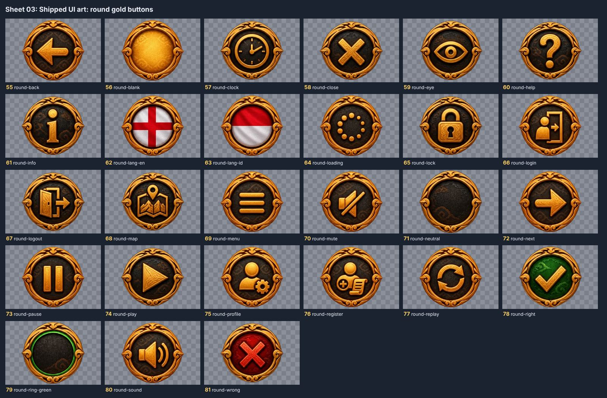

| No | Picture | Shows | Used in the game | Status | Notes |
|---|---|---|---|---|---|
| 55 | [`round-back`](../../public/assets/ui/round-back.webp) | Round gold button: back | Ships with the game in `public/assets/ui/`; never in the picture list |  |  |
| 56 | [`round-blank`](../../public/assets/ui/round-blank.webp) | Round gold button: blank | Ships with the game in `public/assets/ui/`; never in the picture list |  |  |
| 57 | [`round-clock`](../../public/assets/ui/round-clock.webp) | Round gold button: clock | Ships with the game in `public/assets/ui/`; never in the picture list |  |  |
| 58 | [`round-close`](../../public/assets/ui/round-close.webp) | Round gold button: close | Ships with the game in `public/assets/ui/`; never in the picture list |  |  |
| 59 | [`round-eye`](../../public/assets/ui/round-eye.webp) | Round gold button: eye | Ships with the game in `public/assets/ui/`; never in the picture list |  |  |
| 60 | [`round-help`](../../public/assets/ui/round-help.webp) | Round gold button: help | Ships with the game in `public/assets/ui/`; never in the picture list |  |  |
| 61 | [`round-info`](../../public/assets/ui/round-info.webp) | Round gold button: info | Ships with the game in `public/assets/ui/`; never in the picture list |  |  |
| 62 | [`round-lang-en`](../../public/assets/ui/round-lang-en.webp) | Round gold button: lang-en | Ships with the game in `public/assets/ui/`; never in the picture list |  |  |
| 63 | [`round-lang-id`](../../public/assets/ui/round-lang-id.webp) | Round gold button: lang-id | Ships with the game in `public/assets/ui/`; never in the picture list |  |  |
| 64 | [`round-loading`](../../public/assets/ui/round-loading.webp) | Round gold button: loading | Ships with the game in `public/assets/ui/`; never in the picture list |  |  |
| 65 | [`round-lock`](../../public/assets/ui/round-lock.webp) | Round gold button: lock | Ships with the game in `public/assets/ui/`; never in the picture list |  |  |
| 66 | [`round-login`](../../public/assets/ui/round-login.webp) | Round gold button: login | Ships with the game in `public/assets/ui/`; never in the picture list |  |  |
| 67 | [`round-logout`](../../public/assets/ui/round-logout.webp) | Round gold button: logout | Ships with the game in `public/assets/ui/`; never in the picture list |  |  |
| 68 | [`round-map`](../../public/assets/ui/round-map.webp) | Round gold button: map | Ships with the game in `public/assets/ui/`; never in the picture list |  |  |
| 69 | [`round-menu`](../../public/assets/ui/round-menu.webp) | Round gold button: menu | Ships with the game in `public/assets/ui/`; never in the picture list |  |  |
| 70 | [`round-mute`](../../public/assets/ui/round-mute.webp) | Round gold button: mute | Ships with the game in `public/assets/ui/`; never in the picture list |  |  |
| 71 | [`round-neutral`](../../public/assets/ui/round-neutral.webp) | Round gold button: neutral | Ships with the game in `public/assets/ui/`; never in the picture list |  |  |
| 72 | [`round-next`](../../public/assets/ui/round-next.webp) | Round gold button: next | Ships with the game in `public/assets/ui/`; never in the picture list |  |  |
| 73 | [`round-pause`](../../public/assets/ui/round-pause.webp) | Round gold button: pause | Ships with the game in `public/assets/ui/`; never in the picture list |  |  |
| 74 | [`round-play`](../../public/assets/ui/round-play.webp) | Round gold button: play | Ships with the game in `public/assets/ui/`; never in the picture list |  |  |
| 75 | [`round-profile`](../../public/assets/ui/round-profile.webp) | Round gold button: profile | Ships with the game in `public/assets/ui/`; never in the picture list |  |  |
| 76 | [`round-register`](../../public/assets/ui/round-register.webp) | Round gold button: register | Ships with the game in `public/assets/ui/`; never in the picture list |  |  |
| 77 | [`round-replay`](../../public/assets/ui/round-replay.webp) | Round gold button: replay | Ships with the game in `public/assets/ui/`; never in the picture list |  |  |
| 78 | [`round-right`](../../public/assets/ui/round-right.webp) | Round gold button: right | Ships with the game in `public/assets/ui/`; never in the picture list |  |  |
| 79 | [`round-ring-green`](../../public/assets/ui/round-ring-green.webp) | Round gold button: ring-green | Ships with the game in `public/assets/ui/`; never in the picture list |  |  |
| 80 | [`round-sound`](../../public/assets/ui/round-sound.webp) | Round gold button: sound | Ships with the game in `public/assets/ui/`; never in the picture list |  |  |
| 81 | [`round-wrong`](../../public/assets/ui/round-wrong.webp) | Round gold button: wrong | Ships with the game in `public/assets/ui/`; never in the picture list |  |  |

## Part 2: the pictures of the list (`data.json`) and of the mock-up folders

These are what `php spark gelita:katalog:impor` installs.

### Sheet 04: Logo, start buttons, result screen, badges

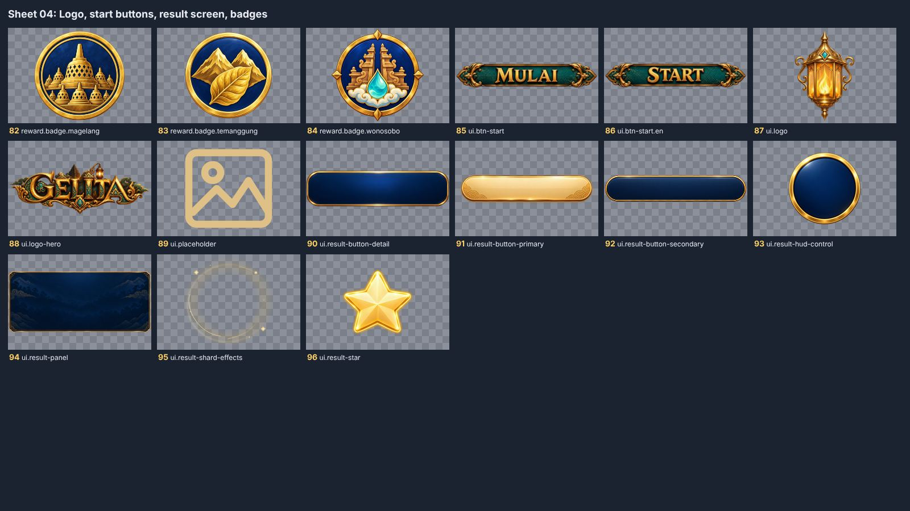

| No | Picture | Shows | Used in the game | Status | Notes |
|---|---|---|---|---|---|
| 82 | [`reward.badge.magelang`](assets/lencana/reward.badge.magelang.webp) | Lencana Magelang | Lencana wilayah Magelang (Profil siswa, sesudah wilayah tuntas) |  |  |
| 83 | [`reward.badge.temanggung`](assets/lencana/reward.badge.temanggung.webp) | Lencana Temanggung | Lencana wilayah Temanggung (Profil siswa, sesudah wilayah tuntas) |  |  |
| 84 | [`reward.badge.wonosobo`](assets/lencana/reward.badge.wonosobo.webp) | Lencana Wonosobo | Lencana wilayah Wonosobo (Profil siswa, sesudah wilayah tuntas) |  |  |
| 85 | [`ui.btn-start`](assets/antarmuka/ui.btn-start.webp) | Tombol MULAI | Tombol MULAI bergambar (bahasa Indonesia) (Halaman awal, tombol utama (bahasa Indonesia)) |  |  |
| 86 | [`ui.btn-start.en`](assets/antarmuka/ui.btn-start.en.webp) | Tombol START | Tombol START bergambar (bahasa Inggris) (Halaman awal saat bahasa permainan diganti ke bahasa itu) |  |  |
| 87 | [`ui.logo`](assets/logo/ui.logo.webp) | Emblem panel tanpa tulisan | Emblem logo (tanpa tulisan) (Pita atas layar akun (di tengah, di samping tombol Kembali); Pita atas langkah daftar) |  |  |
| 88 | [`ui.logo-hero`](assets/logo/ui.logo-hero.webp) | Logo utama tanpa tagline | Logo GELITA besar (landscape) (Halaman awal (logo besar di atas tombol Mulai); Halaman masuk panel staf (logo di tengah, di atas formulir)) |  |  |
| 89 | [`ui.placeholder`](assets/antarmuka/ui.placeholder.svg) | Gambar pengganti | Not installed by the game |  |  |
| 90 | [`ui.result-button-detail`](assets/antarmuka/ui.result-button-detail.webp) | Tombol Detail hasil — permukaan navy | Tombol Detail hasil (Tantangan selesai, tombol tengah bawah) |  |  |
| 91 | [`ui.result-button-primary`](assets/antarmuka/ui.result-button-primary.webp) | Tombol Berikutnya — permukaan emas | Tombol utama (Berikutnya) (Tantangan selesai, tombol kanan bawah) |  |  |
| 92 | [`ui.result-button-secondary`](assets/antarmuka/ui.result-button-secondary.webp) | Tombol peta — permukaan navy | Tombol peta wilayah (Tantangan selesai, tombol kiri bawah) |  |  |
| 93 | [`ui.result-hud-control`](assets/antarmuka/ui.result-hud-control.webp) | Kontrol HUD — permukaan lingkaran | Alas tombol bundar HUD (Tantangan selesai, tombol suara dan menu di kanan atas) |  |  |
| 94 | [`ui.result-panel`](assets/antarmuka/ui.result-panel.webp) | Panel hasil bergambar — navy emas | Panel hasil tantangan (Tantangan selesai, panel tengah) |  |  |
| 95 | [`ui.result-shard-effects`](assets/antarmuka/ui.result-shard-effects.svg) | Efek medali serpihan — glow dan partikel | Not installed by the game |  | Fact: not a game slot |
| 96 | [`ui.result-star`](assets/antarmuka/ui.result-star.webp) | Bintang hasil — emas bercahaya | Bintang permainan (Tantangan selesai, bintang di bawah judul; Peta Kedu, panel wilayah yang dipilih) |  |  |

### Sheet 05: Maps, pins, lanterns

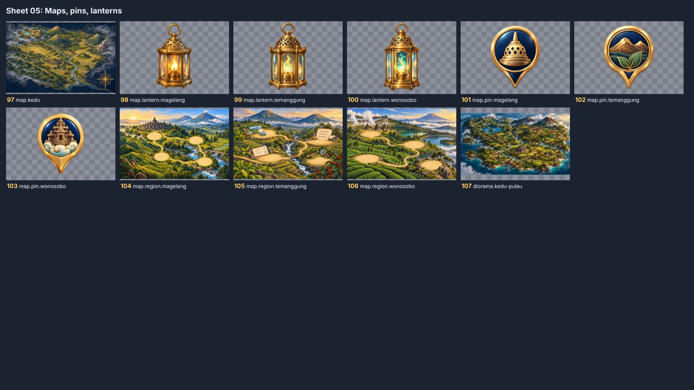

| No | Picture | Shows | Used in the game | Status | Notes |
|---|---|---|---|---|---|
| 97 | [`map.kedu`](assets/peta/map.kedu.webp) | Peta utama Kedu | Peta Karesidenan Kedu (Peta Kedu (tiga pin wilayah di atas gambar)) |  |  |
| 98 | [`map.lantern.magelang`](assets/ikon/map.lantern.magelang.webp) | map.lantern.magelang | Lentera Kenali Magelang |  |  |
| 99 | [`map.lantern.temanggung`](assets/ikon/map.lantern.temanggung.webp) | map.lantern.temanggung | Lentera Kenali Temanggung |  |  |
| 100 | [`map.lantern.wonosobo`](assets/ikon/map.lantern.wonosobo.webp) | map.lantern.wonosobo | Lentera Kenali Wonosobo |  |  |
| 101 | [`map.pin.magelang`](assets/ikon/map.pin.magelang.webp) | map.pin.magelang | Pin peta Magelang (Peta Kedu) |  |  |
| 102 | [`map.pin.temanggung`](assets/ikon/map.pin.temanggung.webp) | map.pin.temanggung | Pin peta Temanggung (Peta Kedu) |  |  |
| 103 | [`map.pin.wonosobo`](assets/ikon/map.pin.wonosobo.webp) | map.pin.wonosobo | Pin peta Wonosobo (Peta Kedu) |  |  |
| 104 | [`map.region.magelang`](assets/peta/map.region.magelang.webp) | Peta wilayah Magelang | Peta wilayah Magelang (Peta wilayah (empat tombol tantangan di atas gambar)) |  | Fact: four stops measured, the game has five challenges; five-stop maps are rows P-T, P-M, P-W of `../chatgpt-images/TASKS.md` |
| 105 | [`map.region.temanggung`](assets/peta/map.region.temanggung.webp) | Peta wilayah Temanggung | Peta wilayah Temanggung (Peta wilayah (empat tombol tantangan di atas gambar)) |  | Fact: four stops measured, the game has five challenges; five-stop maps are rows P-T, P-M, P-W of `../chatgpt-images/TASKS.md` |
| 106 | [`map.region.wonosobo`](assets/peta/map.region.wonosobo.webp) | Peta wilayah Wonosobo | Peta wilayah Wonosobo (Peta wilayah (empat tombol tantangan di atas gambar)) |  | Fact: four stops measured, the game has five challenges; five-stop maps are rows P-T, P-M, P-W of `../chatgpt-images/TASKS.md` |
| 107 | [`diorama.kedu-pulau`](mockup/gambar-mockup/peta-kedu/revisi-05/aset/diorama.kedu-pulau.webp) | Peta Kedu island map (owner, 20 October 2026) | Peta pulau Dataran Kedu (Peta Kedu) · slot `map.kedu-diorama` |  |  |

### Sheet 06: App icons, avatars, language flags

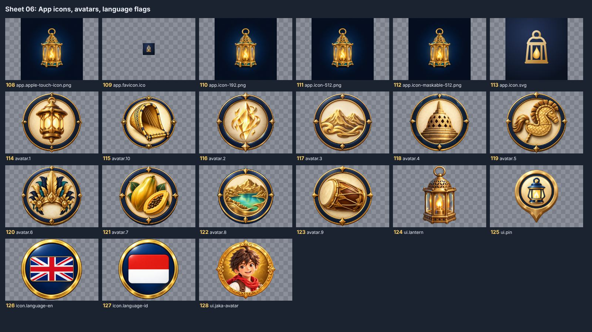

| No | Picture | Shows | Used in the game | Status | Notes |
|---|---|---|---|---|---|
| 108 | [`app.apple-touch-icon.png`](assets/ikon/app.apple-touch-icon.webp) | Ikon aplikasi apple-touch-icon.png | Not installed by the game |  |  |
| 109 | [`app.favicon.ico`](assets/ikon/app.favicon.webp) | Ikon aplikasi favicon.ico | Ikon tab peramban (favicon) (Tab peramban di semua halaman permainan dan panel) · slot `app.favicon` |  |  |
| 110 | [`app.icon-192.png`](assets/ikon/app.icon-192.webp) | Ikon aplikasi icon-192.png | Not installed by the game |  |  |
| 111 | [`app.icon-512.png`](assets/ikon/app.icon-512.webp) | Ikon aplikasi icon-512.png | Not installed by the game |  |  |
| 112 | [`app.icon-maskable-512.png`](assets/ikon/app.icon-maskable-512.webp) | Ikon aplikasi icon-maskable-512.png | Not installed by the game |  |  |
| 113 | [`app.icon.svg`](assets/ikon/app.icon.svg) | Ikon aplikasi icon.svg | Not installed by the game |  |  |
| 114 | [`avatar.1`](assets/ikon/avatar.1.webp) | Avatar Lentera Kedu | Avatar 1 (Pilihan avatar di pendaftaran; Profil (Ganti avatar)) |  |  |
| 115 | [`avatar.10`](assets/ikon/avatar.10.webp) | Avatar bundengan | Avatar 10 (Pilihan avatar di pendaftaran; Profil (Ganti avatar)) |  |  |
| 116 | [`avatar.2`](assets/ikon/avatar.2.webp) | Avatar Serpihan Cahaya | Medali Serpihan Cahaya (Tantangan selesai, medali di kiri panel) · slot `ui.result-medal` |  |  |
| 117 | [`avatar.3`](assets/ikon/avatar.3.webp) | Avatar gunung kembar Sindoro–Sumbing | Avatar 3 (Pilihan avatar di pendaftaran; Profil (Ganti avatar)) |  |  |
| 118 | [`avatar.4`](assets/ikon/avatar.4.webp) | Avatar stupa Borobudur | Avatar 4 (Pilihan avatar di pendaftaran; Profil (Ganti avatar)) |  |  |
| 119 | [`avatar.5`](assets/ikon/avatar.5.webp) | Avatar kuda lumping | Avatar 5 (Pilihan avatar di pendaftaran; Profil (Ganti avatar)) |  |  |
| 120 | [`avatar.6`](assets/ikon/avatar.6.webp) | Avatar kuluk Topeng Ireng | Avatar 6 (Pilihan avatar di pendaftaran; Profil (Ganti avatar)) |  |  |
| 121 | [`avatar.7`](assets/ikon/avatar.7.webp) | Avatar buah carica | Avatar 7 (Pilihan avatar di pendaftaran; Profil (Ganti avatar)) |  |  |
| 122 | [`avatar.8`](assets/ikon/avatar.8.webp) | Avatar Telaga Warna | Avatar 8 (Pilihan avatar di pendaftaran; Profil (Ganti avatar)) |  |  |
| 123 | [`avatar.9`](assets/ikon/avatar.9.webp) | Avatar kendang | Avatar 9 (Pilihan avatar di pendaftaran; Profil (Ganti avatar)) |  |  |
| 124 | [`ui.lantern`](assets/ikon/ui.lantern.webp) | ui.lantern | Lentera (HUD dan tirai peta) (HUD (lentera serpihan); Tirai "Membuka Peta Kedu") |  |  |
| 125 | [`ui.pin`](assets/ikon/ui.pin.webp) | ui.pin | Pin wilayah (semua kota) (Peta Kedu) |  |  |
| 126 | [`icon.language-en`](assets/ikon/icon.language-en.webp) | English — bendera UK | Ikon bahasa Inggris (EN) (Pita atas semua layar, pemilih bahasa di kanan atas; Pita atas layar akun) · slot `ui.lang.en` |  |  |
| 127 | [`icon.language-id`](assets/ikon/icon.language-id.webp) | Bahasa Indonesia — bendera merah putih | Ikon bahasa Indonesia (ID) (Pita atas semua layar, pemilih bahasa di kanan atas; Pita atas layar akun) · slot `ui.lang.id` |  |  |
| 128 | [`ui.jaka-avatar`](mockup/gambar-mockup/kenali/aset/ui.jaka-avatar.webp) | Jaka's avatar in a gold ring (owner, 19 October 2026) | Avatar Jaka (potret cerita Peta Kedu dan layar Kenali) (Pita cerita Jaka di bawah Peta Kedu; Layar Mengenal wilayah, baris yang diucapkan Jaka) |  |  |

### Sheet 07: Vector icons (1 of 2)

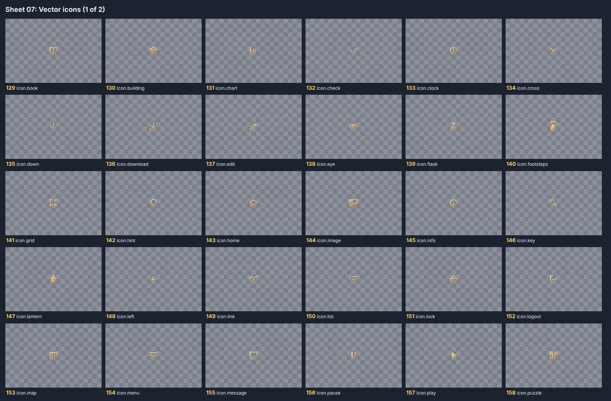

| No | Picture | Shows | Used in the game | Status | Notes |
|---|---|---|---|---|---|
| 129 | [`icon.book`](assets/ikon/icon.book.svg) | book — Pustaka | Not installed by the game |  |  |
| 130 | [`icon.building`](assets/ikon/icon.building.svg) | building — sumber resmi / sekolah | Not installed by the game |  |  |
| 131 | [`icon.chart`](assets/ikon/icon.chart.svg) | chart — grafik | Not installed by the game |  |  |
| 132 | [`icon.check`](assets/ikon/icon.check.svg) | check — benar / selesai | Not installed by the game |  |  |
| 133 | [`icon.clock`](assets/ikon/icon.clock.svg) | clock — waktu | Not installed by the game |  |  |
| 134 | [`icon.cross`](assets/ikon/icon.cross.svg) | cross — salah / tutup | Not installed by the game |  |  |
| 135 | [`icon.down`](assets/ikon/icon.down.svg) | down — naik / turun | Not installed by the game |  |  |
| 136 | [`icon.download`](assets/ikon/icon.download.svg) | download — unduh / pasang aplikasi | Not installed by the game |  |  |
| 137 | [`icon.edit`](assets/ikon/icon.edit.svg) | edit — sunting | Not installed by the game |  |  |
| 138 | [`icon.eye`](assets/ikon/icon.eye.svg) | eye — lihat sandi | Not installed by the game |  |  |
| 139 | [`icon.flask`](assets/ikon/icon.flask.svg) | flask — penelitian | Not installed by the game |  |  |
| 140 | [`icon.footsteps`](assets/ikon/icon.footsteps.svg) | footsteps | Not installed by the game |  |  |
| 141 | [`icon.grid`](assets/ikon/icon.grid.svg) | grid — kisi | Not installed by the game |  |  |
| 142 | [`icon.hint`](assets/ikon/icon.hint.svg) | hint — petunjuk | Not installed by the game |  |  |
| 143 | [`icon.home`](assets/ikon/icon.home.svg) | home — beranda / Peta Kedu | Not installed by the game |  |  |
| 144 | [`icon.image`](assets/ikon/icon.image.svg) | image — gambar | Not installed by the game |  |  |
| 145 | [`icon.info`](assets/ikon/icon.info.svg) | info — informasi | Not installed by the game |  |  |
| 146 | [`icon.key`](assets/ikon/icon.key.svg) | key — kata sandi | Not installed by the game |  |  |
| 147 | [`icon.lantern`](assets/ikon/icon.lantern.svg) | lantern — lentera / serpihan | Not installed by the game |  |  |
| 148 | [`icon.left`](assets/ikon/icon.left.svg) | left — kembali / lanjut | Not installed by the game |  |  |
| 149 | [`icon.link`](assets/ikon/icon.link.svg) | link — tautan | Not installed by the game |  |  |
| 150 | [`icon.list`](assets/ikon/icon.list.svg) | list — daftar | Not installed by the game |  |  |
| 151 | [`icon.lock`](assets/ikon/icon.lock.svg) | lock — terkunci | Not installed by the game |  |  |
| 152 | [`icon.logout`](assets/ikon/icon.logout.svg) | logout — keluar | Not installed by the game |  |  |
| 153 | [`icon.map`](assets/ikon/icon.map.svg) | map — peta | Not installed by the game |  |  |
| 154 | [`icon.menu`](assets/ikon/icon.menu.svg) | menu — menu | Not installed by the game |  |  |
| 155 | [`icon.message`](assets/ikon/icon.message.svg) | message — masukan / narasi | Not installed by the game |  |  |
| 156 | [`icon.pause`](assets/ikon/icon.pause.svg) | pause — jeda | Not installed by the game |  |  |
| 157 | [`icon.play`](assets/ikon/icon.play.svg) | play — putar | Not installed by the game |  |  |
| 158 | [`icon.puzzle`](assets/ikon/icon.puzzle.svg) | puzzle — puzzle | Not installed by the game |  |  |

### Sheet 08: Vector icons (2 of 2)

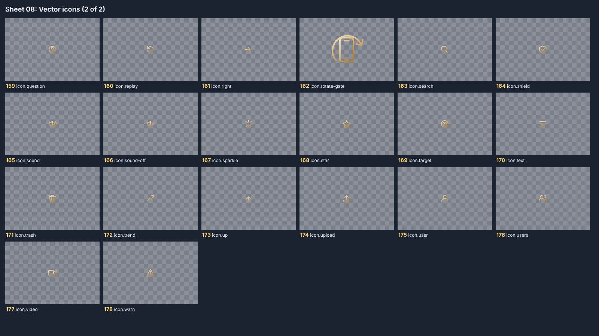

| No | Picture | Shows | Used in the game | Status | Notes |
|---|---|---|---|---|---|
| 159 | [`icon.question`](assets/ikon/icon.question.svg) | question — tidak jelas / anonim | Not installed by the game |  |  |
| 160 | [`icon.replay`](assets/ikon/icon.replay.svg) | replay — ulangi | Not installed by the game |  |  |
| 161 | [`icon.right`](assets/ikon/icon.right.svg) | right — kembali / lanjut | Not installed by the game |  |  |
| 162 | [`icon.rotate-gate`](assets/ikon/icon.rotate-gate.svg) | rotate-gate | Not installed by the game |  |  |
| 163 | [`icon.search`](assets/ikon/icon.search.svg) | search — cari | Not installed by the game |  |  |
| 164 | [`icon.shield`](assets/ikon/icon.shield.svg) | shield — keamanan | Not installed by the game |  |  |
| 165 | [`icon.sound`](assets/ikon/icon.sound.svg) | sound — suara menyala | Not installed by the game |  |  |
| 166 | [`icon.sound-off`](assets/ikon/icon.sound-off.svg) | sound-off — suara mati | Not installed by the game |  |  |
| 167 | [`icon.sparkle`](assets/ikon/icon.sparkle.svg) | sparkle — istimewa | Not installed by the game |  |  |
| 168 | [`icon.star`](assets/ikon/icon.star.svg) | star — bintang / tuntas | Not installed by the game |  |  |
| 169 | [`icon.target`](assets/ikon/icon.target.svg) | target — ketepatan | Not installed by the game |  |  |
| 170 | [`icon.text`](assets/ikon/icon.text.svg) | text — transkrip | Not installed by the game |  |  |
| 171 | [`icon.trash`](assets/ikon/icon.trash.svg) | trash — hapus | Not installed by the game |  |  |
| 172 | [`icon.trend`](assets/ikon/icon.trend.svg) | trend — tren | Not installed by the game |  |  |
| 173 | [`icon.up`](assets/ikon/icon.up.svg) | up — naik / turun | Not installed by the game |  |  |
| 174 | [`icon.upload`](assets/ikon/icon.upload.svg) | upload — unggah | Not installed by the game |  |  |
| 175 | [`icon.user`](assets/ikon/icon.user.svg) | user — profil | Not installed by the game |  |  |
| 176 | [`icon.users`](assets/ikon/icon.users.svg) | users — peserta | Not installed by the game |  |  |
| 177 | [`icon.video`](assets/ikon/icon.video.svg) | video — video | Not installed by the game |  |  |
| 178 | [`icon.warn`](assets/ikon/icon.warn.svg) | warn — peringatan | Not installed by the game |  |  |

### Sheet 09: Characters (frame 1 of each pose)

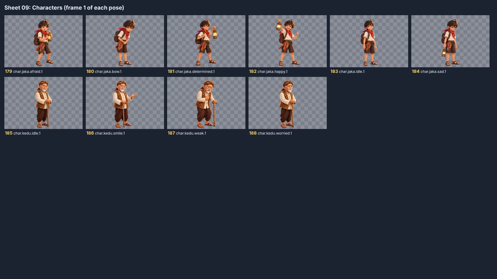

| No | Picture | Shows | Used in the game | Status | Notes |
|---|---|---|---|---|---|
| 179 | [`char.jaka.afraid.1`](assets/karakter/char.jaka.afraid.1.webp) | Jaka · afraid · frame 1 | Jaka · pose takut · gambar 1 (Baris cerita yang memakai pose ini: cerita pembuka, dialog dan wilayah tuntas, penutup (rinciannya di halaman detail)) |  | Fact: 24 frames in this pose; the verdict covers all of them |
| 180 | [`char.jaka.bow.1`](assets/karakter/char.jaka.bow.1.webp) | Jaka · bow · frame 1 | Jaka · pose membungkuk hormat · gambar 1 (Baris cerita yang memakai pose ini: cerita pembuka, dialog dan wilayah tuntas, penutup (rinciannya di hal… |  | Fact: 24 frames in this pose; the verdict covers all of them |
| 181 | [`char.jaka.determined.1`](assets/karakter/char.jaka.determined.1.webp) | Jaka · determined · frame 1 | Jaka · pose bertekad · gambar 1 (Baris cerita yang memakai pose ini: cerita pembuka, dialog dan wilayah tuntas, penutup (rinciannya di halaman deta… |  | Fact: 24 frames in this pose; the verdict covers all of them |
| 182 | [`char.jaka.happy.1`](assets/karakter/char.jaka.happy.1.webp) | Jaka · happy · frame 1 | Jaka · pose senang · gambar 1 (Baris cerita yang memakai pose ini: cerita pembuka, dialog dan wilayah tuntas, penutup (rinciannya di halaman detail)) |  | Fact: 24 frames in this pose; the verdict covers all of them |
| 183 | [`char.jaka.idle.1`](assets/karakter/char.jaka.idle.1.webp) | Jaka · idle · frame 1 | Jaka · pose diam · gambar 1 (Baris cerita yang memakai pose ini: cerita pembuka, dialog dan wilayah tuntas, penutup (rinciannya di halaman detail)) |  | Fact: 24 frames in this pose; the verdict covers all of them |
| 184 | [`char.jaka.sad.1`](assets/karakter/char.jaka.sad.1.webp) | Jaka · sad · frame 1 | Jaka · pose sedih · gambar 1 (Baris cerita yang memakai pose ini: cerita pembuka, dialog dan wilayah tuntas, penutup (rinciannya di halaman detail)) |  | Fact: 24 frames in this pose; the verdict covers all of them |
| 185 | [`char.kedu.idle.1`](assets/karakter/char.kedu.idle.1.webp) | Mbah Kedu · idle · frame 1 | Mbah Kedu · pose diam · gambar 1 (Baris cerita yang memakai pose ini: cerita pembuka, dialog dan wilayah tuntas, penutup (rinciannya di halaman det… |  | Fact: 24 frames in this pose; the verdict covers all of them |
| 186 | [`char.kedu.smile.1`](assets/karakter/char.kedu.smile.1.webp) | Mbah Kedu · smile · frame 1 | Mbah Kedu · pose tersenyum · gambar 1 (Baris cerita yang memakai pose ini: cerita pembuka, dialog dan wilayah tuntas, penutup (rinciannya di halama… |  | Fact: 24 frames in this pose; the verdict covers all of them |
| 187 | [`char.kedu.weak.1`](assets/karakter/char.kedu.weak.1.webp) | Mbah Kedu · weak · frame 1 | Mbah Kedu · pose lemah · gambar 1 (Baris cerita yang memakai pose ini: cerita pembuka, dialog dan wilayah tuntas, penutup (rinciannya di halaman de… |  | Fact: 24 frames in this pose; the verdict covers all of them |
| 188 | [`char.kedu.worried.1`](assets/karakter/char.kedu.worried.1.webp) | Mbah Kedu · worried · frame 1 | Mbah Kedu · pose cemas · gambar 1 (Baris cerita yang memakai pose ini: cerita pembuka, dialog dan wilayah tuntas, penutup (rinciannya di halaman de… |  | Fact: 24 frames in this pose; the verdict covers all of them |

### Sheet 10: Backgrounds and story slides

| No | Picture | Shows | Used in the game | Status | Notes |
|---|---|---|---|---|---|
| 189 | [`bg.auth`](assets/latar/bg.auth.webp) | bg.auth | Latar masuk, daftar, dan ganti kata sandi |  |  |
| 190 | [`bg.cerita-intro-01`](assets/latar/bg.cerita-intro-01.webp) | Dataran yang Bercahaya | Story slide background: Cerita pembuka, slide 1 |  |  |
| 191 | [`bg.cerita-intro-02`](assets/latar/bg.cerita-intro-02.webp) | Cahaya dari Ilmu dan Budaya | Story slide background: Cerita pembuka, slide 2 |  |  |
| 192 | [`bg.cerita-intro-03`](assets/latar/bg.cerita-intro-03.webp) | Kabut Lupa | Story slide background: Cerita pembuka, slide 3 |  |  |
| 193 | [`bg.cerita-intro-04`](assets/latar/bg.cerita-intro-04.webp) | Malam Lentera Retak | Story slide background: Cerita pembuka, slide 4 |  |  |
| 194 | [`bg.cerita-intro-05`](assets/latar/bg.cerita-intro-05.webp) | Penjaga yang Menua | Story slide background: Cerita pembuka, slide 5 |  |  |
| 195 | [`bg.cerita-intro-06`](assets/latar/bg.cerita-intro-06.webp) | Jaka, Pembawa Lentera | Story slide background: Cerita pembuka, slide 6 |  |  |
| 196 | [`bg.cerita-intro-07`](assets/latar/bg.cerita-intro-07.webp) | Cara Mengumpulkan Serpihan | Story slide background: Cerita pembuka, slide 7 |  |  |
| 197 | [`bg.cerita-intro-08`](assets/latar/bg.cerita-intro-08.webp) | Tiga Kunci Cahaya | Story slide background: Cerita pembuka, slide 8 |  |  |
| 198 | [`bg.cerita-intro-09`](assets/latar/bg.cerita-intro-09.webp) | Perjalanan Dimulai | Story slide background: Cerita pembuka, slide 9 |  |  |
| 199 | [`bg.cerita-penutup-01`](assets/latar/bg.cerita-penutup-01.webp) | Lentera Menyala Kembali | Story slide background: Cerita penutup, slide 1 |  |  |
| 200 | [`bg.cerita-penutup-02`](assets/latar/bg.cerita-penutup-02.webp) | Kabut Tersibak | Story slide background: Cerita penutup, slide 2 |  |  |
| 201 | [`bg.cerita-penutup-03`](assets/latar/bg.cerita-penutup-03.webp) | Mbah Kedu Pulih | Story slide background: Cerita penutup, slide 3 |  |  |
| 202 | [`bg.cerita-penutup-04`](assets/latar/bg.cerita-penutup-04.webp) | Janji Jaka | Story slide background: Cerita penutup, slide 4 |  |  |
| 203 | [`bg.cerita-penutup-05`](assets/latar/bg.cerita-penutup-05.webp) | Penjaga Lentera | Story slide background: Cerita penutup, slide 5 |  |  |
| 204 | [`bg.intro`](assets/latar/bg.intro.webp) | bg.intro | Latar cerita pembuka & penutup (Cerita pembuka (slide tanpa latar sendiri); Cerita penutup) |  |  |
| 205 | [`bg.loading`](assets/latar/bg.loading.webp) | bg.loading | Latar tirai "Membuka Peta Kedu" (Tirai pemuatan sesudah cerita pembuka, sebelum Peta Kedu) |  |  |
| 206 | [`bg.loading.magelang`](assets/latar/bg.loading.magelang.webp) | bg.loading.magelang | Latar tirai menuju Magelang (Tirai menuju wilayah (dari peta Kedu)) |  |  |
| 207 | [`bg.loading.temanggung`](assets/latar/bg.loading.temanggung.webp) | bg.loading.temanggung | Latar tirai menuju Temanggung (Tirai menuju wilayah (dari peta Kedu)) |  |  |
| 208 | [`bg.loading.wonosobo`](assets/latar/bg.loading.wonosobo.webp) | bg.loading.wonosobo | Latar tirai menuju Wonosobo (Tirai menuju wilayah (dari peta Kedu)) |  |  |
| 209 | [`bg.magelang.region`](assets/latar/bg.magelang.region.webp) | fajar berkabut tipis, "Tanah Candi Agung" | Latar wilayah Magelang (Dialog masuk wilayah; Peta wilayah) |  |  |
| 210 | [`bg.map`](assets/latar/bg.map.webp) | bg.map | Latar Peta Kedu, Profil, dan rak Pustaka (Peta Kedu; Rak Pustaka) |  |  |
| 211 | [`bg.reflection`](assets/latar/bg.reflection.webp) | bg.reflection | Latar Balai Refleksi (Balai Refleksi) |  |  |
| 212 | [`bg.result.temanggung`](assets/latar/bg.result.temanggung.webp) | Latar hasil Temanggung — senja 3D | Latar tantangan selesai Temanggung (Tantangan selesai di wilayah ini) |  |  |
| 213 | [`bg.temanggung.region`](assets/latar/bg.temanggung.region.webp) | pagi, "Di Antara Dua Gunung" | Latar wilayah Temanggung (Dialog masuk wilayah; Peta wilayah) |  |  |
| 214 | [`bg.welcome`](assets/latar/bg.welcome.webp) | bg.welcome | Latar halaman awal & akun (Halaman awal; Pilih masuk atau daftar) |  |  |
| 215 | [`bg.wonosobo.region`](assets/latar/bg.wonosobo.region.webp) | fajar dingin, "Negeri di Atas Awan" | Latar wilayah Wonosobo (Dialog masuk wilayah; Peta wilayah) |  |  |

### Sheet 11: Susun Gambar pictures

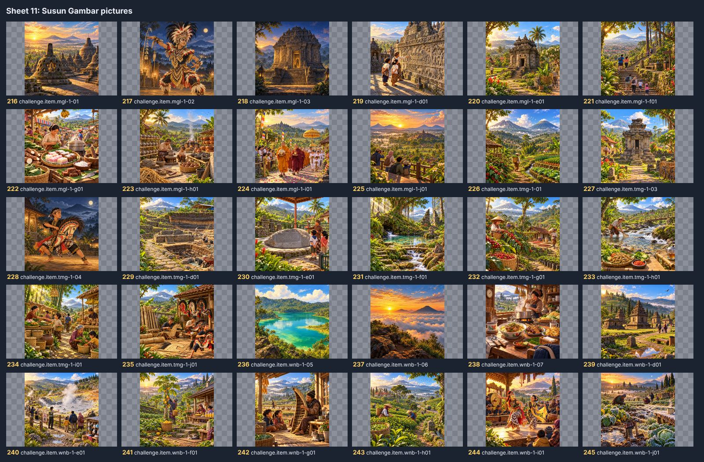

| No | Picture | Shows | Used in the game | Status | Notes |
|---|---|---|---|---|---|
| 216 | [`challenge.item.mgl-1-01`](assets/tantangan/challenge.item.mgl-1-01.webp) | Stupa Borobudur | Gambar Susun Gambar Magelang (Tantangan Susun Gambar Magelang) |  |  |
| 217 | [`challenge.item.mgl-1-02`](assets/tantangan/challenge.item.mgl-1-02.webp) | Penari Topeng Ireng | Gambar Susun Gambar Magelang (Tantangan Susun Gambar Magelang) |  |  |
| 218 | [`challenge.item.mgl-1-03`](assets/tantangan/challenge.item.mgl-1-03.webp) | Candi Mendut | Gambar Susun Gambar Magelang (Tantangan Susun Gambar Magelang) |  |  |
| 219 | [`challenge.item.mgl-1-d01`](assets/tantangan/challenge.item.mgl-1-d01.webp) | Relief Borobudur | Gambar Susun Gambar Magelang (Tantangan Susun Gambar Magelang) |  |  |
| 220 | [`challenge.item.mgl-1-e01`](assets/tantangan/challenge.item.mgl-1-e01.webp) | Candi Pawon | Gambar Susun Gambar Magelang (Tantangan Susun Gambar Magelang) |  | Fact: replacement MGL-P05R is in `../chatgpt-images/out/` |
| 221 | [`challenge.item.mgl-1-f01`](assets/tantangan/challenge.item.mgl-1-f01.webp) | Gunung Tidar | Gambar Susun Gambar Magelang (Tantangan Susun Gambar Magelang) |  |  |
| 222 | [`challenge.item.mgl-1-g01`](assets/tantangan/challenge.item.mgl-1-g01.webp) | Getuk Magelang | Gambar Susun Gambar Magelang (Tantangan Susun Gambar Magelang) |  |  |
| 223 | [`challenge.item.mgl-1-h01`](assets/tantangan/challenge.item.mgl-1-h01.webp) | Gerabah Klipoh | Gambar Susun Gambar Magelang (Tantangan Susun Gambar Magelang) |  |  |
| 224 | [`challenge.item.mgl-1-i01`](assets/tantangan/challenge.item.mgl-1-i01.webp) | Perjalanan Waisak | Gambar Susun Gambar Magelang (Tantangan Susun Gambar Magelang) |  |  |
| 225 | [`challenge.item.mgl-1-j01`](assets/tantangan/challenge.item.mgl-1-j01.webp) | Borobudur di Antara Dua Pasang Gunung Kembar | Gambar Susun Gambar Magelang (Tantangan Susun Gambar Magelang) |  |  |
| 226 | [`challenge.item.tmg-1-01`](assets/tantangan/challenge.item.tmg-1-01.webp) | Gunung Sindoro dan Sumbing | Gambar Susun Gambar Temanggung (Tantangan Susun Gambar Temanggung) |  |  |
| 227 | [`challenge.item.tmg-1-03`](assets/tantangan/challenge.item.tmg-1-03.webp) | Candi Pringapus | Gambar Susun Gambar Temanggung (Tantangan Susun Gambar Temanggung) |  |  |
| 228 | [`challenge.item.tmg-1-04`](assets/tantangan/challenge.item.tmg-1-04.webp) | Kuda Lumping | Gambar Susun Gambar Temanggung (Tantangan Susun Gambar Temanggung) |  |  |
| 229 | [`challenge.item.tmg-1-d01`](assets/tantangan/challenge.item.tmg-1-d01.webp) | Situs Liyangan | Gambar Susun Gambar Temanggung (Tantangan Susun Gambar Temanggung) |  |  |
| 230 | [`challenge.item.tmg-1-e01`](assets/tantangan/challenge.item.tmg-1-e01.webp) | Prasasti Gondosuli | Gambar Susun Gambar Temanggung (Tantangan Susun Gambar Temanggung) |  |  |
| 231 | [`challenge.item.tmg-1-f01`](assets/tantangan/challenge.item.tmg-1-f01.webp) | Umbul Jumprit | Gambar Susun Gambar Temanggung (Tantangan Susun Gambar Temanggung) |  |  |
| 232 | [`challenge.item.tmg-1-g01`](assets/tantangan/challenge.item.tmg-1-g01.webp) | Panen Kopi di Lereng Sindoro–Sumbing | Gambar Susun Gambar Temanggung (Tantangan Susun Gambar Temanggung) |  |  |
| 233 | [`challenge.item.tmg-1-h01`](assets/tantangan/challenge.item.tmg-1-h01.webp) | Ikan Uceng dan Sungai Jernih | Gambar Susun Gambar Temanggung (Tantangan Susun Gambar Temanggung) |  |  |
| 234 | [`challenge.item.tmg-1-i01`](assets/tantangan/challenge.item.tmg-1-i01.webp) | Pasar Papringan | Gambar Susun Gambar Temanggung (Tantangan Susun Gambar Temanggung) |  |  |
| 235 | [`challenge.item.tmg-1-j01`](assets/tantangan/challenge.item.tmg-1-j01.webp) | Perajin Kuda Kepang | Gambar Susun Gambar Temanggung (Tantangan Susun Gambar Temanggung) |  |  |
| 236 | [`challenge.item.wnb-1-05`](assets/tantangan/challenge.item.wnb-1-05.webp) | Telaga Warna | Gambar Susun Gambar Wonosobo (Tantangan Susun Gambar Wonosobo) |  |  |
| 237 | [`challenge.item.wnb-1-06`](assets/tantangan/challenge.item.wnb-1-06.webp) | Matahari Terbit di Sikunir | Gambar Susun Gambar Wonosobo (Tantangan Susun Gambar Wonosobo) |  |  |
| 238 | [`challenge.item.wnb-1-07`](assets/tantangan/challenge.item.wnb-1-07.webp) | Mi Ongklok | Gambar Susun Gambar Wonosobo (Tantangan Susun Gambar Wonosobo) |  |  |
| 239 | [`challenge.item.wnb-1-d01`](assets/tantangan/challenge.item.wnb-1-d01.webp) | Kompleks Candi Arjuna | Gambar Susun Gambar Wonosobo (Tantangan Susun Gambar Wonosobo) |  |  |
| 240 | [`challenge.item.wnb-1-e01`](assets/tantangan/challenge.item.wnb-1-e01.webp) | Kawah di Dieng: Tetap di Balik Pagar | Gambar Susun Gambar Wonosobo (Tantangan Susun Gambar Wonosobo) |  |  |
| 241 | [`challenge.item.wnb-1-f01`](assets/tantangan/challenge.item.wnb-1-f01.webp) | Carica, Pepaya Gunung | Gambar Susun Gambar Wonosobo (Tantangan Susun Gambar Wonosobo) |  |  |
| 242 | [`challenge.item.wnb-1-g01`](assets/tantangan/challenge.item.wnb-1-g01.webp) | Bundengan | Gambar Susun Gambar Wonosobo (Tantangan Susun Gambar Wonosobo) |  |  |
| 243 | [`challenge.item.wnb-1-h01`](assets/tantangan/challenge.item.wnb-1-h01.webp) | Kebun Teh Tambi | Gambar Susun Gambar Wonosobo (Tantangan Susun Gambar Wonosobo) |  |  |
| 244 | [`challenge.item.wnb-1-i01`](assets/tantangan/challenge.item.wnb-1-i01.webp) | Tari Topeng Lengger | Gambar Susun Gambar Wonosobo (Tantangan Susun Gambar Wonosobo) |  |  |
| 245 | [`challenge.item.wnb-1-j01`](assets/tantangan/challenge.item.wnb-1-j01.webp) | Embun Upas | Gambar Susun Gambar Wonosobo (Tantangan Susun Gambar Wonosobo) |  |  |

### Sheet 12: Benar atau Salah pictures and Cari Objek scenes

| No | Picture | Shows | Used in the game | Status | Notes |
|---|---|---|---|---|---|
| 246 | [`challenge.item.tmg-3-a03`](assets/tantangan/challenge.item.tmg-3-a03.webp) | Butir padi hangus | Gambar pernyataan Benar atau Salah Temanggung (Tantangan Benar atau Salah Temanggung) |  |  |
| 247 | [`challenge.item.tmg-3-b03`](assets/tantangan/challenge.item.tmg-3-b03.webp) | Arca Buddha duduk | Gambar pernyataan Benar atau Salah Temanggung (Tantangan Benar atau Salah Temanggung) |  | Fact: no item of the current question bank uses this code |
| 248 | [`challenge.item.tmg-3-c03`](assets/tantangan/challenge.item.tmg-3-c03.webp) | Biji kopi sangrai | Gambar pernyataan Benar atau Salah Temanggung (Tantangan Benar atau Salah Temanggung) |  | Fact: no item of the current question bank uses this code |
| 249 | [`challenge.mgl-4.scene`](assets/tantangan/challenge.mgl-4.scene.webp) | Galeri Budaya Magelang | Adegan Cari Objek Magelang (Tantangan Cari Objek Magelang) |  |  |
| 250 | [`challenge.tmg-4.scene`](assets/tantangan/challenge.tmg-4.scene.webp) | Pasar Budaya Temanggung | Adegan Cari Objek Temanggung (Tantangan Cari Objek Temanggung) |  |  |
| 251 | [`challenge.wnb-4.scene`](assets/tantangan/challenge.wnb-4.scene.webp) | Pasar Oleh-oleh Dieng | Adegan Cari Objek Wonosobo (Tantangan Cari Objek Wonosobo) |  |  |

### Sheet 13: Cari Objek objects

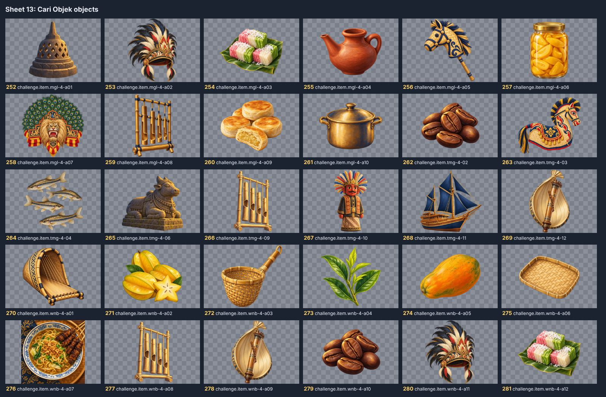

| No | Picture | Shows | Used in the game | Status | Notes |
|---|---|---|---|---|---|
| 252 | [`challenge.item.mgl-4-a01`](assets/tantangan/challenge.item.mgl-4-a01.webp) | Stupa berlubang | Benda Cari Objek Magelang (Tantangan Cari Objek Magelang) |  |  |
| 253 | [`challenge.item.mgl-4-a02`](assets/tantangan/challenge.item.mgl-4-a02.webp) | Kuluk Topeng Ireng | Benda Cari Objek Magelang (Tantangan Cari Objek Magelang) |  |  |
| 254 | [`challenge.item.mgl-4-a03`](assets/tantangan/challenge.item.mgl-4-a03.webp) | Getuk | Benda Cari Objek Magelang (Tantangan Cari Objek Magelang) |  |  |
| 255 | [`challenge.item.mgl-4-a04`](assets/tantangan/challenge.item.mgl-4-a04.webp) | Kendil gerabah | Benda Cari Objek Magelang (Tantangan Cari Objek Magelang) |  |  |
| 256 | [`challenge.item.mgl-4-a05`](assets/tantangan/challenge.item.mgl-4-a05.webp) | Kuda kepang bambu | Benda Cari Objek Magelang (Tantangan Cari Objek Magelang) |  |  |
| 257 | [`challenge.item.mgl-4-a06`](assets/tantangan/challenge.item.mgl-4-a06.webp) | Manisan carica dalam stoples | Benda Cari Objek Magelang (Tantangan Cari Objek Magelang) |  |  |
| 258 | [`challenge.item.mgl-4-a07`](assets/tantangan/challenge.item.mgl-4-a07.webp) | Dadak merak Reog | Benda Cari Objek Magelang (Tantangan Cari Objek Magelang) |  |  |
| 259 | [`challenge.item.mgl-4-a08`](assets/tantangan/challenge.item.mgl-4-a08.webp) | Angklung | Benda Cari Objek Magelang (Tantangan Cari Objek Magelang) |  |  |
| 260 | [`challenge.item.mgl-4-a09`](assets/tantangan/challenge.item.mgl-4-a09.webp) | Bakpia | Benda Cari Objek Magelang (Tantangan Cari Objek Magelang) |  |  |
| 261 | [`challenge.item.mgl-4-a10`](assets/tantangan/challenge.item.mgl-4-a10.webp) | Panci logam | Benda Cari Objek Magelang (Tantangan Cari Objek Magelang) |  |  |
| 262 | [`challenge.item.tmg-4-02`](assets/tantangan/challenge.item.tmg-4-02.webp) | Biji kopi | Benda Cari Objek Temanggung (Tantangan Cari Objek Temanggung) |  |  |
| 263 | [`challenge.item.tmg-4-03`](assets/tantangan/challenge.item.tmg-4-03.webp) | Kuda kepang bambu | Benda Cari Objek Temanggung (Tantangan Cari Objek Temanggung) |  |  |
| 264 | [`challenge.item.tmg-4-04`](assets/tantangan/challenge.item.tmg-4-04.webp) | Ikan uceng | Benda Cari Objek Temanggung (Tantangan Cari Objek Temanggung) |  |  |
| 265 | [`challenge.item.tmg-4-06`](assets/tantangan/challenge.item.tmg-4-06.webp) | Arca Nandi | Benda Cari Objek Temanggung (Tantangan Cari Objek Temanggung) |  |  |
| 266 | [`challenge.item.tmg-4-09`](assets/tantangan/challenge.item.tmg-4-09.webp) | Angklung | Benda Cari Objek Temanggung (Tantangan Cari Objek Temanggung) |  |  |
| 267 | [`challenge.item.tmg-4-10`](assets/tantangan/challenge.item.tmg-4-10.webp) | Ondel-ondel | Benda Cari Objek Temanggung (Tantangan Cari Objek Temanggung) |  |  |
| 268 | [`challenge.item.tmg-4-11`](assets/tantangan/challenge.item.tmg-4-11.webp) | Perahu pinisi | Benda Cari Objek Temanggung (Tantangan Cari Objek Temanggung) |  |  |
| 269 | [`challenge.item.tmg-4-12`](assets/tantangan/challenge.item.tmg-4-12.webp) | Sasando | Benda Cari Objek Temanggung (Tantangan Cari Objek Temanggung) |  |  |
| 270 | [`challenge.item.wnb-4-a01`](assets/tantangan/challenge.item.wnb-4-a01.webp) | Bundengan | Benda Cari Objek Wonosobo (Tantangan Cari Objek Wonosobo) |  |  |
| 271 | [`challenge.item.wnb-4-a02`](assets/tantangan/challenge.item.wnb-4-a02.webp) | Buah carica | Benda Cari Objek Wonosobo (Tantangan Cari Objek Wonosobo) |  |  |
| 272 | [`challenge.item.wnb-4-a03`](assets/tantangan/challenge.item.wnb-4-a03.webp) | Keranjang ongklok | Benda Cari Objek Wonosobo (Tantangan Cari Objek Wonosobo) |  |  |
| 273 | [`challenge.item.wnb-4-a04`](assets/tantangan/challenge.item.wnb-4-a04.webp) | Daun teh | Benda Cari Objek Wonosobo (Tantangan Cari Objek Wonosobo) |  |  |
| 274 | [`challenge.item.wnb-4-a05`](assets/tantangan/challenge.item.wnb-4-a05.webp) | Pepaya biasa | Benda Cari Objek Wonosobo (Tantangan Cari Objek Wonosobo) |  |  |
| 275 | [`challenge.item.wnb-4-a06`](assets/tantangan/challenge.item.wnb-4-a06.webp) | Rigen | Benda Cari Objek Wonosobo (Tantangan Cari Objek Wonosobo) |  |  |
| 276 | [`challenge.item.wnb-4-a07`](assets/tantangan/challenge.item.wnb-4-a07.webp) | Semangkuk mi ongklok | Benda Cari Objek Wonosobo (Tantangan Cari Objek Wonosobo) |  |  |
| 277 | [`challenge.item.wnb-4-a08`](assets/tantangan/challenge.item.wnb-4-a08.webp) | Angklung | Benda Cari Objek Wonosobo (Tantangan Cari Objek Wonosobo) |  |  |
| 278 | [`challenge.item.wnb-4-a09`](assets/tantangan/challenge.item.wnb-4-a09.webp) | Sasando | Benda Cari Objek Wonosobo (Tantangan Cari Objek Wonosobo) |  |  |
| 279 | [`challenge.item.wnb-4-a10`](assets/tantangan/challenge.item.wnb-4-a10.webp) | Biji kopi | Benda Cari Objek Wonosobo (Tantangan Cari Objek Wonosobo) |  |  |
| 280 | [`challenge.item.wnb-4-a11`](assets/tantangan/challenge.item.wnb-4-a11.webp) | Kuluk Topeng Ireng | Benda Cari Objek Wonosobo (Tantangan Cari Objek Wonosobo) |  |  |
| 281 | [`challenge.item.wnb-4-a12`](assets/tantangan/challenge.item.wnb-4-a12.webp) | Getuk | Benda Cari Objek Wonosobo (Tantangan Cari Objek Wonosobo) |  |  |

### Sheet 14: Pustaka (1 of 2)

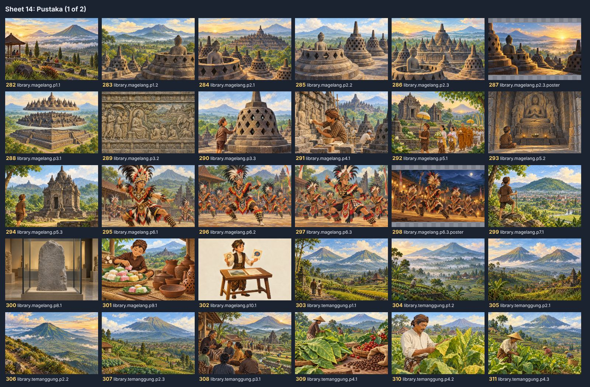

| No | Picture | Shows | Used in the game | Status | Notes |
|---|---|---|---|---|---|
| 282 | [`library.magelang.p1.1`](assets/pustaka/library.magelang.p1.1.webp) | Selamat Datang di Magelang | Gambar Pustaka (Pustaka Kedu) |  |  |
| 283 | [`library.magelang.p1.2`](assets/pustaka/library.magelang.p1.2.webp) | Lambang_Kabupaten_Magelang.jpg | Gambar Pustaka (Pustaka Kedu) |  |  |
| 284 | [`library.magelang.p2.1`](assets/pustaka/library.magelang.p2.1.webp) | Candi Borobudur, Mahakarya Dunia | Gambar Pustaka (Pustaka Kedu) |  |  |
| 285 | [`library.magelang.p2.2`](assets/pustaka/library.magelang.p2.2.webp) | Borobudur_stupas_on_upper_terrace.jpg | Gambar Pustaka (Pustaka Kedu) |  |  |
| 286 | [`library.magelang.p2.3`](assets/pustaka/library.magelang.p2.3.webp) | youtube.com/watch?v=txujqGtB_6g | Not installed by the game |  | Fact: this Pustaka medium is a video; the game uses only its cover (`.poster`) |
| 287 | [`library.magelang.p2.3.poster`](assets/pustaka/library.magelang.p2.3.poster.webp) | library.magelang.p2.3.poster | Not installed by the game |  | Fact: this Pustaka medium is a video; the game uses only its cover (`.poster`) |
| 288 | [`library.magelang.p3.1`](assets/pustaka/library.magelang.p3.1.webp) | Tiga Alam di Borobudur | Gambar Pustaka (Pustaka Kedu) |  |  |
| 289 | [`library.magelang.p3.2`](assets/pustaka/library.magelang.p3.2.webp) | Relief_Di_Candi_Borobudur.jpg | Gambar Pustaka (Pustaka Kedu) |  |  |
| 290 | [`library.magelang.p3.3`](assets/pustaka/library.magelang.p3.3.webp) | Stupa_Borobudur.jpg | Gambar Pustaka (Pustaka Kedu) |  |  |
| 291 | [`library.magelang.p4.1`](assets/pustaka/library.magelang.p4.1.webp) | Menemukan dan Memugar Borobudur | Gambar Pustaka (Pustaka Kedu) |  |  |
| 292 | [`library.magelang.p5.1`](assets/pustaka/library.magelang.p5.1.webp) | Mendut, Pawon, dan Perjalanan Waisak | Gambar Pustaka (Pustaka Kedu) |  |  |
| 293 | [`library.magelang.p5.2`](assets/pustaka/library.magelang.p5.2.webp) | Buddha's_statue_inside_candi_Mendut.JPG | Gambar Pustaka (Pustaka Kedu) |  |  |
| 294 | [`library.magelang.p5.3`](assets/pustaka/library.magelang.p5.3.webp) | Candi_Pawon_6.jpg | Gambar Pustaka (Pustaka Kedu) |  |  |
| 295 | [`library.magelang.p6.1`](assets/pustaka/library.magelang.p6.1.webp) | Topeng Ireng, Tarian Penuh Semangat | Gambar Pustaka (Pustaka Kedu) |  |  |
| 296 | [`library.magelang.p6.2`](assets/pustaka/library.magelang.p6.2.webp) | Topeng_Ireng_(4).jpg | Gambar Pustaka (Pustaka Kedu) |  |  |
| 297 | [`library.magelang.p6.3`](assets/pustaka/library.magelang.p6.3.webp) | youtube.com/watch?v=CicQwPmwCWQ | Not installed by the game |  | Fact: this Pustaka medium is a video; the game uses only its cover (`.poster`) |
| 298 | [`library.magelang.p6.3.poster`](assets/pustaka/library.magelang.p6.3.poster.webp) | library.magelang.p6.3.poster | Not installed by the game |  | Fact: this Pustaka medium is a video; the game uses only its cover (`.poster`) |
| 299 | [`library.magelang.p7.1`](assets/pustaka/library.magelang.p7.1.webp) | Gunung Tidar, Paku Tanah Jawa | Gambar Pustaka (Pustaka Kedu) |  |  |
| 300 | [`library.magelang.p8.1`](assets/pustaka/library.magelang.p8.1.webp) | Prasasti Canggal dan Awal Mataram Kuno | Gambar Pustaka (Pustaka Kedu) |  |  |
| 301 | [`library.magelang.p9.1`](assets/pustaka/library.magelang.p9.1.webp) | Rasa dan Karya Magelang | Gambar Pustaka (Pustaka Kedu) |  |  |
| 302 | [`library.magelang.p10.1`](assets/pustaka/library.magelang.p10.1.webp) | Tips Jaka: Fakta, Pendapat, dan Menghubungkan Informasi | Gambar Pustaka (Pustaka Kedu) |  |  |
| 303 | [`library.temanggung.p1.1`](assets/pustaka/library.temanggung.p1.1.webp) | Selamat Datang di Temanggung | Gambar Pustaka (Pustaka Kedu) |  |  |
| 304 | [`library.temanggung.p1.2`](assets/pustaka/library.temanggung.p1.2.webp) | Kabut_Tipis_Temanggung.jpg | Gambar Pustaka (Pustaka Kedu) |  |  |
| 305 | [`library.temanggung.p2.1`](assets/pustaka/library.temanggung.p2.1.webp) | Si Kembar Sindoro dan Sumbing | Gambar Pustaka (Pustaka Kedu) |  |  |
| 306 | [`library.temanggung.p2.2`](assets/pustaka/library.temanggung.p2.2.webp) | Gunung_Sindoro_dari_puncak_Gunung_Sumbing.jpg | Gambar Pustaka (Pustaka Kedu) |  |  |
| 307 | [`library.temanggung.p2.3`](assets/pustaka/library.temanggung.p2.3.webp) | Gunung_Sumbing_Temanggung.jpg | Gambar Pustaka (Pustaka Kedu) |  |  |
| 308 | [`library.temanggung.p3.1`](assets/pustaka/library.temanggung.p3.1.webp) | Asal-usul Nama dan Sejarah Temanggung | Gambar Pustaka (Pustaka Kedu) |  |  |
| 309 | [`library.temanggung.p4.1`](assets/pustaka/library.temanggung.p4.1.webp) | Tembakau Srintil dan Kopi Temanggung | Gambar Pustaka (Pustaka Kedu) |  |  |
| 310 | [`library.temanggung.p4.2`](assets/pustaka/library.temanggung.p4.2.webp) | Petani_Tembakau_memeriksa_daun_Tembakau_yang_akan_dipanen.jpg | Gambar Pustaka (Pustaka Kedu) |  |  |
| 311 | [`library.temanggung.p4.3`](assets/pustaka/library.temanggung.p4.3.webp) | Tobacco_Fields_on_the_slopes_of_Mt._Sumbing.jpg | Gambar Pustaka (Pustaka Kedu) |  |  |

### Sheet 15: Pustaka (2 of 2)

| No | Picture | Shows | Used in the game | Status | Notes |
|---|---|---|---|---|---|
| 312 | [`library.temanggung.p5.1`](assets/pustaka/library.temanggung.p5.1.webp) | Jejak Mataram Kuno | Gambar Pustaka (Pustaka Kedu) |  |  |
| 313 | [`library.temanggung.p5.2`](assets/pustaka/library.temanggung.p5.2.webp) | Candi_Pringapus_Temanggung_Jateng.jpg | Gambar Pustaka (Pustaka Kedu) |  |  |
| 314 | [`library.temanggung.p5.3`](assets/pustaka/library.temanggung.p5.3.webp) | Arca_Nandi_dalam_bilik_Candi_Pringapus,_Mei_2022.jpg | Gambar Pustaka (Pustaka Kedu) |  |  |
| 315 | [`library.temanggung.p6.1`](assets/pustaka/library.temanggung.p6.1.webp) | Umbul Jumprit, Hulu Kali Progo | Gambar Pustaka (Pustaka Kedu) |  |  |
| 316 | [`library.temanggung.p7.1`](assets/pustaka/library.temanggung.p7.1.webp) | Parakan, Kota Bambu Runcing | Gambar Pustaka (Pustaka Kedu) |  |  |
| 317 | [`library.temanggung.p8.1`](assets/pustaka/library.temanggung.p8.1.webp) | Kuda Lumping dan Tradisi Temanggung | Gambar Pustaka (Pustaka Kedu) |  |  |
| 318 | [`library.temanggung.p8.2`](assets/pustaka/library.temanggung.p8.2.webp) | youtube.com/watch?v=IXDk03NgHqQ | Not installed by the game |  | Fact: this Pustaka medium is a video; the game uses only its cover (`.poster`) |
| 319 | [`library.temanggung.p8.2.poster`](assets/pustaka/library.temanggung.p8.2.poster.webp) | library.temanggung.p8.2.poster | Not installed by the game |  | Fact: this Pustaka medium is a video; the game uses only its cover (`.poster`) |
| 320 | [`library.temanggung.p9.1`](assets/pustaka/library.temanggung.p9.1.webp) | Rasa Temanggung | Gambar Pustaka (Pustaka Kedu) |  |  |
| 321 | [`library.temanggung.p10.1`](assets/pustaka/library.temanggung.p10.1.webp) | Tips Jaka: Membaca Informasi Tersurat | Gambar Pustaka (Pustaka Kedu) |  |  |
| 322 | [`library.wonosobo.p1.1`](assets/pustaka/library.wonosobo.p1.1.webp) | Selamat Datang di Wonosobo | Gambar Pustaka (Pustaka Kedu) |  |  |
| 323 | [`library.wonosobo.p1.2`](assets/pustaka/library.wonosobo.p1.2.webp) | Lambang_Kabupaten_Wonosobo.webp | Gambar Pustaka (Pustaka Kedu) |  |  |
| 324 | [`library.wonosobo.p2.1`](assets/pustaka/library.wonosobo.p2.1.webp) | Dieng, Tempat Para Dewa | Gambar Pustaka (Pustaka Kedu) |  |  |
| 325 | [`library.wonosobo.p2.2`](assets/pustaka/library.wonosobo.p2.2.webp) | Peta_Kawasan_Dataran_Tinggi_Dieng.jpg | Gambar Pustaka (Pustaka Kedu) |  |  |
| 326 | [`library.wonosobo.p3.1`](assets/pustaka/library.wonosobo.p3.1.webp) | Telaga Warna dan Telaga Pengilon | Gambar Pustaka (Pustaka Kedu) |  |  |
| 327 | [`library.wonosobo.p3.2`](assets/pustaka/library.wonosobo.p3.2.webp) | Telaga_Warna_in_The_Dieng_Plateau.jpg | Gambar Pustaka (Pustaka Kedu) |  |  |
| 328 | [`library.wonosobo.p3.3`](assets/pustaka/library.wonosobo.p3.3.webp) | Telaga_Warna_Dieng_02.jpg | Gambar Pustaka (Pustaka Kedu) |  |  |
| 329 | [`library.wonosobo.p4.1`](assets/pustaka/library.wonosobo.p4.1.webp) | Sembungan dan Sikunir | Gambar Pustaka (Pustaka Kedu) |  |  |
| 330 | [`library.wonosobo.p4.2`](assets/pustaka/library.wonosobo.p4.2.webp) | The_Golden_Sunrise_Sikunir.jpg | Gambar Pustaka (Pustaka Kedu) |  |  |
| 331 | [`library.wonosobo.p5.1`](assets/pustaka/library.wonosobo.p5.1.webp) | Embun Upas, Es di Pulau Tropis | Gambar Pustaka (Pustaka Kedu) |  |  |
| 332 | [`library.wonosobo.p6.1`](assets/pustaka/library.wonosobo.p6.1.webp) | Candi-candi Dieng | Gambar Pustaka (Pustaka Kedu) |  |  |
| 333 | [`library.wonosobo.p6.2`](assets/pustaka/library.wonosobo.p6.2.webp) | Pagi_Candi_Arjuna_Dieng.jpg | Gambar Pustaka (Pustaka Kedu) |  |  |
| 334 | [`library.wonosobo.p7.1`](assets/pustaka/library.wonosobo.p7.1.webp) | Tari Topeng Lengger dan Bundengan | Not installed by the game |  | Fact: this Pustaka medium is a video; the game uses only its cover (`.poster`) |
| 335 | [`library.wonosobo.p7.1.poster`](assets/pustaka/library.wonosobo.p7.1.poster.webp) | library.wonosobo.p7.1.poster | Not installed by the game |  | Fact: this Pustaka medium is a video; the game uses only its cover (`.poster`) |
| 336 | [`library.wonosobo.p8.1`](assets/pustaka/library.wonosobo.p8.1.webp) | Tradisi Rambut Gimbal Dieng | Not installed by the game |  | Fact: this Pustaka medium is a video; the game uses only its cover (`.poster`) |
| 337 | [`library.wonosobo.p8.1.poster`](assets/pustaka/library.wonosobo.p8.1.poster.webp) | library.wonosobo.p8.1.poster | Not installed by the game |  | Fact: this Pustaka medium is a video; the game uses only its cover (`.poster`) |
| 338 | [`library.wonosobo.p9.1`](assets/pustaka/library.wonosobo.p9.1.webp) | Rasa Wonosobo | Gambar Pustaka (Pustaka Kedu) |  |  |
| 339 | [`library.wonosobo.p9.2`](assets/pustaka/library.wonosobo.p9.2.webp) | Mountain_papaya_(Vasconcellea_pubescens).jpg | Gambar Pustaka (Pustaka Kedu) |  |  |
| 340 | [`library.wonosobo.p9.3`](assets/pustaka/library.wonosobo.p9.3.webp) | Es_carica_dieng_wonosobo.jpg | Gambar Pustaka (Pustaka Kedu) |  |  |
| 341 | [`library.wonosobo.p10.1`](assets/pustaka/library.wonosobo.p10.1.webp) | Tips Jaka: Cek Dulu Sebelum Percaya dan Berbagi | Gambar Pustaka (Pustaka Kedu) |  |  |

### Sheet 16: Skenario Digital situation pictures

| No | Picture | Shows | Used in the game | Status | Notes |
|---|---|---|---|---|---|
| 342 | [`item.skenario.mgl-5-a01`](mockup/gambar-mockup/skenario/aset/item.skenario.mgl-5-a01.webp) | Situation picture | Gambar situasi Skenario Digital Magelang (Tantangan Skenario Digital Magelang) |  |  |
| 343 | [`item.skenario.mgl-5-a02`](mockup/gambar-mockup/skenario/aset/item.skenario.mgl-5-a02.webp) | Situation picture | Gambar situasi Skenario Digital Magelang (Tantangan Skenario Digital Magelang) |  |  |
| 344 | [`item.skenario.mgl-5-a03`](mockup/gambar-mockup/skenario/aset/item.skenario.mgl-5-a03.webp) | Situation picture | Gambar situasi Skenario Digital Magelang (Tantangan Skenario Digital Magelang) |  |  |
| 345 | [`item.skenario.mgl-5-a04`](mockup/gambar-mockup/skenario/aset/item.skenario.mgl-5-a04.webp) | Situation picture | Gambar situasi Skenario Digital Magelang (Tantangan Skenario Digital Magelang) |  |  |
| 346 | [`item.skenario.mgl-5-b01`](mockup/gambar-mockup/skenario/aset/item.skenario.mgl-5-b01.webp) | Situation picture | Gambar situasi Skenario Digital Magelang (Tantangan Skenario Digital Magelang) |  |  |
| 347 | [`item.skenario.mgl-5-b02`](mockup/gambar-mockup/skenario/aset/item.skenario.mgl-5-b02.webp) | Situation picture | Gambar situasi Skenario Digital Magelang (Tantangan Skenario Digital Magelang) |  |  |
| 348 | [`item.skenario.mgl-5-b03`](mockup/gambar-mockup/skenario/aset/item.skenario.mgl-5-b03.webp) | Situation picture | Gambar situasi Skenario Digital Magelang (Tantangan Skenario Digital Magelang) |  |  |
| 349 | [`item.skenario.mgl-5-b04`](mockup/gambar-mockup/skenario/aset/item.skenario.mgl-5-b04.webp) | Situation picture | Gambar situasi Skenario Digital Magelang (Tantangan Skenario Digital Magelang) |  |  |
| 350 | [`item.skenario.tmg-5-a01`](mockup/gambar-mockup/skenario/aset/item.skenario.tmg-5-a01.webp) | Situation picture | Gambar situasi Skenario Digital Temanggung (Tantangan Skenario Digital Temanggung) |  |  |
| 351 | [`item.skenario.tmg-5-a02`](mockup/gambar-mockup/skenario/aset/item.skenario.tmg-5-a02.webp) | Situation picture | Gambar situasi Skenario Digital Temanggung (Tantangan Skenario Digital Temanggung) |  |  |
| 352 | [`item.skenario.tmg-5-a03`](mockup/gambar-mockup/skenario/aset/item.skenario.tmg-5-a03.webp) | Situation picture | Gambar situasi Skenario Digital Temanggung (Tantangan Skenario Digital Temanggung) |  |  |
| 353 | [`item.skenario.tmg-5-a04`](mockup/gambar-mockup/skenario/aset/item.skenario.tmg-5-a04.webp) | Situation picture | Gambar situasi Skenario Digital Temanggung (Tantangan Skenario Digital Temanggung) |  |  |
| 354 | [`item.skenario.tmg-5-b01`](mockup/gambar-mockup/skenario/aset/item.skenario.tmg-5-b01.webp) | Situation picture | Gambar situasi Skenario Digital Temanggung (Tantangan Skenario Digital Temanggung) |  |  |
| 355 | [`item.skenario.tmg-5-b02`](mockup/gambar-mockup/skenario/aset/item.skenario.tmg-5-b02.webp) | Situation picture | Gambar situasi Skenario Digital Temanggung (Tantangan Skenario Digital Temanggung) |  |  |
| 356 | [`item.skenario.tmg-5-b03`](mockup/gambar-mockup/skenario/aset/item.skenario.tmg-5-b03.webp) | Situation picture | Gambar situasi Skenario Digital Temanggung (Tantangan Skenario Digital Temanggung) |  |  |
| 357 | [`item.skenario.tmg-5-b04`](mockup/gambar-mockup/skenario/aset/item.skenario.tmg-5-b04.webp) | Situation picture | Gambar situasi Skenario Digital Temanggung (Tantangan Skenario Digital Temanggung) |  |  |
| 358 | [`item.skenario.wnb-5-a01`](mockup/gambar-mockup/skenario/aset/item.skenario.wnb-5-a01.webp) | Situation picture | Gambar situasi Skenario Digital Wonosobo (Tantangan Skenario Digital Wonosobo) |  |  |
| 359 | [`item.skenario.wnb-5-a02`](mockup/gambar-mockup/skenario/aset/item.skenario.wnb-5-a02.webp) | Situation picture | Gambar situasi Skenario Digital Wonosobo (Tantangan Skenario Digital Wonosobo) |  |  |
| 360 | [`item.skenario.wnb-5-a03`](mockup/gambar-mockup/skenario/aset/item.skenario.wnb-5-a03.webp) | Situation picture | Gambar situasi Skenario Digital Wonosobo (Tantangan Skenario Digital Wonosobo) |  |  |
| 361 | [`item.skenario.wnb-5-a04`](mockup/gambar-mockup/skenario/aset/item.skenario.wnb-5-a04.webp) | Situation picture | Gambar situasi Skenario Digital Wonosobo (Tantangan Skenario Digital Wonosobo) |  |  |
| 362 | [`item.skenario.wnb-5-b01`](mockup/gambar-mockup/skenario/aset/item.skenario.wnb-5-b01.webp) | Situation picture | Gambar situasi Skenario Digital Wonosobo (Tantangan Skenario Digital Wonosobo) |  |  |
| 363 | [`item.skenario.wnb-5-b02`](mockup/gambar-mockup/skenario/aset/item.skenario.wnb-5-b02.webp) | Situation picture | Gambar situasi Skenario Digital Wonosobo (Tantangan Skenario Digital Wonosobo) |  |  |
| 364 | [`item.skenario.wnb-5-b03`](mockup/gambar-mockup/skenario/aset/item.skenario.wnb-5-b03.webp) | Situation picture | Gambar situasi Skenario Digital Wonosobo (Tantangan Skenario Digital Wonosobo) |  |  |
| 365 | [`item.skenario.wnb-5-b04`](mockup/gambar-mockup/skenario/aset/item.skenario.wnb-5-b04.webp) | Situation picture | Gambar situasi Skenario Digital Wonosobo (Tantangan Skenario Digital Wonosobo) |  |  |

### Sheet 17: Test stimulus pictures

| No | Picture | Shows | Used in the game | Status | Notes |
|---|---|---|---|---|---|
| 366 | [`instr.tes-ae-A01`](mockup/gambar-mockup/instrumen/aset/instr.tes-ae-A01.webp) | Test stimulus | Gambar tes awal–akhir (Modul tes) |  |  |
| 367 | [`instr.tes-ae-A02`](mockup/gambar-mockup/instrumen/aset/instr.tes-ae-A02.webp) | Test stimulus | Gambar tes awal–akhir (Modul tes) |  |  |
| 368 | [`instr.tes-ae-A03`](mockup/gambar-mockup/instrumen/aset/instr.tes-ae-A03.webp) | Test stimulus | Gambar tes awal–akhir (Modul tes) |  |  |
| 369 | [`instr.tes-ae-A04`](mockup/gambar-mockup/instrumen/aset/instr.tes-ae-A04.webp) | Test stimulus | Gambar tes awal–akhir (Modul tes) |  |  |
| 370 | [`instr.tes-ae-A05`](mockup/gambar-mockup/instrumen/aset/instr.tes-ae-A05.webp) | Test stimulus | Gambar tes awal–akhir (Modul tes) |  |  |
| 371 | [`instr.tes-ae-A06`](mockup/gambar-mockup/instrumen/aset/instr.tes-ae-A06.webp) | Test stimulus | Gambar tes awal–akhir (Modul tes) |  |  |
| 372 | [`instr.tes-ae-A07`](mockup/gambar-mockup/instrumen/aset/instr.tes-ae-A07.webp) | Test stimulus | Gambar tes awal–akhir (Modul tes) |  |  |
| 373 | [`instr.tes-ae-A08`](mockup/gambar-mockup/instrumen/aset/instr.tes-ae-A08.webp) | Test stimulus | Gambar tes awal–akhir (Modul tes) |  |  |
| 374 | [`instr.tes-ae-B01`](mockup/gambar-mockup/instrumen/aset/instr.tes-ae-B01.webp) | Test stimulus | Gambar tes awal–akhir (Modul tes) |  |  |
| 375 | [`instr.tes-ae-B02`](mockup/gambar-mockup/instrumen/aset/instr.tes-ae-B02.webp) | Test stimulus | Gambar tes awal–akhir (Modul tes) |  |  |
| 376 | [`instr.tes-ae-B03`](mockup/gambar-mockup/instrumen/aset/instr.tes-ae-B03.webp) | Test stimulus | Gambar tes awal–akhir (Modul tes) |  |  |
| 377 | [`instr.tes-ae-B04`](mockup/gambar-mockup/instrumen/aset/instr.tes-ae-B04.webp) | Test stimulus | Gambar tes awal–akhir (Modul tes) |  |  |
| 378 | [`instr.tes-ae-B05`](mockup/gambar-mockup/instrumen/aset/instr.tes-ae-B05.webp) | Test stimulus | Gambar tes awal–akhir (Modul tes) |  |  |
| 379 | [`instr.tes-ae-B06`](mockup/gambar-mockup/instrumen/aset/instr.tes-ae-B06.webp) | Test stimulus | Gambar tes awal–akhir (Modul tes) |  |  |
| 380 | [`instr.tes-ae-B07`](mockup/gambar-mockup/instrumen/aset/instr.tes-ae-B07.webp) | Test stimulus | Gambar tes awal–akhir (Modul tes) |  |  |
| 381 | [`instr.tes-ae-B08`](mockup/gambar-mockup/instrumen/aset/instr.tes-ae-B08.webp) | Test stimulus | Gambar tes awal–akhir (Modul tes) |  |  |
| 382 | [`instr.tes-bd-A-G1`](mockup/gambar-mockup/instrumen/aset/instr.tes-bd-A-G1.webp) | Test stimulus | Gambar tes awal–akhir (Modul tes) |  |  |
| 383 | [`instr.tes-bd-A-G2`](mockup/gambar-mockup/instrumen/aset/instr.tes-bd-A-G2.webp) | Test stimulus | Gambar tes awal–akhir (Modul tes) |  |  |
| 384 | [`instr.tes-bd-B-G1`](mockup/gambar-mockup/instrumen/aset/instr.tes-bd-B-G1.webp) | Test stimulus | Gambar tes awal–akhir (Modul tes) |  |  |
| 385 | [`instr.tes-bd-B-G2`](mockup/gambar-mockup/instrumen/aset/instr.tes-bd-B-G2.webp) | Test stimulus | Gambar tes awal–akhir (Modul tes) |  |  |
| 386 | [`instr.tes-mb-A-M3`](mockup/gambar-mockup/instrumen/aset/instr.tes-mb-A-M3.webp) | Test stimulus | Gambar tes awal–akhir (Modul tes) |  |  |
| 387 | [`instr.tes-mb-A-M4`](mockup/gambar-mockup/instrumen/aset/instr.tes-mb-A-M4.webp) | Test stimulus | Gambar tes awal–akhir (Modul tes) |  |  |
| 388 | [`instr.tes-mb-B-M3`](mockup/gambar-mockup/instrumen/aset/instr.tes-mb-B-M3.webp) | Test stimulus | Gambar tes awal–akhir (Modul tes) |  |  |
| 389 | [`instr.tes-mb-B-M4`](mockup/gambar-mockup/instrumen/aset/instr.tes-mb-B-M4.webp) | Test stimulus | Gambar tes awal–akhir (Modul tes) |  |  |

### Sheet 18: Interim bridge-story backgrounds

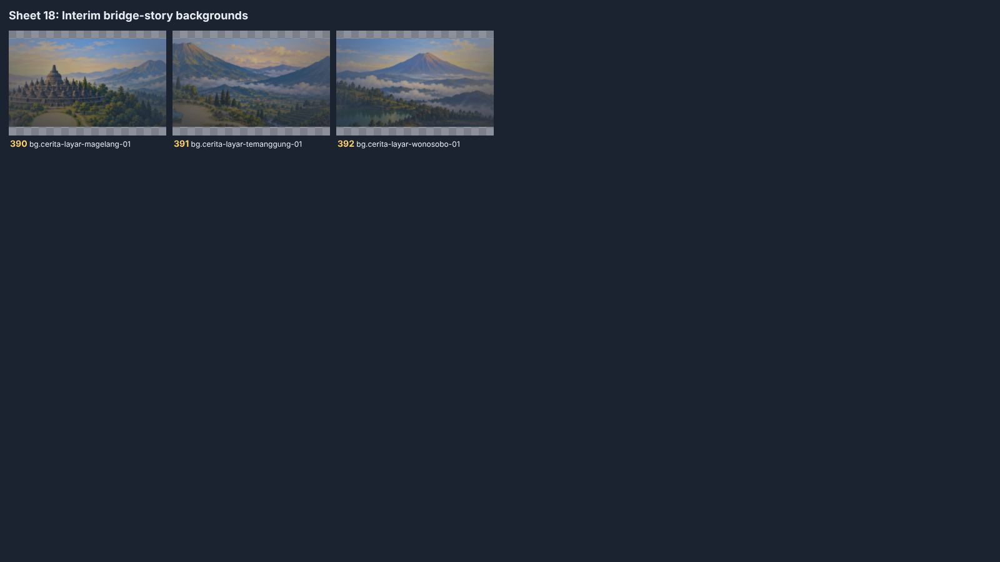

| No | Picture | Shows | Used in the game | Status | Notes |
|---|---|---|---|---|---|
| 390 | [`bg.cerita-layar-magelang-01`](mockup/gambar-mockup/cerita-layar/aset/bg.cerita-layar-magelang-01.webp) | Interim background cut from the region map | Story slide background: Cerita penghubung (sebelum tantangan kelima), Magelang, slide 1 |  | Fact: six identical files per region (slides 01 to 06); the generated pictures T-L1, M-L1, W-L1 replace them |
| 391 | [`bg.cerita-layar-temanggung-01`](mockup/gambar-mockup/cerita-layar/aset/bg.cerita-layar-temanggung-01.webp) | Interim background cut from the region map | Story slide background: Cerita penghubung (sebelum tantangan kelima), Temanggung, slide 1 |  | Fact: six identical files per region (slides 01 to 06); the generated pictures T-L1, M-L1, W-L1 replace them |
| 392 | [`bg.cerita-layar-wonosobo-01`](mockup/gambar-mockup/cerita-layar/aset/bg.cerita-layar-wonosobo-01.webp) | Interim background cut from the region map | Story slide background: Cerita penghubung (sebelum tantangan kelima), Wonosobo, slide 1 |  | Fact: six identical files per region (slides 01 to 06); the generated pictures T-L1, M-L1, W-L1 replace them |

### Sheet 19: Style references

| No | Picture | Shows | Used in the game | Status | Notes |
|---|---|---|---|---|---|
| 393 | [`reference.01`](assets/referensi/reference.01.webp) | Jaka — lembar karakter | Not installed by the game |  |  |
| 394 | [`reference.02`](assets/referensi/reference.02.webp) | Mbah Kedu — avatar | Avatar Mbah Kedu (potret layar Kenali) (Layar Mengenal wilayah, di ujung kiri kotak teks (tombol Kenali di Peta Kedu)) · slot `ui.kedu-avatar` |  |  |
| 395 | [`reference.03`](assets/referensi/reference.03.webp) | Jaka — avatar syal merah | Not installed by the game |  |  |
| 396 | [`reference.04`](assets/referensi/reference.04.webp) | Lembah magis saat senja | Not installed by the game |  |  |
| 397 | [`reference.05`](assets/referensi/reference.05.webp) | Cahaya Kedu — latar prolog | Not installed by the game |  |  |
| 398 | [`reference.06`](assets/referensi/reference.06.webp) | Jalur cahaya menuju candi | Not installed by the game |  |  |
| 399 | [`reference.07`](assets/referensi/reference.07.webp) | Gerbang pohon tua | Not installed by the game |  |  |
| 400 | [`reference.08`](assets/referensi/reference.08.webp) | Diorama wilayah Kedu | Not installed by the game |  |  |
| 401 | [`reference.09`](assets/referensi/reference.09.webp) | Logo GELITA landscape | Not installed by the game |  |  |
| 402 | [`reference.10`](assets/referensi/reference.10.webp) | Tombol mulai | Not installed by the game |  |  |
| 403 | [`reference.11`](assets/referensi/reference.11.webp) | Medali kopi dan daun | Not installed by the game |  |  |
| 404 | [`reference.12`](assets/referensi/reference.12.webp) | Judul Peta Wilayah Kedu | Not installed by the game |  |  |
| 405 | [`reference.13`](assets/referensi/reference.13.webp) | Jaka — sprite petualang | Not installed by the game |  |  |
| 406 | [`reference.14`](assets/referensi/reference.14.webp) | Mbah Kedu — narator | Not installed by the game |  |  |
| 407 | [`reference.15`](assets/referensi/reference.15.webp) | Pendukung — penjaga desa | Not installed by the game |  |  |
| 408 | [`reference.16`](assets/referensi/reference.16.webp) | Logo simbol lentera | Not installed by the game |  |  |
| 409 | [`reference.17`](assets/referensi/reference.17.webp) | Speaker aktif | Not installed by the game |  |  |
| 410 | [`reference.18`](assets/referensi/reference.18.webp) | Speaker nonaktif | Not installed by the game |  |  |
| 411 | [`reference.19`](assets/referensi/reference.19.webp) | English — bendera UK | Not installed by the game |  |  |
| 412 | [`reference.20`](assets/referensi/reference.20.webp) | Bahasa Indonesia — bendera merah putih | Not installed by the game |  |  |
| 413 | [`reference.21`](assets/referensi/reference.21.webp) | Masuk layar penuh | Not installed by the game |  |  |
| 414 | [`reference.22`](assets/referensi/reference.22.webp) | Keluar layar penuh | Not installed by the game |  |  |
| 415 | [`reference.23`](assets/referensi/reference.23.webp) | Kembali | Not installed by the game |  |  |
| 416 | [`reference.24`](assets/referensi/reference.24.webp) | Selanjutnya | Not installed by the game |  |  |
| 417 | [`reference.25`](assets/referensi/reference.25.webp) | Login — lentera penyambut | Not installed by the game |  |  |
| 418 | [`reference.26`](assets/referensi/reference.26.webp) | Daftar — awal petualangan | Not installed by the game |  |  |

## Part 3: new pictures waiting to be installed

Shown here only so they can be compared with the rest.

### Sheet 20: New pictures waiting in chatgpt-images/out (1 of 2)

| No | Picture | Shows | Used in the game | Status | Notes |
|---|---|---|---|---|---|
| 419 | [`bg.cerita-dialog-magelang-01`](../chatgpt-images/out/bg.cerita-dialog-magelang-01.webp) | New picture made by ChatGPT | Not installed yet |  | Status is kept in `../chatgpt-images/TASKS.md`, not here |
| 420 | [`bg.cerita-dialog-magelang-05`](../chatgpt-images/out/bg.cerita-dialog-magelang-05.webp) | New picture made by ChatGPT | Not installed yet |  | Status is kept in `../chatgpt-images/TASKS.md`, not here |
| 421 | [`bg.cerita-dialog-magelang-09`](../chatgpt-images/out/bg.cerita-dialog-magelang-09.webp) | New picture made by ChatGPT | Not installed yet |  | Status is kept in `../chatgpt-images/TASKS.md`, not here |
| 422 | [`bg.cerita-dialog-magelang-15`](../chatgpt-images/out/bg.cerita-dialog-magelang-15.webp) | New picture made by ChatGPT | Not installed yet |  | Status is kept in `../chatgpt-images/TASKS.md`, not here |
| 423 | [`bg.cerita-dialog-temanggung-01`](../chatgpt-images/out/bg.cerita-dialog-temanggung-01.webp) | New picture made by ChatGPT | Not installed yet |  | Status is kept in `../chatgpt-images/TASKS.md`, not here |
| 424 | [`bg.cerita-dialog-temanggung-06`](../chatgpt-images/out/bg.cerita-dialog-temanggung-06.webp) | New picture made by ChatGPT | Not installed yet |  | Status is kept in `../chatgpt-images/TASKS.md`, not here |
| 425 | [`bg.cerita-dialog-temanggung-12`](../chatgpt-images/out/bg.cerita-dialog-temanggung-12.webp) | New picture made by ChatGPT | Not installed yet |  | Status is kept in `../chatgpt-images/TASKS.md`, not here |
| 426 | [`bg.cerita-dialog-wonosobo-01`](../chatgpt-images/out/bg.cerita-dialog-wonosobo-01.webp) | New picture made by ChatGPT | Not installed yet |  | Status is kept in `../chatgpt-images/TASKS.md`, not here |
| 427 | [`bg.cerita-dialog-wonosobo-03`](../chatgpt-images/out/bg.cerita-dialog-wonosobo-03.webp) | New picture made by ChatGPT | Not installed yet |  | Status is kept in `../chatgpt-images/TASKS.md`, not here |
| 428 | [`bg.cerita-dialog-wonosobo-07`](../chatgpt-images/out/bg.cerita-dialog-wonosobo-07.webp) | New picture made by ChatGPT | Not installed yet |  | Status is kept in `../chatgpt-images/TASKS.md`, not here |
| 429 | [`bg.cerita-dialog-wonosobo-14`](../chatgpt-images/out/bg.cerita-dialog-wonosobo-14.webp) | New picture made by ChatGPT | Not installed yet |  | Status is kept in `../chatgpt-images/TASKS.md`, not here |
| 430 | [`bg.cerita-kenal-magelang-01`](../chatgpt-images/out/bg.cerita-kenal-magelang-01.webp) | New picture made by ChatGPT | Not installed yet |  | Status is kept in `../chatgpt-images/TASKS.md`, not here |
| 431 | [`bg.cerita-kenal-magelang-03`](../chatgpt-images/out/bg.cerita-kenal-magelang-03.webp) | New picture made by ChatGPT | Not installed yet |  | Status is kept in `../chatgpt-images/TASKS.md`, not here |
| 432 | [`bg.cerita-kenal-magelang-04`](../chatgpt-images/out/bg.cerita-kenal-magelang-04.webp) | New picture made by ChatGPT | Not installed yet |  | Status is kept in `../chatgpt-images/TASKS.md`, not here |
| 433 | [`bg.cerita-kenal-temanggung-01`](../chatgpt-images/out/bg.cerita-kenal-temanggung-01.webp) | New picture made by ChatGPT | Not installed yet |  | Status is kept in `../chatgpt-images/TASKS.md`, not here |
| 434 | [`bg.cerita-kenal-temanggung-02`](../chatgpt-images/out/bg.cerita-kenal-temanggung-02.webp) | New picture made by ChatGPT | Not installed yet |  | Status is kept in `../chatgpt-images/TASKS.md`, not here |
| 435 | [`bg.cerita-kenal-temanggung-03`](../chatgpt-images/out/bg.cerita-kenal-temanggung-03.webp) | New picture made by ChatGPT | Not installed yet |  | Status is kept in `../chatgpt-images/TASKS.md`, not here |
| 436 | [`bg.cerita-kenal-temanggung-04`](../chatgpt-images/out/bg.cerita-kenal-temanggung-04.webp) | New picture made by ChatGPT | Not installed yet |  | Status is kept in `../chatgpt-images/TASKS.md`, not here |
| 437 | [`bg.cerita-kenal-wonosobo-01`](../chatgpt-images/out/bg.cerita-kenal-wonosobo-01.webp) | New picture made by ChatGPT | Not installed yet |  | Status is kept in `../chatgpt-images/TASKS.md`, not here |
| 438 | [`bg.cerita-kenal-wonosobo-02`](../chatgpt-images/out/bg.cerita-kenal-wonosobo-02.webp) | New picture made by ChatGPT | Not installed yet |  | Status is kept in `../chatgpt-images/TASKS.md`, not here |
| 439 | [`bg.cerita-kenal-wonosobo-03`](../chatgpt-images/out/bg.cerita-kenal-wonosobo-03.webp) | New picture made by ChatGPT | Not installed yet |  | Status is kept in `../chatgpt-images/TASKS.md`, not here |
| 440 | [`bg.cerita-kenal-wonosobo-04`](../chatgpt-images/out/bg.cerita-kenal-wonosobo-04.webp) | New picture made by ChatGPT | Not installed yet |  | Status is kept in `../chatgpt-images/TASKS.md`, not here |
| 441 | [`bg.cerita-layar-magelang-01`](../chatgpt-images/out/bg.cerita-layar-magelang-01.webp) | New picture made by ChatGPT | Not installed yet |  | Status is kept in `../chatgpt-images/TASKS.md`, not here |
| 442 | [`bg.cerita-layar-temanggung-01`](../chatgpt-images/out/bg.cerita-layar-temanggung-01.webp) | New picture made by ChatGPT | Not installed yet |  | Status is kept in `../chatgpt-images/TASKS.md`, not here |
| 443 | [`bg.cerita-layar-wonosobo-01`](../chatgpt-images/out/bg.cerita-layar-wonosobo-01.webp) | New picture made by ChatGPT | Not installed yet |  | Status is kept in `../chatgpt-images/TASKS.md`, not here |
| 444 | [`bg.cerita-tuntas-magelang-01`](../chatgpt-images/out/bg.cerita-tuntas-magelang-01.webp) | New picture made by ChatGPT | Not installed yet |  | Status is kept in `../chatgpt-images/TASKS.md`, not here |
| 445 | [`bg.cerita-tuntas-temanggung-01`](../chatgpt-images/out/bg.cerita-tuntas-temanggung-01.webp) | New picture made by ChatGPT | Not installed yet |  | Status is kept in `../chatgpt-images/TASKS.md`, not here |
| 446 | [`bg.cerita-tuntas-wonosobo-01`](../chatgpt-images/out/bg.cerita-tuntas-wonosobo-01.webp) | New picture made by ChatGPT | Not installed yet |  | Status is kept in `../chatgpt-images/TASKS.md`, not here |
| 447 | [`challenge.item.mgl-1-e01`](../chatgpt-images/out/challenge.item.mgl-1-e01.webp) | New picture made by ChatGPT | Not installed yet |  | Status is kept in `../chatgpt-images/TASKS.md`, not here |
| 448 | [`challenge.item.tmg-1-k01`](../chatgpt-images/out/challenge.item.tmg-1-k01.webp) | New picture made by ChatGPT | Not installed yet |  | Status is kept in `../chatgpt-images/TASKS.md`, not here |

### Sheet 21: New pictures waiting in chatgpt-images/out (2 of 2)

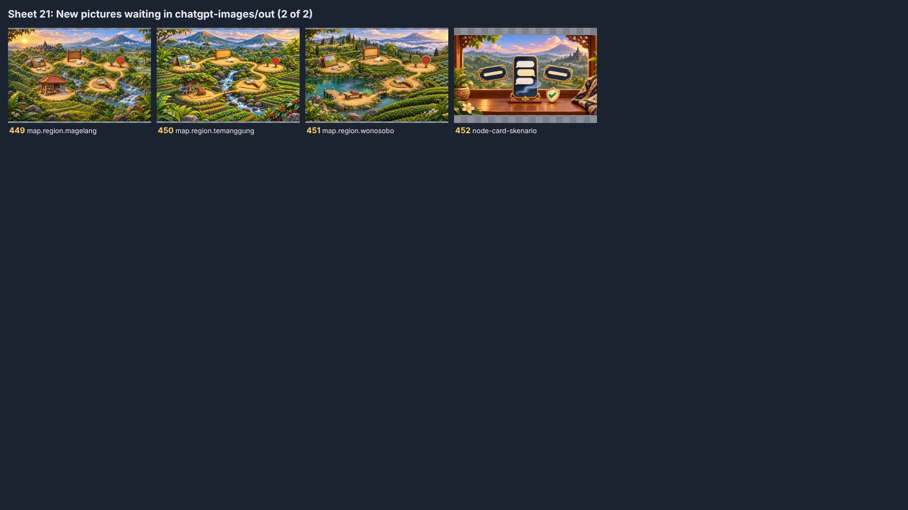

| No | Picture | Shows | Used in the game | Status | Notes |
|---|---|---|---|---|---|
| 449 | [`map.region.magelang`](../chatgpt-images/out/map.region.magelang.webp) | New picture made by ChatGPT | Not installed yet |  | Status is kept in `../chatgpt-images/TASKS.md`, not here |
| 450 | [`map.region.temanggung`](../chatgpt-images/out/map.region.temanggung.webp) | New picture made by ChatGPT | Not installed yet |  | Status is kept in `../chatgpt-images/TASKS.md`, not here |
| 451 | [`map.region.wonosobo`](../chatgpt-images/out/map.region.wonosobo.webp) | New picture made by ChatGPT | Not installed yet |  | Status is kept in `../chatgpt-images/TASKS.md`, not here |
| 452 | [`node-card-skenario`](../chatgpt-images/out/node-card-skenario.webp) | New picture made by ChatGPT | Not installed yet |  | Status is kept in `../chatgpt-images/TASKS.md`, not here |

