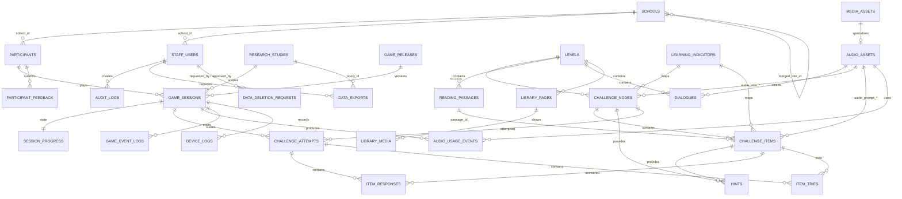

# 01_DATABASE.md — Skema Database GELITA

Proyek: **GELITA** (Game Edukasi Literasi dan Etnopedagogi Kedu)
Stack: CodeIgniter 4.7 · PHP 8.2+ · MariaDB 10.11 / MySQL 8 · InnoDB · utf8mb4

Dokumen ini menggambarkan skema database GELITA seperti yang dibuat oleh migration di repo: setiap tabel, kolom, kunci, foreign key, bentuk kolom JSON, aturan yang dijaga aplikasi, dan retensi data. Cara memasang server ada di [08_DEPLOYMENT.md](08_DEPLOYMENT.md); Model dan Entity di [03_MODEL_ENTITY.md](03_MODEL_ENTITY.md).

---

## Ringkasan

GELITA adalah game edukasi sekaligus instrumen penelitian untuk siswa **kelas 5 SD/MI**. Pemain (Jaka, dibimbing Mbah Kedu) menjelajahi tiga wilayah berurutan untuk mengumpulkan **12 Serpihan Cahaya**:

| `levels.sequence` | `levels.code` | Tingkat (`difficulty`) | Tantangan (`challenge_nodes.sequence` → `engine_type`) |
|---:|---|---|---|
| 1 | `temanggung` | `mudah` | 1 `puzzle` · 2 `rumpang` · 3 `boleh` · 4 `cari` |
| 2 | `magelang` | `sedang` | 1 `puzzle` · 2 `rumpang` · 3 `boleh` · 4 `cari` |
| 3 | `wonosobo` | `sulit` | 1 `puzzle` · 2 `rumpang` · 3 `boleh` · 4 `cari` |

```
3 wilayah (levels) × 4 tantangan (challenge_nodes) = 12 tantangan = 12 serpihan
1 tantangan → beberapa variasi (variant_group a/b/c) → soal (challenge_items)
1 pengerjaan (challenge_attempts) = satu variasi yang dipilih acak
1 soal dalam satu pengerjaan → 1 baris item_responses (keadaan akhir)
                             → 1..n baris item_tries (setiap percobaan)
```

Nama tampilan keempat jenis tantangan: Susun Gambar (`puzzle`), Isi Rumpang (`rumpang`), Benar atau Salah (`boleh`), Cari Objek (`cari`).

Skema dibuat oleh **29 migration** di `app/Database/Migrations/`, satu tabel per berkas, dari `2026-01-01-000100_CreateSchools.php` sampai `2026-01-01-002900_CreateCiSessions.php`. Hasilnya 28 tabel domain + `ci_sessions`, ditambah tabel `migrations` milik CodeIgniter (30 tabel). Urutan berkas mengikuti ketergantungan foreign key, sehingga `php spark migrate` berjalan bersih dari database kosong dan `php spark migrate:rollback` membuang tabel dalam urutan terbalik.

Migration `2026-01-01-003100_AddPackageTrackingToSessionsAndEvents.php` (asset package Stage 5) adds columns to existing tables: `game_sessions.package_code`, `game_sessions.package_mode`, a wider `game_sessions.app_client_version`, and `game_event_logs.clock_offset_ms`. Migration `2026-01-01-003200_AddParticipantAvatar.php` (display plan Phase B) adds `participants.avatar_no`. Migration `2026-01-01-003300_AddPackageCodeToResearchStudies.php` (asset package Stage 6) adds `research_studies.package_code`; `SystemResetService::REQUIRED_MIGRATION` now points at it.

Database menyimpan lima kelompok data:

1. **Peserta dan sesi**: sekolah, siswa, studi, versi permainan, sesi bermain, kemajuan.
2. **Konten**: wilayah, tantangan, soal, bacaan, petunjuk, cerita, Pustaka Kedu.
3. **Media dan audio**: berkas gambar/video/suara dan rekaman bertranskrip.
4. **Data penelitian mentah**: pengerjaan, jawaban, percobaan, pemakaian audio, event, perangkat.
5. **Tata kelola**: akun staf, audit, ekspor, permintaan penghapusan data.

Database tidak menyimpan skor, indeks, atau agregat penelitian. Yang dihitung server hanya hitungan per pengerjaan (benar pada percobaan pertama, benar di akhir) dan bintang sebagai hadiah di layar siswa; peneliti mengolah data mentah dari halaman **Data mentah** di panel atau dari unduhan XLSX/CSV-ZIP (lihat [Data mentah](#data-mentah)).

---

## Konvensi umum

Pola bersama semua migration ada di `App\Database\GelitaMigration` (di luar folder `Migrations` agar tidak dibaca MigrationRunner). Setiap migration tabel domain memperluas kelas ini.

| Hal | Aturan |
|---|---|
| Engine, charset | `InnoDB`, `utf8mb4`, collation `utf8mb4_unicode_ci` (`createGelitaTable()`) |
| Primary key | `id BIGINT UNSIGNED AUTO_INCREMENT` (`id()`). Pengecualian: `field_session_members` (PK = `field_session_id`, `participant_id`) dan `ci_sessions` (PK `VARCHAR(128)`) |
| Kolom referensi | `BIGINT UNSIGNED`, `NULL` bila opsional (`ref()`) |
| Flag 0/1 | `TINYINT(1) NOT NULL` dengan default (`flag()`); benar/salah yang belum diketahui `TINYINT(1) NULL` (`nullableFlag()`) |
| Waktu | `DATETIME(6)` (presisi mikrodetik untuk urutan event penelitian). `created_at` = `DEFAULT CURRENT_TIMESTAMP(6)`; `updated_at` = `DEFAULT CURRENT_TIMESTAMP(6) ON UPDATE CURRENT_TIMESTAMP(6)` (`timestamps()`) |
| JSON | Tipe `JSON`. Di MariaDB menjadi `LONGTEXT` ber-collation `utf8mb4_bin` dengan `CHECK (json_valid(...))`. Model meng-encode array lewat trait `App\Models\Traits\EncodesJson`; Entity membaca dengan cast `json-array` |
| Dwibahasa | Pasangan kolom `*_id` (Indonesia) dan `*_en` (Inggris). Bila `*_en` kosong, aplikasi menampilkan `*_id` |
| Nilai berkode | `VARCHAR`, bukan `ENUM`. Daftar nilai sah dijaga aturan validasi Model atau `Config\Gelita`, sehingga nilai baru tidak memerlukan migration |
| Foreign key | `ON DELETE RESTRICT` (bawaan, tertulis tanpa klausa) untuk induk konten dan induk sesi; `CASCADE` untuk data turunan; `SET NULL` untuk referensi opsional. Tidak ada `ON UPDATE` khusus |
| Nama index | Nama kolom (mis. `session_id_occurred_at`); index untuk FK yang dibuat otomatis bernama `{tabel}_{kolom}_foreign` |
| CHECK constraint | Tidak dipakai selain `json_valid` bawaan MariaDB. Aturan antarkolom dijaga aplikasi (lihat [Aturan integritas](#aturan-integritas)) |
| Soft delete | Hanya `participants.deleted_at` (lewat Model) dan `game_event_logs.deleted_at/deleted_by/delete_reason` (lewat layanan penghapusan data) |
| IP | IP mentah tidak disimpan di tabel domain; yang disimpan `ip_hash` = SHA-256 IP + garam `gelita.ipSalt` (`hash_ip()`) |
| Waktu klien | `occurred_at` event dan audio dikirim klien (ISO 8601), dikonversi ke zona aplikasi dengan pecahan detik; yang tidak dapat diurai diganti waktu server |

Master wilayah administratif Indonesia tidak disimpan di database. Daftarnya berkas statis `public/assets/data/wilayah-id.json`; tabel hanya menyimpan kode dan salinan nama (`*_name_snapshot`).

---

## Daftar tabel

| Kelompok | Tabel | Migration | Fungsi singkat |
|---|---|---|---|
| A. Peserta dan sesi | [`schools`](#schools) | `000100` | Direktori sekolah resmi (NPSN) dan nama sekolah ketikan siswa |
| | [`participants`](#participants) | `000400` | Akun dan profil siswa |
| | [`research_studies`](#research_studies) | `000300` | Studi penelitian, mode buka wilayah, masa simpan data |
| | [`game_releases`](#game_releases) | `000500` | Versi permainan/konten/aturan bintang yang dipakai sesi |
| | [`game_sessions`](#game_sessions) | `001700` | Sesi bermain siswa |
| | [`participant_progress`](#participant_progress) | `003500` | Kemajuan siswa per studi (wilayah terbuka, serpihan, bintang); replaced `session_progress` (`001800`) |
| | [Field sessions](#research-revision-10-part-2-field-sessions-migration-003500) | `003500` | `field_sessions`, `field_session_tokens`, `field_session_members`, `participant_seats`, `participant_code_counters` |
| | [`participant_feedback`](#participant_feedback) | `002400` | Kritik dan saran siswa (Balai Refleksi) |
| B. Konten | [`levels`](#levels) | `000900` | Tiga wilayah |
| | [`learning_indicators`](#learning_indicators) | `000600` | Indikator pembelajaran (`literasi`, `budaya`, `sikap`) |
| | [`challenge_nodes`](#challenge_nodes) | `001100` | Empat tantangan per wilayah |
| | [`challenge_items`](#challenge_items) | `001200` | Bank soal per variasi |
| | [`reading_passages`](#reading_passages) | `001000` | Bacaan Benar atau Salah, satu per variasi |
| | [`hints`](#hints) | `001300` | Petunjuk tantangan atau soal |
| | [`dialogues`](#dialogues) | `001400` | Narasi dan dialog cerita |
| | [`library_pages`](#library_pages) | `001500` | Halaman Pustaka Kedu |
| | [`library_media`](#library_media) | `001600` | Gambar/video halaman Pustaka |
| C. Media dan audio | [`media_assets`](#media_assets) | `000700` | Semua berkas gambar, video, suara, frame tokoh |
| | [`audio_assets`](#audio_assets) | `000800` | Rekaman suara bertranskrip dan berstatus persetujuan |
| | [`asset_packages`](#asset_packages) | `003000` | Asset packages built from active media and code (download-once package, `docs/rencana-paket-aset.md`) |
| D. Data penelitian mentah | [`challenge_attempts`](#challenge_attempts) | `001900` | Satu pengerjaan tantangan |
| | [`item_responses`](#item_responses) | `002000` | Keadaan akhir satu soal dalam satu pengerjaan |
| | [`item_tries`](#item_tries) | `002100` | Satu percobaan satu soal (insert-only) |
| | [`audio_usage_events`](#audio_usage_events) | `002200` | Pemakaian audio |
| | [`game_event_logs`](#game_event_logs) | `002300` | Event mentah permainan |
| | [`device_logs`](#device_logs) | `002800` | Perangkat siswa setiap daftar/masuk/lanjut sesi |
| E. Tata kelola dan admin | [`staff_users`](#staff_users) | `000200` | Akun admin dan guru |
| | [`audit_logs`](#audit_logs) | `002500` | Jejak tindakan staf dan command |
| | [`data_exports`](#data_exports) | `002600` | Permintaan dan berkas ekspor |
| | [`data_deletion_requests`](#data_deletion_requests) | `002700` | Permintaan penghapusan data (pratinjau → eksekusi) |
| F. Sistem | [`ci_sessions`](#ci_sessions) | `002900` | Sesi HTTP CodeIgniter |

Awalan migration ditulis singkat: `000100` = `2026-01-01-000100_Create…`. Tabel `migrations` dibuat CodeIgniter sendiri dan tidak didokumentasikan di sini.

---

## Relasi



Referensi media (`*_media_id`, `media_asset_id`, `poster_media_id`) dari `levels`, `challenge_nodes`, `challenge_items`, `reading_passages`, `dialogues`, dan `library_media` ke `media_assets` tidak digambar agar diagram terbaca; semuanya `ON DELETE SET NULL`.

Ringkasan aturan `ON DELETE`:

| Anak → induk | Aturan | Akibat |
|---|---|---|
| `challenge_nodes.level_id` → `levels` | RESTRICT | Wilayah yang punya tantangan tidak dapat dihapus |
| `challenge_items.challenge_node_id` → `challenge_nodes` | CASCADE | Menghapus tantangan menghapus soalnya (bila belum pernah dijawab) |
| `item_responses` / `item_tries` `.challenge_item_id` → `challenge_items` | RESTRICT | Soal yang sudah dijawab tidak dapat dihapus; soal diistirahatkan dengan `is_active = 0` |
| `challenge_attempts.challenge_node_id` → `challenge_nodes` | RESTRICT | Tantangan yang sudah dikerjakan tidak dapat dihapus |
| `game_sessions.participant_id` / `study_id` / `release_id` | RESTRICT | Siswa, studi, dan rilis yang punya sesi tidak dapat dihapus langsung; penghapusan siswa lewat `RetentionService` (anak dulu) |
| Turunan sesi (`challenge_attempts`, `audio_usage_events`, `game_event_logs`, `device_logs`) → `game_sessions` | CASCADE | Menghapus sesi menghapus seluruh data turunannya |
| `item_responses`, `item_tries`, `audio_usage_events.challenge_attempt_id` → `challenge_attempts` | CASCADE | |
| `audio_usage_events.audio_asset_id` → `audio_assets` | RESTRICT | Rekaman yang pernah diputar tidak dapat dihapus |
| `audio_assets.media_asset_id` → `media_assets` | CASCADE | Menghapus berkas menghapus catatan rekamannya |
| `reading_passages`, `dialogues`, `library_pages` `.level_id` → `levels` | CASCADE | |
| `library_media.library_page_id` → `library_pages` | CASCADE | |
| `hints` → `challenge_nodes` / `challenge_items` | CASCADE | |
| `participant_feedback.participant_id` → `participants` | CASCADE | |
| `data_exports.requested_by`, `data_deletion_requests.requested_by` → `staff_users` | RESTRICT | Akun staf yang pernah meminta ekspor/penghapusan dinonaktifkan, bukan dihapus |
| Referensi opsional lainnya | SET NULL | |

`game_event_logs.participant_id`, `level_id`, `challenge_node_id`, `challenge_attempt_id`, `challenge_item_id` dan `device_logs.participant_id` sengaja **tanpa FK**: log harus tetap utuh untuk audit walaupun konten berubah.

## Spesifikasi tabel

Kolom tabel ditulis dengan tipe MariaDB. "Null" = boleh NULL; "Bawaan" = nilai `DEFAULT`; tanda — berarti tanpa bawaan (wajib diisi). `NOW` = `CURRENT_TIMESTAMP(6)`, `NOW↻` = `CURRENT_TIMESTAMP(6) ON UPDATE CURRENT_TIMESTAMP(6)`.

### A. Peserta dan sesi

#### `schools`

Direktori sekolah. Baris resmi (`is_verified = 1`, NPSN di `code`) dipasang `SchoolSeeder` / `php spark gelita:schools:import` dari `app/Database/Seeds/data/sekolah-jateng.csv` (sekolah Jawa Tengah, lihat [`docs/sekolah/`](sekolah/README.md)); impor hanya menulis yang berubah dan tidak pernah menghapus. Baris `is_verified = 0` adalah nama sekolah yang diketik siswa dan tidak cocok dengan sekolah resmi.

| Kolom | Tipe | Null | Bawaan | Arti |
|---|---|---|---|---|
| id | BIGINT UNSIGNED | tidak | AUTO | PK |
| code | VARCHAR(80) | ya | NULL | UNIQUE. NPSN 8 angka sekolah resmi; NULL untuk nama ketikan |
| name | VARCHAR(200) | tidak | — | Nama resmi, atau nama yang diketik siswa. INDEX |
| level | VARCHAR(20) | ya | NULL | Bentuk pendidikan dari data induk: `SD`, `MI`, `SMP`, `MTS`, `SLB`, `SPK SD`, … |
| stage | VARCHAR(10) | ya | NULL | Jenjang `sd` \| `smp` \| `slb`. Pendaftaran lewat NPSN hanya menerima `Config\Gelita::$registrationSchoolStages` (`sd`, `slb`) |
| status | VARCHAR(10) | ya | NULL | `NEGERI` \| `SWASTA` |
| country_code | VARCHAR(5) | ya | `ID` | INDEX |
| province_code | VARCHAR(10) | ya | NULL | Kode Kemendagri, mis. `33`. INDEX |
| district_code | VARCHAR(10) | ya | NULL | Kode kabupaten/kota, mis. `33.23`. INDEX |
| subdistrict_name | VARCHAR(120) | ya | NULL | Kecamatan, tanpa awalan "KEC." |
| village_name | VARCHAR(120) | ya | NULL | Desa/kelurahan |
| is_active | TINYINT(1) | tidak | 1 | 0 = sudah digabung ke sekolah lain |
| is_verified | TINYINT(1) | tidak | 0 | 1 = sekolah resmi atau disahkan admin |
| match_key | VARCHAR(200) | ya | NULL | Nama ternormalisasi (`App\Libraries\SchoolName::key()`) untuk pencocokan |
| merged_into_id | BIGINT UNSIGNED | ya | NULL | FK `schools.id` SET NULL. Tujuan penggabungan |
| created_at, updated_at | DATETIME(6) | tidak | NOW, NOW↻ | |

Index: `schools_district_match_key (district_code, match_key)`, `schools_match_key (match_key)`, `schools_verified_active (is_verified, is_active)`.

Siswa yang memilih provinsi berdirektori (`Config\Gelita::$schoolDirectoryProvinces` = `['33']`) wajib mengisi NPSN. Nama ketikan dicocokkan lewat `match_key` oleh `App\Services\SchoolDirectory::resolve()` dan hanya ditautkan ke sekolah resmi bila kandidatnya tunggal; selain itu disimpan sebagai `is_verified = 0`, satu baris per (wilayah, `match_key`). Admin merapikan sisanya di panel Sekolah: **gabung** (siswa dan akun guru pindah, `school_name_snapshot` ikut nama tujuan, asal menjadi `is_active = 0` + `merged_into_id` dan menjadi alias bagi ketikan yang sama berikutnya) atau **sahkan** (NPSN wajib unik). Keduanya tercatat di `audit_logs` (`school_merge`, `school_verify`).

#### `participants`

Akun dan profil siswa. Akun siswa terpisah dari akun staf (`staff_users`) dan tidak pernah digabung. Pendaftaran tiga langkah (`/daftar/1..3`); langkah 3 memuat centang persetujuan siswa (`assented_at`).

| Kolom | Tipe | Null | Bawaan | Arti |
|---|---|---|---|---|
| id | BIGINT UNSIGNED | tidak | AUTO | PK |
| participant_code | VARCHAR(40) | tidak | — | UNIQUE. Kode pseudonim penelitian `GLT-000001`, dibuat server dari id baris (`ParticipantModel::assignCode()`) |
| username | VARCHAR(30) | tidak | — | UNIQUE. Huruf kecil, angka, titik, garis bawah, 3–30 karakter (`valid_username`); disimpan huruf kecil; nama cadangan `Config\Gelita::$reservedUsernames` ditolak |
| password_hash | VARCHAR(255) | tidak | — | `password_hash()` PASSWORD_DEFAULT. Satu-satunya jalur tulis: `ParticipantModel::setPassword()` |
| must_change_password | TINYINT(1) | tidak | 0 | 1 setelah guru mereset sandi |
| display_name | VARCHAR(150) | ya | NULL | Nama asli; tidak ikut ekspor anonim |
| age | TINYINT UNSIGNED | ya | NULL | Umur. Pendaftaran menerima `Config\Gelita::$registrationAge` (8–15); Model menerima 5–80. INDEX |
| gender | VARCHAR(20) | ya | NULL | `laki-laki` \| `perempuan` (`Config\Gelita::$genders`). INDEX |
| class_level | VARCHAR(20) | ya | NULL | Selalu `5` dari pendaftaran (`Config\Gelita::$registrationClass`). INDEX |
| avatar_no | TINYINT UNSIGNED | ya | NULL | Avatar chosen at sign-up or in the profile: N of slot `avatar.N`; NULL = initial of the name. Not research data: not exported, no event (migration `003200`) |
| school_id | BIGINT UNSIGNED | ya | NULL | FK `schools.id` SET NULL. INDEX |
| school_name_snapshot | VARCHAR(200) | ya | NULL | Salinan nama sekolah saat daftar. INDEX |
| country_code | VARCHAR(5) | ya | `ID` | INDEX |
| country_name_snapshot | VARCHAR(100) | ya | NULL | |
| province_code | VARCHAR(10) | ya | NULL | INDEX |
| province_name_snapshot | VARCHAR(120) | ya | NULL | |
| district_code | VARCHAR(10) | ya | NULL | INDEX |
| district_name_snapshot | VARCHAR(120) | ya | NULL | |
| pw_first_submit_criteria | TINYINT UNSIGNED | ya | NULL | 0–5: jumlah syarat sandi yang terpenuhi pada kiriman pertama formulir pendaftaran |
| pw_weak_submit_count | SMALLINT UNSIGNED | tidak | 0 | Berapa kali formulir ditolak karena sandi belum kuat |
| failed_login_count | SMALLINT UNSIGNED | tidak | 0 | Pencacah gagal masuk (`Config\Gelita::$loginThrottle['participant']`: 8 kali → kunci 5 menit) |
| locked_until | DATETIME(6) | ya | NULL | Akhir penguncian sementara |
| last_login_at | DATETIME(6) | ya | NULL | |
| password_changed_at | DATETIME(6) | ya | NULL | |
| intro_seen_at | DATETIME(6) | ya | NULL | Pertama kali menyelesaikan cerita pembuka (`/intro/selesai`). NULL = wajib menonton sebelum peta terbuka. Diisi sekali, tidak pernah ditimpa (`markIntroSeen()`) |
| assented_at | DATETIME(6) | ya | NULL | Waktu siswa mencentang persetujuan di langkah 3 pendaftaran |
| created_at, updated_at | DATETIME(6) | tidak | NOW, NOW↻ | |
| deleted_at | DATETIME(6) | ya | NULL | Soft delete (`ParticipantModel` `useSoftDeletes`). INDEX |

Salinan nama (`*_snapshot`) disimpan agar catatan penelitian tetap terbaca walaupun data sekolah atau wilayah berubah.

**Kebijakan kata sandi siswa** (materi literasi keamanan digital). Sumbernya satu, `Config\Gelita::$passwordPolicy`, dipakai `App\Libraries\PasswordPolicy`, aturan validasi `strong_password`, dan JavaScript:

| # | Syarat | Aturan |
|---:|---|---|
| 1 | Panjang | 8–64 karakter (dan ≤ 72 byte, batas bcrypt) |
| 2 | Huruf besar | minimal satu `A–Z` |
| 3 | Huruf kecil | minimal satu `a–z` |
| 4 | Angka | minimal satu `0–9` |
| 5 | Simbol | minimal satu karakter bukan huruf/angka |
| — | Tambahan | tidak boleh memuat `username`; ulangan sandi harus sama |

Tingkat tampilan: lemah 0–2 syarat, sedang 3–4, kuat 5. Pendaftaran hanya diterima bila kuat. `pw_first_submit_criteria` dan `pw_weak_submit_count` dihitung server dari kiriman formulir, disimpan saat akun dibuat, dan tidak memuat informasi apa pun tentang isi kata sandi.

#### `research_studies`

Studi penelitian. Sesi baru selalu masuk studi berstatus `active` terbaru (`ResearchStudyModel::activeStudy()`); tanpa studi aktif sesi tidak dapat dibuat.

| Kolom | Tipe | Null | Bawaan | Arti |
|---|---|---|---|---|
| id | BIGINT UNSIGNED | tidak | AUTO | PK |
| code | VARCHAR(50) | tidak | — | UNIQUE, mis. `STUDI-KEDU-KELAS5-2026` |
| name | VARCHAR(200) | tidak | — | |
| description | TEXT | ya | NULL | |
| year_label | VARCHAR(20) | ya | NULL | Mis. `2026`. INDEX |
| status | VARCHAR(20) | tidak | `draft` | `draft` \| `active` \| `closed`. INDEX |
| retention_days | INT UNSIGNED | tidak | 1825 | Masa simpan data sesi studi ini (5 tahun); lihat [Retensi](#retensi-dan-penghapusan-data) |
| default_locale | VARCHAR(5) | tidak | `id` | `id` \| `en` |
| unlock_mode | VARCHAR(20) | tidak | `sequential` | `sequential` (wilayah terbuka berurutan) \| `free` (semua wilayah terbuka). Nilai `free`, bukan `open`, agar tidak tertukar dengan status wilayah/tantangan `open` di layar peta |
| package_code | VARCHAR(30) | ya | NULL | Asset package locked when the study became `active` (the package the active release named then); NULL = not running yet, or started while package mode was off. Written by the server only (migration `003300`) |
| created_at, updated_at | DATETIME(6) | tidak | NOW, NOW↻ | |

**Study package lock (rencana-paket-aset §7.2, migration `003300`).** When the Penelitian page changes a study's status to `active` (new or from `draft`/`closed`), `StudyController` stores `AssetPackageService::releasePackageCode()` in `package_code`; saving a study that is already running keeps it. The page shows the locked package and a warning when students now get another one. While a study runs, activating a release with another package (Rilis, or the package switch on Rilis → Paket aset) needs a confirmation tick and a reason, recorded in the `release_activate` audit entry with `package_from` and `package_to` (`App\Services\ReleaseActivation`). The migration locks a study that is already running to its active release's package when that package exists in `asset_packages`.

#### `game_releases`

Versi permainan, konten, aset, dan aturan bintang. Setiap sesi mencatat rilis aktif saat dibuat, sehingga data dapat dikelompokkan per versi.

| Kolom | Tipe | Null | Bawaan | Arti |
|---|---|---|---|---|
| id | BIGINT UNSIGNED | tidak | AUTO | PK |
| release_code | VARCHAR(80) | tidak | — | UNIQUE, mis. `GELITA-KELAS5-2026` |
| app_version | VARCHAR(30) | tidak | — | Mis. `2.0.0` |
| content_version | VARCHAR(30) | tidak | — | Mis. `kelas5-1` |
| asset_version | VARCHAR(30) | tidak | — | |
| scoring_version | VARCHAR(30) | tidak | — | Kode aturan bintang, `bintang-1` (`App\Services\ScoringService::VERSION`) |
| published_at | DATETIME(6) | ya | NULL | INDEX |
| notes | TEXT | ya | NULL | |
| is_active | TINYINT(1) | tidak | 0 | Hanya satu baris boleh 1; `GameReleaseModel::activate()` menegakkannya dalam satu transaction |

Tabel ini tanpa `created_at`/`updated_at`.

**`asset_version` and package mode (rencana-paket-aset §5.4, §6.3).** `asset_version` names the asset package of the release: a `package_code` of a built package means package mode is on, anything else (empty, or the old default `1`) means off. The package switch on Rilis → Paket aset creates releases itself (`ReleaseActivation::createForPackage()`): same `app_version`, `content_version`, and `scoring_version` as the active release, `asset_version` = the new package code (release code = the package code) or empty (release code `tanpa-paket-YYYY-MM-DD-NN`), with a note saying it was made automatically.

#### `game_sessions`

Sesi bermain: dari daftar/masuk sampai selesai atau ditinggalkan. Satu siswa boleh punya beberapa sesi dalam satu studi; yang dilanjutkan adalah sesi `active`/`paused` terbaru (`GameSessionModel::resumable()`).

| Kolom | Tipe | Null | Bawaan | Arti |
|---|---|---|---|---|
| id | BIGINT UNSIGNED | tidak | AUTO | PK |
| session_code | VARCHAR(64) | tidak | — | UNIQUE. 32 karakter hex acak (`random_code(16)`); pengenal internal untuk ekspor dan log, **bukan** token login |
| participant_id | BIGINT UNSIGNED | tidak | — | FK `participants.id` RESTRICT |
| study_id | BIGINT UNSIGNED | tidak | — | FK `research_studies.id` RESTRICT. INDEX |
| release_id | BIGINT UNSIGNED | tidak | — | FK `game_releases.id` RESTRICT |
| locale | VARCHAR(5) | tidak | `id` | Bahasa sesi (`valid_locale`) |
| status | VARCHAR(20) | tidak | `active` | `active` \| `paused` \| `completed` \| `abandoned`. INDEX |
| started_at | DATETIME(6) | tidak | NOW | INDEX |
| last_active_at | DATETIME(6) | tidak | NOW | Denyut terakhir. INDEX |
| ended_at | DATETIME(6) | ya | NULL | Diisi saat sesi `completed` atau ditinggalkan lewat `SessionService::abandon()`; penandaan `abandoned` oleh retensi terjadwal tidak mengisinya |
| duration_ms | BIGINT UNSIGNED | tidak | 0 | Akumulasi waktu aktif antar-denyut; jeda lebih lama dari batas diam tidak dihitung |
| last_level_id | BIGINT UNSIGNED | ya | NULL | FK `levels.id` SET NULL |
| last_challenge_node_id | BIGINT UNSIGNED | ya | NULL | FK `challenge_nodes.id` SET NULL |
| device_type | VARCHAR(30) | ya | NULL | Ringkasan perangkat saat sesi dibuat (`DeviceProfile::sessionSummary()`); rincian lengkap di `device_logs` |
| os_name | VARCHAR(80) | ya | NULL | |
| browser_name | VARCHAR(80) | ya | NULL | |
| screen_size | VARCHAR(20) | ya | NULL | Mis. `1366x768` |
| is_touch | TINYINT(1) | ya | NULL | |
| app_client_version | VARCHAR(100) | ya | NULL | `{app_version}+{package_code}` when the session starts (`SessionService::packageColumns()`), just `{app_version}` without a package; widened by migration `003100` |
| package_code | VARCHAR(64) | ya | NULL | Asset package on the device when the session started; NULL without a package (`003100`) |
| package_mode | VARCHAR(10) | ya | NULL | `lengkap` \| `daring` \| `nonaktif` (rencana-paket-aset §8.7); `nonaktif` when the client reports nothing (`003100`) |
| ip_hash | CHAR(64) | ya | NULL | SHA-256 IP + garam |
| created_at | DATETIME(6) | tidak | NOW | |

Index gabungan: `participant_id_study_id_status (participant_id, study_id, status)`.

**Asset package tracking (migration `003100`, rencana-paket-aset §7.1).** Login and sign-up send `package_code` and `package_mode` inside `device_json` (`core/device.js`, hook `window.GELITA_PACKAGE`). The three package columns are written when the session is created and never change afterwards (S8): a resumed session whose device reports another package or mode keeps its columns and gets a `package_changed` event (`reason = resume`). Sessions from before `003100` are backfilled with `package_mode = nonaktif` and the `app_version` of their release; one that is resumed with a client report gets its columns filled from that report.

Perubahan status: `active` → `paused` bila diam lebih dari `Config\Gelita::$sessionIdleMinutes` (45 menit, `GameSessionModel::markStale()`) atau siswa keluar; `paused` → `active` saat masuk lagi; → `completed` saat semua wilayah aktif tuntas (`SessionService::completeIfFinished()`, event `session_completed`); `paused` yang diam lebih dari `$sessionAbandonDays` (30 hari) → `abandoned` oleh `gelita:retention:run`.

#### `participant_progress`

A student's latest progress in one study, one row per student and study (research revision 10, part 2, migration `003500`; replaces `session_progress`). It follows the student across game sessions, so a new session (a later meeting, or a new login after a completed session) does not start from empty. Every number can be recomputed from `challenge_attempts` (`App\Libraries\ProgressRules`); `ChallengeService::refreshProgress()` writes it with a conditional UPDATE.

| Kolom | Tipe | Null | Bawaan | Arti |
|---|---|---|---|---|
| id | BIGINT UNSIGNED | tidak | AI | PK |
| participant_id | BIGINT UNSIGNED | tidak | — | FK `participants.id` CASCADE; UNIQUE (`participant_id`, `study_id`) |
| study_id | BIGINT UNSIGNED | tidak | — | FK `research_studies.id` CASCADE |
| current_level_id | BIGINT UNSIGNED | ya | NULL | FK `levels.id` SET NULL |
| current_node_id | BIGINT UNSIGNED | ya | NULL | FK `challenge_nodes.id` SET NULL |
| unlocked_level_sequence | TINYINT UNSIGNED | tidak | 1 | `levels.sequence` tertinggi yang terbuka; pada `unlock_mode = free` = jumlah wilayah; not used in field mode |
| completed_nodes | SMALLINT UNSIGNED | tidak | 0 | Jumlah tantangan tuntas = jumlah Serpihan Cahaya (0–12) |
| completed_levels | TINYINT UNSIGNED | tidak | 0 | Wilayah yang keempat tantangannya tuntas |
| total_stars | SMALLINT UNSIGNED | tidak | 0 | Jumlah bintang terbaik per tantangan (`ScoringService::totalStars()`), paling banyak 36 |
| updated_at | DATETIME(6) | tidak | NOW↻ | INDEX |

"Tuntas" = punya pengerjaan `completed` (apa pun `completion_reason`-nya) in any game session of the student in that study. Pengerjaan terbaik per tantangan = bintang terbanyak, lalu yang paling awal (`ChallengeAttemptModel::completedForParticipant()`). Migration `003500` filled this table from the completed attempts already stored before it dropped `session_progress`.

#### `participant_feedback`

Kritik dan saran di Balai Refleksi, yang terbuka setelah semua tantangan tuntas. Tidak memengaruhi bintang.

| Kolom | Tipe | Null | Bawaan | Arti |
|---|---|---|---|---|
| id | BIGINT UNSIGNED | tidak | AUTO | PK |
| participant_id | BIGINT UNSIGNED | tidak | — | FK `participants.id` CASCADE. INDEX |
| session_id | BIGINT UNSIGNED | ya | NULL | FK `game_sessions.id` SET NULL. INDEX |
| rating | TINYINT UNSIGNED | tidak | — | 1–5 |
| liked_most | TEXT | ya | NULL | Paling disukai |
| hardest_part | TEXT | ya | NULL | Paling sulit |
| new_learning | TEXT | ya | NULL | Hal baru yang dipelajari |
| suggestion | TEXT | ya | NULL | Saran |
| submitted_at | DATETIME(6) | tidak | NOW | INDEX |

Aturan (`Game\ReflectionController`): `rating` wajib; minimal 2 dari 4 kolom teks terisi; setiap teks paling banyak 2.000 karakter.

### B. Konten

Konten kelas 5 berasal dari dua workbook yang diimpor `App\Services\ContentImportService` dalam satu transaction (panel admin atau `php spark gelita:bank:import`): bank soal `docs/bank-soal/gelita-bank-soal-kelas5.xlsx` (dibangun dari `docs/bank-soal/data/*.php` oleh `docs/bank-soal/build-workbook.php`) dan Pustaka `docs/pustaka/gelita-pustaka.xlsx`. Struktur 12 tantangan dan cerita diisi `ContentSeeder`. Aturan bank soal per tingkat ada di `App\Libraries\BankRules` dan `App\Libraries\DifficultyRules`.

#### `levels`

Tiga wilayah, tepat tiga baris aktif dengan `sequence` 1–3.

| Kolom | Tipe | Null | Bawaan | Arti |
|---|---|---|---|---|
| id | BIGINT UNSIGNED | tidak | AUTO | PK |
| sequence | TINYINT UNSIGNED | tidak | — | UNIQUE. Urutan wilayah: 1 Temanggung, 2 Magelang, 3 Wonosobo (wajib) |
| code | VARCHAR(40) | tidak | — | UNIQUE. `temanggung` \| `magelang` \| `wonosobo`; awalan kode tantangan `tmg`/`mgl`/`wnb` dipetakan di `Config\Gelita::$levelPrefixes` |
| name_id, name_en | VARCHAR(100) | tidak | — | Nama wilayah |
| difficulty | VARCHAR(20) | tidak | — | `mudah` \| `sedang` \| `sulit`. Menentukan aturan `DifficultyRules` (ukuran papan, jumlah rumpang, rentang Bloom). INDEX |
| focus_id, focus_en | TEXT | tidak | — | Fokus belajar wilayah |
| cp_id, cp_en | TEXT | ya | NULL | Capaian pembelajaran |
| tp_id, tp_en | TEXT | ya | NULL | Tujuan pembelajaran (diisi admin) |
| intro_id, intro_en | TEXT | ya | NULL | Keterangan wilayah (popup info) |
| map_media_id | BIGINT UNSIGNED | ya | NULL | FK `media_assets.id` SET NULL. Peta tantangan wilayah |
| background_media_id | BIGINT UNSIGNED | ya | NULL | FK `media_assets.id` SET NULL. Latar wilayah |
| badge_media_id | BIGINT UNSIGNED | ya | NULL | FK `media_assets.id` SET NULL. Lencana |
| map_x, map_y | DECIMAL(5,2) | tidak | 50.00 | Posisi titik wilayah di peta Kedu, persen lebar/tinggi |
| is_active | TINYINT(1) | tidak | 1 | INDEX |
| created_at, updated_at | DATETIME(6) | tidak | NOW, NOW↻ | |

Fokus per tingkat: **mudah** menemukan informasi tersurat; **sedang** menghubungkan dua atau lebih informasi; **sulit** menilai informasi dan mengambil keputusan secara bertanggung jawab.

#### `learning_indicators`

Indikator pembelajaran yang dipetakan ke tantangan dan soal.

| Kolom | Tipe | Null | Bawaan | Arti |
|---|---|---|---|---|
| id | BIGINT UNSIGNED | tidak | AUTO | PK |
| code | VARCHAR(50) | tidak | — | UNIQUE |
| name_id, name_en | VARCHAR(200) | tidak | — | |
| description_id, description_en | TEXT | ya | NULL | |
| domain | VARCHAR(50) | ya | NULL | `kognitif` \| `afektif`. INDEX |
| is_active | TINYINT(1) | tidak | 1 | |

Isi bawaan (`LearningIndicatorSeeder`): `literasi` (Literasi membaca, kognitif), `budaya` (Pengetahuan budaya, kognitif), `sikap` (Sikap menjaga warisan, afektif).

#### `challenge_nodes`

Tantangan: empat per wilayah, urutan `engine_type` sama di ketiga wilayah (`Config\Gelita::$engineTypes`, `BankRules::ENGINES`). Kode tantangan (`node_ref`) = awalan wilayah + urutan, mis. `tmg-1` … `wnb-4`.

| Kolom | Tipe | Null | Bawaan | Arti |
|---|---|---|---|---|
| id | BIGINT UNSIGNED | tidak | AUTO | PK |
| level_id | BIGINT UNSIGNED | tidak | — | FK `levels.id` RESTRICT |
| sequence | TINYINT UNSIGNED | tidak | — | 1–4 (Model: `greater_than[0]\|less_than[5]`) |
| engine_type | VARCHAR(20) | tidak | — | 1 `puzzle` · 2 `rumpang` · 3 `boleh` · 4 `cari` (`valid_engine_type`). INDEX |
| variant_code | VARCHAR(60) | ya | NULL | Kode jenis tampilan: `susun_gambar`, `rumpang_bacaan`, `benar_salah_bacaan`, `cari_objek`. INDEX |
| title_id, title_en | VARCHAR(250) | tidak | — | Judul tantangan (dari sheet `nodes` workbook). Judul per variasi ada di `config_json.variants` |
| instruction_id, instruction_en | TEXT | ya | NULL | Petunjuk cara bermain |
| description_id, description_en | TEXT | ya | NULL | Teks kartu misi; boleh kosong |
| indicator_id | BIGINT UNSIGNED | ya | NULL | FK `learning_indicators.id` SET NULL. Bawaan: `budaya` untuk `puzzle`/`cari`, `literasi` untuk `rumpang`/`boleh` |
| background_media_id | BIGINT UNSIGNED | ya | NULL | FK `media_assets.id` SET NULL. Latar layar tantangan |
| scene_media_id | BIGINT UNSIGNED | ya | NULL | FK `media_assets.id` SET NULL. Gambar adegan Cari Objek (slot `challenge.{node}.scene`, 1280 × 720) |
| audio_intro_id | BIGINT UNSIGNED | ya | NULL | FK `audio_assets.id` SET NULL. Narasi kartu misi, bahasa Indonesia |
| audio_intro_en_id | BIGINT UNSIGNED | ya | NULL | FK `audio_assets.id` SET NULL. Narasi kartu misi, bahasa Inggris |
| config_json | JSON | ya | NULL | Variasi, pengecoh, dan pengaturan engine; lihat [Bentuk JSON](#challenge_nodesconfig_json) |
| map_x, map_y | DECIMAL(5,2) | tidak | 50.00 | Posisi titik tantangan di peta wilayah, persen |
| content_version | VARCHAR(20) | tidak | `1` | INDEX |
| is_active | TINYINT(1) | tidak | 1 | INDEX |
| created_at, updated_at | DATETIME(6) | tidak | NOW, NOW↻ | |

UNIQUE: `level_id_sequence (level_id, sequence)`.

#### `challenge_items`

Bank soal. Setiap soal milik satu variasi (`variant_group`) satu tantangan; satu pengerjaan memakai semua soal aktif dari satu variasi. Ini bank soal, bukan jawaban siswa.

| Kolom | Tipe | Null | Bawaan | Arti |
|---|---|---|---|---|
| id | BIGINT UNSIGNED | tidak | AUTO | PK |
| challenge_node_id | BIGINT UNSIGNED | tidak | — | FK `challenge_nodes.id` CASCADE |
| item_key | VARCHAR(100) | tidak | — | Kode soal `{node}-{variasi}{NN}`, mis. `tmg-2-a01`, `wnb-4-a12` |
| sequence | SMALLINT UNSIGNED | tidak | 1 | Urutan dalam tantangan. INDEX |
| variant_group | VARCHAR(10) | ya | NULL | Variasi `a` \| `b` \| `c` (huruf/angka, ≤ 10). Kosong dianggap `a` (`ChallengeItemModel::groupByVariant()`) |
| interaction_type | VARCHAR(40) | tidak | — | `puzzle_arrange` \| `fill_blank_bank` \| `verdict_card` \| `find_object` (`Config\Gelita::$interactionTypes`). INDEX |
| prompt_id, prompt_en | TEXT | ya | NULL | Isi soal; artinya per jenis soal, lihat tabel di bawah |
| source_text_id, source_text_en | LONGTEXT | ya | NULL | Teks sumber khusus satu soal (tidak dipakai bank kelas 5) |
| passage_id | BIGINT UNSIGNED | ya | NULL | FK `reading_passages.id` SET NULL. Bacaan Benar atau Salah |
| answer_key_json | JSON | ya | NULL | Kunci jawaban; [bentuk per jenis soal](#challenge_itemsanswer_key_json). Tidak pernah dikirim ke browser |
| media_asset_id | BIGINT UNSIGNED | ya | NULL | FK `media_assets.id` SET NULL. Gambar Susun Gambar, gambar pernyataan, atau gambar benda Cari Objek |
| audio_prompt_id | BIGINT UNSIGNED | ya | NULL | FK `audio_assets.id` SET NULL. Rekaman petunjuk Cari Objek, bahasa Indonesia |
| audio_prompt_en_id | BIGINT UNSIGNED | ya | NULL | FK `audio_assets.id` SET NULL. Rekaman petunjuk Cari Objek, bahasa Inggris |
| indicator_id | BIGINT UNSIGNED | ya | NULL | FK `learning_indicators.id` SET NULL |
| bloom_level | VARCHAR(2) | ya | NULL | Taksonomi Bloom revisi `C1` … `C6`. Kosong untuk Susun Gambar dan benda pengecoh. INDEX `challenge_items_bloom_level` |
| config_json | JSON | ya | NULL | Ukuran papan, posisi benda, keterampilan, umpan balik pengecoh; [bentuk](#challenge_itemsconfig_json) |
| reference_source | VARCHAR(500) | ya | NULL | Sumber rujukan konten |
| review_status | VARCHAR(30) | tidak | `draft` | `draft` \| `needs_verification` \| `verified`. INDEX |
| review_note | TEXT | ya | NULL | Catatan pemeriksaan fakta |
| scorable | TINYINT(1) | tidak | 1 | 0 = tidak dinilai (benda pengecoh Cari Objek) |
| is_active | TINYINT(1) | tidak | 1 | 0 = soal diistirahatkan, tidak dipilih lagi. INDEX |
| created_at, updated_at | DATETIME(6) | tidak | NOW, NOW↻ | |

UNIQUE: `challenge_node_id_item_key (challenge_node_id, item_key)`. Index pemilihan variasi: `challenge_items_node_variant_active (challenge_node_id, variant_group, is_active)`.

Isi soal per jenis tantangan:

| Tantangan | `interaction_type` | Soal per variasi (mudah / sedang / sulit) | `prompt_*` | Lainnya |
|---|---|---|---|---|
| Susun Gambar | `puzzle_arrange` | 1 / 1 / 1 | Keterangan yang tampil setelah gambar utuh | `media_asset_id` = gambar utuh; papan 3 × 3 kotak / 4 × 4 kotak / 4 × 4 jigsaw |
| Isi Rumpang | `fill_blank_bank` | 3 / 5 / 7 | Satu potongan bacaan dengan satu rumpang `___` | Bacaan = semua soal variasi berurutan; bank kata = semua jawaban + pengecoh variasi |
| Benar atau Salah | `verdict_card` | 3 / 5 / 6 | Pernyataan | `passage_id` = bacaan variasi; `media_asset_id` = gambar pernyataan (opsional) |
| Cari Objek | `find_object` | 4 target + 4 / 6 / 8 pengecoh | Target: kalimat petunjuk; pengecoh: nama benda | Satu variasi `a`; `media_asset_id` = gambar benda; adegan di `challenge_nodes.scene_media_id` |

Isi Rumpang dan Benar atau Salah punya tiga variasi (a/b/c), Susun Gambar 3–10 (bank kelas 5: a–j), Cari Objek satu (`BankRules::VARIANTS`). Bank kelas 5 revisi Oktober 2026: 151 baris soal (147 aktif: 129 dinilai + 18 pengecoh; 4 diistirahatkan), 51 variasi.

#### `reading_passages`

Bacaan tantangan Benar atau Salah, satu per variasi. Kode `{node}-{variasi}`, mis. `tmg-3-a`; jumlah paragraf mengikuti tingkat wilayah (1 / 2 / 3). Isi Rumpang tidak memakai tabel ini: bacaannya tersusun dari `prompt_*` soal-soalnya.

| Kolom | Tipe | Null | Bawaan | Arti |
|---|---|---|---|---|
| id | BIGINT UNSIGNED | tidak | AUTO | PK |
| level_id | BIGINT UNSIGNED | tidak | — | FK `levels.id` CASCADE. INDEX |
| passage_key | VARCHAR(60) | tidak | — | UNIQUE |
| title_id, title_en | VARCHAR(200) | ya | NULL | Judul bacaan |
| body_id, body_en | LONGTEXT | tidak | — | Isi bacaan; paragraf dipisah baris kosong |
| media_asset_id | BIGINT UNSIGNED | ya | NULL | FK `media_assets.id` SET NULL. Gambar pendamping |
| reference_source | VARCHAR(500) | ya | NULL | Sumber rujukan |
| is_active | TINYINT(1) | tidak | 1 | |
| created_at, updated_at | DATETIME(6) | tidak | NOW, NOW↻ | |

Soal hanya boleh merujuk bacaan dari wilayah yang sama dengan tantangannya (dilaporkan galat oleh `gelita:content:verify`).

#### `hints`

Petunjuk yang dapat dibuka siswa. Petunjuk **tantangan** (`challenge_item_id` NULL) berlaku untuk seluruh pengerjaan; petunjuk **soal** (`challenge_item_id` terisi) untuk satu soal. Bank kelas 5 memakai 3 petunjuk tantangan per tantangan (36 baris).

| Kolom | Tipe | Null | Bawaan | Arti |
|---|---|---|---|---|
| id | BIGINT UNSIGNED | tidak | AUTO | PK |
| challenge_node_id | BIGINT UNSIGNED | ya | NULL | FK `challenge_nodes.id` CASCADE. INDEX |
| challenge_item_id | BIGINT UNSIGNED | ya | NULL | FK `challenge_items.id` CASCADE. INDEX |
| sequence | SMALLINT UNSIGNED | tidak | 1 | Urutan tampil |
| text_id, text_en | TEXT | tidak | — | Isi petunjuk |
| is_active | TINYINT(1) | tidak | 1 | INDEX |

Minimal salah satu dari `challenge_node_id` / `challenge_item_id` wajib terisi; tidak ada CHECK constraint. `HintModel::forNode()` hanya membaca baris dengan `challenge_item_id` NULL; `forItem()` membaca berdasarkan `challenge_item_id`. Membuka petunjuk menambah `challenge_attempts.hint_count`, mengisi `item_responses.hint_used` bila untuk satu soal, dan mencatat event `hint_opened`. Petunjuk tidak mengurangi bintang.

#### `dialogues`

Narasi dan dialog cerita: 91 baris dari `app/Database/Seeds/data/story.php` (salinan persis `docs/naskah-cerita.md`), disisipkan `ContentSeeder::seedDialogues()`.

| Kolom | Tipe | Null | Bawaan | Arti |
|---|---|---|---|---|
| id | BIGINT UNSIGNED | tidak | AUTO | PK |
| level_id | BIGINT UNSIGNED | ya | NULL | FK `levels.id` CASCADE. NULL = konteks global |
| context_code | VARCHAR(50) | tidak | `level_open` | Global: `intro` \| `map_intro` \| `ending`; per wilayah: `region_intro` \| `level_open` \| `level_done` (`Config\Gelita::$dialogueContexts`). INDEX |
| sequence | INT UNSIGNED | tidak | 1 | Urutan slide dalam konteks. INDEX |
| character_code | VARCHAR(30) | tidak | — | `jaka` \| `mbah_kedu` \| `narator` |
| pose | VARCHAR(30) | ya | NULL | Pose tokoh (`Config\Gelita::$characterPoses`): Jaka `idle`, `happy`, `bow`, `sad`, `afraid`, `determined`; Mbah Kedu `idle`, `smile`, `worried`, `weak`. NULL = `idle`; narator selalu NULL |
| effect | VARCHAR(30) | ya | NULL | Efek layar (`Config\Gelita::$dialogueEffects`): `fog`, `fog-lift`, `glow`, `flash`, `shake`, `dim`. NULL = tanpa efek |
| title_id, title_en | VARCHAR(200) | ya | NULL | Judul slide (pembuka, peta, Kenali wilayah, penutup) |
| text_id, text_en | LONGTEXT | tidak | — | Ucapan |
| audio_id_asset_id | BIGINT UNSIGNED | ya | NULL | FK `audio_assets.id` SET NULL. Rekaman bahasa Indonesia |
| audio_en_asset_id | BIGINT UNSIGNED | ya | NULL | FK `audio_assets.id` SET NULL. Rekaman bahasa Inggris |
| background_media_id | BIGINT UNSIGNED | ya | NULL | FK `media_assets.id` SET NULL |
| is_active | TINYINT(1) | tidak | 1 | |

UNIQUE: `level_id_context_code_sequence (level_id, context_code, sequence)`. Karena MySQL/MariaDB mengizinkan NULL berulang pada UNIQUE, keunikan baris global dijaga seeder (`insertIfMissing`), dan `DialogueModel::global()` mengurutkan `sequence` lalu `id` agar hasilnya tetap stabil. Nilai `pose` dan `effect` dijaga aturan `valid_dialogue_pose[character_code]` dan `valid_dialogue_effect` di `DialogueModel`, bukan ENUM.

Isi bawaan: `intro` 9, `map_intro` 3, `ending` 5 (global), serta per wilayah `region_intro` 4, `level_open` 15–16, `level_done` 4. Rekaman narasi ditautkan `php spark gelita:narration:import` (nama berkas `intro-NN`, `peta-NN`, `kenal-{wilayah}-NN`, `dialog-{wilayah}-NN`, `tuntas-{wilayah}-NN`, `penutup-NN`).

#### `library_pages`

Halaman Pustaka Kedu: bacaan mendalam per wilayah (30 halaman, 10 per wilayah). Tidak memengaruhi bintang.

| Kolom | Tipe | Null | Bawaan | Arti |
|---|---|---|---|---|
| id | BIGINT UNSIGNED | tidak | AUTO | PK |
| level_id | BIGINT UNSIGNED | tidak | — | FK `levels.id` CASCADE |
| sequence | SMALLINT UNSIGNED | tidak | 1 | Nomor halaman |
| title_id, title_en | VARCHAR(250) | tidak | — | |
| body_id, body_en | LONGTEXT | tidak | — | Isi halaman, format ringan tanpa HTML |
| is_active | TINYINT(1) | tidak | 1 | INDEX |
| created_at, updated_at | DATETIME(6) | tidak | NOW, NOW↻ | |

UNIQUE: `level_id_sequence (level_id, sequence)`.

`body_*` dirender `rich_text()`: baris kosong = paragraf, `## ` subjudul, `- ` daftar, `> ` kotak fakta, baris `Sumber:` catatan rujukan, `**tebal**`, `*miring*`. Seluruh teks di-escape lebih dulu. Gambar dan video halaman ada di `library_media`.

#### `library_media`

Gambar/video halaman Pustaka, tanpa batas jumlah per halaman (48 baris bawaan). Setiap baris berasal dari berkas unggahan **atau** tautan luar.

| Kolom | Tipe | Null | Bawaan | Arti |
|---|---|---|---|---|
| id | BIGINT UNSIGNED | tidak | AUTO | PK |
| library_page_id | BIGINT UNSIGNED | tidak | — | FK `library_pages.id` CASCADE |
| sequence | SMALLINT UNSIGNED | tidak | 1 | Urutan dalam galeri halaman |
| media_kind | VARCHAR(10) | tidak | `image` | `image` \| `video` |
| media_asset_id | BIGINT UNSIGNED | ya | NULL | FK `media_assets.id` SET NULL. Berkas unggahan |
| external_url | VARCHAR(1000) | ya | NULL | Tautan YouTube, Google Drive, Vimeo, Wikimedia Commons, atau berkas `https` langsung; dibaca `App\Libraries\MediaLink` |
| poster_media_id | BIGINT UNSIGNED | ya | NULL | FK `media_assets.id` SET NULL. Sampul video (diisi otomatis `gelita:library:thumbnails` bila dapat) |
| caption_id, caption_en | VARCHAR(500) | ya | NULL | Keterangan dan teks alternatif |
| credit | VARCHAR(300) | ya | NULL | Pemilik dan lisensi media pihak lain |
| is_active | TINYINT(1) | tidak | 1 | |
| created_at, updated_at | DATETIME(6) | tidak | NOW, NOW↻ | |

INDEX `library_page_id_sequence (library_page_id, sequence)`, tidak UNIQUE: editor admin menyimpan ulang seluruh media satu halaman sekaligus. Baris tanpa berkas aktif dan tanpa tautan yang dikenali `MediaLink` tidak dirender; hanya tautan `http(s)` yang diterima.

### C. Media dan audio

#### `media_assets`

Semua berkas yang dipakai permainan: gambar, video, suara, dan frame tokoh. Aset tetap (latar, tokoh, peta, logo) dirujuk lewat `asset_key`; konten dirujuk lewat `id` (kolom `*_media_id`). `MediaAssetSeeder` mendaftarkan slot bawaan dari `public/assets/`; slot yang berkasnya belum ada tersimpan `is_active = 0` dan tampil sebagai placeholder.

| Kolom | Tipe | Null | Bawaan | Arti |
|---|---|---|---|---|
| id | BIGINT UNSIGNED | tidak | AUTO | PK |
| asset_key | VARCHAR(160) | tidak | — | UNIQUE. Kunci slot, mis. `bg.temanggung`, `char.jaka.idle.1`, `map.region.magelang`, `challenge.tmg-4.scene`, `challenge.item.wnb-4-a01`, `audio.narasi.id.intro-01`, `library.thumb.youtube.…` |
| asset_type | VARCHAR(20) | tidak | — | `image` \| `audio` \| `video` \| `sprite_frame` (frame animasi tokoh). INDEX |
| storage_path | VARCHAR(500) | tidak | — | Relatif terhadap `public/`, mis. `assets/audio/narasi/en/dialog-magelang-01.mp3`; unggahan di `assets/uploads/`, gambar contoh di `assets/uploads/mockup/` |
| mime_type | VARCHAR(100) | tidak | — | |
| file_size | BIGINT UNSIGNED | ya | NULL | Byte |
| sha256 | CHAR(64) | ya | NULL | Sidik berkas. INDEX |
| width_px, height_px | INT UNSIGNED | ya | NULL | Ukuran gambar; ukuran wajib per slot di `Config\Gelita::$assetSizes` |
| locale | VARCHAR(5) | ya | NULL | `id` \| `en` bila berkas memuat tulisan atau suara satu bahasa |
| credit | VARCHAR(500) | ya | NULL | Pemilik/lisensi |
| label | VARCHAR(120) | ya | NULL | Nama gambar yang diharapkan (dari workbook bank soal), mis. "Bundengan" |
| description | VARCHAR(500) | ya | NULL | Isi gambar yang diharapkan, panduan bagi pembuat gambar |
| version | VARCHAR(20) | tidak | `1` | |
| is_active | TINYINT(1) | tidak | 1 | 0 = berkas belum ada atau dinonaktifkan |
| is_placeholder | TINYINT(1) | tidak | 0 | 1 = gambar contoh (mockup) buatan `App\Libraries\MockupGenerator` / `php spark gelita:mockups`. INDEX `media_assets_is_placeholder` |
| created_at, updated_at | DATETIME(6) | tidak | NOW, NOW↻ | |

Gambar tantangan punya **45 slot**: 42 `challenge.item.*` (gambar Susun Gambar, gambar pernyataan, benda Cari Objek) dan 3 `challenge.{node}.scene` (adegan Cari Objek). Instalasi baru mengisinya dengan gambar contoh (`is_placeholder = 1`). Mengunggah berkas lewat panel (`App\Libraries\MediaStore`) selalu menulis `is_placeholder = 0`, dan `MockupGenerator` tidak pernah menimpa gambar asli. Selama masih ada gambar contoh aktif, `php spark gelita:content:verify --siap-penelitian` gagal.

#### `audio_assets`

Rekaman suara bertranskrip: narasi cerita, petunjuk Cari Objek, dan rekaman unggahan admin. Satu baris melengkapi satu baris `media_assets` (berkasnya).

| Kolom | Tipe | Null | Bawaan | Arti |
|---|---|---|---|---|
| id | BIGINT UNSIGNED | tidak | AUTO | PK |
| media_asset_id | BIGINT UNSIGNED | tidak | — | UNIQUE + FK `media_assets.id` CASCADE |
| locale | VARCHAR(5) | tidak | — | `id` \| `en`. INDEX |
| character_code | VARCHAR(30) | ya | NULL | `jaka` \| `mbah_kedu` (`Config\Gelita::$characters`); NULL untuk narator dan efek suara. INDEX |
| context_code | VARCHAR(80) | tidak | — | Tempat diputar: konteks dialog (`intro`, `map_intro`, `region_intro`, `level_open`, `level_done`, `ending`) atau `hunt_clue` (petunjuk Cari Objek). INDEX |
| transcript | LONGTEXT | tidak | — | Wajib; dipakai tombol transkrip |
| production_method | VARCHAR(20) | tidak | `own_recording` | `own_recording` (direkam) \| `tts` (suara buatan komputer) |
| voice_profile | VARCHAR(200) | ya | NULL | Nama pengisi suara atau nama suara TTS |
| duration_ms | INT UNSIGNED | ya | NULL | Diukur server |
| approval_status | VARCHAR(20) | tidak | `draft` | `draft` \| `review` \| `approved` \| `rejected`. INDEX |
| approved_by | BIGINT UNSIGNED | ya | NULL | FK `staff_users.id` SET NULL |
| approved_at | DATETIME(6) | ya | NULL | |
| version | VARCHAR(20) | tidak | `1` | |

Tabel ini tanpa `created_at`/`updated_at`. Hanya rekaman `approved` dengan berkas aktif yang dikirim ke pemain (`audio_src()`). Rekaman narasi pengisi suara (103 per bahasa: 91 baris cerita + 12 petunjuk Cari Objek; rekaman TTS bawaan dihapus 17 Oktober 2026) diunggah di panel atau didaftarkan `php spark gelita:narration:import` sebagai `draft`, lalu disetujui admin di panel **Rekaman narasi**. Importer menautkan rekaman ke `dialogues.audio_id_asset_id` / `audio_en_asset_id` dan, untuk petunjuk `petunjuk-{node}-NN`, ke `challenge_items.audio_prompt_id` / `audio_prompt_en_id`.

#### `asset_packages`

*(New section, English.)* One row per asset package (`docs/rencana-paket-aset.md` §5.4), written by `App\Services\AssetPackageBuilder` (`php spark gelita:paket:bangun`, or the batch build on Rilis → Paket aset). The files are not in the database: media are copied content-addressed to `public/assets/p/{sha256[0:16]}.{ext}`, game code to `public/assets/k/{code_version}/`, the manifest to `public/paket/{package_code}.json`, and the URL map used by the media helpers to `writable/paket/{package_code}.php`. A release uses a package when `game_releases.asset_version` equals its `package_code`; any other value (the old default `1`) means package mode is off.

| Kolom | Tipe | Null | Bawaan | Arti |
|---|---|---|---|---|
| id | BIGINT UNSIGNED | tidak | AUTO | PK |
| package_code | VARCHAR(30) | tidak | — | UNIQUE. `pkt-YYYY-MM-DD-NN`; also the release's `asset_version` |
| app_version | VARCHAR(30) | tidak | — | Code version at build time (active release's `app_version`, or `--versi-aplikasi`) |
| code_version | VARCHAR(60) | ya | NULL | Code folder name `{app_version}-{hash of the code files[0:8]}` under `assets/k/` |
| content_version | VARCHAR(30) | ya | NULL | Active release's `content_version` at build time |
| manifest_sha256 | CHAR(64) | ya | NULL | sha256 of the manifest file; sent by `GET /api/paket/aktif` |
| total_bytes | BIGINT UNSIGNED | tidak | 0 | Sum of the file sizes in the manifest |
| file_count | INT UNSIGNED | tidak | 0 | Files in the manifest |
| groups_json | JSON | ya | NULL | Bytes per group (`kode`, `inti`, `wilayah-*`, `penutup`) |
| warnings_json | JSON | ya | NULL | Build warnings `[{code, key, detail}]`: `placeholder`, `narration_not_approved`, `over_budget`, `file_missing`, `hash_mismatch`, `library_copy_failed` |
| status | VARCHAR(20) | tidak | `membangun` | Stored codes: `membangun` (batch build running) \| `dibangun` (built, never published) \| `terbit` (named by the active release) \| `ditarik` (was published, no longer active). Every release activation updates `terbit`/`ditarik` (`ReleaseActivation`). INDEX |
| built_by | BIGINT UNSIGNED | ya | NULL | FK `staff_users.id` SET NULL; NULL for the CLI |
| built_at | DATETIME(6) | ya | NULL | Build finished |
| published_at | DATETIME(6) | ya | NULL | Last time a release naming this package was activated |
| notes | TEXT | ya | NULL | |
| created_at, updated_at | DATETIME(6) | tidak | NOW, NOW↻ | |

`gelita:reset` does not touch this table (group E). `gelita:paket:bersihkan` deletes package files no row refers to, and builds left in `membangun` for more than 24 hours.

The panel setting **Izinkan mode daring untuk perangkat lab** (rencana-paket-aset §8.7) is not in the database: it lives in `writable/paket/pengaturan.json` (`{"online_lab_allowed": bool, "changed_at", "changed_by"}`, `AssetPackageService::onlineLabAllowed()`), next to the package URL maps it qualifies. A missing file means off.

### D. Data penelitian mentah

Tabel ini diisi server selama permainan (`App\Services\ChallengeService`, `EventService`, `SessionService`). Penilaian benar/salah hanya dilakukan server memakai kunci di database; nilai `correct` yang dikirim browser diabaikan.

**Aturan 3 kesempatan** (`Config\Gelita::$maxTries` = 3, disalin ke `challenge_attempts.max_tries` saat pengerjaan dibuat):

- Susun Gambar, Isi Rumpang, Benar atau Salah: satu tekan "Cek jawabanku" = satu percobaan (`check_count + 1`) untuk semua soal yang belum benar; soal yang sudah benar terkunci dan tidak dinilai ulang. Semua benar → ditutup `solved`. Cek ke-`max_tries` masih ada yang salah → event `challenge_tries_exhausted`, ditutup `tries_exhausted`, jawaban terakhir disimpan apa adanya.
- Cari Objek: satu ketukan benda = satu percobaan untuk petunjuk yang sedang dicari. Ketukan salah ke-`max_tries` menutup petunjuk itu sebagai salah (event `clue_failed`). Semua petunjuk tertutup → ditutup `solved` bila semuanya ditemukan, selain itu `tries_exhausted`.

Penutupan berjalan dalam transaction yang sama dengan percobaan terakhirnya.

#### Data mentah

Panel dan ekspor tidak punya tabel sendiri: setiap dimensi `App\Services\RawDataService::DIMENSIONS` adalah satu query baca atas tabel kelompok D (ditambah kode sesi, siswa, wilayah, dan tantangan), dengan nilai apa adanya. Kode dimensi sama dengan kode lembar ekspor (`data_exports.scope_json.sheets`), nama berkas CSV, dan URL tab `/admin/data/{dimensi}`.

| Dimensi | Sumber utama | Tab `/admin/data` |
|---|---|---|
| `peserta` | `participants` | — (halaman Siswa) |
| `sesi` | `game_sessions` | — (halaman Sesi bermain) |
| `perangkat` | `device_logs` | Perangkat |
| `progres` | `game_sessions` + `participant_progress` | Progres (one row per session, with its student's progress) |
| `pengerjaan` | `challenge_attempts` | Pengerjaan |
| `jawaban` | `item_responses` | Jawaban & ketepatan |
| `percobaan` | `item_tries` | Riwayat percobaan |
| `navigasi` | `game_event_logs`, event `RawDataService::NAVIGATION_EVENTS` | Navigasi |
| `bantuan` | event `hint_opened` ∪ `audio_usage_events` | Bantuan |
| `selesai` | `game_event_logs`, event `RawDataService::COMPLETION_EVENTS` | Penyelesaian |
| `event` | `game_event_logs` semua jenis (khusus admin) | — |
| `masukan` | `participant_feedback` | — (halaman Kritik & saran) |
| `butir` | `challenge_items` (kunci jawaban khusus admin) | — |

Waktu ditulis ISO 8601 WIB dengan milidetik dan durasi dalam milidetik. Baris `game_event_logs` bertanda `deleted_at` dan siswa `participants.deleted_at` tidak ikut. Guru hanya membaca sekolahnya, tanpa kolom identitas (`RawDataService::IDENTITY_COLUMNS`), tanpa `event`, dan tanpa kunci jawaban.

#### `challenge_attempts`

Satu pengerjaan satu tantangan dalam satu sesi. Pengerjaan `in_progress` yang sudah ada dilanjutkan saat tantangan dibuka lagi; pengerjaan baru memilih **satu variasi acak** (`random_int`), dengan menghindari variasi yang sudah pernah didapat siswa itu di sesi mana pun selama masih ada yang lain (`ChallengeItemModel::pickVariant()`, `ChallengeAttemptModel::variantsServed()`). Pengerjaan pertama hanya memilih dari variasi a–c (`BankRules::FIRST_ATTEMPT_GROUPS`), sehingga variasi Susun Gambar d–j hanya muncul pada pengerjaan ulang.

| Kolom | Tipe | Null | Bawaan | Arti |
|---|---|---|---|---|
| id | BIGINT UNSIGNED | tidak | AUTO | PK |
| session_id | BIGINT UNSIGNED | tidak | — | FK `game_sessions.id` CASCADE |
| challenge_node_id | BIGINT UNSIGNED | tidak | — | FK `challenge_nodes.id` RESTRICT |
| attempt_no | SMALLINT UNSIGNED | tidak | 1 | Pengerjaan ke-n tantangan ini dalam sesi |
| variant_group | VARCHAR(10) | ya | NULL | Variasi yang dipakai (`a` \| `b` \| `c`) |
| status | VARCHAR(20) | tidak | `in_progress` | `in_progress` \| `completed` \| `abandoned`. INDEX |
| completion_reason | VARCHAR(20) | ya | NULL | `solved` \| `tries_exhausted`; diisi saat `completed` |
| selected_item_ids_json | JSON | tidak | — | Id soal variasi ini, urut tampil; benda pengecoh Cari Objek di akhir |
| scorable_items | SMALLINT UNSIGNED | tidak | 0 | Jumlah soal dinilai (`scorable = 1`) |
| first_pass_correct | SMALLINT UNSIGNED | tidak | 0 | Soal dinilai yang benar pada percobaan pertama; ditulis saat ditutup |
| final_correct | SMALLINT UNSIGNED | tidak | 0 | Soal dinilai yang benar di akhir; ditulis saat ditutup |
| check_count | SMALLINT UNSIGNED | tidak | 0 | Berapa kali "Cek jawabanku" ditekan (Cari Objek tetap 0) |
| max_tries | TINYINT UNSIGNED | tidak | 3 | Batas percobaan yang berlaku untuk pengerjaan ini |
| hint_count | SMALLINT UNSIGNED | tidak | 0 | Petunjuk yang dibuka |
| answer_change_count | SMALLINT UNSIGNED | tidak | 0 | Jumlah perubahan jawaban antarpercobaan, semua soal |
| audio_use_count | SMALLINT UNSIGNED | tidak | 0 | Jumlah event audio (aksi apa pun) yang terkait pengerjaan ini |
| stars | TINYINT UNSIGNED | tidak | 0 | 0–3, aturan `bintang-1` |
| started_at | DATETIME(6) | tidak | NOW | |
| completed_at | DATETIME(6) | ya | NULL | Waktu ditutup (`completed` atau `abandoned`) |
| duration_ms | BIGINT UNSIGNED | ya | NULL | `completed_at − started_at` saat ditutup `completed` |
| created_at | DATETIME(6) | tidak | NOW | |

UNIQUE: `session_id_challenge_node_id_attempt_no (session_id, challenge_node_id, attempt_no)`. Index: `challenge_node_id_status (challenge_node_id, status)`, `status`.

**Bintang** (`App\Services\ScoringService`, aturan `bintang-1`), dari soal yang dinilai saja: ★★★ semua benar pada percobaan pertama; ★★ semua benar di akhir; ★ selesai tetapi ada yang tetap salah; 0 belum selesai atau `abandoned`. Petunjuk, audio, dan waktu tidak mengurangi bintang. Pengerjaan `abandoned` (tombol Keluar, atau `gelita:retention:run` setelah `Config\Gelita::$attemptAbandonHours` = 24 jam tanpa sentuhan) mendapat `stars = 0`; jawaban dan percobaannya tetap tersimpan.

#### `item_responses`

Keadaan akhir satu soal dalam satu pengerjaan. Saat pengerjaan dibuat, setiap soal terpilih mendapat satu baris `pending` (`ItemResponseModel::createPlaceholders()`), termasuk benda pengecoh Cari Objek yang tidak pernah dijawab. Riwayat setiap percobaan ada di `item_tries`.

| Kolom | Tipe | Null | Bawaan | Arti |
|---|---|---|---|---|
| id | BIGINT UNSIGNED | tidak | AUTO | PK |
| challenge_attempt_id | BIGINT UNSIGNED | tidak | — | FK `challenge_attempts.id` CASCADE |
| challenge_item_id | BIGINT UNSIGNED | tidak | — | FK `challenge_items.id` RESTRICT. INDEX |
| display_order | SMALLINT UNSIGNED | tidak | 1 | Urutan tampil |
| status | VARCHAR(20) | tidak | `pending` | `pending` \| `answered` \| `skipped`. INDEX |
| first_answer_json | JSON | ya | NULL | Jawaban percobaan pertama; diisi sekali |
| final_answer_json | JSON | ya | NULL | Jawaban terakhir yang dinilai |
| first_pass_correct | TINYINT(1) | ya | NULL | Benar pada percobaan pertama |
| is_correct | TINYINT(1) | ya | NULL | Benar pada keadaan akhir |
| change_count | SMALLINT UNSIGNED | tidak | 0 | Berapa kali jawaban berubah antarpercobaan |
| try_count | SMALLINT UNSIGNED | tidak | 0 | Jumlah percobaan soal ini (= jumlah baris `item_tries`) |
| solved_on_try | TINYINT UNSIGNED | ya | NULL | Percobaan ke berapa soal ini benar; NULL = tidak pernah benar |
| hint_used | TINYINT(1) | tidak | 0 | Petunjuk soal ini dibuka |
| wrong_click_count | SMALLINT UNSIGNED | tidak | 0 | Cari Objek: ketukan salah selama petunjuk ini dicari |
| started_at | DATETIME(6) | ya | NULL | Saat baris dibuat |
| answered_at | DATETIME(6) | ya | NULL | Percobaan terakhir |
| duration_ms | BIGINT UNSIGNED | ya | NULL | Milidetik sampai masukan terakhir, dari klien (`last_input_ms`) |
| created_at, updated_at | DATETIME(6) | tidak | NOW, NOW↻ | |

UNIQUE: `challenge_attempt_id_challenge_item_id (challenge_attempt_id, challenge_item_id)`.

Pada Cari Objek, ketukan salah pertama menutup first-pass petunjuk itu sebagai salah (`first_pass_correct = 0`), dan ketukan benar sesudahnya tidak mengubahnya lagi. Petunjuk yang kesempatannya habis ditutup `status = answered`, `is_correct = 0`, `final_answer_json` = ketukan terakhir.

#### `item_tries`

Satu baris = satu percobaan satu soal: satu tekan "Cek jawabanku" untuk soal yang belum benar, atau satu ketukan benda pada Cari Objek. Ini data mentah utama untuk dimensi ketepatan, percobaan, dan waktu. **Insert-only**: baris tidak pernah diubah (`ItemTryModel` hanya punya callback `beforeInsert`).

| Kolom | Tipe | Null | Bawaan | Arti |
|---|---|---|---|---|
| id | BIGINT UNSIGNED | tidak | AUTO | PK |
| challenge_attempt_id | BIGINT UNSIGNED | tidak | — | FK `challenge_attempts.id` CASCADE |
| challenge_item_id | BIGINT UNSIGNED | tidak | — | FK `challenge_items.id` RESTRICT |
| try_no | TINYINT UNSIGNED | tidak | 1 | Percobaan ke-n soal ini (1–`max_tries`) |
| check_no | SMALLINT UNSIGNED | ya | NULL | Nomor "Cek jawabanku" (`check_count`) yang menghasilkan percobaan ini; NULL untuk Cari Objek |
| answer_json | JSON | tidak | — | Jawaban percobaan ini apa adanya |
| is_correct | TINYINT(1) | tidak | 0 | |
| hint_opened_before | TINYINT(1) | tidak | 0 | 1 bila sudah ada petunjuk yang dibuka di pengerjaan ini sebelum percobaan |
| first_input_ms | INT UNSIGNED | ya | NULL | Milidetik sejak tantangan dibuka sampai masukan pertama soal ini (klien) |
| last_input_ms | INT UNSIGNED | ya | NULL | Milidetik sampai masukan terakhir sebelum percobaan (klien); Cari Objek: sejak petunjuk tampil |
| occurred_at | DATETIME(6) | tidak | NOW | Waktu server |

UNIQUE: `challenge_attempt_id_challenge_item_id_try_no (challenge_attempt_id, challenge_item_id, try_no)`. Index analisis butir: `challenge_item_id_is_correct (challenge_item_id, is_correct)`. Angka milidetik klien yang negatif, bukan angka, atau melampaui INT UNSIGNED disimpan NULL.

#### `audio_usage_events`

Pemakaian audio, satu baris per aksi pemutar. Setiap baris disertai event `audio_*` di `game_event_logs` dalam transaction yang sama (`EventService::recordAudio()`), idempoten terhadap `client_event_id`.

| Kolom | Tipe | Null | Bawaan | Arti |
|---|---|---|---|---|
| id | BIGINT UNSIGNED | tidak | AUTO | PK |
| session_id | BIGINT UNSIGNED | tidak | — | FK `game_sessions.id` CASCADE |
| challenge_attempt_id | BIGINT UNSIGNED | ya | NULL | FK `challenge_attempts.id` CASCADE. INDEX |
| audio_asset_id | BIGINT UNSIGNED | tidak | — | FK `audio_assets.id` RESTRICT. INDEX |
| action | VARCHAR(20) | tidak | — | `play` (siswa menekan putar) \| `autoplay` (layar bernarasi memutar sendiri) \| `pause` \| `replay` \| `complete` (`AudioUsageEventModel::ACTIONS`) |
| play_index | INT UNSIGNED | tidak | 1 | Pemutaran ke-n aset itu dalam sesi, dihitung server: `play`/`autoplay`/`replay` membuka pemutaran baru, `pause`/`complete` milik pemutaran yang sedang berjalan |
| listened_ms | BIGINT UNSIGNED | ya | NULL | |
| completed | TINYINT(1) | tidak | 0 | |
| occurred_at | DATETIME(6) | tidak | NOW | Waktu klien. INDEX |
| server_received_at | DATETIME(6) | tidak | NOW | |

Index: `session_id_occurred_at (session_id, occurred_at)`.

#### `game_event_logs`

Event mentah permainan, sumber kebenaran penelitian. Tidak pernah diganti agregat dan tidak pernah dihapus diam-diam. Tabel tulis-berat: index tunggal yang sudah tercakup awalan index gabungan sengaja tidak dibuat.

| Kolom | Tipe | Null | Bawaan | Arti |
|---|---|---|---|---|
| id | BIGINT UNSIGNED | tidak | AUTO | PK |
| event_uuid | CHAR(36) | tidak | — | UNIQUE, dibuat server |
| client_event_id | VARCHAR(120) | tidak | — | Kunci idempotensi dari klien; event server memakai `srv-{uuid}` |
| session_id | BIGINT UNSIGNED | tidak | — | FK `game_sessions.id` CASCADE |
| participant_id | BIGINT UNSIGNED | tidak | — | Tanpa FK (log tetap utuh untuk audit) |
| level_id | BIGINT UNSIGNED | ya | NULL | Tanpa FK. INDEX |
| challenge_node_id | BIGINT UNSIGNED | ya | NULL | Tanpa FK |
| challenge_attempt_id | BIGINT UNSIGNED | ya | NULL | Tanpa FK. INDEX |
| challenge_item_id | BIGINT UNSIGNED | ya | NULL | Tanpa FK. INDEX |
| event_type | VARCHAR(50) | tidak | — | Salah satu `Config\Gelita::$eventTypes` (`valid_event_type`) |
| sequence_no | BIGINT UNSIGNED | tidak | 0 | Nomor urut kiriman klien, atau nomor berikutnya dari server. Since Stage 5 the client number continues across pages of one tab (see below) |
| occurred_at | DATETIME(6) | tidak | — | Waktu kejadian (klien) |
| server_received_at | DATETIME(6) | tidak | NOW | |
| clock_offset_ms | BIGINT | ya | NULL | `server_received_at − client_sent_at` of the batch that carried the event; corrected time = `occurred_at + clock_offset_ms`. 0 for server-written events, NULL when the client sent no `client_sent_at` (`003100`) |
| payload_json | JSON | ya | NULL | Data tambahan per event |
| deleted_at | DATETIME(6) | ya | NULL | Ditandai hapus oleh permintaan penghapusan data. INDEX |
| deleted_by | BIGINT UNSIGNED | ya | NULL | FK `staff_users.id` SET NULL |
| delete_reason | VARCHAR(255) | ya | NULL | |

UNIQUE: `event_uuid`; `session_id_client_event_id (session_id, client_event_id)`. Index gabungan: `(session_id, sequence_no)`, `(session_id, occurred_at)`, `(participant_id, event_type, occurred_at)`, `(challenge_node_id, event_type, occurred_at)`, `(event_type, occurred_at)`.

**`event_type` yang sah** (`Config\Gelita::$eventTypes`):

| Kelompok | Event |
|---|---|
| Sesi dan navigasi | `session_started`, `session_resumed`, `session_paused`, `session_abandoned`, `session_completed`, `locale_changed`, `level_opened`, `level_completed`, `library_opened`, `library_page_viewed`, `dialogue_advanced`, `intro_completed`, `screen_viewed`, `overlay_opened`, `page_hidden`, `page_visible`, `viewport_changed` |
| Tantangan | `challenge_opened`, `challenge_checked`, `challenge_completed`, `challenge_abandoned`, `challenge_tries_exhausted`, `answer_submitted`, `answer_changed`, `answer_selected`, `wrong_target_clicked`, `clue_failed`, `reading_progress`, `hint_opened` |
| Audio | `audio_play`, `audio_autoplay`, `audio_pause`, `audio_replay`, `audio_completed` |
| Lain-lain | `feedback_submitted`, `password_changed` |
| Asset package and queue integrity | `package_changed`, `events_dropped` |

Event `screen_viewed`, `challenge_tries_exhausted`, `clue_failed`, dan `events_dropped` hanya boleh ditulis server; kiriman klien dengan jenis itu ditolak (`EventService::SERVER_ONLY`). Batch klien paling banyak `Config\Gelita::$maxEventsPerBatch` (50) event; duplikat `(session_id, client_event_id)` diabaikan tanpa menulis baris baru. Contoh payload: `session_started`/`session_resumed` membawa `via` = `register` \| `login`; `intro_completed` membawa `first` (`true` saat `participants.intro_seen_at` baru diisi); `challenge_completed` membawa `stars`, `first_pass_correct`, `final_correct`, `scorable_items`, `completion_reason`, `attempt_no`. Kegagalan masuk tidak ditulis ke tabel ini (belum ada sesi); jejaknya di `participants.failed_login_count`.

**Event order and clock (rencana-paket-aset §7.3, migration `003100`).**

- Every batch to `/api/events` and `/api/audio-events` carries `client_sent_at`; `EventService` stores `clock_offset_ms` per row. The offset is computed when the batch arrives, so events that waited in the offline queue get the error of the clock that stamped them. Raw `occurred_at` is never changed.
- The client `sequence_no` continues across page loads per session in `sessionStorage` (`gelita.seq.{sessionTag}`) and never goes below `sequenceFloor` from `js_config()`. The client mirrors its last number in the cookie `gelita_seq={sessionTag}.{n}`; server-written events take `EventService::nextServerSequence()` = max(next number in the table, cookie + 1), so the next page's `screen_viewed` follows the previous page's events even while those are still in a beacon. Two tabs of one session can still produce equal numbers; ties are broken by `occurred_at`.
- `package_changed` (client or server; payload `from`, `to`, `reason`) records a device that had to switch asset package mid-session.
- `events_dropped` (server only; payload `dropped`, `channel`) records events the client's offline queue could not keep (queue full at 5,000 entries or storage refused). The client sends the count as `dropped` + `dropped_id` with its next batch; `client_event_id = drop-{dropped_id}` makes a re-sent report a duplicate.

#### `device_logs`

Perangkat siswa, satu baris setiap siswa mendaftar, masuk, atau melanjutkan sesi. Diisi `App\Libraries\DeviceProfile::capture()`: User-Agent + Client Hints (`Sec-CH-UA-*`, diminta `App\Filters\ClientHintsFilter`) diurai `matomo/device-detector`, dilengkapi sinyal browser dari formulir. Hanya ditambah, tidak pernah diubah.

| Kolom | Tipe | Null | Bawaan | Arti |
|---|---|---|---|---|
| id | BIGINT UNSIGNED | tidak | AUTO | PK |
| session_id | BIGINT UNSIGNED | tidak | — | FK `game_sessions.id` CASCADE. INDEX |
| participant_id | BIGINT UNSIGNED | tidak | — | Tanpa FK |
| via | VARCHAR(20) | tidak | — | `register` \| `login` \| `resume` (`DeviceLogModel::VIA`) |
| user_agent | VARCHAR(512) | ya | NULL | |
| device_type | VARCHAR(30) | ya | NULL | Mis. `smartphone`, `tablet`, `desktop` |
| device_brand | VARCHAR(60) | ya | NULL | |
| device_model | VARCHAR(100) | ya | NULL | |
| os_name, os_version, os_platform | VARCHAR(60/40/20) | ya | NULL | |
| browser_name, browser_version, browser_engine | VARCHAR(60/40/40) | ya | NULL | |
| is_bot | TINYINT(1) | tidak | 0 | |
| client_hints_json | JSON | ya | NULL | `{headers: {...}, ua_data: {...}}` Client Hints mentah |
| screen_w, screen_h | SMALLINT UNSIGNED | ya | NULL | Ukuran layar (px CSS) |
| viewport_w, viewport_h | SMALLINT UNSIGNED | ya | NULL | Ukuran jendela |
| pixel_ratio | DECIMAL(4,2) | ya | NULL | |
| touch_points | TINYINT UNSIGNED | ya | NULL | |
| orientation | VARCHAR(20) | ya | NULL | |
| is_standalone | TINYINT(1) | ya | NULL | Dibuka sebagai aplikasi terpasang |
| language | VARCHAR(20) | ya | NULL | Bahasa browser |
| timezone | VARCHAR(60) | ya | NULL | |
| corrected | VARCHAR(40) | ya | NULL | Koreksi yang diterapkan, mis. `ipad_desktop_ua` (iPadOS yang mengaku Macintosh dicatat tablet) |
| detector | VARCHAR(40) | ya | NULL | Nama dan versi pengurai |
| ip_hash | CHAR(64) | ya | NULL | SHA-256 IP + garam |
| created_at | DATETIME(6) | tidak | NOW | |

Index: `participant_id_created_at (participant_id, created_at)`.

### E. Tata kelola dan admin

#### `staff_users`

Akun panel admin dan guru. `admin` melihat dan mengelola semua data; `guru` hanya melihat siswa sekolahnya sendiri (`school_id`).

| Kolom | Tipe | Null | Bawaan | Arti |
|---|---|---|---|---|
| id | BIGINT UNSIGNED | tidak | AUTO | PK |
| username | VARCHAR(100) | tidak | — | UNIQUE (`alpha_dash`, 3–100 karakter) |
| email | VARCHAR(190) | ya | NULL | UNIQUE |
| password_hash | VARCHAR(255) | tidak | — | `password_hash()` PASSWORD_DEFAULT; ditulis lewat `StaffUserModel::setPassword()` |
| must_change_password | TINYINT(1) | tidak | 0 | 1 = sandi diketahui admin (akun baru, atau sandi sementara dari reset di `/admin/staf` / `php spark gelita:staff:password`); panel terkunci ke Ganti kata sandi (`/admin/akun/sandi`) sampai diganti pemiliknya |
| role | VARCHAR(20) | tidak | `guru` | `admin` \| `guru`. INDEX |
| display_name | VARCHAR(150) | tidak | — | |
| school_id | BIGINT UNSIGNED | ya | NULL | FK `schools.id` SET NULL. Cakupan guru; NULL untuk admin |
| is_active | TINYINT(1) | tidak | 1 | Akun dinonaktifkan, bukan dihapus. INDEX |
| failed_login_count | SMALLINT UNSIGNED | tidak | 0 | `Config\Gelita::$loginThrottle['staff']`: 5 kali → kunci 15 menit |
| locked_until | DATETIME(6) | ya | NULL | |
| last_login_at | DATETIME(6) | ya | NULL | |
| created_at, updated_at | DATETIME(6) | tidak | NOW, NOW↻ | |

Akun pertama, `admin`, dibuat `StaffUserSeeder` dengan sandi dari variabel lingkungan `GELITA_ADMIN_PASSWORD`; seeder gagal bila variabel itu kosong. Sandi tidak pernah ditanam di kode.

#### `audit_logs`

Jejak tindakan staf dan command. Kata sandi mentah tidak pernah masuk `metadata_json`.

| Kolom | Tipe | Null | Bawaan | Arti |
|---|---|---|---|---|
| id | BIGINT UNSIGNED | tidak | AUTO | PK |
| staff_user_id | BIGINT UNSIGNED | ya | NULL | FK `staff_users.id` SET NULL. NULL untuk command tanpa akun. INDEX |
| action | VARCHAR(50) | tidak | — | Kode tindakan. INDEX |
| target_type | VARCHAR(50) | ya | NULL | Mis. `workbook`, `data_deletion_request` |
| target_id | VARCHAR(100) | ya | NULL | |
| metadata_json | JSON | ya | NULL | Rincian tindakan |
| ip_hash | CHAR(64) | ya | NULL | SHA-256 IP + garam; NULL untuk command CLI |
| occurred_at | DATETIME(6) | tidak | NOW | INDEX |

Kode `action` yang ditulis aplikasi antara lain: `login`, `login_failed`, `logout`, `participant_password_reset`, `staff_create`, `staff_update`, `staff_deactivate`, `staff_password_reset`, `staff_password_change`, `staff_password_change_failed`, `study_create`, `study_update`, `release_create`, `release_activate`, `content_import`, `content_update`, `media_upload`, `media_deactivate`, `media_scan`, `media_mockups`, `audio_upload`, `audio_approve`, `audio_approve_bulk`, `narration_import`, `narration_list_download`, `school_merge`, `school_verify`, `export`, `export_download`, `export_csv` (Unduh CSV satu tab Data mentah), `list_csv` (Unduh CSV tabel Siswa, Sesi, linimasa sesi, atau Kritik & saran; `target_id` = nama tabel, kata cari `q` hanya dicatat ada/tidaknya), `export_purge`, `delete_preview`, `delete_execute`, `delete_cancel`, `retention_run`, `system_reset`.

#### `data_exports`

Permintaan dan berkas ekspor. Berkas disimpan di `writable/exports/`.

| Kolom | Tipe | Null | Bawaan | Arti |
|---|---|---|---|---|
| id | BIGINT UNSIGNED | tidak | AUTO | PK |
| requested_by | BIGINT UNSIGNED | tidak | — | FK `staff_users.id` RESTRICT. INDEX |
| study_id | BIGINT UNSIGNED | ya | NULL | FK `research_studies.id` SET NULL. INDEX |
| format | VARCHAR(10) | tidak | — | `xlsx` (workbook data mentah) \| `csv` (CSV-ZIP data mentah, berkas `.zip`) \| `pdf` (laporan satu siswa) |
| scope_json | JSON | tidak | — | Filter dan sheet yang diminta; lihat [Bentuk JSON](#kolom-json-lainnya) |
| anonymized | TINYINT(1) | tidak | 1 | 1 = tanpa kolom identitas. Pemohon `guru` selalu anonim |
| status | VARCHAR(20) | tidak | `queued` | `queued` \| `running` \| `done` \| `failed`. INDEX |
| row_count | BIGINT UNSIGNED | ya | NULL | Jumlah baris (PDF: jumlah siswa) |
| file_path | VARCHAR(500) | ya | NULL | NULL setelah berkas dihapus retensi |
| file_sha256 | CHAR(64) | ya | NULL | |
| error_message | VARCHAR(500) | ya | NULL | Pesan gagal, atau keterangan berkas sudah dihapus |
| created_at | DATETIME(6) | tidak | NOW | |
| completed_at | DATETIME(6) | ya | NULL | |
| expires_at | DATETIME(6) | ya | NULL | Diisi saat `done`: waktu selesai + `Config\Gelita::$exportRetentionDays` (7 hari). INDEX |

`App\Services\ExportService` membaca ulang hak pemohon dari `staff_users`: pemohon non-admin selalu dibatasi sekolahnya, selalu anonim, tanpa lembar Event Mentah (`event`) dan tanpa kolom kunci jawaban. `password_hash`, `failed_login_count`, dan `locked_until` tidak pernah dibaca ekspor.

#### `data_deletion_requests`

Permintaan penghapusan data penelitian, dua langkah: pratinjau jumlah baris per tabel (`preview`), lalu eksekusi yang dikonfirmasi admin. Lihat [Retensi dan penghapusan data](#retensi-dan-penghapusan-data).

| Kolom | Tipe | Null | Bawaan | Arti |
|---|---|---|---|---|
| id | BIGINT UNSIGNED | tidak | AUTO | PK |
| requested_by | BIGINT UNSIGNED | tidak | — | FK `staff_users.id` RESTRICT. INDEX |
| scope_json | JSON | tidak | — | Cakupan, hitungan pratinjau, dan asal permintaan |
| reason | TEXT | ya | NULL | Alasan |
| mode | VARCHAR(20) | tidak | `soft` | `soft` (tandai) \| `hard` (hapus baris) |
| status | VARCHAR(20) | tidak | `preview` | `preview` \| `approved` \| `executed` \| `cancelled`. INDEX |
| affected_count | BIGINT UNSIGNED | ya | NULL | Total baris pratinjau, lalu total baris yang benar-benar terdampak |
| approved_by | BIGINT UNSIGNED | ya | NULL | FK `staff_users.id` SET NULL. Admin yang mengeksekusi. INDEX |
| executed_at | DATETIME(6) | ya | NULL | |
| created_at | DATETIME(6) | tidak | NOW | |

### F. Sistem

#### `ci_sessions`

Sesi HTTP CodeIgniter (`Config\Session::$driver` = `DatabaseHandler`, `savePath` = `ci_sessions`). Migration `002900` memakai kelas `Migration` bawaan, bukan `GelitaMigration`.

| Kolom | Tipe | Null | Bawaan | Arti |
|---|---|---|---|---|
| id | VARCHAR(128) | tidak | — | PK, id sesi |
| ip_address | VARCHAR(64) | tidak | — | Alamat IP klien yang ditulis handler sesi |
| timestamp | TIMESTAMP | tidak | `current_timestamp()` | Aktivitas terakhir. INDEX |
| data | BLOB | tidak | — | Isi sesi |

Kolom `ip_address` cukup lebar untuk hash SHA-256 dari `App\Libraries\HashedIpSessionHandler`, tetapi handler itu belum dipasang di `Config\Session`; selama itu `DatabaseHandler` bawaan menyimpan IP apa adanya sampai sesi kedaluwarsa dibersihkan. Tabel ini dikosongkan `gelita:reset` dan tidak diperlukan dalam cadangan.

## Bentuk JSON

Semua kunci di bawah ditulis importer workbook (`ContentImportService`), editor konten panel, atau `ChallengeService`. Kunci yang tidak dikenal diabaikan.

### `challenge_nodes.config_json`

```jsonc
// semua engine
{
  "selection": "variant",                 // selalu: satu variasi acak per pengerjaan
  "variants": {                           // per variant_group; dari sheet variants dan distractors
    "a": { "title_id": "Candi Borobudur", "title_en": "Borobudur Temple",
           "distractors": [ {"text_id": "enam", "text_en": "six"}, {"text_id": "arca", "text_en": "statues"} ] },
    "b": { "title_id": "Tari Topeng Ireng", "title_en": "The Topeng Ireng Dance", "distractors": [ … ] },
    "c": { … }
  }
}

// rumpang: tambahan
{ "as_reading": true, "use_word_bank": true, "distractor_count": 2 }

// boleh: tambahan
{ "verdict_options": ["benar", "salah"] }
```

| Kunci | Arti |
|---|---|
| `selection` | Selalu `variant` |
| `variants.{grup}.title_id/title_en` | Judul tampil variasi; bila kosong dipakai `challenge_nodes.title_*` (`ChallengeNode::variantTitle()`) |
| `variants.{grup}.distractors` | Kata pengecoh bank kata Isi Rumpang variasi itu. Bentuk yang dibaca `ChallengeNode::distractors()`: `{"text_id","text_en"}` (ditulis importer), `{"id","en"}` (ditulis editor panel), atau string |
| `as_reading` | Isi Rumpang tampil sebagai satu bacaan: semua soal variasi berurutan, satu rumpang per soal |
| `use_word_bank` | Isi Rumpang memakai bank kata |
| `distractor_count` | Banyaknya pengecoh (dari awal daftar variasi) yang masuk bank kata: 0 untuk `mudah`, 2 untuk `sedang`/`sulit` (`DifficultyRules::reading()`) |
| `verdict_options` | Disimpan seeder; tombol Benar atau Salah selalu `benar`/`salah` (`ChallengeNode::verdictOptions()`) |

Bank kata = semua jawaban soal variasi + `distractor_count` pengecoh, diacak dengan benih per pengerjaan; pemetaan kata → rumpang tidak pernah dikirim ke browser. Ukuran papan Susun Gambar tidak disimpan di tantangan, melainkan per soal.

### `challenge_items.config_json`

```jsonc
// puzzle_arrange — ukuran papan dan bentuk keping, dibekukan saat soal dibuat
{ "grid": 3, "shape": "square" }          // sedang: {grid 4, square}; sulit: {grid 4, jigsaw}

// verdict_card — keterampilan membaca yang diukur pernyataan
{ "skill": "informasi_tersurat" }

// find_object — benda target
{ "x": 84, "y": 6, "w": 12, "decoy": false }

// find_object — benda pengecoh
{ "x": 74, "y": 40, "w": 12, "decoy": true,
  "wrong_feedback_id": "Ini angklung, alat musik bambu dari Jawa Barat …",
  "wrong_feedback_en": "This is an angklung, a bamboo instrument from West Java …" }

// fill_blank_bank — tidak memakai config_json (NULL)
```

| Kunci | Jenis soal | Arti |
|---|---|---|
| `grid` | `puzzle_arrange` | Papan `grid × grid` keping (dibatasi 2–6 saat dibaca, `PuzzleCut::resolve()`) |
| `shape` | `puzzle_arrange` | `square` \| `jigsaw` (`DifficultyRules::SHAPES`). Bila kosong: aturan tingkat wilayah bila ukurannya sama, selain itu `square` |
| `skill` | `verdict_card` | Salah satu `DifficultyRules::SKILLS`. Mudah: `informasi_tersurat`, `mengenali_fakta`, `mengenali_gambar`; sedang: `gagasan_pokok`, `menghubungkan_informasi`, `mengklasifikasikan_tindakan`; sulit: `membandingkan_informasi`, `menilai_pilihan`, `menentukan_solusi` |
| `x`, `y`, `w` | `find_object` | Posisi dan lebar benda di adegan, dalam persen (bawaan 50, 50, 12) |
| `decoy` | `find_object` | `true` = benda pengecoh dari daerah lain |
| `wrong_feedback_id/en` | `find_object` | Penjelasan saat benda pengecoh/salah diketuk; dikirim **sesudah** ketukan |

Hanya `x`, `y`, `w`, `grid`, `shape` yang ikut payload pemain (`ChallengeItem::safeConfig()`); `decoy`, `skill`, dan `wrong_feedback_*` tetap di server.

### `challenge_items.answer_key_json`

| `interaction_type` | Bentuk | Cara menilai |
|---|---|---|
| `puzzle_arrange` | `{"order": [0, 1, 2, …, n²−1]}` | Urutan keping per posisi harus sama persis; panjang kunci = `grid²` |
| `fill_blank_bank` | `{"text_id": "Sumbing", "text_en": "Sumbing"}` | Kata yang dipilih dibandingkan dengan `text_{locale}` (jatuh ke `text_id`), huruf kecil dan dipangkas |
| `verdict_card` | `{"verdict": "benar"}` | `benar` \| `salah` |
| `find_object` | `{"target": true}` (pengecoh: `{"target": false}`) | Benar bila benda yang diketuk adalah soal target itu sendiri; benda `decoy` tidak pernah benar |
| `find_part` | `{"part": "A2"}` | Round 2: the tapped post part is the key part of the clue |
| `scenario_choice` | `{}` | Scored by part 6 from `scenario_options.score` |

Kunci tidak pernah dikirim ke browser. Kunci Susun Gambar dibuat otomatis `range(0, grid² − 1)` dari tingkat wilayah saat soal pertama kali dibuat dan tidak dihitung ulang pada impor berikutnya.

### Jawaban siswa (`item_tries.answer_json`, `item_responses.first_answer_json` / `final_answer_json`)

| `interaction_type` | Bentuk |
|---|---|
| `puzzle_arrange` | `{"order": [3, 0, 1, …]}` — keping di setiap posisi papan |
| `fill_blank_bank` | `{"text": "subur"}` |
| `verdict_card` | `{"verdict": "salah"}` |
| `find_object` | `{"item_id": 27}` — id soal (benda) yang diketuk. Klien mengirim token objek HMAC per pengerjaan, yang diterjemahkan server; id kiriman klien diabaikan |

Waktu masukan klien (`first_input_ms`, `last_input_ms`) disimpan di kolom sendiri, tidak di dalam jawaban.

### Kolom JSON lainnya

| Kolom | Bentuk |
|---|---|
| `challenge_attempts.selected_item_ids_json` | `[22, 23, 24, 25, 26, …]` — id soal urut tampil |
| `game_event_logs.payload_json` | Objek bebas per `event_type`, mis. `{"via": "login"}`, `{"check_no": 2, "try_no": 2, "correct_count": 4, "total": 5, "exhausted": false}` |
| `device_logs.client_hints_json` | `{"headers": {"Sec-CH-UA-Model": …}, "ua_data": {…}}` |
| `audit_logs.metadata_json` | Objek bebas per `action`, mis. `{"file_sha256": "…", "written": {"items": 126}}` |
| `data_exports.scope_json` | `{"filters": {"study_id": 1, "school_id": 3, "date_from": "2026-10-01", …}, "sheets": ["kamus", "peserta", …], "labels": "label"}`; `labels` = `label` \| `code`; ekspor per siswa menambah `"participant_id": 42`, laporan PDF juga `"template": "participant"`. Kunci filter: `ExportService::FILTER_KEYS` |
| `data_deletion_requests.scope_json` | `{"scope": {"participant_id": 42}, "counts": {"game_event_logs": 310, …}}`; cakupan studi boleh menambah `date_from`/`date_to`; pratinjau buatan retensi menambah `"origin": "retention"` |

## Aturan integritas

Aturan yang tidak dapat (atau sengaja tidak) dinyatakan sebagai constraint database, dan tempat aplikasi menjaganya. `php spark gelita:content:verify` (`App\Libraries\ContentVerifier`, `BankRules`) memeriksa aturan konten setelah perubahan.

1. **Wilayah.** Tepat 3 `levels` aktif dengan `sequence` 1, 2, 3 dan `code` `temanggung`, `magelang`, `wonosobo` (UNIQUE di database; jumlah diperiksa `gelita:content:verify`).
2. **Tantangan.** Setiap wilayah punya 4 `challenge_nodes` aktif berurutan `puzzle`, `rumpang`, `boleh`, `cari` (`BankRules::region()`); `sequence` 1–4 (validasi `ChallengeNodeModel`); UNIQUE `(level_id, sequence)`.
3. **Nilai berkode.** `engine_type`, `interaction_type`, `bloom_level`, `review_status`, `skill`, `pose`, `effect`, `event_type`, dan status lain hanya boleh nilai yang tercantum di dokumen ini; dijaga aturan validasi Model dan pemeriksaan importer, bukan ENUM.
4. **Kunci soal yang sudah dijawab tidak boleh berubah.** Bila sebuah soal sudah punya baris `item_responses` (`ChallengeItemModel::hasResponses()`), impor yang mengubah `answer_key_json`-nya ditolak seluruhnya. Kunci baru = soal baru dengan `item_key` baru; soal lama diistirahatkan (`is_active = 0`), tidak dihapus (FK RESTRICT dari `item_responses`/`item_tries` juga mencegah penghapusan). Ukuran papan dan kunci Susun Gambar dibekukan saat soal dibuat, sehingga perubahan aturan tingkat tidak mengubah soal lama. Impor ulang dengan `is_active` kosong tidak menghidupkan lagi soal yang sudah diistirahatkan.
5. **Kode soal.** UNIQUE `(challenge_node_id, item_key)` di database; di antara soal aktif `item_key` wajib unik secara global (galat `gelita:content:verify`), karena importer dan editor mencari soal berdasarkan `item_key` saja.
6. **Bacaan satu wilayah.** `challenge_items.passage_id` hanya boleh menunjuk `reading_passages` dengan `level_id` yang sama dengan tantangan soal itu (galat `gelita:content:verify`).
7. **Jawaban hanya untuk soal pengerjaan itu.** Server hanya menilai soal yang ada di `challenge_attempts.selected_item_ids_json` (jawaban Cari Objek untuk soal lain ditolak, jawaban lain di "Cek jawabanku" diabaikan); soal yang diistirahatkan di tengah pengerjaan membuat pengerjaan itu ditinggalkan (`via: content_changed`) dan diganti yang baru saat tantangan dibuka lagi.
8. **Urutan event.** Linimasa diurutkan `occurred_at`, lalu `sequence_no`, lalu `id` (`GameEventLogModel::timeline()`). `sequence_no` kiriman klien dimulai ulang setiap halaman dimuat, jadi bukan kunci urutan utama; event yang datang tidak berurutan tetap disimpan apa adanya. Since asset package Stage 5 (October 2026) the client number continues across pages of one tab, so within such sessions `(session_id, sequence_no)` also orders events without relying on the device clock.
9. **Idempotensi.** `(session_id, client_event_id)` UNIQUE; kiriman ulang diabaikan (`INSERT IGNORE`) dan dihitung sebagai duplikat, tanpa baris baru. Telemetri audio memeriksa `client_event_id` yang sama sebelum menulis `audio_usage_events`.
10. **`item_tries` insert-only.** Setiap percobaan menulis tepat satu baris dan tidak pernah diubah atau dihapus selain lewat penghapusan data. Pada saat yang sama `item_responses.try_count` naik satu, `first_answer_json`/`first_pass_correct` diisi hanya pada percobaan pertama, dan `solved_on_try` diisi sekali saat pertama kali benar. Soal yang sudah benar terkunci.
11. **Penilaian hanya di server.** Nilai `correct` dari browser diabaikan; `answer_key_json`, penanda `decoy`, pemetaan bank kata, dan id benda Cari Objek tidak pernah ada di payload pemain.
12. **Kesempatan.** Cek ke-(`max_tries` + 1) ditolak `TRIES_EXHAUSTED` tanpa perubahan data; pengerjaan hanya dapat ditutup `solved` atau `tries_exhausted`, tidak ada "selesaikan dengan jawaban ini". Klien mengirim `check_no` (nomor cek menurut layarnya); bila tidak sama dengan `check_count + 1` (tab lama, kiriman ulang), cek ditolak `ATTEMPT_CHANGED` tanpa tulisan. Dua tulisan bersamaan ke `challenge_attempts`/`item_responses` memakai UPDATE bersyarat (`ChallengeService::updateIf()`), bukan kunci baris: yang kalah dibatalkan dan dijawab dari keadaan terbaru, sehingga `item_tries.try_no` tidak pernah melebihi `max_tries` dan pengerjaan tidak ditutup dua kali.
13. **Petunjuk tantangan atau soal.** Minimal salah satu dari `hints.challenge_node_id` / `challenge_item_id` terisi; tanpa CHECK constraint, dijaga importer (`ContentImportService::validateHint()`).
14. **Satu rilis aktif.** Hanya satu `game_releases.is_active = 1` (`GameReleaseModel::activate()` dalam satu transaction). Tanpa rilis aktif dan studi aktif sesi tidak dapat dibuat.
15. **Audio.** `audio_assets` dengan `approval_status` selain `approved`, atau berkasnya tidak aktif, tidak pernah dikirim ke pemain.
16. **Siswa terhapus.** `participants.deleted_at` terisi = tidak tampil di panel, Data mentah, dan ekspor (kueri memakai `deleted_at IS NULL`); nama penggunanya tetap terpakai (`usernameAvailable()` ikut membaca baris terhapus). `game_event_logs` hanya dihapus/ditandai lewat `data_deletion_requests`.
17. **Kata sandi.** `participants.password_hash` dan `staff_users.password_hash` tidak pernah dikirim ke view, API, log, maupun ekspor. Kata sandi mentah tidak pernah disimpan atau dicatat di mana pun, termasuk `game_event_logs.payload_json` dan `audit_logs.metadata_json`.
18. **Nama pengguna siswa** disimpan huruf kecil; nama cadangan (`admin`, `guru`, `gelita`, `root`, `system`, `test`) ditolak.
19. **Data identitas** (`display_name`, `username`, nama sekolah, NPSN) tidak ikut ekspor anonim.
20. **Sekali isi.** `participants.intro_seen_at` dan `item_responses.first_answer_json` tidak pernah ditimpa setelah terisi.
21. **Dialog global.** Keunikan `(context_code, sequence)` baris global (`level_id` NULL) dijaga seeder, karena UNIQUE database tidak berlaku untuk NULL.
22. **Gambar contoh.** Data penelitian baru boleh diambil setelah `gelita:content:verify --siap-penelitian` lolos, yaitu tidak ada lagi `media_assets.is_placeholder = 1` yang aktif.

Nilai bawaan penting: `game_sessions.locale = 'id'`, `game_sessions.status = 'active'`, `challenge_attempts.max_tries = 3`, `data_exports.anonymized = 1`, `research_studies.retention_days = 1825`, `challenge_items.review_status = 'draft'`.

## Retensi dan penghapusan data

`App\Services\RetentionService` adalah satu-satunya jalur yang menghapus data penelitian. Penghapusan selalu dua langkah, dan retensi terjadwal tidak pernah menghapus data penelitian sendiri.

### Retensi terjadwal

`php spark gelita:retention:run` (cron harian, atau tombol di panel) menjalankan, lalu mencatat ringkasan ke `audit_logs` (`retention_run`):

| Langkah | Batas (`Config\Gelita`) | Akibat |
|---|---|---|
| Sesi diam | `$sessionIdleMinutes` = 45 menit | `game_sessions` `active` → `paused` |
| Pengerjaan diam | `$attemptAbandonHours` = 24 jam sejak sentuhan terakhir (mulai, jawaban, atau event pengerjaan) | `challenge_attempts` → `abandoned`, `stars = 0`, event `challenge_abandoned {via: retention}` |
| Sesi lama | `$sessionAbandonDays` = 30 hari | `game_sessions` `paused` → `abandoned`, event `session_abandoned {via: retention}` |
| Berkas ekspor | `$exportRetentionDays` = 7 hari (`data_exports.expires_at`) | Berkas di `writable/exports/` dihapus, `file_path = NULL`, `status` tetap `done`; audit `export_purge` |
| Masa simpan studi | `research_studies.retention_days` (bawaan 1825 hari) | Tidak menghapus: membuat atau memperbarui **satu pratinjau `hard` per studi** (`scope_json.origin = "retention"`) untuk sesi yang dimulai sebelum batas, yang tampil sebagai peringatan di **Ringkasan** panel (hanya untuk admin). Pemohonnya admin yang menjalankan, atau admin aktif pertama |

### Penghapusan data penelitian

1. **Pratinjau** (`RetentionService::preview()`): tepat satu cakupan, `participant_id`, `session_id`, atau `study_id` (cakupan studi boleh dipersempit `date_from`/`date_to` atas `game_sessions.started_at`). Jumlah baris per tabel dihitung tanpa mengubah apa pun dan disimpan sebagai `data_deletion_requests` berstatus `preview`; audit `delete_preview`.
2. **Eksekusi** (`execute()`), dalam satu transaction: jumlah dihitung ulang, dan eksekusi dibatalkan bila menyimpang dari pratinjau lebih dari `max($deletionDriftMinRows, $deletionDriftFraction × pratinjau)` = max(10 baris, 10 %). Status menjadi `executed`, `approved_by` = admin pelaksana; audit `delete_execute`. Pratinjau dapat dibatalkan (`cancelled`, audit `delete_cancel`). Status `approved` tersedia di skema tetapi tidak dipakai alur ini.

| Mode | Yang berubah |
|---|---|
| `soft` | `game_event_logs` sesi dalam cakupan ditandai `deleted_at`, `deleted_by`, `delete_reason`; untuk cakupan siswa, `participants.deleted_at` diisi. Baris lain tetap ada agar dapat diaudit |
| `hard` | Baris dihapus dari anak ke induk agar FK RESTRICT tidak menggagalkan transaction: `game_event_logs`, `audio_usage_events`, `item_tries`, `item_responses`, `challenge_attempts`, `device_logs`, `participant_progress`, `participant_feedback`, `game_sessions`, lalu `participants` (hanya untuk cakupan satu siswa) |

### Reset data uji coba

`php spark gelita:reset` (`App\Services\SystemResetService`) dijalankan sekali sebelum pengambilan data penelitian, dengan akun database yang punya hak `TRUNCATE` (akun migrasi); akun tanpa hak itu ditolak sebelum ada tabel yang dikosongkan.

| Kelompok | Tabel | Perlakuan |
|---|---|---|
| A. Data penelitian dan uji coba | `participants`, `game_sessions`, `participant_progress`, `challenge_attempts`, `item_responses`, `item_tries`, `audio_usage_events`, `game_event_logs`, `device_logs`, `participant_feedback`, `data_exports`, `data_deletion_requests`, `audit_logs`, `ci_sessions` | `TRUNCATE` (AUTO_INCREMENT kembali ke 1, siswa pertama `GLT-000001`); folder `writable/exports/` dikosongkan |
| B. Konten tantangan | `hints`, `challenge_items`, `reading_passages`, `challenge_nodes` | Dikosongkan, lalu 12 tantangan dibangun ulang dan bank soal kelas 5 diimpor ulang (kecuali `--tanpa-bank`) |
| C. Pengaturan | `research_studies`, `game_releases`, `learning_indicators` | Dikosongkan, lalu diisi nilai bawaan |
| D. Sebagian | `schools`, `staff_users` | Sekolah `is_verified = 0` dibuang; akun staf tetap (kunci login dibuka), kecuali akun guru dengan `--hapus-guru` |
| E. Tidak disentuh | `levels`, `dialogues`, `library_pages`, `library_media`, `media_assets`, `audio_assets`, `asset_packages` | Pustaka, cerita, media, audio, dan paket aset tetap (rilis bawaan sesudah reset tidak memakai paket) |

Siswa simulasi dari `php spark gelita:simulasi` (nama pengguna `sim_NNN`, sekolah ketikan "Sekolah Simulasi …" yang `is_verified = 0`) adalah baris biasa di tabel kelompok A dan D, jadi ikut terhapus reset.

Jangan menjalankan reset terhadap server yang sedang mengambil data penelitian.

## Research revision 10, part 5: bank labels, error codes, choice tables

*(New, English; migrations `2026-01-01-003900_AddBankLabelsAndErrorCodes` and `003910_CreateBankChoiceTables`, 31 §15.)* All new columns are nullable; the new tables hold bank content, not student data, and are cleared and rebuilt by `gelita:reset` (`SystemResetService::GROUP_B`).

| Table | New columns or table |
|---|---|
| `challenge_items` | `round` TINYINT (Cari Objek 1/2), `dimension` VARCHAR(4) (D1, D2, D3, PBK), `subaspect` VARCHAR(4) (D1a, D1b), `akm_level` VARCHAR(2), `akm_level_source` VARCHAR(10) (`developer`, `expert`), `pirls_process` VARCHAR(20), `bloom_level_source` VARCHAR(10), `testlet_key` VARCHAR(40), `error_code` VARCHAR(12) (statements, round-1 decoys), `d2_topic` VARCHAR(4), `d3_clue_type` VARCHAR(4), `explanation_id`/`explanation_en` TEXT (scenarios), `surface_json` JSON (SurfaceLoad, frozen at import); index (`challenge_node_id`, `variant_group`, `round`) |
| `reading_passages` | `text_genre` VARCHAR(30), `layout` VARCHAR(20) (`plain`, `info_screen`, `chat`, `search`, `post`) |
| `item_tries` | `error_code` VARCHAR(12) (derived by the server when the try is graded), `manual_code` VARCHAR(12) (L5 import of part 3 only); index (`error_code`) |
| `challenge_attempts` | `variant_source` VARCHAR(10) (`booklet`, `random`, `retake`), `booklet_at_open` CHAR(2) (B1–B4) |
| `item_error_codes` (new) | `id`, `challenge_item_id` FK CASCADE, `choice_type` VARCHAR(10) (`word`, `object`, `part`), `choice_ref` VARCHAR(100), `error_code` VARCHAR(12), `is_main` TINYINT(1) = 0; unique (`challenge_item_id`, `choice_type`, `choice_ref`) |
| `post_scenes` (new) | `id`, `challenge_node_id` FK CASCADE, `variant_group`, `title_id`/`title_en`, `text_genre`, `media_asset_id` FK SET NULL, `reference_source`, timestamps; unique (`challenge_node_id`, `variant_group`) |
| `post_parts` (new) | `id`, `post_scene_id` FK CASCADE, `part_key` VARCHAR(10), `kind` VARCHAR(20), `label_*`, `text_*`, `x`, `y`, `w`, `h` DECIMAL(5,2) (percent of the 16:9 scene), `sequence`; unique (`post_scene_id`, `part_key`) |
| `scenario_options` (new) | `id`, `challenge_item_id` FK CASCADE, `kind` (`action`, `reason`), `option_key` VARCHAR(10), `sequence`, `text_*`, `score` TINYINT (actions 0/1/2), `code` VARCHAR(12) (DIG-*, R-*), `feedback_*`; unique (`challenge_item_id`, `kind`, `option_key`). Read by the scenario engine of part 6 |

`learning_indicators` gets the rows D1a, D1b, D2, D3, PBK from the workbook sheet `indicators`; the old `budaya`, `literasi`, `sikap` rows are made inactive, not deleted.

## Research revision 10, part 6: Skenario Digital (migration `004000`)

Plan: `docs/revisi-10-analitik/32_IMPLEMENTASI_SKENARIO_DIGITAL.md` §11. Migration `2026-01-01-004000_AddScenarioEngineColumns`; `SystemResetService::REQUIRED_MIGRATION` = `2026-01-01-004000`. Nothing is deleted; every new column is nullable.

| Table | Column | Type | Meaning |
|---|---|---|---|
| `item_tries` | `action_key` | VARCHAR(10) NULL | bank key of the chosen action (`A1` …), Skenario Digital only |
| | `action_score` | TINYINT UNSIGNED NULL | 0, 1, or 2, from `scenario_options` (server) |
| | `reason_key` | VARCHAR(10) NULL | bank key of the chosen reason (`R1` …) |
| | `reason_code` | VARCHAR(12) NULL, index | R-RISK, R-ETIK, R-ATUR, R-SOS, R-ACAK (never graded) |
| | `reason_ready_ms`, `action_last_input_ms`, `reason_last_input_ms` | INT UNSIGNED NULL | client ms since the challenge opened (32 §6.4); a value later than `last_input_ms` is stored NULL |
| `challenge_nodes` | `audio_instruction_id`, `audio_instruction_en_id` | BIGINT UNSIGNED NULL, FK `audio_assets` ON DELETE SET NULL | instruction narration (context `challenge_instruction`) |

- `item_tries.answer_json` of a scenario try = `{action, reason, order: {actions: [...], reasons: [...]}}`, the option keys in the order shown (once per attempt, seed attempt id + item id + kind).
- `item_tries.error_code` of a scenario try = the DIG-* code of the action (NULL for score 2); `is_correct` = score 2.
- `item_tries.ready_ms` belongs to part 3 (migration `003600`) and is not created here; the engine writes it once the column exists.
- Stored codes: engine `skenario` (`challenge_nodes.engine_type`), item type `scenario_choice`, dialogue context `scenario_open`, audio contexts `challenge_instruction`, `scenario_situation`, `post_clue`; server event `scenario_failed` (`try_count`).
- `ContentSeeder::NODES` seeds five challenges per region; `gelita:reset` sets a `skenario` node without active items inactive, so a bank without Skenario Digital keeps 12 nodes (32 K8).

## Isi database setelah instalasi baru

Instalasi baru: `php spark migrate`, lalu `GELITA_ADMIN_PASSWORD='…' php spark db:seed DatabaseSeeder` (langkah lengkap di [08_DEPLOYMENT.md](08_DEPLOYMENT.md)). `DatabaseSeeder` menjalankan seeder di `app/Database/Seeds/` berurutan; setiap seeder hanya menyisipkan baris yang belum ada (`GelitaSeeder::insertIfMissing()`), jadi aman dijalankan ulang.

| Seeder | Mengisi |
|---|---|
| `SchoolSeeder` | `schools`: sekolah resmi Jawa Tengah dari `app/Database/Seeds/data/sekolah-jateng.csv` |
| `StaffUserSeeder` | `staff_users`: akun `admin` (sandi dari `GELITA_ADMIN_PASSWORD`) |
| `LearningIndicatorSeeder` | `learning_indicators`: `literasi`, `budaya`, `sikap` |
| `GameReleaseSeeder` | `game_releases`: `GELITA-KELAS5-2026`, `scoring_version = bintang-1`, aktif bila belum ada rilis aktif |
| `ResearchStudySeeder` | `research_studies`: `STUDI-KEDU-KELAS5-2026`, `active`, `retention_days = 1825`, `unlock_mode = sequential` |
| `LevelSeeder` | `levels`: tiga wilayah |
| `MediaAssetSeeder` | `media_assets`: slot aset tetap (latar, tokoh, peta, lencana, UI, musik, efek suara, berkas narasi); slot tanpa berkas `is_active = 0` |
| `ContentSeeder` | `challenge_nodes`: 12 tantangan dengan judul sementara dan `config_json` bawaan; `dialogues`: 91 baris cerita |
| `KontenKelas5Seeder` | Impor `docs/pustaka/gelita-pustaka.xlsx` (Pustaka) dan `docs/bank-soal/gelita-bank-soal-kelas5.xlsx` (judul tantangan, variasi, bacaan, soal, petunjuk, slot gambar), lalu 45 gambar contoh |

Jumlah baris yang diharapkan sesudahnya:

| Tabel | Baris |
|---|---:|
| `levels` | 3 |
| `challenge_nodes` | 12 |
| `challenge_items` | 126 (108 `scorable = 1`, 18 benda pengecoh) |
| `reading_passages` | 9 |
| `hints` | 36 |
| `dialogues` | 91 |
| `library_pages` / `library_media` | 30 / 48 |
| `media_assets` dengan `is_placeholder = 1` | 45 |
| `learning_indicators` / `research_studies` / `game_releases` / `staff_users` | 3 / 1 / 1 / 1 |
| `audio_assets` | 0; 206 (103 per bahasa) setelah `php spark gelita:narration:import` |
| Data penelitian (kelompok D) | 0 |

Kueri pemeriksaan:

```sql
SELECT l.sequence, l.code, COUNT(n.id) AS tantangan
FROM levels l
LEFT JOIN challenge_nodes n ON n.level_id = l.id AND n.is_active = 1
WHERE l.is_active = 1
GROUP BY l.id ORDER BY l.sequence;          -- 1 temanggung 4 · 2 magelang 4 · 3 wonosobo 4

SELECT n.engine_type, COUNT(DISTINCT i.variant_group) AS variasi,
       COUNT(*) AS soal, SUM(i.scorable) AS dinilai
FROM challenge_items i JOIN challenge_nodes n ON n.id = i.challenge_node_id
WHERE i.is_active = 1
GROUP BY n.engine_type;                     -- variasi per tantangan: puzzle/rumpang/boleh 3, cari 1
```

Sesudah itu: impor dan setujui narasi, jalankan `php spark gelita:content:verify`, ganti gambar contoh dengan gambar asli sampai **daftar siap penelitian** (`App\Libraries\ResearchReadiness`: 0 `media_assets.is_placeholder = 1` aktif, semua rekaman narasi `approved` menurut `NarrationCatalog`, verifikasi `--siap-penelitian` tanpa galat) hijau, lalu sebelum pengambilan data penelitian jalankan `php spark gelita:reset`.


## Research revision 10, part 2: field sessions (migration `003500`)

Source: `docs/revisi-10-analitik/28_IMPLEMENTASI_SESI_LAPANGAN.md` §14. Everything here only matters while the active study has `field_mode = 1` (off by default). `participant_progress` is described above.

| Table / column | Content |
|---|---|
| `field_sessions` | One meeting of one class group: `study_id` FK, `code` (`S03-A-P2`, make-ups `-S`, `-S2`; UNIQUE with `study_id`), `school_id` FK, `rombel` CHAR(1), `meeting_no` 1–5, `makeup_no` (0 = main), `main_session_id` (self FK, make-ups), `session_date`, `opens_at`, `closes_at`, `closed_at` (closed early), `region_code` (plan `satu_sesi` only), `created_by`/`closed_by` FK staff SET NULL. The state (pending/open/closed) is derived from the hours, never stored |
| `field_session_tokens` | `token` CHAR(6) UNIQUE over all history (alphabet without O, 0, I, 1, L), `revoked_at`; only the latest unrevoked token of an open session works |
| `field_session_members` | Students allowed into a make-up session (PK `field_session_id`, `participant_id`; FK participants CASCADE) |
| `participant_seats` | L2 sheet per student and study: `row_no`, `seat_no`, computed `booklet` (`B1`–`B4`), `pre_form`/`post_form` (`A`/`B`), `entered_by`, `entered_at`, `updated_at`, `locked_at` (set by part 8 when the pre-test starts). UNIQUE (`participant_id`, `study_id`). Part 5 reads `booklet` |
| `participant_code_counters` | Next number per school and class group (`next_no`, UNIQUE `school_id`, `rombel`), not per study; moved on with a conditional UPDATE |
| `game_sessions.field_session_id`, `meeting_no` | The field session a game session belongs to (one each, 28 K6); INDEX (`field_session_id`, `participant_id`) |
| `participants.rombel` | Class group from the field session at registration |
| `schools.research_code` | `S03`, `U01`, `V01` (UNIQUE, filled by the admin on `/admin/sekolah`); unchangeable once the school has students |
| `research_studies.field_mode`, `meeting_plan` | Field mode switch (TINYINT, default 0) and meeting plan (`lima_pertemuan` default, `satu_sesi`) |

Foreign keys to `staff_users` are `ON DELETE SET NULL`; to `participants` `ON DELETE CASCADE`. `RetentionService::HARD_ORDER` deletes `participant_progress`, `participant_seats`, and `field_session_members` itself so their counts show in the preview. `gelita:reset` empties all five new tables and starts the study with `field_mode = 0`.
