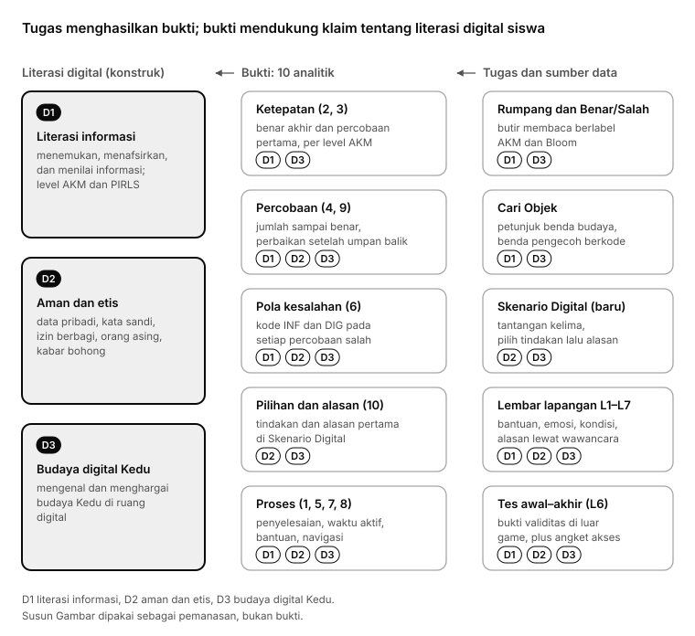
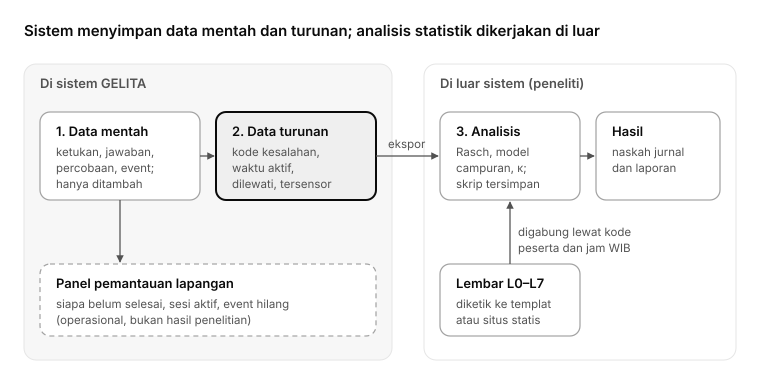
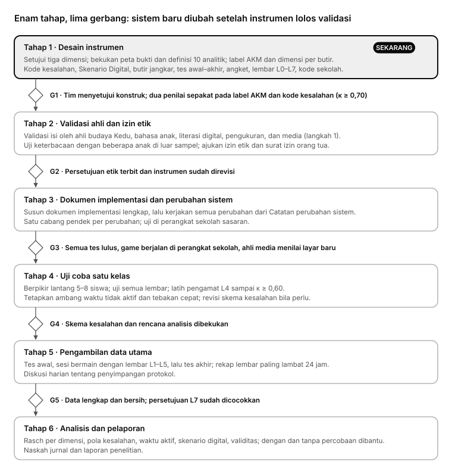

# Revisi 10 Analitik Penelitian GELITA

**Judul penelitian:** *Pengembangan Game Edukasi Etnopedagogi Kedu Berbasis Analitik sebagai Model Asesmen Literasi Digital Peserta Didik Sekolah Dasar*

Per 23 Oktober 2026 · Dokumen revisi, belum implementasi

Mulai sekarang, 10 analitik penelitian jadi pegangan kita untuk GELITA. Sesuai judul penelitian, literasi digital jadi konstruk utama dengan tiga dimensi, dan Skenario Digital masuk sebagai tantangan kelima. Admin dan peneliti jadi dua peran yang terpisah, dan log yang tidak dibutuhkan dihapus. Status setiap dokumen dan urutan bacanya ada di [00_INDEKS.md](00_INDEKS.md). Data yang tidak bisa direkam game kita kumpulkan lewat lembar lapangan L0–L7 ([02_LEMBAR_LAPANGAN.md](02_LEMBAR_LAPANGAN.md)). Arti semua kode ada di [03_KODE_DAN_ARTI.md](03_KODE_DAN_ARTI.md), dan riwayat keputusan di [04_CATATAN_KEPUTUSAN.md](04_CATATAN_KEPUTUSAN.md). Telaah setiap butir terhadap dimensinya ada di [05_TELAAH_BUTIR_DAN_DIMENSI.md](05_TELAAH_BUTIR_DAN_DIMENSI.md). Kisi-kisi bank soal baru ada di [06_KISI_KISI_BANK_SOAL.md](06_KISI_KISI_BANK_SOAL.md), telaah instrumen validasi ahli di [07_TELAAH_INSTRUMEN_VALIDASI.md](07_TELAAH_INSTRUMEN_VALIDASI.md), draf bank soal baru di [08_DRAF_BANK_SOAL.md](08_DRAF_BANK_SOAL.md), telaah pendahuluan bank soal di [09_TELAAH_PENDAHULUAN_BANK_SOAL.md](09_TELAAH_PENDAHULUAN_BANK_SOAL.md), telaah pendahuluan media di [10_TELAAH_PENDAHULUAN_MEDIA.md](10_TELAAH_PENDAHULUAN_MEDIA.md), cara menghitung setiap data penelitian di kamus data [11_KAMUS_DATA.md](11_KAMUS_DATA.md), dan cerita penghubung serta narasi tantangan kelima di [12_CERITA_PENGHUBUNG_DAN_NARASI.md](12_CERITA_PENGHUBUNG_DAN_NARASI.md).

Dokumen ini belum mengubah sistem apa pun. Isinya rencana kerja tim; dokumen implementasi yang lengkap disusun setelah revisi ini selesai.

## Keputusan yang sudah diambil

Ada sepuluh keputusan dari pemilik proyek. Semuanya berlaku mulai dokumen ini.

| Keputusan | Artinya buat penelitian |
| --- | --- |
| Judul penelitian ditetapkan (lihat di atas) | Literasi digital jadi konstruk utama. Literasi membaca dan pengetahuan budaya Kedu masuk sebagai dimensinya (lihat bagian berikut). |
| Literasi digital **wajib** ada | Game butuh tugas baru soal keamanan dan etika digital. Analitik 10 (pilihan dan alasan di skenario digital) tetap dipakai. |
| Skenario Digital jadi **tantangan kelima** di tiap wilayah | Totalnya jadi 15 tantangan dan 15 Serpihan Cahaya. Cerita, narasi, dan peta perlu menyesuaikan. |
| **Semua rekomendasi telaah** diterima | Evidence-Centered Design, level AKM/PIRLS sebagai acuan utama, skema kategori kesalahan, waktu aktif, uji Rasch, butir jangkar, dan observasi lapangan masuk rencana. |
| **Admin dan peneliti** dua peran yang berbeda | Admin mengurus sistem dan identitas. Peneliti memegang data penelitian yang sudah disamarkan. Lihat bagian *Admin dan peneliti*. |
| Log yang tidak dibutuhkan **dihapus**, sisanya **dipisah** | Setiap log masuk salah satu dari tiga: dihapus, hanya untuk admin, atau untuk peneliti. Lihat bagian *Log: dihapus atau dipisah*. |
| Guru **tidak ikut** dalam penelitian | Guru cukup membantu menyiapkan perangkat dan internet. Kolom "Informasi bagi guru" kita ganti jadi "Makna bagi penelitian". Semua pengamatan dilakukan peneliti. |
| Laporan untuk guru cuma **ide tambahan** | Laporan kelas untuk guru di luar lingkup penelitian. Kita simpan sebagai gagasan pengembangan nanti. |
| Semua yang ada di game **boleh dirombak total** | Tidak ada fitur yang wajib dipertahankan. Batasnya hanya kebutuhan penelitian: kunci jawaban tetap di server, kode butir yang sudah punya data siswa tidak dipakai ulang untuk isi lain, dan data mentah tetap lengkap. |
| **Belum ada implementasi** di sistem | Sekarang fokusnya desain instrumen, validasi, dan persiapan lapangan. Perubahan sistem dicatat di bagian akhir dan baru dikerjakan setelah desainnya disetujui. |

Karena guru tidak ikut, bantuan guru pada isi soal harus dicegah lewat arahan sebelum sesi. Kalau tetap terjadi, kita catat di lembar L3.

## Judul penelitian dan konstruk

Judulnya menyebut GELITA sebagai **model asesmen literasi digital**. Jadi yang kita ukur adalah literasi digital siswa, dan Kedu adalah konteks budayanya. Literasi membaca dan pengetahuan budaya tidak lagi berdiri sebagai konstruk sendiri; keduanya jadi dimensi literasi digital. Penyelarasan ini sudah disetujui pemilik proyek (25 Oktober 2026), bersama rumusan dimensi di [05](05_TELAAH_BUTIR_DAN_DIMENSI.md) dan kisi-kisi di [06](06_KISI_KISI_BANK_SOAL.md).

| Dimensi | Artinya | Pilar Komdigi | Area DigComp 3.0 | Diukur lewat | Kode kesalahan | Acuan level |
| --- | --- | --- | --- | --- | --- | --- |
| D1 Literasi informasi | Bertumpu pada literasi membaca: menemukan, menafsirkan, dan menilai informasi dari teks dan gambar di layar, termasuk teks bergenre digital. Sub-aspek D1a memahami informasi dan D1b menilai informasi dan sumber | Cakap Bermedia Digital | 1 *Information search, evaluation and management* (1.1, 1.2) | Isi Rumpang, Benar atau Salah, kartu jangkar | INF-* | Level AKM, padanan PIRLS 2026 |
| D2 Aman dan etis | Menjaga data pribadi, kata sandi, dan OTP; minta izin sebelum membagikan foto atau obrolan diri sendiri dan teman; menghadapi orang asing dan kabar bohong | Aman dan Etis Bermedia Digital | 4 *Safety, wellbeing and responsible use* (4.2, 4.3); 2.2 *Sharing* | Skenario Digital (tindakan diskor 0–1–2); metrik kata sandi saat daftar sebagai bukti validitas eksternal | DIG-*, R-* | Kerumitan skenario per wilayah |
| D3 Partisipasi dan representasi budaya Kedu di ruang digital | Atribusi, representasi akurat, izin pelaku dan pemilik karya, dan sikap menghargai tradisi saat budaya Kedu tampil di ruang digital | Budaya Bermedia Digital | 2 *Communication and collaboration* (2.2, 2.3, 2.5); 3.3 *Copyright and licences* | Cari Objek babak 2 *Periksa Unggahan*. Babak 1 jadi skala pendamping Pengetahuan Budaya Kedu (PBK) | BUD-* | Kerumitan adegan per wilayah |

Kerangka payungnya: empat pilar literasi digital Komdigi dan Siberkreasi, dengan DigComp 3.0 (Joint Research Centre, 2025) sebagai padanan internasional. Untuk dimensi D1, level kognitifnya tetap mengikuti AKM dan PIRLS 2026.

## Kerangka: peta bukti

Kita pakai cara pikir Evidence-Centered Design: tentukan dulu apa yang mau kita klaim, lalu bukti apa yang mendukung, lalu tugas apa yang menghasilkan bukti itu. Klaimnya tentang literasi digital siswa di tiga dimensi.



Setiap analitik harus bisa ditelusuri ke minimal satu dimensi. Data yang tidak nyambung ke dimensi mana pun masuk daftar log yang dihapus.

## 10 analitik versi revisi

Dari 10 analitik, 3 sudah terekam penuh, 5 baru sebagian, dan 2 belum ada sama sekali: pola kesalahan dan skenario digital. Sekarang setiap analitik punya definisi yang bisa dihitung dari log atau dari lembar lapangan.

| No | Analitik | Definisi operasional (revisi) | Makna bagi penelitian | Sumber data | Status di sistem | Yang perlu dilakukan |
| --- | --- | --- | --- | --- | --- | --- |
| 1 | Penyelesaian aktivitas | Tantangan tuntas per wilayah. "Dilewati" dipecah tiga: (a) petunjuk Cari Objek gagal 3 kali, (b) pengerjaan ditinggal dan tidak dilanjutkan di sesi yang sama, (c) tantangan yang sudah terbuka tapi tidak pernah dimulai sampai pengambilan data selesai. | Seberapa banyak dan seberapa tekun siswa menyelesaikan; dasar untuk menentukan data siswa lengkap atau tidak | Log game + L1 | Sebagian | Definisi "dilewati" dan tiga jenisnya ada di [kamus data](11_KAMUS_DATA.md#analitik-1-penyelesaian-aktivitas) |
| 2 | Ketepatan jawaban | Benar atau salah akhir per butir, dikelompokkan per dimensi (D1–D3) dan per level AKM | Indikator yang sudah atau belum dikuasai | Log game | Sebagian | Susun indikator per dimensi, beri label level AKM per butir. Indikator `sikap` jadi skala pendamping lewat Balai Refleksi (diputuskan 25 Oktober 2026) |
| 3 | Ketepatan percobaan pertama | Jawaban di Cek pertama (Isi Rumpang, Benar atau Salah), ketukan pertama per petunjuk (Cari Objek), atau pilihan pertama (Skenario Digital), sebelum ada umpan balik | Ukuran utama kemampuan awal; data inti untuk uji Rasch | Log game | Sudah | Ingat peluang tebakan 50% di Benar atau Salah; butir level tinggi sebaiknya punya 3 pilihan atau lebih |
| 4 | Jumlah percobaan | Percobaan ke berapa butir jadi benar (1, 2, 3), atau "belum berhasil setelah 3" | Butir yang butuh pengulangan | Log game | Sudah | Saat analisis, "belum berhasil" diperlakukan sebagai data tersensor, bukan angka 3 |
| 5 | Waktu pengerjaan | Waktu aktif = waktu total dikurangi (a) selang layar tersembunyi dan (b) bagian jeda tanpa masukan yang melebihi 3 menit (ambang sementara, keputusan 26 Oktober 2026; berupa pengaturan yang mudah diubah dan ditetapkan ulang setelah uji coba). Waktu per butir di tantangan yang dicek bersamaan hanya perkiraan | Tugas yang makan waktu lebih lama | Log game + L3 | Sebagian | Hitung waktu aktif; laporkan waktu total dan waktu aktif berdampingan |
| 6 | Pola kesalahan | Kode kategori kesalahan di setiap percobaan salah, dari skema yang ditetapkan sebelum pengambilan data | Jenis kesulitan: salah memilih informasi atau salah memilih tindakan digital | Log game + pengodean manual | Belum | Beri kode di setiap kata pengecoh, benda pengecoh, pernyataan, dan pilihan skenario |
| 7 | Penggunaan bantuan | Membuka tombol Bantuan, memutar atau mengulang narasi soal, mengulang instruksi; di setiap percobaan dicatat apakah Bantuan sudah dibuka sebelumnya | Dukungan apa saja yang dipakai siswa | Log game + L1 (headset) + L3 (bantuan orang) | Sebagian | Pisahkan rekaman narasi instruksi dengan kode konteks sendiri; bantuan dari teman, guru, atau peneliti hanya tercatat lewat L3 |
| 8 | Navigasi permainan | Urutan layar, membuka Pustaka, menggulir bacaan, keluar dari tantangan. "Kembali ke materi" = membuka Pustaka wilayah atau kembali ke bacaan di dalam tantangan | Alur siswa saat mencari informasi | Log game | Sudah | Sudah berlebih; event yang tidak menjawab pertanyaan penelitian dihapus (lihat *Log: dihapus atau dipisah*) |
| 9 | Perubahan setelah umpan balik | Untuk butir yang salah di percobaan pertama: diperbaiki, tetap salah dengan kesalahan yang sama, atau pindah ke kesalahan lain | Kemampuan memperbaiki jawaban | Log game | Sebagian | Data mentahnya sudah ada; ukuran turunannya dihitung di lapis data turunan |
| 10 | Pilihan dan alasan di skenario digital | Pilihan tindakan pertama dan alasan yang dipilih di skenario data pribadi, kata sandi, izin berbagi, dan pesan orang asing (ditambah kabar bohong dan etika) | Pemahaman keamanan dan etika digital, termasuk "tindakannya benar, alasannya keliru" | Log game + L5 + metrik kata sandi saat daftar | Belum | Bangun tantangan Skenario Digital (bagian berikut) |

Kolom status bisa diubah tim seiring pekerjaan berjalan.

## Skenario Digital: tantangan kelima

Sudah diputuskan: tiap wilayah dapat tantangan kelima, **Skenario Digital** (kode kerja `tmg-5`, `mgl-5`, `wnb-5`). Isinya mengacu ke empat pilar literasi digital dari Komdigi dan Siberkreasi: Cakap, Etis, Aman, dan Budaya Bermedia Digital. Sekarang game baru merekam literasi digital dari pembuatan kata sandi waktu daftar; tantangan literasi digital yang lama sudah dihapus saat perombakan kelas 5.

**Topiknya sama di tiap wilayah, kerumitannya yang naik.** Keempat topik dari analitik 10 muncul di setiap wilayah, jadi topik tidak tercampur dengan tingkat kesulitan. Izin atas karya dan tradisi budaya pindah ke D3 (*Periksa Unggahan*, BUD-IZN), jadi topik izin di D2 cukup foto dan obrolan diri sendiri atau teman ([06](06_KISI_KISI_BANK_SOAL.md#topik-skenario-digital-d2)).

| Topik (pilar) | Temanggung (mudah) | Magelang (sedang) | Wonosobo (sulit) |
| --- | --- | --- | --- |
| Data pribadi (Aman) | Tanda bahayanya jelas | Tanda bahayanya samar | Ada hadiah yang menggoda |
| Kata sandi dan kode OTP (Aman) | Orang asing yang minta | Teman dekat yang minta | Permintaannya kelihatan resmi |
| Izin membagikan foto atau obrolan (Etis) | Foto diri sendiri | Foto teman | Tangkapan layar obrolan teman mau diteruskan ke grup |
| Pesan orang asing dan kabar bohong (Aman, Cakap) | Pesannya jelas mencurigakan | Pesan berantai dari grup | Situasinya berkembang dua langkah |
| Jumlah pilihan tindakan | 3 | 4 | 4 |
| Jumlah pilihan alasan | 3 | 4 | 5 |

**Alur satu skenario:**

1. Situasi pendek berlatar Kedu, bergambar dan bernarasi, dengan sudut pandang "kamu".
2. Langkah 1, pilih tindakan. Satu pilihan aman dan tepat, satu kurang tepat (aman tapi belum lengkap), sisanya berisiko. Setiap pilihan punya kode kesalahan.
3. Langkah 2, pilih alasan. Ditanyakan apa pun tindakan yang dipilih, supaya "tindakannya benar, alasannya keliru" kelihatan.
4. Umpan balik yang ramah tentang akibat pilihannya, tanpa kata "salah" atau "gagal".
5. Yang dianalisis adalah pilihan dan alasan **pertama**. Siswa boleh mencoba lagi untuk belajar dengan aturan yang sama seperti tantangan lain: **tiga kesempatan** (diputuskan 25 Oktober 2026). Setiap kesempatan berisi pilihan tindakan dan alasan. Skenario selesai saat tindakan yang tepat dipilih; pilihan "kurang tepat" mendapat umpan balik dan memakai satu kesempatan. Setelah kesempatan ketiga, tindakan yang aman ditampilkan dan dijelaskan.

**Contoh skenario Wonosobo (pesan orang asing, sulit).** Akun yang tidak kamu kenal mengirim pesan: "Selamat! Kamu menang wisata gratis ke Telaga Warna untuk sekeluarga. Kirim foto kartu pelajar dan nomor HP orang tuamu sekarang, kuotanya tinggal 3!"

| Pilihan tindakan | Kode | Sifat |
| --- | --- | --- |
| Langsung kirim sebelum kuotanya habis | DIG-PRI | berisiko |
| Balas dulu, tanya dia siapa | DIG-ASG | berisiko |
| Jangan dibalas; tunjukkan ke orang tua, lalu blokir dan laporkan akunnya | — | tepat |
| Diamkan saja tanpa cerita ke siapa pun | DIG-PSF | kurang tepat |

| Pilihan alasan | Kode |
| --- | --- |
| Hadiah dari orang yang tidak dikenal bisa jadi tipuan untuk mengambil data | R-RISK |
| Data orang tua bukan milikku untuk dibagikan tanpa izin | R-ETIK |
| Kata guru tidak boleh membalas orang asing | R-ATUR |
| Teman-temanku juga ikut mengirim | R-SOS |
| Aku memang tidak terlalu suka jalan-jalan | R-ACAK |

Latar contoh ini sudah dicek: Telaga Warna memang ada di Wonosobo. Contoh sebelumnya memakai Dieng Culture Festival, padahal festival itu digelar di Banjarnegara, jadi kita ganti (lihat *Cek fakta dan rujukan*). Skenario tidak boleh menakut-nakuti dan tidak memuat tautan sungguhan. Metrik kata sandi saat daftar tetap dipakai sebagai bukti tambahan dimensi D2.

## Skema kategori kesalahan

Setiap pilihan salah diberi satu kode **sebelum** data diambil, lalu kode itu ikut tercatat di setiap percobaan yang salah. Skema ini dibekukan setelah uji coba dan tidak diubah selama pengambilan data utama. Kode INF masuk dimensi D1, kecuali di Cari Objek babak 1 yang menjadi skala pendamping PBK; INF-BUD hanya dipakai di sana. Kode DIG hanya masuk D2, termasuk DIG-IZN dan DIG-ETK. Kode BUD masuk D3. Arti setiap kode ada di [03](03_KODE_DAN_ARTI.md).

**A. Salah memilih informasi (INF)**

| Kode | Kategori | Contoh dalam konteks Kedu |
| --- | --- | --- |
| INF-LIT | Salah membaca informasi tersurat | Memilih "Sindoro" padahal teksnya menyebut "Sumbing" |
| INF-KAT | Terkecoh kesamaan kata | Menilai salah sebuah pernyataan hanya karena ada kata "sama-sama" |
| INF-REL | Benar, tapi tidak menjawab | Ditanya fungsi sebuah tarian, malah memilih "tarian itu berasal dari Wonosobo" |
| INF-HUB | Salah menghubungkan informasi (sebab-akibat, urutan) | Mengisi "karena" di rumpang yang butuh "sehingga" |
| INF-SUM | Salah menilai sumber | Lebih percaya unggahan viral tanpa nama daripada pengumuman resmi tentang Telaga Warna |
| INF-FOP | Mencampur fakta dan pendapat | Menganggap "Dieng tempat paling indah" sebagai fakta |
| INF-BUD | Tertukar benda budaya yang mirip | Mengetuk angklung (Jawa Barat) untuk petunjuk tentang bundengan (Wonosobo) |
| INF-GEN | Menggeneralisasi berlebihan | Menerima pernyataan yang memakai "selalu" atau "semua" |

**B. Salah memilih tindakan digital (DIG)**

| Kode | Kategori | Contoh | Sifat |
| --- | --- | --- | --- |
| DIG-PRI | Membagikan data pribadi berlebihan | Mengunggah foto di Borobudur lengkap dengan nama sekolah dan alamat rumah | berisiko |
| DIG-SAN | Membagikan kata sandi atau kode OTP | Memberi teman kode supaya bisa main GELITA pakai akunmu | berisiko |
| DIG-IZN | Membagikan tanpa izin | Mengunggah video sepupu menari tanpa bertanya dulu | berisiko |
| DIG-ASG | Menanggapi orang asing | Membalas pesan "kirim nomormu untuk tur gratis ke Dieng" | berisiko |
| DIG-HOX | Meneruskan kabar yang belum dicek | Meneruskan "Air Telaga Warna beracun, sebarkan!" | berisiko |
| DIG-ETK | Berkomunikasi tidak etis | Mengejek tradisi ruwatan rambut gimbal Dieng di kolom komentar | berisiko |
| DIG-PSF | Terlalu pasif, tidak melapor | Mendiamkan orang asing tapi tidak cerita ke orang tua atau guru | kurang tepat |

**C. Budaya digital Kedu (BUD)**, untuk D3 di Cari Objek babak 2 *Periksa Unggahan*

| Kode | Kategori |
| --- | --- |
| BUD-ATR | Tidak mencantumkan atau salah menunjuk pembuat dan sumber karya budaya |
| BUD-REP | Menerima atau menyebarkan keterangan budaya yang keliru |
| BUD-IZN | Mengunggah ulang penampilan atau karya budaya tanpa izin |
| BUD-ETK | Menanggapi tradisi dengan cara yang tidak menghormati |

**D. Prosedural (NON):** NON-TEB menebak cepat (menjawab kurang dari 3 detik tanpa membaca; ambang sementara, keputusan 26 Oktober 2026, ditetapkan ulang setelah uji coba), NON-SEN salah ketuk di dekat sasaran, NON-HABIS jawaban terakhir saat kesempatan habis. Kesalahan yang tidak cocok dengan kode mana pun diberi INF-LAIN, DIG-LAIN, atau BUD-LAIN, lalu dikode manual.

**E. Alasan di Skenario Digital (R):** R-RISK paham risikonya, R-ETIK empati atau izin, R-ATUR "karena disuruh atau dilarang", R-SOS tekanan teman atau ingin disukai, R-ACAK alasannya tidak nyambung.

**Cara kode menempel di tiap jenis tantangan:**

- Isi Rumpang: matriks rumpang × kata. Setiap pasangan "kata ini di rumpang itu" punya satu kode, termasuk kata yang sebenarnya benar untuk rumpang lain.
- Benar atau Salah: setiap pernyataan punya satu kode jebakan. Kalau siswa keliru menilai pernyataan itu, kodenya yang dipakai.
- Cari Objek babak 1 (*Temukan Benda*, PBK): setiap benda pengecoh punya satu kode (INF-BUD atau INF-LIT); mengetuk tempat kosong di dekat sasaran = NON-SEN.
- Cari Objek babak 2 (*Periksa Unggahan*, D3): setiap bagian unggahan yang salah untuk sebuah petunjuk punya satu kode BUD; bagian netral (misalnya jumlah suka) = NON-SEN.
- Skenario Digital: setiap pilihan tindakan dan setiap alasan punya satu kode.
- Susun Gambar: tidak dikode, karena dipakai sebagai pemanasan.

**Validasi:** dua pengode bekerja terpisah pada sampel 20% jawaban dan semua transkrip berpikir lantang (L5). Kesepakatan minimal Cohen's κ = 0,70. Kalau beda, didiskusikan dan dicatat. Skema dan rencana analisis didaftarkan lebih dulu (pra-registrasi di OSF) di gerbang G4, setelah uji coba dan sebelum pengambilan data utama (diputuskan 25 Oktober 2026).

**Contoh data mentah** (bentuk ekspor percobaan dengan kolom baru `error_code`, `reason_code`, dan `rapid_guess`, memakai format kode peserta baru). Kode kesalahan dari bank tidak pernah ditimpa; tebakan cepat (NON-TEB) menjadi penanda tersendiri. Semua kolom dan aturannya dibekukan di [kamus data](11_KAMUS_DATA.md#analitik-6-pola-kesalahan).

```csv
participant_code,item_key,try_no,answer,is_correct,error_code,reason_code,rapid_guess,hint_before,last_input_ms
S03-A07,wnb-2-a01,1,karena,0,INF-HUB,,,0,14200
S03-A07,wnb-2-a01,2,sehingga,1,,,,1,9800
S03-A07,wnb-3-a01,1,salah,0,INF-LIT,,0,0,21500
S03-A07,wnb-4-x03,1,tap:angklung,0,INF-BUD,,0,0,6100
S03-A07,wnb-5-a01,1,kirim_data,0,DIG-PRI,R-SOS,0,0,18300
S03-A07,wnb-5-a01,2,lapor_ortu,1,,R-RISK,0,0,7400
S03-A12,wnb-5-a02,1,diamkan,0,DIG-PSF,R-ATUR,0,0,5200
S03-A12,mgl-3-b02,1,benar,0,INF-HUB,,1,0,900
```

Contoh ringkasan untuk laporan penelitian: "Di wilayah Wonosobo, kesalahan terbanyak adalah INF-HUB (34%) dan INF-SUM (22%). Sebanyak 41% siswa memilih tindakan aman di skenario orang asing, tapi dengan alasan R-ATUR." Angka ini cuma ilustrasi.

## Pelevelan wilayah

Urutan Temanggung (mudah), Magelang (sedang), Wonosobo (sulit) tetap dipakai. Bedanya, tingkat kesulitan sekarang dibuktikan dengan data, bukan cuma dengan label Bloom. Untuk dimensi D1, acuan utamanya level kognitif AKM Literasi Membaca dengan padanan proses membaca PIRLS 2026. Untuk D2, tingkatnya dari kerumitan skenario. Bloom tetap ditulis sebagai label kedua.

| Wilayah | Level AKM utama (D1) | Padanan PIRLS 2026 | Bloom (label kedua) | Skenario Digital (D2) |
| --- | --- | --- | --- | --- |
| Temanggung (mudah) | Menemukan informasi | Fokus dan mengambil informasi tersurat | C1–C2 | Tanda bahaya jelas, 3 pilihan |
| Magelang (sedang) | Interpretasi dan integrasi | Membuat inferensi langsung; menafsirkan dan memadukan gagasan | C2–C4 | Tanda bahaya samar, 4 pilihan |
| Wonosobo (sulit) | Evaluasi dan refleksi | Mengevaluasi dan mengkritisi isi teks | C3–C5 | Nilai yang bertentangan, dua langkah |

**Kenapa AKM/PIRLS jadi acuan utama.** AKM adalah kerangka nasional untuk literasi membaca, jadi hasil kita gampang dibaca pemangku kepentingan di Indonesia. Sampai 2025, AKM diikuti sampel siswa kelas 5 lewat Asesmen Nasional. Mulai 2026 aturannya ada di Kepmendikdasmen Nomor 56 Tahun 2026. Beberapa sumber menyebut soal literasi membaca kini masuk ke TKA Bahasa Indonesia di kelas 6, artinya siswa kelas 5 kita akan menghadapinya setahun lagi. Teks resmi keputusan itu belum kita baca langsung, jadi perlu dicek. PIRLS 2026 memberi padanan internasional untuk jurnal. Bloom mengelompokkan tujuan belajar, bukan tingkat kesulitan nyata. Pembanding lain (SOLO, Depth of Knowledge Webb) kurang pas untuk soal pilihan tertutup.

**Lima langkah supaya klaim tingkat kesulitan bisa dipertahankan:**

1. Dua penilai ahli memberi label level AKM pada semua butir yang dinilai (116 butir literasi digital, lihat [06](06_KISI_KISI_BANK_SOAL.md) dan [08](08_DRAF_BANK_SOAL.md)) secara terpisah, dengan kesepakatan minimal κ = 0,70. Label Bloom diperiksa ulang. Misalnya, petunjuk Cari Objek berlabel C3 sebenarnya lebih dekat ke C1–C2, dan C5 di kartu Benar atau Salah sulit dipertahankan.
2. Tambahkan **butir jangkar**: 6 pernyataan D1 (2 per wilayah) di kartu jangkar yang sama untuk variasi a dan b, supaya kedua variasi tersambung di satu skala. Diputuskan 25 Oktober 2026 menggantikan rencana awal (butir yang diulang di ketiga wilayah), karena siswa yang sama memainkan ketiga wilayah; lihat [06](06_KISI_KISI_BANK_SOAL.md#butir-jangkar-usulan).
3. Catat beban permukaan sebagai variabel sendiri: jumlah rumpang, jumlah kata pengecoh, panjang bacaan (kata), jumlah benda pengecoh, dan ukuran kotak Susun Gambar.
4. Setelah data terkumpul, jalankan model Rasch pada ketepatan percobaan pertama, per dimensi (atau model Rasch multidimensi). Periksa urutan kesulitan butir dibandingkan wilayah dan level AKM, kecocokan butir, dan kesetaraan variasi a dan b (DIF).
5. Urutan wilayah tidak bisa diacak karena mengikuti cerita. Ini kita tulis sebagai keterbatasan, dengan waktu aktif kumulatif dan nomor pertemuan sebagai kovariat.

## Admin dan peneliti: dua peran berbeda

Admin dan peneliti adalah dua entitas yang berbeda. **Admin** menjaga sistem berjalan dan memegang identitas. **Peneliti** memegang data penelitian yang sudah disamarkan (pseudonim). Sekarang sistem baru punya dua peran staf: `admin` yang bisa melihat semuanya, termasuk nama siswa, dan `guru` yang melihat data sekolahnya sendiri tanpa nama. Revisi ini menambah peran `peneliti` dan menghapus peran `guru` seluruhnya (diputuskan 25 Oktober 2026).

| Fitur atau data | Admin | Peneliti |
| --- | --- | --- |
| Akun staf (buat, nonaktifkan, ganti peran) | Ya | — |
| Akun siswa, reset kata sandi, nama dan nama pengguna | Ya | Reset kata sandi lewat kode peserta saja, tanpa melihat nama |
| Daftar sekolah, NPSN, dan pemetaan ke kode sekolah | Ya | Kode sekolah saja |
| Konten, bank soal, media, narasi | Ya | Lihat saja (untuk validasi) |
| Rilis dan paket aset | Ya | — |
| Log teknis: perangkat, paket, event hilang, audit | Ya | Ringkasan event hilang di panel pemantauan |
| Sesi lapangan dan token | — | Ya |
| Panel pemantauan lapangan | Lihat | Ya |
| Data penelitian (jawaban, percobaan, navigasi, bantuan, waktu) dan ekspornya | — | Ya, dengan kode peserta |
| Data turunan dan kamus data | — | Ya |
| Penelitian (studi) dan statusnya | — | Ya |
| Permintaan hapus data peserta | Menjalankan | Mengajukan |

**Aturan pemisahan:**

- Peneliti tidak pernah melihat nama atau nama pengguna siswa di sistem. Nama hanya ada di akun (dikelola admin) dan di lembar L7 di kertas, yang dipegang P1 dan ketua peneliti.
- Admin tidak mengunduh data penelitian. Kalau admin butuh memeriksa masalah teknis, cukup log teknis.
- Satu orang boleh memegang dua peran, tapi lewat dua akun terpisah, supaya jejak audit jelas.
- Peran `guru` dihapus seluruhnya, termasuk halaman dan hak aksesnya (diputuskan 25 Oktober 2026). Kalau nanti laporan untuk guru dibuat, perannya dibangun ulang dengan hak yang baru.
- Nama lengkap siswa tetap disimpan di akun dan hanya terlihat oleh admin (dikukuhkan 25 Oktober 2026).
- Siswa yang lupa kata sandi di lapangan: P1 mencari kode pesertanya di L2, lalu me-reset kata sandi dari panel peneliti lewat kode itu. Sistem memberi kata sandi sementara dan mencatatnya di log audit; peneliti tetap tidak melihat nama.

## Log: dihapus atau dipisah

Log yang tidak menjawab 10 analitik dihapus, bukan cuma disembunyikan. Log yang masih perlu untuk menjaga sistem hanya bisa dilihat admin. Sisanya untuk peneliti. Alasannya minimalisasi data anak, sesuai UU Nomor 27 Tahun 2022 tentang Pelindungan Data Pribadi.

| Log atau data | Isinya | Keputusan | Alasan |
| --- | --- | --- | --- |
| `session_started`, `session_resumed`, `session_paused`, `session_abandoned`, `session_completed` | Awal, jeda, dan akhir sesi bermain | Peneliti | Analitik 1 dan 5 |
| `level_opened`, `level_completed`, `intro_completed` | Wilayah dibuka dan tuntas, cerita pembuka selesai | Peneliti | Analitik 1 |
| `challenge_opened`, `challenge_checked`, `challenge_completed`, `challenge_abandoned`, `challenge_tries_exhausted`, `clue_failed` | Alur satu tantangan | Peneliti | Analitik 1, 3, 4 |
| `answer_submitted`, `wrong_target_clicked` | Jawaban dikirim, ketukan salah di Cari Objek | Peneliti | Analitik 2, 6; cek duplikasi dengan tabel percobaan saat implementasi |
| `answer_changed`, `answer_selected` | Setiap kali siswa mengganti pilihan sebelum Cek | Dihapus | Tidak dipakai 10 analitik; cukup hitungan perubahan per butir |
| `hint_opened` dan `audio_play`, `audio_autoplay`, `audio_replay`, `audio_completed` | Bantuan dan narasi | Peneliti | Analitik 7 |
| `audio_pause` | Narasi dijeda | Dihapus | Lama mendengar sudah tercatat di `listened_ms` |
| `screen_viewed`, `overlay_opened`, `library_opened`, `library_page_viewed`, `reading_progress` | Layar, Pustaka, dan gulir bacaan | Peneliti | Analitik 8 |
| `page_hidden`, `page_visible` | Layar disembunyikan atau tampil lagi | Peneliti | Analitik 5 (waktu aktif) |
| `dialogue_advanced` | Setiap geser slide cerita | Dihapus | Tidak dipakai 10 analitik |
| `locale_changed` | Ganti bahasa | Peneliti | Kovariat bahasa |
| `feedback_submitted` dan isi kritik dan saran | Masukan siswa | Peneliti | Pelengkap kualitatif, bukan 10 analitik |
| Jawaban skala sikap di Balai Refleksi | Skala pendamping sikap menjaga warisan | Peneliti | Skala pendamping, di luar skor literasi digital (keputusan 25 Oktober 2026) |
| `password_changed` | Kata sandi diganti | Admin | Urusan akun |
| `viewport_changed`, `package_changed`, `clock_offset_ms` | Ukuran layar berubah, paket aset berganti, selisih jam perangkat | Admin | Teknis; koreksi jam tetap dipakai server untuk data peneliti |
| `events_dropped` | Event yang hilang di perangkat | Admin | Mutu data; jumlahnya tampil di panel pemantauan peneliti |
| Rincian perangkat: merek, model, user agent, client hints, rasio piksel, titik sentuh, zona waktu, bahasa browser | Catatan perangkat | Dihapus | Tidak dipakai dan menambah risiko identifikasi |
| Nama OS dan browser beserta versinya | Catatan perangkat | Admin | Untuk memeriksa masalah teknis |
| Jenis perangkat dan ukuran layar | Catatan sesi | Peneliti | Kovariat |
| Log audit staf dan riwayat unduhan | Siapa melakukan apa di panel | Admin | Keamanan; peneliti melihat riwayat unduhannya sendiri |
| Nama, nama pengguna, nama sekolah, NPSN, provinsi, kabupaten | Identitas dan pendaftaran | Admin | Identitas; peneliti cukup kode peserta dan kode sekolah |
| Usia, jenis kelamin, kelas, rombel | Data peserta | Peneliti | Kovariat |
| Metrik kata sandi saat daftar | Jumlah syarat terpenuhi dan jumlah penolakan | Peneliti | Bukti dimensi D2 |

Bintang dan Serpihan Cahaya tetap ada di game sebagai hadiah, tapi tidak dianalisis sebagai prestasi karena dihitung dari jumlah percobaan. Susun Gambar dipakai sebagai pemanasan dan tidak dinilai.

## Olah data: di sistem atau di alat lain?

Saran kita: **dua-duanya, dengan batas yang jelas.** Sistem tetap menghasilkan data mentah, ditambah satu lapis data turunan yang dihitung sistem. Analisis statistiknya dikerjakan peneliti di perangkat lunak statistik dengan skrip yang disimpan.



| Lapis | Dikerjakan di | Isinya | Kenapa di situ |
| --- | --- | --- | --- |
| 1. Data mentah | Sistem GELITA | Setiap ketukan, jawaban, percobaan, dan event, hanya ditambah dan tidak pernah diubah | Sumber kebenaran; bisa ditelusuri ulang kapan saja |
| 2. Data turunan | Sistem GELITA | Kode kesalahan per percobaan, waktu aktif, tiga jenis "dilewati", penanda tersensor, penanda tebakan cepat, label level AKM dan dimensi | Aturannya bergantung pada logika game, yang paling dipahami sistem. Dihitung sekali, sama untuk semua peneliti, bisa diuji otomatis, dan dijelaskan di kamus data |
| 3. Analisis | R, jamovi, Winsteps, atau Python | Rasch, model campuran, κ, grafik, tabel untuk naskah | Reviewer jurnal mengharapkan perangkat lunak statistik standar dan skrip yang bisa diulang. Membangun statistik di dalam game mahal dan rawan salah |

**Lembar lapangan** diketik ke templat spreadsheet atau ke situs statis revisi ini, lalu digabung dengan data di lapis 3 lewat skrip. Kuncinya kode peserta, jam WIB, dan kode sesi. Mengimpor lembar ke sistem itu opsional dan bisa nanti.

**Yang tetap perlu ada di sistem** adalah panel pemantauan sederhana selama pengambilan data: siapa yang belum selesai, sesi mana yang aktif, dan apakah ada event yang hilang. Panel ini untuk operasional di lapangan, bukan untuk hasil penelitian.

## Token sesi: perlu atau tidak?

**Diputuskan (25 Oktober 2026): dipakai, versi ringan, dan token sekaligus mengatur wilayah yang dibuka di tiap pertemuan.** Bukan sistem ujian seperti ANBK, cukup konsep tokennya. GELITA bukan untuk umum, dan data kita hanya bersih kalau siswa bermain di sesi yang kita amati.

**Yang kita dapat dari token sesi:**

- Siswa hanya bisa bermain di sesi yang diamati peneliti, jadi tidak ada data dari rumah yang dibantu orang tua atau kakak dan tidak tercatat di lembar lapangan.
- Setiap sesi game otomatis tersambung ke sesi lapangan (L1), jadi penggabungan dengan lembar tidak perlu dicocokkan manual.
- Token membawa sekolah dan rombel. Saat siswa mendaftar dengan token, sekolah dan kelasnya terisi sendiri: tidak perlu mengetik NPSN, dan peran guru makin sedikit.
- Token juga mengatur wilayah yang dibuka di pertemuan itu, supaya laju bermain antar kelas setara: P1 pendaftaran dan cerita pembuka, P2 Temanggung, P3 Magelang, P4 Wonosobo, P5 tantangan yang tertinggal dan cerita penutup.

**Cara kerjanya:**

1. Sebelum pertemuan, P1 membuat sesi lapangan di panel peneliti: sekolah, rombel, pertemuan ke berapa, tanggal, dan jam buka–tutup.
2. Sistem membuat token 6 huruf tanpa huruf yang mudah tertukar (tanpa O, 0, I, 1), misalnya `KD7RMA`. P1 menulisnya di papan tulis.
3. Siswa masuk atau daftar, lalu mengetik token sekali per sesi.
4. Token hanya berlaku di jam sesi itu. P1 bisa menutupnya lebih awal atau membuat token baru kalau token bocor.
5. Di luar sesi, seluruh game tertutup sampai penelitian selesai, termasuk Pustaka dan Profil. Game menampilkan pesan ramah: "Permainan dibuka waktu sesi bersama kakak peneliti, ya." Setelah status studi ditutup, game terbuka seperti biasa.

**Bedanya dengan ANBK:** tidak ada aplikasi ujian khusus, tidak ada proktor, dan token tidak berganti tiap 15 menit. Itu wajar untuk ujian berisiko tinggi, tapi berlebihan untuk penelitian kita.

## Kode peserta baru

Usulan kode peserta yang memuat sekolah dan nomor urut bisa dipakai, dengan satu tambahan: huruf rombel. Satu sekolah bisa punya dua kelas 5, masing-masing sampai 50 siswa, jadi nomor urut per sekolah saja bisa lewat dari 99.

**Format: `S03-A07`** (disetujui pemilik proyek, 25 Oktober 2026)

| Bagian | Arti | Contoh |
| --- | --- | --- |
| `S03` | Kode sekolah penelitian, dari daftar yang dibuat peneliti (bukan NPSN) | Sekolah ke-3 dalam daftar |
| `A` | Rombel kelas 5 di sekolah itu | 5A |
| `07` | Nomor urut siswa di rombel itu, dua angka (01–99) | Siswa ke-7 yang mendaftar |

**Aturannya:**

- Kode sekolah dibuat peneliti, bukan NPSN, supaya kode tetap samaran (pseudonim) dan pendek. Pemetaan NPSN ke kode sekolah hanya dilihat admin dan disimpan juga bersama L7.
- Dua angka di setiap bagian sudah cukup (99 sekolah, 99 siswa per rombel) dan urutannya tetap rapi kalau disortir.
- Sekolah yang cuma punya satu kelas 5 memakai `A`.
- Sekolah uji coba memakai awalan `U`, misalnya `U01-A03`, supaya datanya tidak tercampur dengan data utama.
- Awalan `GLT-` dihapus karena tidak menambah informasi.
- Kode dibuat sistem saat siswa mendaftar. Sekolah dan rombel diambil dari token sesi, nomor urut dari urutan daftar. Setelah ada data, kode tidak pernah diubah.
- Rombel juga berguna untuk analisis, karena kelas adalah satu tingkat dalam model campuran.

## Kerja lapangan: cara kerjanya

Log game hanya melihat apa yang terjadi di layar. Lembar lapangan mengisi yang tidak kelihatan: siapa yang dibantu, perangkat yang dipakai bareng, kondisi kelas, emosi siswa, dan alasan di balik jawaban. Semua lembar diisi **peneliti**, bukan guru. Setiap lembar memakai dua kunci yang sama dengan log: **kode peserta** dan **jam WIB**. Isi lengkap tiap lembar ada di [02_LEMBAR_LAPANGAN.md](02_LEMBAR_LAPANGAN.md).

**Peran untuk satu kelas (sekitar 28 siswa):**

| Peran | Tugas selama sesi | Lembar |
| --- | --- | --- |
| P1 Koordinator sesi | Membuka sesi, memberi arahan, membantu masalah teknis saja (tidak pernah isi soal), mencatat kondisi sesi | L0, L1, L2, L7 |
| P2 Pengamat keterlibatan | Mengamati siswa bergiliran dengan urutan tetap | L4 |
| P3 Pengamat bantuan | Mencatat setiap bantuan dan gangguan; setelah sesi mewawancarai beberapa siswa | L3, L5 |
| Guru kelas | Menyiapkan perangkat dan internet; diminta tidak membantu isi soal | — |

Pengambilan data utama memakai **tiga peneliti per kelas** (diputuskan 25 Oktober 2026). Kalau pada hari itu satu peneliti berhalangan, P1 juga mengisi L3, wawancara L5 dipindah ke pertemuan lain, dan penyimpangannya dicatat di L1.

**Alur satu pertemuan:**

1. **H-7 sampai H-1.** Kumpulkan izin orang tua (L7). Tempel stiker nomor di setiap perangkat. Cetak lembar. Jalankan daftar periksa L0. Buat sesi lapangannya di panel peneliti, termasuk wilayah yang dibuka.
2. **Sebelum siswa masuk.** Samakan jam: semua pengamat memakai jam ponsel yang diatur otomatis dari jaringan (WIB), dicatat sampai detik. Uji internet dan isi bagian atas L1.
3. **Pembukaan (5 menit).** P1 memberi arahan ke siswa dan guru, lalu menulis token di papan tulis.
4. **Masuk atau daftar.** Setelah siswa masuk, P1 menyalin kode peserta dari halaman Profil siswa ("kode penelitian", misalnya S03-A07) ke L2, di samping nomor kursi dan nomor perangkat.
5. **Bermain.** P3 mengisi L3 terus-menerus. P2 mengisi L4 dalam putaran tetap. P1 mencatat gangguan besar dan penyimpangan di L1.
6. **Penutupan.** P1 menutup L1 (jam selesai dan catatan) dan menutup token. P3 mewawancarai 2–3 siswa terpilih dengan L5.
7. **Paling lambat 24 jam setelah sesi.** Lembar dipindah ke templat spreadsheet atau ke situs statis revisi ini. 10% baris diketik ulang orang lain untuk mengecek salah ketik. Tim berdiskusi singkat soal penyimpangan hari itu.

**Cara menyatukan lembar dengan log:**

- L2 menghubungkan kursi dan perangkat dengan kode peserta. Perangkat yang dipakai bareng diberi tanda; datanya dianalisis terpisah atau dikeluarkan.
- Kejadian di L3 menandai percobaan siswa itu dari 1 menit sebelum sampai 2 menit sesudah jam kejadian sebagai "dibantu". Analisis utama dijalankan dengan dan tanpa percobaan yang dibantu.
- Pengamatan L4 dipasangkan dengan aktivitas log terdekat dengan kode dan jam yang sama, misalnya kebingungan di tengah Isi Rumpang.
- L1 jadi kovariat tingkat sesi: headset, kualitas internet, gangguan.
- L7 menentukan siapa yang boleh dianalisis. Data siswa tanpa izin dikeluarkan sesuai protokol.
- Nama siswa hanya ada di L7. L7 disimpan terpisah dan terkunci; lembar lain cuma memakai kode peserta dan nomor kursi.

## Rencana analisis singkat

Data inti analisis adalah ketepatan percobaan pertama. Lembar lapangan dipakai sebagai penanda dan kovariat. Setiap analisis utama dijalankan dua kali: dengan dan tanpa percobaan yang dibantu (L3) atau perangkat yang dipakai bareng (L2).

| Pertanyaan | Data | Metode |
| --- | --- | --- |
| Apakah urutan kesulitan wilayah terbukti? | Percobaan pertama, butir jangkar, label AKM | Model Rasch per dimensi, peta Wright, kecocokan butir (infit dan outfit 0,5–1,5), DIF antarvariasi |
| Apakah tiga dimensi literasi digital terbukti terpisah? | Percobaan pertama per dimensi | Perbandingan model Rasch satu dimensi dan multidimensi |
| Butir mana yang butuh pengulangan? | Jumlah percobaan, tersensor di 3 | Model ordinal atau model kejadian waktu-diskret dengan sensor |
| Kesalahan apa yang paling sering, dan di mana? | Kode kesalahan per percobaan | Frekuensi per wilayah, dimensi, dan level AKM; uji chi-kuadrat atau model multinomial |
| Apakah siswa memperbaiki jawaban setelah umpan balik? | Percobaan 1 ke percobaan 2 | Matriks perpindahan: diperbaiki, kesalahan sama, kesalahan lain |
| Tugas mana yang lama? | Waktu aktif | Median dan rentang antarkuartil; model campuran dengan efek acak siswa dan rombel |
| Apakah bantuan menolong? | Bantuan dibuka sebelum percobaan | Regresi logistik campuran |
| Bagaimana pemahaman keamanan dan etika digital siswa? | Pilihan dan alasan skenario, angket | Tabulasi silang tindakan × alasan; proporsi "tindakannya benar, alasannya keliru" |
| Apakah skor game sejalan dengan kemampuan nyata? | Kemampuan Rasch game, tes awal dan akhir per bagian ([13](13_TES_AWAL_AKHIR.md#analisis)) | Pola korelasi tes awal per bagian dengan kemampuan game per dimensi; perubahan tes awal–akhir per bagian, dilaporkan sebagai perubahan, bukan pengaruh game |
| Apakah data pengamatan bisa dipercaya? | L4, pengodean kesalahan | Cohen's κ; reliabilitas orang di model Rasch |

## Peta jalan dan daftar kerja

Pekerjaan berjalan dalam enam tahap. Tahap berikutnya baru dimulai setelah gerbangnya terpenuhi. Sistem baru diubah di tahap 3, setelah instrumen lolos validasi ahli dan izin etik. Urutan ini dikukuhkan pemilik proyek pada 25 Oktober 2026: dokumen implementasi dan perubahan sistem tidak dimulai sebelum gerbang G2, termasuk persetujuan etik. Izin etik diajukan minggu kedua–keempat November 2026 dan persetujuannya ditargetkan paling lambat akhir September sampai minggu pertama November 2027, jadi tahap 3 bisa baru dimulai sekitar waktu itu. Pemilik proyek memilih tetap menunggu persetujuan (25 Oktober 2026). Uji keterbacaan dengan anak di tahap 2, uji coba, dan pengambilan data juga baru boleh berjalan setelah persetujuan terbit.



Tanggal tiap tahap belum ditetapkan dan perlu diisi tim. Daftar kerja di bawah memuat pekerjaan tahap 1 sampai 4, kecuali perubahan sistem (lihat bagian terakhir).

Gerbang G1 berarti konstruk disetujui dan semua dokumen tahap 1 selesai dan disetujui pemilik proyek. Kesepakatan dua penilai pada label (κ ≥ 0,70) diperiksa sekali saja, pada pelabelan buta dua ahli di tahap 2, dan menjadi bagian gerbang G2 (diputuskan 25 Oktober 2026).

Ahli media menilai dalam dua langkah (diputuskan 25 Oktober 2026): di tahap 2, game yang ada sekarang ditambah rancangan layar baru (Skenario Digital, *Periksa Unggahan*, token) berupa papan cerita atau mock-up; setelah tahap 3, telaah singkat layar yang sudah jadi di instalasi uji sebelum uji coba, sebagai bagian gerbang G3.

| No | Pekerjaan | Tahap | Penanggung jawab | Status |
| --- | --- | --- | --- | --- |
| 1 | Setujui penyelarasan konstruk: literasi digital dengan tiga dimensi | 1 | Pemilik proyek | Selesai |
| 2 | Bekukan peta bukti dan definisi 10 analitik di kamus data ([11](11_KAMUS_DATA.md)) | 1 | Claude (draf), pemilik proyek | Selesai: `kamus-1.0` disetujui 26 Oktober 2026 |
| 3 | Pelabelan buta level AKM dan dimensi pada semua butir yang dinilai oleh dua ahli (B.5a di [07](07_TELAAH_INSTRUMEN_VALIDASI.md)); label pengembang sudah ada di 08 | 2 | | Belum mulai |
| 4 | Periksa ulang label Bloom, terutama Cari Objek dan Benar atau Salah C5 | 1 | | Belum mulai |
| 5 | Beri kode kesalahan pada kata pengecoh, benda pengecoh, dan pernyataan | 1 | Claude | Selesai di draf 08, menunggu validasi |
| 6 | Tulis Skenario Digital untuk tiga wilayah, lengkap dengan pilihan tindakan dan alasan berkode | 1 | Claude | Selesai di draf 08, menunggu validasi |
| 7 | Tulis cerita penghubung dan narasi untuk tantangan kelima | 1 | Claude (draf), pemilik proyek (persetujuan) | Selesai: [12](12_CERITA_PENGHUBUNG_DAN_NARASI.md) disetujui 26 Oktober 2026 |
| 8 | Tentukan 4–6 butir jangkar | 1 | Claude | Selesai di draf 08 (6 butir), menunggu validasi |
| 9 | Susun tes literasi membaca dan tes literasi digital, bentuk A dan B: bagian membaca diadaptasi dari contoh soal AKM/ANBK yang terbuka untuk umum, bagian D2 dan D3 disusun sendiri dan tidak sama dengan butir game | 1 | Claude (draf), pemilik proyek | Draf di [13](13_TES_AWAL_AKHIR.md), [14](14_TES_BAGIAN_MEMBACA.md), dan [15](15_TES_BAGIAN_DIGITAL.md); keputusan pemilik proyek 26 Oktober 2026 (modul tes GELITA, batas waktu longgar, topik di luar Kedu); menunggu validasi |
| 10 | Susun angket akses digital | 1 | Claude (draf), pemilik proyek | Draf di [16](16_ANGKET_AKSES_DIGITAL.md); keputusan pemilik proyek 26 Oktober 2026 (di modul, tidak dibacakan; butir risiko daring di P5); menunggu validasi |
| 11 | Finalkan lembar L0–L7 | 1 | | Belum mulai |
| 12 | Buat daftar kode sekolah penelitian (S01, S02, …) | 1 | | Belum mulai |
| 13 | Tentukan siapa pemegang akun admin dan akun peneliti | 1 | | Belum mulai |
| 14 | Validasi ahli: budaya Kedu, bahasa anak, literasi digital, pengukuran, media | 2 | | Belum mulai |
| 15 | Ajukan izin etik ke *Lembaga Komite Etik* (nama samaran) pada minggu kedua–keempat November 2026, dan siapkan surat izin orang tua | 2 | | Belum mulai |
| 16 | Latih pengamat L4 sampai κ ≥ 0,60 | 4 | | Belum mulai |
| 17 | Uji coba satu kelas dengan semua lembar | 4 | | Belum mulai |
| 18 | Pra-registrasi skema kesalahan dan rencana analisis di OSF, di gerbang G4 | 4 | | Belum mulai |
| 19 | Susun skala pendamping sikap menjaga warisan untuk Balai Refleksi, lalu masukkan ke validasi ahli (no. 14) | 1 | | Belum mulai |
| 20 | Buat papan cerita atau mock-up layar baru (Skenario Digital, *Periksa Unggahan*, token, modul tes dan angket) untuk ahli media langkah 1 | 1 | | Belum mulai |
| 21 | Telaah ahli media langkah 2 pada layar jadi di instalasi uji, sebelum uji coba (G3) | 3 | | Belum mulai |

## Pertanyaan yang masih terbuka

Pertanyaan ini perlu dijawab sebelum desain instrumen dibekukan. Centang kalau tim sudah memutuskan.

- [x] Skenario Digital jadi tantangan kelima atau menggantikan Susun Gambar? **Diputuskan: tantangan kelima.**
- [x] Admin dan peneliti satu peran atau dipisah? **Diputuskan: dua peran berbeda.**
- [x] Setuju literasi digital jadi konstruk utama dengan tiga dimensi? **Diputuskan (25 Oktober 2026): ya, model multidimensi *between-item*, D1 bertumpu pada literasi membaca dengan sub-aspek D1a dan D1b. D3 menjadi *Partisipasi dan Representasi Budaya Kedu di Ruang Digital* di Cari Objek babak 2 (lihat [05](05_TELAAH_BUTIR_DAN_DIMENSI.md) dan [06](06_KISI_KISI_BANK_SOAL.md)).**
- [x] Berapa variasi per tantangan? **Diputuskan (25 Oktober 2026): dua (a/b).**
- [x] Ahli media ikut memvalidasi (daftar kerja no. 14)? **Diputuskan (25 Oktober 2026): ya.**
- [x] Peran `guru` dinonaktifkan selama penelitian, atau dihapus sama sekali? **Diputuskan (25 Oktober 2026): dihapus seluruhnya.**
- [x] Skenario Digital memakai aturan 3 kesempatan, atau satu pilihan lalu umpan balik? **Diputuskan (25 Oktober 2026): tiga kesempatan; yang dinilai tindakan dan alasan pertama.**
- [x] Token sesi dipakai? **Diputuskan (25 Oktober 2026): ya, versi ringan, dan token mengatur wilayah yang dibuka di tiap pertemuan.**
- [x] Di luar sesi, apakah Pustaka dan Profil tetap boleh dibuka, atau semuanya tertutup? **Diputuskan (25 Oktober 2026): semuanya tertutup sampai penelitian selesai.**
- [x] Format kode peserta `S03-A07` disetujui? **Diputuskan (25 Oktober 2026): ya.**
- [x] Berapa pertemuan per kelas, dan tantangan mana yang dibuka di tiap pertemuan? **Diputuskan (25 Oktober 2026): lima pertemuan; satu wilayah per pertemuan (lihat [06](06_KISI_KISI_BANK_SOAL.md#waktu-bermain)).**
- [x] Siapa yang menulis skenario dan cerita penghubungnya (Mbah Kedu dan Jaka), dan siapa yang mengisi suara narasinya? **Diputuskan (25 Oktober 2026): skenario sudah ada di draf 08; cerita penghubung dan narasinya didraf Claude dan disetujui pemilik proyek; suaranya direkam pengisi suara yang sama dengan narasi lain, di sesi rekaman yang sama.**
- [ ] Siapa validator ahlinya: isi budaya Kedu, bahasa anak, literasi digital, pengukuran, dan media? (Panel ahli materi lima orang, lihat [07](07_TELAAH_INSTRUMEN_VALIDASI.md).) **Sementara (25 Oktober 2026): tujuh orang dengan nama samaran sampai pemilik proyek menetapkan orangnya: Ahli Bahasa Anak 1 dan 2, Ahli Literasi Digital 1 dan 2, dan Ahli Pengukuran (panel ahli materi lima orang), Ahli Budaya Kedu (pengamat budaya), dan Ahli Media Pembelajaran.**
- [x] Tes awal dan akhir disusun sendiri atau mengadaptasi contoh soal AKM/TKA yang terbuka untuk umum? **Diputuskan (25 Oktober 2026): bagian literasi membaca diadaptasi dari contoh soal AKM/ANBK yang terbuka; bagian D2 dan D3 disusun sendiri, sejajar dengan kisi-kisi tapi tidak sama dengan butir game; divalidasi bersama bank di tahap 2.**
- [x] Berapa lama tes awal–akhir, dan di media apa? **Diputuskan (26 Oktober 2026): lama P1 dan P5 mengikuti kebutuhan, tidak terikat JP sekolah, karena izin penelitian mencakup seluruh JP sampai setelah jam sekolah. Setiap bagian tes diberi batas longgar tanpa jam di layar (Bagian 1 ± 40 menit, Bagian 2 dan 3 ± 35 menit). Tes dikerjakan di modul tes GELITA dengan tampilan Bootstrap yang tidak seperti game (perubahan sistem no. 22). Lihat [13](13_TES_AWAL_AKHIR.md#keputusan-pemilik-proyek).**
- [x] Topik teks dan adegan tes? **Diputuskan (26 Oktober 2026): budaya Nusantara di luar Kedu.**
- [x] Angket akses digital: media, dan perlu butir pengalaman risiko daring? **Diputuskan (26 Oktober 2026): angket di modul yang sama, langsung setelah tes awal, hanya di layar dan tidak dibacakan; 2–3 butir risiko daring diisi sendiri di layar di P5 setelah tes akhir, dengan prosedur rujukan dan disebut di izin etik ([16](16_ANGKET_AKSES_DIGITAL.md)).**
- [x] Kapan variabel tes dan angket masuk kamus data? **Diputuskan (26 Oktober 2026): di `kamus-1.1`, setelah uji coba; `kamus-1.0` tidak diubah.**
- [x] Pertemuan wilayah P2–P4 tetap 2 JP? **Diputuskan (26 Oktober 2026): tidak; waktu bermain ± 90 menit per pertemuan, sisa tantangan tetap dilanjutkan di susulan P5 (paling lama 20 menit).**
- [x] Izin orang tua untuk butir risiko daring? **Diputuskan (26 Oktober 2026): centang terpisah di surat izin orang tua dan L7.**
- [x] Berapa sekolah, kelas, dan siswa dalam sampel? **Diputuskan (25 Oktober 2026): target 300 siswa yang datanya bisa dianalisis, merekrut sekitar 360 (± 13 kelas). Jumlah sekolah mengikuti ketersediaan kelas.**
- [x] Berapa peneliti per kelas: tiga (ideal) atau dua? **Diputuskan (25 Oktober 2026): tiga (P1, P2, P3).**
- [ ] Izin etik diajukan ke komisi etik mana, dan kapan? **Sementara (25 Oktober 2026): nama samaran *Lembaga Komite Etik*; diajukan minggu kedua sampai keempat November 2026; persetujuan diperoleh sebelum kegiatan yang mensyaratkannya dimulai, paling lambat antara akhir September dan minggu pertama November 2027. Nama komite sebenarnya belum ditetapkan.**
- [x] Skema kesalahan dan rencana analisis dipra-registrasi (misalnya di OSF) atau tidak? **Diputuskan (25 Oktober 2026): ya, di OSF pada gerbang G4.**
- [x] Indikator `sikap` dipakai (misalnya lewat Balai Refleksi) atau dihapus? **Diputuskan (25 Oktober 2026): dipakai sebagai skala pendamping sikap lewat Balai Refleksi, di luar skor literasi digital; instrumennya disusun di tahap 1 dan divalidasi di tahap 2.**
- [x] Kapan skala sikap diisi: hanya di P5 setelah cerita penutup, atau juga di P1 sebagai data awal? **Diputuskan (25 Oktober 2026): hanya di P5, di Balai Refleksi.**
- [x] Ambang waktu tidak aktif (usulan 60 detik) dan tebakan cepat (usulan 1,5 detik) ditetapkan setelah uji coba? **Ya: mengikuti tahap 4 peta jalan, yang urutannya dikukuhkan 25 Oktober 2026. Sampai uji coba, ambang sementaranya jeda 3 menit dan tebakan cepat di bawah 3 detik (26 Oktober 2026); keduanya pengaturan yang mudah diubah.**
- [x] Karena sistem baru diubah setelah G2, bagaimana ahli media menilai layar baru (Skenario Digital, *Periksa Unggahan*, token) sebelum uji coba? **Diputuskan (25 Oktober 2026): dua langkah, mock-up di tahap 2 dan layar jadi di instalasi uji sebelum uji coba (G3).**

## Catatan perubahan sistem untuk tahap nanti

Belum ada yang dikerjakan sekarang. Daftar ini jadi bahan dokumen implementasi dan tahap 3, setelah desain instrumen disetujui. Karena semua bagian game boleh dirombak, daftar ini bukan batas; ini yang wajib ada untuk penelitian.

| No | Perubahan | Analitik | Catatan untuk pengembang |
| --- | --- | --- | --- |
| 1 | Kode kesalahan pada setiap kata pengecoh, benda pengecoh, pernyataan, dan pilihan skenario | 6, 9 | Kolom baru di workbook bank soal; sistem menurunkan kode ke setiap percobaan salah (`item_tries`); kode tidak pernah dikirim ke browser |
| 2 | Tantangan kelima Skenario Digital di tiga wilayah | 10 | Engine baru dua langkah (tindakan, alasan), simpan `reason_code`; cerita, narasi, gambar, peta; Serpihan Cahaya jadi 15. Cerita penghubung (konteks `scenario_open`), kartu misi, naskah yang berubah, dan daftar rekaman ada di [12](12_CERITA_PENGHUBUNG_DAN_NARASI.md#yang-perlu-disiapkan-di-tahap-3) |
| 3 | Label level AKM dan dimensi per butir; indikator per dimensi | 2, 3 | Kolom baru di bank soal dan ekspor butir; label Bloom tetap ada |
| 4 | Butir jangkar antarvariasi | 2, 3 | Kartu jangkar di Benar atau Salah, 2 pernyataan per wilayah, sama untuk variasi a dan b; butir berkode `x` (lihat [06](06_KISI_KISI_BANK_SOAL.md#butir-jangkar-usulan)) |
| 5 | Waktu aktif | 5 | Dihitung dari selang layar tersembunyi dan jeda tanpa masukan; ambangnya pengaturan di konfigurasi studi (sementara 3 menit), ditetapkan ulang dari hasil uji coba |
| 6 | Narasi instruksi dengan kode konteks sendiri | 7 | Supaya "mengulang instruksi" terpisah dari "memutar narasi soal" |
| 7 | Pembersihan log | semua | Hapus event dan kolom bertanda "Dihapus" di bagian *Log: dihapus atau dipisah*; pindahkan yang bertanda "Admin" keluar dari ekspor penelitian |
| 8 | Variabel beban permukaan per tantangan | 2, 5 | Jumlah rumpang, pengecoh, panjang bacaan, benda pengecoh, ukuran kotak di ekspor butir |
| 9 | Lapis data turunan | 1, 4, 5, 6, 9 | Satu tempat menghitung kode kesalahan, waktu aktif, "dilewati", tersensor, tebakan cepat; berversi dan diuji otomatis |
| 10 | Peran `peneliti` terpisah dari `admin` | semua | Hak akses sesuai tabel *Admin dan peneliti*; peneliti hanya melihat data pseudonim dan bisa me-reset kata sandi siswa lewat kode peserta; admin tidak mengunduh data penelitian; peran `guru` dihapus seluruhnya |
| 11 | Token sesi lapangan | semua | Sesi lapangan di panel peneliti (sekolah, rombel, pertemuan, wilayah yang dibuka, jam buka–tutup); buklet per kode peserta dimasukkan P1 dari L2 dan panel memeriksa keseimbangannya per rombel; token 6 huruf, sesi game tersambung ke sesi lapangan; di luar sesi seluruh game tertutup sampai studi ditutup |
| 12 | Kode peserta baru `S03-A07` dan rombel | semua | Daftar kode sekolah penelitian; sekolah dan rombel dari token; nomor urut per rombel dibuat dengan aman saat banyak siswa mendaftar bersamaan |
| 13 | Panel pemantauan lapangan | 1 | Siapa belum selesai, sesi aktif, event hilang; hanya untuk operasional |
| 14 | Kamus data dan ekspor penelitian | semua | Ekspor hanya berisi data bertanda "Peneliti"; kamus data memuat definisi "dilewati", waktu aktif, dimensi, dan kode; event dan kolom mentah baru yang dibutuhkan kamus ada di [11](11_KAMUS_DATA.md#yang-harus-disediakan-sistem-di-tahap-3) |
| 15 | Templat spreadsheet lembar lapangan L1–L7 | semua | Kolomnya sama dengan [02_LEMBAR_LAPANGAN.md](02_LEMBAR_LAPANGAN.md), kuncinya kode peserta, jam WIB, dan kode sesi |
| 16 | Mode penelitian: jam disembunyikan, sesi penelitian di layar kecil ditolak dengan pesan ramah (di luar studi cukup peringatan), pengerjaan ulang baru terbuka setelah kelima tantangan wilayah pertemuan itu tuntas, Kenali wilayah baru terbuka setelah wilayahnya tuntas ([12](12_CERITA_PENGHUBUNG_DAN_NARASI.md#keputusan-pemilik-proyek), 26 Oktober 2026) | 5, semua | Sakelar di konfigurasi studi; data pengerjaan ulang disimpan tapi tidak dinilai; waktu tetap direkam server; ambang layar kecil ditetapkan dari ukuran panggung (keputusan media, 25 Oktober 2026) |
| 17 | Pemeriksaan otomatis area ketuk Cari Objek | 2, 6 | Area ketuk tidak boleh bersentuhan (jarak minimal setara 24 dp) di aturan bank soal, untuk babak 1 dan *Periksa Unggahan*; adegan Magelang dan Wonosobo ditata ulang |
| 18 | Aturan narasi | 7 | Bacaan dan pernyataan D1 tidak pernah dibacakan; situasi Skenario Digital dan petunjuk *Periksa Unggahan* hanya lewat tombol ▶ dan tercatat |
| 19 | Perbaikan media lain dari telaah pendahuluan | semua | Temuan M-04 sampai M-11 di [10_TELAAH_PENDAHULUAN_MEDIA.md](10_TELAAH_PENDAHULUAN_MEDIA.md): nama berkas gambar benda yang acak, antrean event saat keluar, ukuran petunjuk, dua pelanggaran axe, kode penelitian di Profil, data pendaftaran |
| 20 | Bank soal baru dari kisi-kisi | 2, 3, 6, 10 | Cari Objek dua babak, kartu jangkar, variasi dari buklet B1–B4, aturan `DifficultyRules` baru, kolom dan sheet workbook baru; daftar lengkapnya di [06](06_KISI_KISI_BANK_SOAL.md#yang-perlu-disiapkan-sistem-nanti). Isi bank ada di [08](08_DRAF_BANK_SOAL.md). Selama studi, Susun Gambar diacak dari dua variasi yang keterangannya bersih dari kunci, termasuk satu gambar baru Temanggung ([08](08_DRAF_BANK_SOAL.md#susun-gambar-selama-studi)) |
| 21 | Skala pendamping sikap di Balai Refleksi | pendamping | Butir skala dan jawabannya berkode sendiri (`sikap`), masuk ekspor peneliti, bukan bagian skor literasi digital (keputusan 25 Oktober 2026) |
| 22 | Modul tes awal–akhir dan angket akses digital ([13](13_TES_AWAL_AKHIR.md#modul-tes-di-gelita), [16](16_ANGKET_AKSES_DIGITAL.md); keputusan 26 Oktober 2026) | bukti validitas, kovariat | Tampilan Bootstrap tanpa unsur game; Bootstrap disimpan lokal berversi di `public/assets/vendor/`, tanpa CDN. Dibuka token sesi P1 dan P5; bentuk A/B ditetapkan panel peneliti dari denah L2. Satu bagian dalam satu waktu, boleh kembali sebelum dikirim; urutan pilihan tetap. Batas waktu per bagian tersembunyi, berupa pengaturan di konfigurasi studi. Jawaban tersimpan per butir di server; kunci dan skor tidak pernah dikirim ke browser. Waktu tampil per butir dan penggantian jawaban dicatat. Angket langsung setelah tes awal; butir risiko daring setelah tes akhir, hanya untuk siswa yang izinnya mencakup butir itu. Susulan dibuka peneliti. Jawaban, skor, dan variabel masuk ekspor peneliti sesuai [11](11_KAMUS_DATA.md) |

Laporan kelas untuk guru tetap tercatat sebagai gagasan di luar penelitian dan tidak masuk daftar ini.

## Cek fakta dan rujukan

Semua sumber di bawah dibuka atau dicari ulang pada 23 Oktober 2026. Yang belum bisa dipastikan ditandai.

**Cek fakta budaya di contoh**

| Fakta di dokumen | Hasil cek | Sumber |
| --- | --- | --- |
| Bundengan alat musik dari Wonosobo, berasal dari kowangan (tudung bambu) penggembala bebek | Benar. Bundengan juga dipakai mengiringi topeng lengger | [GNFI 2019](https://www.goodnewsfromindonesia.id/2019/10/14/bundenga-alat-musik-tradisional-yang-berawal-dari-pelindung-gembala), [GNFI 2025](https://www.goodnewsfromindonesia.id/2025/07/29/kampung-bundengan-inisiatif-melestarikan-alat-musik-tradisional) |
| Telaga Warna ada di Wonosobo | Benar: Desa Dieng Wetan, Kecamatan Kejajar, Wonosobo | [Indonesia Travel](https://www.indonesia.travel/uae-ar/destination/java/central-java/dieng-plateau---telaga-warna), [Suara.com](https://www.suara.com/lifestyle/2025/04/04/164027/6-rekomendasi-tempat-wisata-di-dieng-nuansa-alam-penuh-history?page=all) |
| Dieng Culture Festival sebagai latar skenario Wonosobo | **Dikoreksi.** Festival ini digelar di kompleks Candi Arjuna, Dieng, Banjarnegara. Contoh Wonosobo diganti ke Telaga Warna | [Jatengprov](https://jatengprov.go.id/publik/ahmad-luthfi-dan-ahy-ikut-mencukur-rambut-gimbal/), [GNFI 2025](https://www.goodnewsfromindonesia.id/2025/08/25/dieng-culture-festival-2025-angkat-tradisi-rambut-gimbal-ke-panggung-internasional) |
| Ruwatan rambut gimbal adalah tradisi Dieng | Benar; dipakai di contoh DIG-ETK sebagai "tradisi Dieng" | [Detik](https://www.detik.com/jateng/budaya/d-6813272/ruwatan-anak-gimbal-di-dieng-7-jenis-tumpeng-dan-aneka-jajanan-disajikan) |
| Lengger/topeng lengger kesenian Wonosobo | Benar | [Wikipedia: Lengger](https://en.wikipedia.org/wiki/Lengger), [jurnal UIN Gus Dur](https://e-journal.uingusdur.ac.id/iqtida/article/view/12940) |
| Angklung dari Jawa Barat; Borobudur di Magelang; Sindoro–Sumbing di Temanggung | Pengetahuan umum dan sudah ada di bank soal; tidak dicek ulang | — |

**Kerangka dan kebijakan (dicek)**

- Asesmen Nasional 2025 tetap digelar untuk sampel siswa kelas 5 SD: [Kompas, 18 Maret 2025](https://www.kompas.com/edu/read/2025/03/18/135650571/pemerintah-pastikan-asesmen-nasional-dan-ujian-nasional-digelar-2025).
- Kepmendikdasmen Nomor 56 Tahun 2026 tentang Pedoman Penyelenggaraan TKA dan AN: [Detik, 11 Maret 2026](https://www.detik.com/edu/sekolah/d-8394778/jadwal-tka-dan-an-terbaru-jenjang-sd-smp-sma-smk-sederajat). TKA kelas 6 SD 2026 memuat Bahasa Indonesia dan literasi membaca: [Medcom](https://www.medcom.id/pendidikan/news-pendidikan/GNGG4eQN-kerjakan-tka-sd-2026-jangan-panik-sebenarnya-ini-diujikan-ke-siswa). **Belum pasti:** apakah AKM untuk kelas 5 masih berjalan. Cek teks resmi di JDIH Kemendikdasmen.
- Level kognitif AKM literasi membaca (menemukan informasi; interpretasi dan integrasi; evaluasi dan refleksi), dirangkum dari kerangka AKM Pusmendik: [ringkasan](https://akupintar.id/info-pintar/-/blogs/komponen-asesmen-kompetensi-minimum). Dokumen kerangka resminya perlu diunduh dari Pusmendik.
- von Davier, M., & Kennedy, A. (Eds.). (2024). *PIRLS 2026 Assessment Frameworks*. TIMSS & PIRLS International Study Center, Boston College: [DOI](https://doi.org/10.6017/lse.tpisc.tr2103.kb4199), [situs resmi](https://timssandpirls.bc.edu/pirls2026/frameworks/index.html). Empat proses pemahaman: fokus dan mengambil informasi tersurat (20%), membuat inferensi langsung (30%), menafsirkan dan memadukan gagasan (30%), mengevaluasi dan mengkritisi isi teks (20%) ([Bab 1](https://timssandpirls.bc.edu/pirls2026/frameworks/downloads/P26_Ch1_Reading-Assessment.pdf)).
- Cosgrove, J., & Cachia, R. (2025). *DigComp 3.0: European Digital Competence Framework* (edisi ke-5). Joint Research Centre, Publications Office of the European Union: [DOI](https://doi.org/10.2760/0001149), [berita JRC, 27 November 2025](https://joint-research-centre.ec.europa.eu/jrc-news-and-updates/european-commission-updates-its-digital-competence-framework-digcomp-2025-11-27_en). Menggantikan DigComp 2.2.
- Empat pilar literasi digital (Cakap, Etis, Aman, Budaya Bermedia Digital) dari modul Kominfo (sekarang Komdigi), Japelidi, dan Siberkreasi: [Komdigi Gaungkan Gerakan Literasi Digital](https://www.metrotvnews.com/read/NP6CpMve-komdigi-gaungkan-gerakan-literasi-digital). Modul resminya perlu diunduh dari situs Siberkreasi.
- Ocumpaugh, J., Baker, R. S., & Rodrigo, M. M. T. (2015). *BROMP 2.0 Technical and Training Manual*. Versi terbaru yang ditemukan masih 2015: [ringkasan](https://en.wikipedia.org/wiki/Baker_Rodrigo_Ocumpaugh_Monitoring_Protocol).
- UU Nomor 27 Tahun 2022 tentang Pelindungan Data Pribadi. Per Oktober 2025, peraturan pelaksananya masih menunggu penetapan: [Hukumonline](https://www.hukumonline.com/berita/a/menanti-disahkannya-aturan-turunan-uu-pdp-lt68fae7fbe057d?page=all).

**Rujukan metode (klasik; dicek ulang ke sumber asli pada 26 Oktober 2026, rinciannya di [dokumen pendukung peneliti](dokumen-pendukung-peneliti/README.md))**

- Mislevy, R. J., Steinberg, L. S., & Almond, R. G. (2003). On the structure of educational assessments. *Measurement: Interdisciplinary Research and Perspectives, 1*(1), 3–62.
- Anderson, L. W., & Krathwohl, D. R. (Eds.). (2001). *A Taxonomy for Learning, Teaching, and Assessing*. Longman.
- Biggs, J. B., & Collis, K. F. (1982). *Evaluating the Quality of Learning: The SOLO Taxonomy*. Academic Press.
- Webb, N. L. (1997). *Criteria for Alignment of Expectations and Assessments in Mathematics and Science Education* (Research Monograph No. 6). NISE dan CCSSO: [ERIC ED414305](https://eric.ed.gov/?id=ED414305). Baru memuat kriteria *depth-of-knowledge consistency*, belum level bernomor.
- Webb, N. L. (1999). *Alignment of Science and Mathematics Standards and Assessments in Four States* (Research Monograph No. 18): [ERIC ED440852](https://eric.ed.gov/?id=ED440852). Sumber empat level *Depth of Knowledge* (Recall, Skill/Concept, Strategic Thinking, Extended Thinking), hlm. 2.
- Ericsson, K. A., & Simon, H. A. (1993). *Protocol Analysis: Verbal Reports as Data* (edisi revisi). MIT Press.
- Wise, S. L., & Kong, X. (2005). Response time effort: A new measure of examinee motivation in computer-based tests. *Applied Measurement in Education, 18*(2), 163–183.
- Bond, T. G., & Fox, C. M. (2015). *Applying the Rasch Model* (edisi ke-3). Routledge.
- Cohen, J. (1960). A coefficient of agreement for nominal scales. *Educational and Psychological Measurement, 20*(1), 37–46.

**Dokumen internal**

- Analitik Game Gelita Terbaru (dokumen 10 analitik dari pemilik proyek).
- [`docs/bank-soal/README.md`](../bank-soal/README.md) (bank soal kelas 5) dan [`docs/perombakan-kelas5/CATATAN_IMPLEMENTASI.md`](../perombakan-kelas5/CATATAN_IMPLEMENTASI.md) (catatan keputusan perombakan kelas 5).
