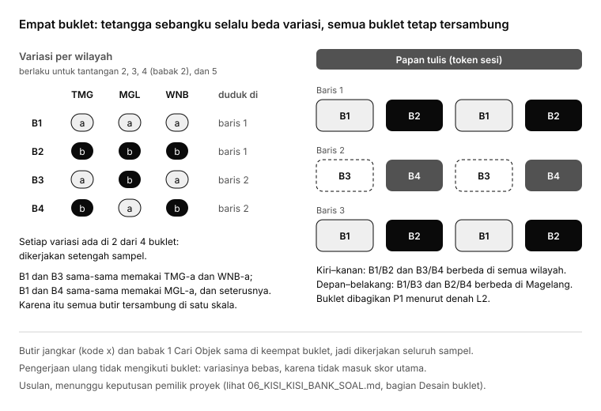

# Kisi-kisi Bank Soal GELITA Kelas 5

**Judul penelitian:** *Pengembangan Game Edukasi Etnopedagogi Kedu Berbasis Analitik sebagai Model Asesmen Literasi Digital Peserta Didik Sekolah Dasar*

Per 26 Oktober 2026 · Bagian dari [revisi 10 analitik](01_REVISI_10_ANALITIK.md) · Status: **disetujui pemilik proyek (25 Oktober 2026)**, termasuk semua bagian yang semula bertanda "usulan". Variasi Susun Gambar disesuaikan dengan keputusan 26 Oktober 2026 di [08](08_DRAF_BANK_SOAL.md#susun-gambar-selama-studi). Isi bank yang mengikuti kisi-kisi ini ada di [08_DRAF_BANK_SOAL.md](08_DRAF_BANK_SOAL.md).

Kisi-kisi ini jadi cetak biru bank soal baru: berapa butir, di tantangan mana, mengukur dimensi apa, di level apa, dengan bacaan seperti apa, dan kode kesalahan apa yang dibawa setiap pilihan. Dokumen ini meneruskan [05_TELAAH_BUTIR_DAN_DIMENSI.md](05_TELAAH_BUTIR_DAN_DIMENSI.md) dan tidak mengulang telaahnya. Belum ada yang diubah di sistem atau di [`docs/bank-soal/`](../bank-soal/README.md).

## Ringkasan

1. **Lima tantangan per wilayah, empat dinilai.** Susun Gambar jadi pemanasan. Isi Rumpang dan Benar atau Salah mengukur **D1**, Cari Objek babak 2 *Periksa Unggahan* mengukur **D3** (usulan), dan Skenario Digital mengukur **D2**. Cari Objek babak 1 jadi skala pendamping *Pengetahuan Budaya Kedu* (PBK).
2. **Per siswa di pengerjaan pertama: 61 butir literasi digital** (37 D1, 12 D2, 12 D3) ditambah 12 butir PBK. D1 terdiri dari 26 butir D1a dan 11 butir D1b, dua kali lipat bukti menilai sumber dibanding bank sekarang (± 5).
3. **Bank yang perlu ditulis: 116 butir literasi digital** (68 D1, 24 skenario D2, 24 petunjuk D3), dalam dua variasi (a/b) per tantangan dinilai, ditambah 6 butir jangkar yang dipakai kedua variasi. 12 petunjuk PBK bisa diambil dari bank lama.
4. **Tujuh dari sembilan teks D1 seorang siswa bergenre digital:** papan informasi digital, unggahan akun resmi dengan komentar, halaman situs, pesan grup, hasil pencarian, dan unggahan bersponsor. Bentuk teks selalu sama di variasi a dan b.
5. **Waktu bermain: sekitar 29–36 menit (Temanggung), 36–44 menit (Magelang), dan 43–52 menit (Wonosobo).** Satu wilayah muat di satu pertemuan, yang kini memberi waktu bermain ± 90 menit dan tidak terikat JP sekolah (keputusan 26 Oktober 2026); sisa tantangan dilanjutkan di P5. Usulan: lima pertemuan per kelas.
6. **Desain empat buklet (usulan).** Tetangga sebangku selalu mendapat variasi berbeda, tapi semua buklet tetap tersambung, jadi seluruh butir bisa ditaruh di satu skala Rasch. Setiap butir variasi dikerjakan setengah sampel; butir jangkar dikerjakan semuanya.
7. **Sampel minimal usulan: 300 siswa yang datanya bisa dianalisis** (150 per butir variasi), artinya merekrut sekitar 360 siswa.

## Dasar yang sudah diputuskan

Keputusan pemilik proyek per 25 Oktober 2026 berikut dianggap tetap di kisi-kisi ini:

| Keputusan | Akibatnya di kisi-kisi |
| --- | --- |
| Seluruh bank boleh diubah, dihapus, dan ditambah; belum ada data siswa sungguhan | Kode butir disusun baru (lihat *Kode butir*). Kunci tetap di server; butir baru atau yang diubah berstatus `needs_verification` sampai divalidasi |
| Dua variasi per tantangan dinilai (a/b), bukan tiga | Setiap butir variasi dikerjakan setengah sampel; butir jangkar dikerjakan seluruh sampel |
| Rasch multidimensi *between-item* | Setiap butir punya tepat satu dimensi utama; label lain hanya untuk diagnosis |
| D1 bertumpu pada literasi membaca, dengan label D1a dan D1b | Setiap butir D1 diberi satu label sub-aspek; jumlah butir D1 boleh lebih dari 29 |
| Sebagian bacaan bergenre digital | Genre ditetapkan per tantangan, sama di variasi a dan b |
| Skenario Digital tantangan kelima, Susun Gambar pemanasan | 15 tantangan, 12 dinilai; Susun Gambar tidak dikode dan tidak diskor |

Yang **masih terbuka** ditandai *usulan* di setiap tabel dan dikumpulkan di *Pertanyaan untuk pemilik proyek*.

## Kisi-kisi per wilayah dan tantangan

Angka di tabel ini **per variasi**, kecuali disebut lain. "Bagian ketuk" di Cari Objek = target ditambah pengecoh yang bisa diketuk di adegan. Kolom AKM memakai L1 (menemukan informasi), L2 (interpretasi dan integrasi), L3 (evaluasi dan refleksi). Untuk D2 dan D3, level ditulis dari kerumitan situasinya, dengan padanan AKM terdekat.

### Temanggung (mudah)

Level utama: **menemukan informasi** · PIRLS 2026: *focus on and retrieve explicitly stated information* · Bloom C1–C2

| Tantangan | Engine | Dimensi | Sub-aspek | AKM / PIRLS | Bloom | Butir | Bacaan | Genre teks | Pilihan |
| --- | --- | --- | --- | --- | --- | --- | --- | --- | --- |
| `tmg-1` Susun Gambar | `puzzle` | — (pemanasan) | — | — | — | 1 papan 3 × 3 | — | — | — |
| `tmg-2` Isi Rumpang | `rumpang` | D1 | 4 D1a | L1 (1 rumpang boleh L2) / *retrieve* | C1–C2 | 4 rumpang | 1 bacaan, 55–70 kata | Teks informasi (artikel Pustaka) | Bank kata 6: 4 jawaban + **2 pengecoh (usulan)** |
| `tmg-3` Benar atau Salah | `boleh` | D1 | 3 D1a, 1 D1b | L1 / *retrieve* | C1–C2 | 4 pernyataan (1 bergambar), kunci 2 benar : 2 salah | 1 paragraf, 50–70 kata | **Papan informasi digital** (layar info di tempat wisata, ada nama pengelola dan tanggal) | 2 (benar, salah) |
| Kartu jangkar Temanggung | `boleh` | D1 | 2 D1a | L1 / *retrieve* | C1 | 2 pernyataan, kunci 1 : 1, sama di a dan b | 1 kartu, 30–40 kata | **Pesan pengumuman di grup kelas** | 2 |
| `tmg-4` babak 1 *Temukan Benda* | `cari` | PBK (pendamping) | — | — | C1–C2 | 4 petunjuk, satu adegan untuk semua | — | — | 8 bagian ketuk (4 + 4 pengecoh) |
| `tmg-4` babak 2 *Periksa Unggahan* (usulan) | `cari` | D3 | — | Tanda keliru jelas; padanan L1 | C2 | 4 petunjuk (ATR, REP, IZN, ETK) | 1 unggahan tiruan + 1 sumber pembanding, 25–40 kata | Unggahan media sosial tiruan | 8 bagian ketuk; 2 pengecoh utama per petunjuk |
| `tmg-5` Skenario Digital | baru | D2 | — | Tanda bahaya jelas | C2–C3 | 4 skenario (satu per topik) | Situasi 30–50 kata | Pesan, unggahan, atau layar aplikasi tiruan | Tindakan 3 (1 tepat, 1 kurang tepat, 1 berisiko); alasan 3 |

Butir D1b di `tmg-3` tetap di level menemukan informasi: siswa menemukan **penanda sumber** yang tersurat, misalnya "Siapa yang memasang pengumuman ini?". Ini memberi butir D1b yang mudah, supaya skala D1b punya rentang kesulitan.

### Magelang (sedang)

Level utama: **interpretasi dan integrasi** · PIRLS 2026: *make straightforward inferences; interpret and integrate ideas and information* · Bloom C2–C4

| Tantangan | Engine | Dimensi | Sub-aspek | AKM / PIRLS | Bloom | Butir | Bacaan | Genre teks | Pilihan |
| --- | --- | --- | --- | --- | --- | --- | --- | --- | --- |
| `mgl-1` Susun Gambar | `puzzle` | — (pemanasan) | — | — | — | 1 papan 4 × 4 | — | — | — |
| `mgl-2` Isi Rumpang | `rumpang` | D1 | 5 D1a | L2 / *inferences, integrate* | C2–C3 | 5 rumpang | 1 bacaan, 100–120 kata | Teks informasi (artikel majalah anak) | Bank kata 7: 5 jawaban + 2 pengecoh |
| `mgl-3` Benar atau Salah | `boleh` | D1 | 3 D1a, 3 D1b | D1a L2; D1b L3 sementara / *interpret*, *evaluate* | C2–C4 | 6 pernyataan, kunci 3 : 3 | 2 paragraf + 2–3 komentar, 110–140 kata | **Unggahan akun resmi pengelola dengan kolom komentar.** Unggahan memuat fakta; komentar memuat pendapat | 2 |
| Kartu jangkar Magelang | `boleh` | D1 | 1 D1a, 1 D1b | L2, L3 | C2–C4 | 2 pernyataan, kunci 1 : 1 | 1 kartu, 40–50 kata | **Halaman hasil pencarian** (3 hasil: iklan, blog pribadi, situs resmi) | 2 |
| `mgl-4` babak 1 *Temukan Benda* | `cari` | PBK | — | — | C2–C3 | 4 petunjuk | — | — | 10 bagian ketuk (4 + 6) |
| `mgl-4` babak 2 *Periksa Unggahan* (usulan) | `cari` | D3 | — | Tanda keliru samar; padanan L2 | C3–C4 | 4 petunjuk | Unggahan + kartu informasi, 40–60 kata | Unggahan tiruan dengan kartu informasi museum atau desa | 10 bagian ketuk; 3 pengecoh utama per petunjuk |
| `mgl-5` Skenario Digital | baru | D2 | — | Tanda bahaya samar | C3–C4 | 4 skenario | Situasi 40–60 kata | Pesan grup, pesan pribadi, layar unggah | Tindakan 4 (1 tepat, 1 kurang tepat, 2 berisiko); alasan 4 |

### Wonosobo (sulit)

Level utama: **evaluasi dan refleksi** (Benar atau Salah, kartu jangkar, D3) · PIRLS 2026: *evaluate and critique content and textual elements* · Bloom C3–C5

| Tantangan | Engine | Dimensi | Sub-aspek | AKM / PIRLS | Bloom | Butir | Bacaan | Genre teks | Pilihan |
| --- | --- | --- | --- | --- | --- | --- | --- | --- | --- |
| `wnb-1` Susun Gambar | `puzzle` | — (pemanasan) | — | — | — | 1 papan 4 × 4 jigsaw | — | — | — |
| `wnb-2` Isi Rumpang | `rumpang` | D1 | 6 D1a | **L2** / *interpret, integrate* | C3–C4 | 6 rumpang (turun dari 7) | 1 bacaan, 110–130 kata | **Artikel situs wisata** (judul, nama penulis, tanggal) | Bank kata 8: 6 jawaban + 2 pengecoh |
| `wnb-3` Benar atau Salah | `boleh` | D1 | 2 D1a, 4 D1b | D1a L2; D1b L3 / *evaluate* | C4–C5 | 6 pernyataan, kunci 3 : 3 | 3 bagian, 90–150 kata | **Dua sumber digital bertentangan:** pesan berantai di grup dan pengumuman akun resmi lembaga | 2 |
| Kartu jangkar Wonosobo | `boleh` | D1 | 2 D1b | L3 | C4–C5 | 2 pernyataan, kunci 1 : 1 | 1 kartu, 25–50 kata | **Unggahan bersponsor (iklan)** | 2 |
| `wnb-4` babak 1 *Temukan Benda* | `cari` | PBK | — | — | C3–C4 | 4 petunjuk | — | — | 12 bagian ketuk (4 + 8) |
| `wnb-4` babak 2 *Periksa Unggahan* (usulan) | `cari` | D3 | — | Nilai yang bertentangan; padanan L3 | C4–C5 | 4 petunjuk | Unggahan + papan museum, 50–70 kata | Unggahan video tiruan dengan komentar dan tombol Bagikan | 12 bagian ketuk; 3 pengecoh utama per petunjuk |
| `wnb-5` Skenario Digital | baru | D2 | — | Situasi berkembang dua langkah | C4–C5 | 4 skenario | Situasi 50–70 kata, dua langkah | Pesan resmi palsu, grup, layar aplikasi | Tindakan 4 (1 tepat, 1 kurang tepat, 2 berisiko); alasan 5 |

`wnb-2` sengaja diberi label **L2**, sesuai telaah: Isi Rumpang yang menguji kata penghubung adalah interpretasi dan integrasi. Klaim "Wonosobo = evaluasi dan refleksi" berlaku untuk Benar atau Salah, kartu jangkar, dan Periksa Unggahan, dan ditulis begitu di laporan.

### Topik Skenario Digital (D2)

Topiknya sama di tiap wilayah; kerumitannya yang naik. Karena izin atas **karya dan tradisi budaya** pindah ke D3, topik izin di D2 cukup foto dan obrolan diri sendiri atau teman.

| Topik | Temanggung | Magelang | Wonosobo | Kode berisiko utama |
| --- | --- | --- | --- | --- |
| Data pribadi | Tanda bahayanya jelas | Tanda bahayanya samar | Ada hadiah yang menggoda | DIG-PRI |
| Kata sandi dan kode OTP | Orang asing yang minta | Teman dekat yang minta | Permintaannya tampak resmi ("admin GELITA") | DIG-SAN |
| Izin membagikan foto atau obrolan | Foto diri sendiri | Foto teman | Tangkapan layar obrolan teman mau diteruskan ke grup | DIG-IZN, DIG-ETK |
| Orang asing dan kabar bohong | Pesan jelas mencurigakan | Pesan berantai di grup | Situasi berkembang dua langkah | DIG-ASG, DIG-HOX |

Variasi a dan b memakai topik yang sama dengan situasi berbeda, jadi setiap siswa mendapat keempat topik di setiap wilayah.

### Periksa Unggahan (D3, usulan)

Setiap wilayah punya empat petunjuk, satu dari setiap jenis. Contoh lengkap Wonosobo ada di [05, bagian 4](05_TELAAH_BUTIR_DAN_DIMENSI.md#4-d3-menjadi-partisipasi-dan-representasi-budaya-kedu-di-ruang-digital).

| Jenis | Yang diukur | Kode | Temanggung | Magelang | Wonosobo |
| --- | --- | --- | --- | --- | --- |
| Atribusi | Menemukan atau mencantumkan pembuat dan sumber karya budaya | BUD-ATR | Nama pembuat tertulis besar | Nama pembuat kecil, bersaing dengan nama akun pengunggah | Pembuat berbeda dari pengunggah, dan pengunggah mengaku sebagai pembuat |
| Representasi akurat | Memeriksa keterangan asal atau makna budaya dengan sumber pembanding | BUD-REP | Keterangan jelas bertentangan dengan papan informasi | Keterangan menyebut asal daerah yang keliru | Keterangan keliru tapi populer dan banyak disukai |
| Izin pelaku dan pemilik karya | Meminta izin sebelum mengunggah ulang penampilan atau karya | BUD-IZN | Langkah minta izin tersedia jelas | Pilihan *Unduh* dan *Bagikan* tampak lebih mudah | Ada tekanan waktu ("tugas dikumpulkan besok") |
| Menghargai tradisi | Memilih tanggapan yang menghormati tradisi; menolak ejekan | BUD-ETK | Ejekan terang-terangan | Candaan yang terkesan ramah | Komentar benar isinya tapi kasar caranya |

## Jumlah per siswa dan jumlah yang harus ditulis

### Per siswa, pengerjaan pertama

| Dimensi | Temanggung | Magelang | Wonosobo | Per siswa | Bentuk skor |
| --- | --- | --- | --- | --- | --- |
| D1a Memahami informasi | 4 + 3 + 2 jangkar = 9 | 5 + 3 + 1 jangkar = 9 | 6 + 2 = 8 | **26** | 0–1 |
| D1b Menilai informasi dan sumber | 1 | 3 + 1 jangkar = 4 | 4 + 2 jangkar = 6 | **11** | 0–1 |
| **D1 jumlah** | 10 | 13 | 14 | **37** butir dari 9 teks | 0–1 |
| D2 Aman dan etis | 4 | 4 | 4 | **12** skenario | 0–1–2 (maks. 24) |
| D3 Partisipasi dan representasi budaya | 4 | 4 | 4 | **12** petunjuk dari 3 adegan | 0–1 |
| **Literasi digital** | 18 | 21 | 22 | **61** | |
| PBK (pendamping) | 4 | 4 | 4 | 12 | 0–1, skala terpisah |
| Alasan Skenario Digital | 4 | 4 | 4 | 12 | diagnosis, tidak diskor |
| Susun Gambar | 1 | 1 | 1 | 3 | tidak diskor |

Perbandingan dengan bank sekarang: D1 naik dari 29 menjadi 37 butir per siswa, dan D1b dari sekitar 5 menjadi 11. Tambahannya datang dari kartu jangkar, satu pernyataan Benar atau Salah tambahan di Temanggung dan Magelang, dan satu rumpang tambahan di Temanggung. Rumpang Wonosobo turun dari 7 ke 6 supaya waktu tetap muat.

### Yang harus ditulis

| Bagian | Per variasi | Variasi | Jumlah butir |
| --- | --- | --- | --- |
| Isi Rumpang | 4 + 5 + 6 = 15 rumpang | a, b | 30 |
| Benar atau Salah | 4 + 6 + 6 = 16 pernyataan | a, b | 32 |
| Kartu jangkar | 2 per wilayah | dipakai bersama | 6 |
| **D1** | | | **68** butir, 15 teks (12 bacaan variasi + 3 kartu jangkar) |
| Skenario Digital | 4 per wilayah | a, b | **24** skenario, masing-masing dengan pilihan tindakan dan alasan |
| Periksa Unggahan | 4 per wilayah | a, b | **24** petunjuk, 6 adegan |
| **Literasi digital** | | | **116** |
| Temukan Benda (PBK) | 4 per wilayah | satu adegan | 12, diambil dari bank lama |
| Susun Gambar | — | 10 per wilayah boleh tetap | Gambar lama tetap dipakai; Temanggung mendapat satu gambar baru (Wayang Kedu), dan gambar Candi Pawon diganti. Pengerjaan pertama selama studi memakai dua variasi yang bersih dari kunci, lihat [08](08_DRAF_BANK_SOAL.md#susun-gambar-selama-studi) |

Bacaan yang ada boleh dipakai ulang sebagai bahan, dengan perbaikan dari [daftar perbaikan butir](05_TELAAH_BUTIR_DAN_DIMENSI.md#daftar-perbaikan-butir) di 05. Dari tiga variasi lama, dua yang paling setara dipilih per tantangan, lalu bentuk teksnya disesuaikan dengan genre di kisi-kisi.

## Genre teks digital

Bentuk teks ditentukan per tantangan, bukan per variasi, supaya variasi a dan b setara dalam konstruk. Ini menutup masalah `wnb-3-b` di bank lama, yang satu-satunya tidak punya sumber digital.

| Teks | Genre | Ciri yang wajib tampil | Gunanya untuk butir |
| --- | --- | --- | --- |
| `tmg-2` | Teks informasi (artikel Pustaka) | Judul | Pembanding non-digital; menemukan informasi |
| `tmg-3` | Papan informasi digital | Nama pengelola, tanggal, jam buka | Menemukan informasi dan penanda sumber |
| Jangkar TMG | Pesan pengumuman di grup kelas | Nama pengirim, jam kirim | Menemukan informasi di pesan |
| `mgl-2` | Teks informasi (artikel majalah anak) | Judul | Pembanding non-digital; memadukan informasi |
| `mgl-3` | Unggahan akun resmi dengan komentar | Nama akun dan tanda resmi, tanggal, 2–3 komentar | Gagasan pokok; fakta (unggahan) dan pendapat (komentar) |
| Jangkar MGL | Halaman hasil pencarian | Judul, alamat situs tiruan, label *Iklan* | Memilih hasil yang relevan dan terpercaya |
| `wnb-2` | Artikel situs wisata | Judul, nama penulis, tanggal | Interpretasi; hubungan sebab-akibat |
| `wnb-3` | Pesan berantai di grup dan pengumuman akun resmi | Label *Diteruskan*, nama lembaga, tanggal | Kredibilitas, kabar bertentangan, strategi cek |
| Jangkar WNB | Unggahan bersponsor | Label *Bersponsor*, jumlah suka | Mengenali tujuan iklan; populer bukan berarti benar |

Semua tampilan digital adalah **tiruan**: nama akun, alamat situs, dan nomor dibuat fiktif menurut aturan di *Aturan menulis butir*. Teks di layar game tetap dibacakan narasi seperti sekarang.

## Waktu bermain

Perkiraan dibuat untuk siswa kelas 5 (10–11 tahun) yang membaca **60–90 kata per menit** di layar. Penelitian kelas 5 di Indonesia melaporkan angka yang sangat beragam: sekitar 136 kata per menit di satu sekolah, dan 41 kata per menit di sekolah lain sebelum ada perlakuan. Kami memakai rentang tengah yang hati-hati, karena teks di game juga diselingi gambar dan tombol. Setiap angka harus dicek ulang dengan waktu aktif saat uji coba.

| Bagian | Temanggung | Magelang | Wonosobo | Dasar hitungan |
| --- | --- | --- | --- | --- |
| Cerita wilayah: pembuka, penghubung, tuntas | 4–5 | 4–5 | 4–5 | Dihitung di [12](12_CERITA_PENGHUBUNG_DAN_NARASI.md#waktu-cerita-per-pertemuan) (disesuaikan 26 Oktober 2026; dulu hanya cerita pembuka, 2–3) |
| Susun Gambar | 2–3 | 3–4 | 4–5 | Ukuran papan |
| Isi Rumpang | 4–5 | 5–7 | 7–8 | Membaca + 20–35 detik per rumpang + Cek ulang |
| Benar atau Salah + kartu jangkar | 4–5 | 7–8 | 8–10 | Membaca + 20–40 detik per pernyataan |
| Cari Objek, dua babak | 5–6 | 6–7 | 7–9 | Babak 1 ± 25 detik per petunjuk; babak 2 membaca unggahan + 40–60 detik per petunjuk |
| Skenario Digital | 6–7 | 7–8 | 9–10 | Per skenario: membaca, tindakan, alasan, umpan balik |
| Kartu misi dan layar hasil (5 tantangan) | 4–5 | 4–5 | 4–5 | ± 1 menit per tantangan |
| **Jumlah (menit)** | **± 29–36** | **± 36–44** | **± 43–52** | |

**Satu pertemuan = satu wilayah.** Lama pertemuan tidak terikat JP sekolah, karena penelitian sudah mendapat izin memakai seluruh JP, bahkan sampai setelah jam sekolah (keputusan 26 Oktober 2026). Pertemuan wilayah memberi waktu bermain ± 90 menit, ditambah pembukaan (5 menit), masuk dan token (5–10 menit), dan penutupan (5 menit). Dengan perkiraan di atas, ketiga wilayah longgar, juga Wonosobo untuk pembaca lambat. Tantangan yang belum selesai tetap dilanjutkan di susulan P5 (paling lama 20 menit). Sebelumnya pertemuan dihitung 2 JP (70 menit, ± 50 menit bermain).

**Usulan pembagian pertemuan:**

| Pertemuan | Isi |
| --- | --- |
| P1 | Daftar akun, tes awal di modul tes GELITA, angket akses digital (langsung di modul), cerita pembuka; lama mengikuti kebutuhan ([13](13_TES_AWAL_AKHIR.md#waktu-di-p1-dan-p5)) |
| P2 | Wilayah Temanggung; wawancara L5 (tiga siswa) setelah bermain |
| P3 | Wilayah Magelang; wawancara L5 (tiga siswa) setelah bermain |
| P4 | Wilayah Wonosobo; wawancara L5 (tiga siswa) setelah bermain |
| P5 | Menyelesaikan tantangan yang tertinggal (paling lama 20 menit), tes akhir di modul tes GELITA, butir risiko daring (hanya dengan izin terpisah), cerita penutup, skala sikap di Balai Refleksi (tes akhir sebelum cerita penutup: keputusan 26 Oktober 2026, [12](12_CERITA_PENGHUBUNG_DAN_NARASI.md#keputusan-pemilik-proyek)) |

Jeda peregangan singkat (2 menit) diberikan setelah tantangan ketiga di setiap pertemuan. Siswa yang belum selesai melanjutkan di pertemuan 5 (susulan), karena token hanya membuka wilayah pertemuan itu; jam lanjutnya dicatat di L1, dan nomor pertemuan dipakai sebagai kovariat. Siswa yang absen di satu pertemuan ikut sesi susulan wilayah itu dalam tiga hari, dengan token sendiri (kode sesi `-S`, [02](02_LEMBAR_LAPANGAN.md#pertemuan-dan-lembar-yang-dipakai); diputuskan 26 Oktober 2026).

## Rencana Rasch dan apa artinya buat kisi-kisi

### Model

| Skala | Butir | Model |
| --- | --- | --- |
| Literasi digital tiga dimensi | 37 D1 + 12 D2 + 12 D3 | Rasch multidimensi *between-item*; D1 dan D3 dikotomus, D2 *partial credit* |
| Literasi digital satu dimensi | Butir yang sama | Pembanding (deviance, AIC, BIC; korelasi laten > 0,90 berarti tidak terbedakan) |
| Pengetahuan Budaya Kedu | 12 petunjuk babak 1 | Rasch satu dimensi, terpisah; dipakai sebagai kovariat |

### Testlet

Butir yang berbagi teks atau adegan saling bergantung. Kisi-kisi ini menghasilkan **12 testlet per siswa**:

| Testlet | Jumlah per siswa | Ukuran | Kalau Q3 menunjukkan ketergantungan |
| --- | --- | --- | --- |
| Bacaan Isi Rumpang | 3 | 4, 5, 6 rumpang | Satukan jadi *super-item* bertingkat (skor 0–4, 0–5, 0–6) atau model Rasch testlet |
| Bacaan Benar atau Salah | 3 | 4, 6, 6 pernyataan | Sama |
| Kartu jangkar | 3 | 2 pernyataan | Biasanya kecil; tetap dicek |
| Adegan Periksa Unggahan | 3 | 4 petunjuk | Satukan jadi super-item 0–4 kalau perlu |
| Skenario Digital | — | Setiap skenario berdiri sendiri | Cek Q3 antarskenario sewilayah |

Kalau semua bacaan D1 harus jadi super-item, D1 tinggal 9 butir bertingkat. Ini sebabnya D1 sengaja diberi lebih dari 29 butir: informasi efektifnya tetap cukup setelah digabung.

### Setengah sampel per butir variasi

Dengan dua variasi, setiap butir variasi dikerjakan **n/2** siswa. Patokan Linacre (1994) untuk stabilitas taksiran butir:

| Sampel yang bisa dianalisis (n) | Per butir variasi (n/2) | Ketelitian butir variasi | Butir jangkar (n) |
| --- | --- | --- | --- |
| 200 | 100 | ± ½ logit, keyakinan 95% | ± ½ logit, 99% |
| **300 (usulan)** | **150** | **± ½ logit, keyakinan 99%** | Memenuhi patokan "pasti" (250) |
| 500 | 250 | Patokan untuk keputusan penting | Sangat stabil |

Untuk butir D2 bertingkat, setiap kategori skor butuh paling sedikit 10 jawaban. Kategori "kurang tepat" (skor 1) bisa jarang dipilih, jadi sebarannya dicek di uji coba. Linacre juga menyarankan menambah sampel 10–40% kalau kondisi pengambilan data tidak seragam, seperti di sekolah yang berbeda-beda. Karena itu **usulan kami: target 300 siswa yang datanya bisa dianalisis, dengan merekrut sekitar 360** (± 13 kelas berisi 28 siswa), untuk menutup izin orang tua yang tidak kembali, siswa absen, dan perangkat bersama.

### Desain buklet (usulan)

Di bank sekarang, variasi dipilih acak per pengerjaan. Telaah 05 mengusulkan variasi diselang-seling per kursi supaya tetangga tidak saling mencontek. Masalahnya, kalau setiap kursi hanya dapat "semua a" atau "semua b", kedua kelompok tidak berbagi butir sama sekali, dan butir variasi a dan b tidak bisa ditaruh di satu skala tanpa anggapan tambahan.

Usulannya **empat buklet**. Buklet menentukan variasi di setiap wilayah dan berlaku untuk semua tantangan dinilai di wilayah itu.

| Buklet | Temanggung | Magelang | Wonosobo | Diberikan ke |
| --- | --- | --- | --- | --- |
| B1 | a | a | a | Baris ganjil, kursi ganjil |
| B2 | b | b | b | Baris ganjil, kursi genap |
| B3 | a | b | a | Baris genap, kursi ganjil |
| B4 | b | a | b | Baris genap, kursi genap |

- Tetangga kiri–kanan selalu berbeda variasi di ketiga wilayah.
- Setiap variasi ada di dua buklet, jadi tetap dikerjakan setengah sampel.
- Setiap pasangan dimensi dan wilayah tersambung lewat buklet yang berbagi variasi (misalnya `tmg-5-a` dikerjakan B1 dan B3, `mgl-5-b` dikerjakan B2 dan B3). Jadi semua butir di setiap dimensi masuk satu skala, tanpa perlu butir jangkar D2 dan D3.
- Buklet dibagikan P1 lewat denah L2 dan ikut tercatat di data sesi. Di P1, langsung setelah semua siswa mendaftar dan sebelum tes awal, koordinator memasukkan buklet, baris, dan kursi per kode peserta di panel peneliti dari L2 (diputuskan 26 Oktober 2026), dan panel memeriksa keseimbangan B1–B4 per rombel. Siswa diminta duduk di kursi yang sama di P2–P4; buklet melekat pada siswa, jadi pindah kursi tidak mengubah variasinya dan cukup dicatat di L2 (diputuskan 25 Oktober 2026).
- Pengerjaan ulang tidak mengikuti buklet. Selama studi, pengerjaan ulang baru terbuka setelah kelima tantangan wilayah pertemuan itu tuntas, hanya di dalam sesi; datanya disimpan tapi tidak dinilai (diputuskan 25 Oktober 2026).
- Karena urutan wilayah tetap, buklet tidak mengacak urutan. Ini tetap dicatat sebagai keterbatasan.

### Butir jangkar (usulan)

Rencana awal di [01](01_REVISI_10_ANALITIK.md#pelevelan-wilayah) adalah 4–6 butir yang sama persis di ketiga wilayah. Dengan desain sekarang kami mengusulkan bentuk lain:

| Pilihan | Isi | Kelebihan | Kekurangan |
| --- | --- | --- | --- |
| **A. Jangkar antarvariasi (usulan)** | 6 pernyataan D1, 2 per wilayah, di kartu jangkar yang sama untuk variasi a dan b | Dikerjakan seluruh sampel; jadi butir yang paling stabil; menyambung buklet; dipakai untuk mengecek kesetaraan a dan b | Menambah ± 1,5 menit per wilayah |
| B. Jangkar antarwilayah | Butir yang sama diulang di Temanggung, Magelang, dan Wonosobo | Bisa melihat perubahan kinerja dari pertemuan ke pertemuan | Siswa yang sama melihat butir yang sama tiga kali, jadi ingatan mencampuri hasil; urutan wilayah sudah tersambung lewat siswa yang sama |

Semua siswa memainkan ketiga wilayah, jadi kesulitan antarwilayah sudah bisa dibandingkan di satu skala lewat siswa yang sama. Jangkar paling berguna untuk menyambung dua variasi. Karena itu pilihan A kami usulkan.

**Penempatan:** kartu jangkar muncul di akhir tantangan Benar atau Salah, sesudah pernyataan variasi, sebagai kartu kedua dengan teks pendeknya sendiri. Sebarannya: Temanggung 2 D1a (L1), Magelang 1 D1a dan 1 D1b (L2, L3), Wonosobo 2 D1b (L3). Jangkar tidak boleh diubah setelah uji coba, dan kalau ada yang tidak cocok (*misfit*) di uji coba, butir itu diganti sebelum pengambilan data utama, bukan saat pengambilan data.

### Batas reliabilitas D2 dan D3

- **D1 (37 butir, 9 teks):** cukup untuk skor perorangan, selalu disertai galat baku. Reliabilitas EAP/PV dilaporkan sebelum dan sesudah penyesuaian testlet.
- **D2 (12 skenario, 0–1–2):** menurut Linacre, satu butir bertingkat dengan tiga kategori kira-kira setara dua butir benar-salah, jadi informasinya mendekati 24 butir dikotomus. Tetap saja, reliabilitas orang kemungkinan di bawah 0,80. D2 dilaporkan di tingkat kelompok dan butir.
- **D3 (12 petunjuk dari 3 adegan):** paling rawan karena testlet adegan. Laporkan di tingkat kelompok. Kalau reliabilitas di uji coba di bawah 0,60, pilihan perbaikannya menambah satu petunjuk per adegan (5 per wilayah, ± 1 menit tambahan).
- Skor gabungan literasi digital dan D1 boleh dilaporkan per siswa; D2 dan D3 per siswa hanya sebagai profil kasar.

## Kode kesalahan di setiap pilihan

Setiap pilihan salah membawa **tepat satu kode** sebelum data diambil. Kode `*-LAIN` hanya untuk pengodean manual setelahnya, tidak boleh dipasang di bank. Kode NON-TEB dan NON-HABIS dihitung sistem dari waktu dan urutan percobaan, bukan dipasang di pilihan.

| Tantangan | Yang diberi kode | Kode yang boleh | Banyak sel kode per variasi |
| --- | --- | --- | --- |
| Isi Rumpang | Setiap pasangan rumpang × kata salah (termasuk jawaban rumpang lain) | INF-LIT, INF-KAT, INF-REL, INF-HUB, INF-GEN | TMG 4 × 5 = 20; MGL 5 × 6 = 30; WNB 6 × 7 = 42 |
| Benar atau Salah, D1a | Setiap pernyataan (kode jebakannya) | INF-LIT, INF-KAT, INF-REL, INF-HUB | Sebanyak pernyataan D1a |
| Benar atau Salah, D1b | Setiap pernyataan | INF-SUM, INF-FOP, INF-GEN | Sebanyak pernyataan D1b |
| Kartu jangkar | Setiap pernyataan | Sesuai sub-aspeknya | 2 |
| Temukan Benda (PBK) | Setiap benda pengecoh; ketukan kosong dekat sasaran = NON-SEN | INF-BUD, INF-LIT | 4, 6, 8 pengecoh |
| Periksa Unggahan (D3) | Setiap bagian ketuk yang salah, untuk setiap petunjuk | BUD-ATR, BUD-REP, BUD-IZN, BUD-ETK; NON-SEN untuk bagian netral (misalnya jumlah suka) | 4 petunjuk × (7, 9, 11) bagian salah |
| Skenario Digital, tindakan | Setiap pilihan tindakan | Tepat: tanpa kode (skor 2); kurang tepat: DIG-PSF atau kode DIG lain yang sesuai (skor 1); berisiko: DIG-PRI, DIG-SAN, DIG-IZN, DIG-ASG, DIG-HOX, DIG-ETK (skor 0) | 3, 4, 4 pilihan |
| Skenario Digital, alasan | Setiap pilihan alasan | R-RISK, R-ETIK, R-ATUR, R-SOS, R-ACAK | 3, 4, 5 pilihan |

**Kode BUD (usulan, dari 05):**

| Kode | Arti | Dimensi |
| --- | --- | --- |
| BUD-ATR | Tidak mencantumkan atau salah menunjuk pembuat dan sumber karya budaya | D3 |
| BUD-REP | Menerima atau menyebarkan keterangan budaya yang keliru | D3 |
| BUD-IZN | Mengunggah ulang penampilan atau karya budaya tanpa izin | D3 |
| BUD-ETK | Menanggapi tradisi dengan cara yang tidak menghormati | D3 |
| BUD-LAIN | Kesalahan budaya digital yang tidak cocok dengan kode lain; dikode manual | D3 |

Dengan pembagian ini, label ganda di [03](03_KODE_DAN_ARTI.md) tidak diperlukan lagi: INF-BUD hanya untuk PBK, DIG-IZN dan DIG-ETK hanya untuk D2.

**Sebaran kode yang dituju.** Supaya analitik 6 (pola kesalahan) punya isi, setiap kode INF yang cocok dengan level wilayah muncul paling sedikit sekali di wilayah itu, dan setiap kode INF muncul di minimal dua wilayah, kecuali INF-FOP yang khusus Magelang. Setiap kode BUD dan kode DIG berisiko utama (PRI, SAN, IZN, HOX) muncul di ketiga wilayah; DIG-ASG cukup di Wonosobo. (Diubah 25 Oktober 2026 atas persetujuan pemilik proyek; aturan awal "dua kali per wilayah per variasi" tidak cocok untuk semua kode.)

**Pertanyaan alasan.** Kalimat tanya alasan netral terhadap tindakan, misalnya "Yang paling penting kupikirkan di sini adalah …". Setiap set alasan memuat R-RISK atau R-ETIK (yang diharapkan), R-ATUR, dan minimal satu R-SOS atau R-ACAK. Di Wonosobo, kelima kode muncul.

## Aturan menulis butir

Aturan ini dipetik dari telaah 05 dan berlaku untuk semua butir baru.

1. **Jawaban harus bisa diturunkan dari teks.** Butir D1 tidak boleh terjawab dari pengetahuan umum, norma, atau kolokasi kata. Istilah yang ditanyakan didefinisikan dulu di teks. Uji cepatnya: tutup bacaannya; kalau butir masih bisa dijawab dengan yakin, tulis ulang.
2. **Tidak ada jawaban yang bocor lewat judul variasi**, judul bacaan, gambar, nama berkas, atau narasi.
3. **Kunci Benar atau Salah seimbang** di setiap variasi (2 : 2 atau 3 : 3, jangkar 1 : 1), dan posisinya tidak berpola (bukan benar–salah–benar–salah).
4. **Pernyataan "salah" salah karena teks**, bukan karena tafsiran. Kalau dua penelaah bisa berdebat soal kuncinya, rumusannya diubah (contoh di 05: `mgl-3-c01`, `wnb-3-a05`).
5. **Pengecoh Isi Rumpang gramatikal** di rumpangnya sendiri, supaya tidak gampang dibuang hanya dari bentuk kata. Jawaban dan pengecoh tidak boleh dobel.
6. **Variasi a dan b setara:** genre teks, panjang (selisih ≤ 15%), jumlah butir per sub-aspek, level AKM, dan sebaran kode kesalahan sama.
7. **Setiap fakta punya sumber.** Setiap bacaan dan setiap fakta budaya di petunjuk D3 punya rujukan di kolom `reference_source`. Fakta yang belum dicek tidak dipakai. Contoh koreksi: jumlah relief Borobudur yang bercerita (1.460 dari 2.672 panel).
8. **Pengetahuan untuk D3 disediakan di tugas.** Petunjuk Periksa Unggahan memuat fakta budaya yang dibutuhkan atau menyediakan sumber pembanding di adegan, supaya yang diukur memeriksa dan merepresentasikan, bukan mengingat.
9. **Skenario ramah anak.** Tidak menakut-nakuti, tidak ada kekerasan atau isi dewasa, tidak mempermalukan siapa pun. Umpan balik menjelaskan akibat tanpa kata "salah" atau "gagal".
10. **Tidak ada tautan, akun, atau nomor sungguhan.** Alamat situs memakai domain contoh yang dicadangkan (`.example`, misalnya `wisata-dieng.example`). Nomor telepon disamarkan (`08xx-xxxx-xxxx`). Nama akun dan sanggar fiktif, dan dicek bahwa nama itu tidak dipakai akun atau sanggar nyata. Lembaga resmi boleh disebut dengan nama aslinya hanya kalau isinya benar dan netral, misalnya nama dinas tanpa logo. Unggahan tampil di aplikasi media sosial fiktif *Kedugram*, dan nama komentator ditulis dengan nama depan saja, tanpa @.
11. **Tokoh fiktif, tidak meniru anak nyata.** Nama tokoh dipilih umum dan beragam; foto wajah anak sungguhan tidak dipakai.
12. **Satu butir, satu dimensi.** Kalau sebuah butir terasa mengukur dua dimensi, pecah atau pindahkan. Label sekunder (Bloom, kode kesalahan) hanya untuk diagnosis.
13. **Bahasa sesuai kelas 5.** Kalimat pendek, satu gagasan per kalimat, kosakata sehari-hari. Kata serapan digital (*unggah*, *tautan*, *akun*) dipakai konsisten dan dijelaskan sekali di Pustaka.
14. **Bloom sesuai rentang wilayah** dan ditulis sebagai label kedua; level AKM label pertama. Keduanya diberi oleh dua penilai terpisah (κ ≥ 0,70).
15. **Status awal `needs_verification`** untuk semua butir baru dan butir yang diubah, sampai lolos validasi ahli.

## Pemetaan dimensi ke kerangka

| Dimensi | DigComp 3.0: area dan kompetensi | Pilar Komdigi | Level AKM | PIRLS 2026 |
| --- | --- | --- | --- | --- |
| D1a Memahami informasi | 1 *Information search, evaluation and management*: 1.1 *Browsing, searching and filtering information* | Cakap Bermedia Digital | L1, L2 | Mengambil informasi tersurat; inferensi langsung; menafsirkan dan memadukan |
| D1b Menilai informasi dan sumber | 1: 1.2 *Evaluating information* | Cakap Bermedia Digital | L3 (L1 untuk penanda sumber di Temanggung) | Mengevaluasi dan mengkritisi isi teks |
| D2 Aman dan etis | 4 *Safety, wellbeing and responsible use*: 4.2 *Protecting personal data and privacy*, 4.3 *Supporting wellbeing*; 2 *Communication and collaboration*: 2.2 *Sharing through digital technologies* | Aman dan Etis Bermedia Digital | Kerumitan skenario (padanan L1–L3) | — |
| D3 Partisipasi dan representasi budaya | 2: 2.2 *Sharing*, 2.3 *Engaging in citizenship through digital technologies*, 2.5 *Digital behaviour*; 3 *Digital content creation*: 3.3 *Copyright and licences* | Budaya Bermedia Digital (dan Etis) | Kerumitan adegan (padanan L1–L3) | — |
| PBK (pendamping) | — | — | — | — |

DigComp 3.0 punya empat tingkat kecakapan (*basic*, *intermediate*, *advanced*, *highly advanced*). Untuk siswa kelas 5, sasaran kisi-kisi ini ada di tingkat *basic*. Pemetaan ini dipakai untuk menjelaskan konstruk, bukan untuk mengklaim siswa mencapai tingkat DigComp tertentu.

## Kode butir (usulan)

Karena belum ada data siswa sungguhan, bank baru boleh memakai set kode baru dengan pola yang sama: `{tantangan}-{variasi}{nn}`.

| Bagian | Kode | Contoh |
| --- | --- | --- |
| Butir variasi | `a`, `b` | `mgl-3-a04`, `wnb-5-b02` |
| Butir yang dipakai bersama semua buklet | `x` | Kartu jangkar `tmg-3-x01`; Temukan Benda `wnb-4-x03` |
| Periksa Unggahan | `a`, `b` di tantangan 4 | `mgl-4-a02` |
| Susun Gambar | `a`, `b` = dua variasi bersih untuk pengerjaan pertama; huruf berikutnya untuk pengerjaan ulang ([08](08_DRAF_BANK_SOAL.md#keputusan-pemilik-proyek-26-oktober-2026)) | `tmg-1-a01`, `tmg-1-k01` |

Setelah uji coba memakai suatu kode, kode itu dibekukan dan tidak dipakai untuk isi yang berbeda.

## Yang perlu disiapkan sistem nanti

Daftar ini hanya catatan untuk dokumen implementasi; belum ada yang dikerjakan.

| No | Perubahan | Catatan |
| --- | --- | --- |
| 1 | Engine Skenario Digital | Dua langkah (tindakan, alasan), skor 0–1–2 di server, simpan `reason_code`; pilihan diacak per pengerjaan |
| 2 | Cari Objek dua babak | Babak 2 dengan adegan per variasi; satu tantangan, dua kelompok butir; babak 1 tanpa variasi |
| 3 | Kartu jangkar di Benar atau Salah | Bacaan kedua di satu tantangan; butir `x` dipakai semua variasi |
| 4 | Variasi dari buklet | Pengerjaan pertama memakai variasi dari buklet siswa (dimasukkan P1 di panel peneliti dari L2), bukan acak; `BankRules::FIRST_ATTEMPT_GROUPS` jadi `a`, `b`. Susun Gambar tidak mengikuti buklet: pengerjaan pertama diacak dari `a` dan `b`, dua variasi yang keterangannya bersih dari kunci ([08](08_DRAF_BANK_SOAL.md#keputusan-pemilik-proyek-26-oktober-2026)) |
| 5 | `DifficultyRules` baru | Isi Rumpang 4/5/6 rumpang, pengecoh 2/2/2; Benar atau Salah 4/6/6 pernyataan dan genre baru; Cari Objek babak 2 (petunjuk, bagian ketuk); Skenario Digital (skenario, jumlah tindakan 3/4/4, alasan 3/4/5); variasi tepat 2 |
| 6 | Keterampilan Benar atau Salah | Tambah kode keterampilan D1b, misalnya `mengenali_penanda_sumber`, `menilai_kredibilitas`, `mengenali_iklan` |
| 7 | Kolom workbook baru | `dimension` (D1, D2, D3, PBK), `subaspect` (D1a, D1b), `akm_level`, `pirls_process`, `text_genre`, `testlet_key`, `booklet_shared` (butir `x`), `error_code` per pengecoh dan per sel rumpang × kata, `reason_code` per alasan, `score` per tindakan, `reference_source` wajib |
| 8 | Sheet workbook baru | `scenarios`, `scenario_options` (tindakan dan alasan), `post_scenes` (adegan Periksa Unggahan), `cloze_matrix` (kode rumpang × kata) |
| 9 | Pemeriksaan bank | Keseimbangan kunci, setara a/b (panjang, sub-aspek, level), satu kode per pilihan salah, domain `.example`, tidak ada `*-LAIN` di bank |
| 10 | Ekspor butir | Kolom dimensi, sub-aspek, level, genre, testlet, buklet, beban permukaan |

## Pertanyaan untuk pemilik proyek

**Semua usulan di bawah disetujui pemilik proyek pada 25 Oktober 2026**, termasuk butir 9 (tiga pilihan untuk D1b Wonosobo ditunda sampai setelah uji coba).

1. **Di mana D3?** Usulan: Cari Objek babak 2 *Periksa Unggahan*; babak 1 jadi skala pendamping PBK. Pilihan lain: D3 masuk Skenario Digital (tantangan kelima jadi 8 skenario per wilayah, terlalu panjang).
2. **Pengecoh kedua di bank kata Temanggung?** Usulan: ya, 2 pengecoh, supaya rumpang terakhir tidak tinggal satu pilihan.
3. **Skor tindakan 0–1–2, alasan hanya diagnosis?** Usulan: ya, di versi pertama. Alasan dianalisis terpisah dengan urutan R-ACAK/R-SOS < R-ATUR < R-RISK/R-ETIK setelah uji coba.
4. **Butir jangkar:** pilihan A (6 pernyataan di kartu jangkar, sama untuk a dan b) atau pilihan B (diulang di tiga wilayah)? Usulan: A.
5. **Jumlah sampel:** usulan 300 siswa yang bisa dianalisis, merekrut ± 360 (± 13 kelas).
6. **Desain empat buklet per kursi** menggantikan pengacakan variasi di pengerjaan pertama? Usulan: ya.
7. **Jumlah butir baru:** Temanggung 4 rumpang dan 4 pernyataan, Wonosobo 6 rumpang (turun dari 7). Setuju?
8. **Lima pertemuan per kelas** (tes awal, tiga wilayah, tes akhir dan susulan)? Ini juga menjawab pertanyaan terbuka di 01.
9. **Opsional:** pernyataan D1b Wonosobo memakai tiga pilihan (*Benar*, *Salah*, *Tidak bisa dipastikan dari teks*) untuk menurunkan peluang tebakan dari 50% ke 33%? Usulan: belum, karena butuh engine baru dan menambah beban baca; dicatat sebagai pengembangan setelah uji coba.

## Untuk dicatat di catatan keputusan

Usulan yang perlu masuk [04_CATATAN_KEPUTUSAN.md](04_CATATAN_KEPUTUSAN.md) setelah pemilik proyek memutuskan (sesi koordinator yang mencatat):

- Kisi-kisi bank soal disusun di `06_KISI_KISI_BANK_SOAL.md`: 61 butir literasi digital per siswa (37 D1, 12 D2, 12 D3) dan 12 butir PBK; 116 butir literasi digital ditulis dalam dua variasi plus 6 butir jangkar.
- D1: 26 D1a dan 11 D1b per siswa; tujuh dari sembilan teks seorang siswa bergenre digital; genre ditetapkan per tantangan, sama di variasi a dan b.
- Jumlah per wilayah berubah: Isi Rumpang 4/5/6 rumpang (Temanggung naik dari 3, Wonosobo turun dari 7), Benar atau Salah 4/6/6 pernyataan, ditambah 2 pernyataan jangkar per wilayah.
- `wnb-2` Isi Rumpang diberi label AKM L2; klaim L3 Wonosobo hanya untuk Benar atau Salah, kartu jangkar, dan Periksa Unggahan.
- Topik izin di D2 dibatasi pada foto dan obrolan diri sendiri atau teman; izin atas karya budaya pindah ke D3 (BUD-IZN).
- Usulan kode BUD-ATR, BUD-REP, BUD-IZN, BUD-ETK, BUD-LAIN (D3); INF-BUD hanya untuk PBK; DIG-IZN dan DIG-ETK hanya D2.
- Usulan desain empat buklet per kursi (B1–B4) untuk pengerjaan pertama, menggantikan pengacakan variasi.
- Usulan butir jangkar antarvariasi (pilihan A), bukan antarwilayah, dengan alasan: siswa yang sama memainkan ketiga wilayah, jadi wilayah sudah tersambung lewat siswa.
- Usulan sampel 300 siswa yang bisa dianalisis, rekrut ± 360.
- Usulan lima pertemuan per kelas; perkiraan waktu bermain 27–34, 34–42, dan 41–50 menit per wilayah, dicek ulang di uji coba.
- Usulan kode butir: `a`/`b` untuk variasi, `x` untuk butir yang dipakai semua buklet.
- Aturan menulis butir (15 aturan) berlaku untuk semua butir baru, termasuk domain `.example` untuk tautan tiruan.
- Untuk 03: tambah kode BUD-*, D1a/D1b, kode buklet B1–B4, dan arti kode butir `x`.
- Untuk 01: pertanyaan terbuka tentang jumlah pertemuan dan jumlah sampel mendapat usulan jawaban dari dokumen ini.

## Rujukan

**Kerangka (dibuka 25 Oktober 2026)**

- Cosgrove, J., & Cachia, R. (2025). *DigComp 3.0: European Digital Competence Framework* (edisi ke-5). Joint Research Centre, [DOI](https://doi.org/10.2760/0001149). Nama area, nama kompetensi 1.1, 1.2, 2.2, 2.3, 2.5, 3.3, 4.2, 4.3, dan empat tingkat kecakapan dicek dari Tabel 2 dan ringkasan eksekutif: [PDF](https://digitalekompetenzen.oead.at/fileadmin/Dokumente/oead.at/Bildung_Digital/Digitale_Kompetenzen/NRDK/2025_DigComp_3.0_European_Digital_Competence_Framework.pdf), [repositori JRC](https://publications.jrc.ec.europa.eu/repository/handle/JRC144121).
- von Davier, M., & Kennedy, A. (Eds.). (2024). *PIRLS 2026 Assessment Frameworks*. TIMSS & PIRLS International Study Center, Boston College: [DOI](https://doi.org/10.6017/lse.tpisc.tr2103.kb4199), [situs resmi](https://timssandpirls.bc.edu/pirls2026/frameworks/index.html).
- Kementerian Kominfo & Katadata Insight Center. (2023). *Status Literasi Digital di Indonesia 2022* (empat pilar: Kecakapan, Etika, Keamanan, dan Budaya Digital; diluncurkan Februari 2023): [PDF](https://cdn1.katadata.co.id/media/microsites/litdik/ReportSurveiStatusLiterasiDigitalIndonesia2022.pdf).
- Level kognitif AKM: lihat rujukan di [01](01_REVISI_10_ANALITIK.md#cek-fakta-dan-rujukan); dokumen kerangka resminya tetap perlu diunduh dari Pusmendik.

**Pengukuran**

- Linacre, J. M. (1994). Sample size and item calibration stability. *Rasch Measurement Transactions, 7*(4), 328: [rasch.org](https://www.rasch.org/rmt/rmt74m.htm). Tabel ukuran sampel, 10 jawaban per kategori untuk butir bertingkat, kesetaraan butir bertingkat dengan butir dikotomus, dan saran menambah sampel 10–40%.
- Rujukan model, testlet, Q3, dan *effort-moderated scoring* sama dengan [05](05_TELAAH_BUTIR_DAN_DIMENSI.md#rujukan).

**Waktu dan kecepatan membaca (dibuka 25 Oktober 2026)**

- Kecepatan membaca siswa kelas 5 sekitar 136 kata per menit (SD Xaverius 2 Palembang): [Jurnal PGSD UKMC](https://journal.ukmc.ac.id/index.php/jpgsdm/article/download/452/433/2280).
- Rata-rata awal 41 kata per menit, naik ke 107 kata per menit setelah tindakan kelas (kelas V, Sumatera Utara): [Digilib Unimed](https://digilib.unimed.ac.id/id/eprint/3625/2/8106181013%20ABSTRAK.pdf).
- Satu JP SD dihitung 35 menit di struktur Kurikulum Merdeka: [struktur kurikulum SD/MI](https://mmc.tirto.id/documents/2024/07/15/2634-struktur-kurikulum-merdeka-sd-mi-compress.pdf?x=2676), [kurikulummerdeka.com](https://kurikulummerdeka.com/struktur-kurikulum-merdeka-sd-bersifat-tahunan/). Lampiran resmi peraturannya belum dibaca langsung.

**Teknis**

- Eastlake, D., & Panitz, A. (1999). *Reserved Top Level DNS Names* (RFC 2606). Domain `.example` dicadangkan untuk contoh dan dokumentasi: [RFC Editor](https://www.rfc-editor.org/rfc/rfc2606).

**Fakta budaya.** Kisi-kisi ini tidak menambah fakta budaya baru. Contoh yang dipakai (bundengan, Telaga Warna, Topeng Ireng dari Desa Tuksongo, uceng, relief Borobudur) sudah dicek di [01](01_REVISI_10_ANALITIK.md#cek-fakta-dan-rujukan) dan [05](05_TELAAH_BUTIR_DAN_DIMENSI.md#rujukan). Fakta di bacaan baru wajib dicek saat butirnya ditulis (aturan 7).
