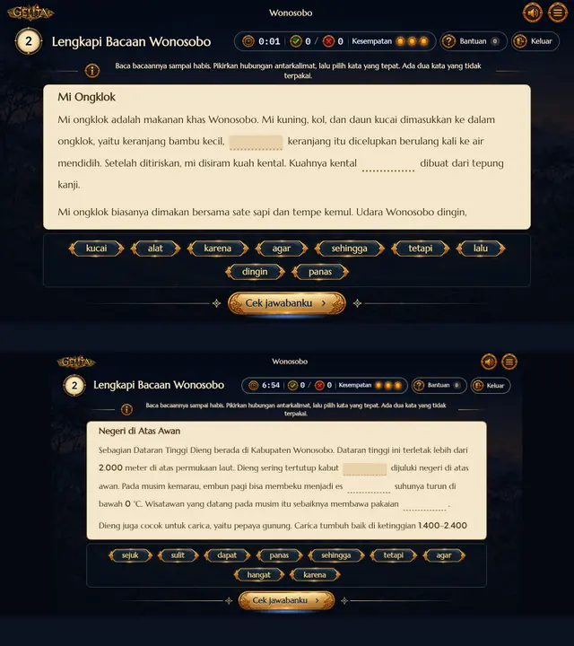
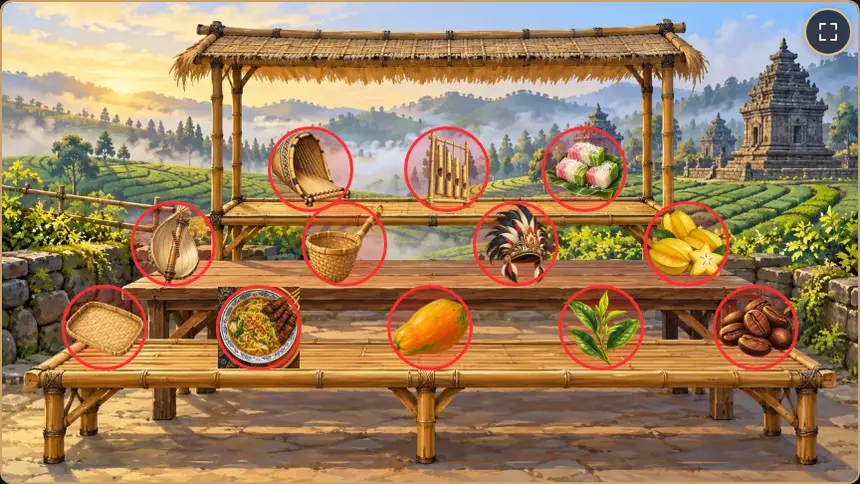
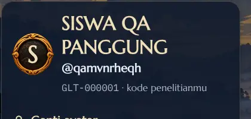

# Telaah Pendahuluan Media GELITA

**Judul penelitian:** *Pengembangan Game Edukasi Etnopedagogi Kedu Berbasis Analitik sebagai Model Asesmen Literasi Digital Peserta Didik Sekolah Dasar*

Per 25 Oktober 2026 · Bagian dari [revisi 10 analitik](01_REVISI_10_ANALITIK.md) · Mengikuti instrumen ahli media v1.0 dan [07_TELAAH_INSTRUMEN_VALIDASI.md](07_TELAAH_INSTRUMEN_VALIDASI.md) (T6)

> **Status: telaah pendahuluan berbantuan AI oleh tim pengembang, bukan validasi ahli.** Temuan di sini tidak ikut dihitung dalam Aiken's V, CVI, atau kesepakatan antarvalidator. Gunanya: masalah yang jelas sudah diperbaiki sebelum media dinilai ahli media sungguhan, sehingga waktu ahli dipakai untuk hal yang perlu penilaian manusia.

**Keputusan pengembang (25 Oktober 2026):** keempat usulan disetujui: tanpa ponsel untuk pengambilan data (M-01), area ketuk Cari Objek ditata ulang dan diperiksa otomatis (M-02), jam disembunyikan selama penelitian (M-03), dan aturan narasi (kebutuhan no. 5). Lihat [catatan keputusan](04_CATATAN_KEPUTUSAN.md) dan perubahan sistem no. 16–19 di [dokumen utama](01_REVISI_10_ANALITIK.md).

## Ringkasan

Media GELITA sekarang sudah kokoh untuk **laptop, Chromebook, dan tablet mendatar**:
- panggung 16:9 utuh di tujuh ukuran layar
- semua tombol minimal 48 dp
- layar putar muncul saat ponsel tegak
- gerakan berhenti dengan pengaturan "kurangi gerakan"
- tidak ada galat JavaScript selama telaah
- kunci jawaban tidak ada di halaman

Ada **tiga temuan yang memengaruhi kebersihan data penelitian** (kode V, keparahan 3) dan perlu diputuskan sebelum uji coba:

1. **Ponsel tidak layak untuk pengambilan data.** Di ponsel mendatar, median ukuran teks hanya 7,5–12 px dan 73–96% teks di bawah 12 px. Membaca bacaan berubah jadi tugas penglihatan, sehingga skor D1 ikut bergantung pada perangkat.
2. **Area ketuk Cari Objek bertumpuk** di Magelang (4 pasang) dan Wonosobo (5 pasang), termasuk sasaran dengan sasaran dan sasaran dengan pengecoh. Ketukan di daerah tumpukan bisa tercatat sebagai jawaban salah berkode INF-BUD, padahal siswa tahu jawabannya.
3. **Jam yang terus berjalan dan hitungan benar/salah selalu tampil** di kepala tantangan. Ini bisa mendorong siswa menebak cepat (NON-TEB) dan menambah tekanan yang bukan bagian dari konstruk.

Ada juga lima temuan sedang (keparahan 2) dan beberapa temuan ringan. Daftar lengkapnya di *Catatan temuan (B.6)*. Bagian terakhir merangkum **perubahan media yang dibutuhkan Revisi 10**, karena media sekarang terbuka untuk diubah (keputusan 25 Oktober 2026).

## Cara telaah dilakukan

| Hal | Isi |
| --- | --- |
| Instalasi | Instalasi uji lokal (bukan server produksi): MariaDB 10.11, `php spark serve`, `main` per 25 Oktober 2026, bank soal kelas 5 draf 2, 441 gambar Katalog Aset terpasang. Studi diatur "wilayah terbuka bebas" supaya ketiga wilayah bisa dikunjungi |
| Peramban | Chromium (Playwright), tanpa kepala. Ukuran layar ditiru: laptop 1366 × 768, tablet 1024 × 768 dan 1280 × 800 (sentuh), ponsel mendatar 844 × 390 dan 740 × 360 (sentuh), ponsel tegak 390 × 844 |
| Alat repositori | `tools/qa/stage-check.mjs`: rasio panggung, halaman tidak bergulir, isi tidak terpotong, sasaran sentuh 48 dp, layar putar; 7 ukuran, semua layar game, 283 tangkapan layar |
| Pemeriksaan tambahan | Ukuran huruf yang benar-benar tampil, axe-core 4.10 (WCAG 2.2 A/AA), jarak dan tumpukan area ketuk Cari Objek, uji tombol Cek (kosong dan ketuk ganda), atribut atau JSON yang membocorkan kunci, data yang tertinggal di peramban setelah keluar, "kurangi gerakan" |
| Telaah visual | Tangkapan layar setiap layar di ukuran laptop dan ponsel |

**Yang belum bisa dinilai di sini** (diisi TD, menunggu ahli media dan perangkat nyata):
- iPad Safari, ponsel dan tablet Android sungguhan, Chromebook sesi tamu, dan aplikasi terpasang.
- Waktu muat di internet sekolah. Angka di server pengembangan tidak sebanding; ukurannya memakai `tools/qa/nav-timing.mjs --serve`.
- Narasi suara: rekaman pengisi suara belum ada di instalasi uji.
- Pemeriksaan keyboard dan pembaca layar: `tools/qa/a11y-check.mjs` berhenti di layar cerita pembuka sesaat setelah mendaftar, dua kali berturut-turut, sebelum pemeriksaan apa pun berjalan.
- Kesan anak yang sesungguhnya: observasi L4 dan wawancara L5.

## Hasil per aspek instrumen (B.3)

Simbol: ✓ lolos pemeriksaan; ! ada temuan (lihat B.6); TD belum bisa dinilai di sini.

| Aspek | Status | Ringkasan |
| --- | --- | --- |
| A. Tampilan dan komunikasi visual | ✓ / ! | A1 lolos di 7 ukuran (stage-check). A2: lihat temuan M-01 (ponsel) dan M-06 (petunjuk lebih kecil dari bacaan). A3: axe menemukan 1 pelanggaran kontras (M-08); sekitar 350 elemen teks di atas gambar perlu dicek manual (banyak di antaranya HUD yang sama di setiap layar). A8 lolos: benar/salah memakai ikon dan teks |
| B. Audio | TD | Musik latar ada; narasi belum direkam. B6 (bisa dikerjakan tanpa audio) lolos: semua petunjuk tantangan tampil sebagai teks |
| C. Interaksi | ✓ / ! | C4: 48 dp lolos di semua layar, tetapi area ketuk Cari Objek bertumpuk (M-02). C6 lolos: keluar dari tantangan meminta konfirmasi. H4 (lihat aspek H) lolos |
| D. Desain permainan | ! | D4: jam dan hitungan benar/salah selalu tampil (M-03). Nama tantangan tidak konsisten (M-07) |
| E. Prinsip multimedia | ✓ / ! | E1 lolos: efek 3D hanya di adegan bernarasi dan mati dengan "kurangi gerakan". E5 lolos: bacaan Isi Rumpang dan pernyataan Benar atau Salah tidak dibacakan narasi (yang dibacakan hanya baris cerita dan 12 petunjuk Cari Objek) |
| F. Aksesibilitas | ✓ / TD | F1 lolos (0 animasi berjalan, 0 kanvas 3D dengan "kurangi gerakan"). F2 dan F4: TD (lihat atas). 1 wilayah gulir tidak terjangkau keyboard di Profil (M-08) |
| G. Kinerja | ✓ / TD | G5 lolos: tidak ada galat konsol selama telaah. Ada 4 galat "Transition was aborted" saat skrip berpindah layar sangat cepat (M-09). G6 lolos (layar putar). G1, G2, G4, G7, G8: TD |
| H. Kelayakan sebagai media asesmen | ✓ / ! | H3 lolos sebagian: tidak ada atribut, JSON, atau teks yang memuat kunci, tetapi nama berkas gambar Cari Objek membedakan sasaran dari pengecoh (M-04). H4 lolos: Cek saat masih kosong memunculkan "Masih ada yang kosong" tanpa memakai kesempatan, dan ketuk ganda Cek hanya memakai satu kesempatan. H7: kode penelitian di Profil kurang menonjol (M-10) |
| I. Keamanan dan privasi | ✓ / ! | I2 lolos: tidak ada iklan atau tautan ke luar di layar siswa (satu-satunya tautan luar adalah bilah debug mode pengembangan). I4: antrean event tertinggal di peramban setelah keluar (M-05). I5: data perangkat dikumpulkan saat mendaftar (M-11) |

## Uji per perangkat (B.5)

Ukuran ditiru di Chromium; perangkat nyata belum diuji. "Ukuran teks" adalah ukuran huruf yang benar-benar tampil di layar (px CSS), dihitung per karakter di layar peta, peta wilayah, kartu misi, tantangan, Pustaka, Profil, dan Refleksi.

| Perangkat (ditiru) | Utuh | Tantangan | Teks terkecil | Median teks | Teks < 12 px | Area ketuk Cari Objek terkecil |
| --- | --- | --- | --- | --- | --- | --- |
| Laptop 1366 × 768 | ✓ | ✓ | 11,7–17,9 px | 16–23,5 px | 0–4% | 92 px |
| Tablet 1280 × 800 | ✓ | ✓ | 11–16,6 px | 15–22 px | 0–6% | 86 px |
| Tablet 1024 × 768 (iPad lama) | ✓ | ✓ | 8,9–13,6 px | 12,8–16 px | 0–10% (rak Pustaka 61%) | 69 px |
| Ponsel 844 × 390 | ✓ | ✓ | 5,9–8,8 px | 8,2–11,9 px | 73–96% | 47 px |
| Ponsel 740 × 360 | ✓ | ✓ | 5,6–8,3 px | 7,5–11 px | 85–96% | 43 px |
| Ponsel tegak 390 × 844 | layar putar ✓ | — | — | — | — | — |
| iPad Safari, Android, Chromebook sesi tamu, aplikasi terpasang | TD | TD | TD | TD | TD | TD |

## Catatan temuan (B.6)

Kode dan skala keparahan mengikuti instrumen ahli media: N1–N10 heuristik Nielsen, P1–P4 heuristik permainan, M multimedia, U aksesibilitas, K kinerja, V validitas ukur, R keamanan dan privasi; keparahan 0–4 (Nielsen, 1994). Temuan berkode V dan R minimal 3 menurut aturan instrumen. Temuan V di bawah yang diberi 2 adalah yang kemungkinan terjadinya kecil; ahli media boleh menaikkannya.

| No | Layar / lokasi | Masalah dan cara memunculkannya | Kode | Keparahan | Usulan perbaikan |
| --- | --- | --- | --- | --- | --- |
| M-01 | Semua layar, ponsel mendatar | Panggung 16:9 diperkecil utuh, jadi di ponsel 844 × 390 median ukuran teks 8–12 px dan 73–96% teks di bawah 12 px. Bacaan Wonosobo juga harus digulir | V, N8 | 3 | Pengambilan data hanya di laptop/Chromebook atau tablet mendatar ≥ 10 inci. Tambahkan ke L0, dan tampilkan peringatan atau tolak sesi penelitian di layar kecil. `game_sessions.device_type` dan `screen_size` sudah ada untuk kovariat |
| M-02 | Cari Objek Magelang dan Wonosobo | Menurut posisi di bank soal, area ketuk bertumpuk atau bersentuhan: Wonosobo bundengan–ongklok (dua sasaran), carica–biji kopi, rigen–sasando, angklung–kuluk, kuluk–getuk; Magelang stupa–dadak merak, getuk–manisan carica, manisan carica–angklung, dadak merak–bakpia. Temanggung bersih (jarak terkecil 37 px di laptop) | V, C4 | 3 | Atur ulang posisi supaya area ketuk tidak bersentuhan, dengan jarak minimal setara 24 dp. Tambahkan pemeriksaan otomatis "tidak ada area ketuk bertumpuk" ke aturan bank soal, supaya berlaku juga untuk bank baru dan adegan *Periksa Unggahan* |
| M-03 | Kepala setiap tantangan | Jam berjalan dan hitungan benar/salah selalu tampil dan tidak bisa dimatikan. Jam menghitung sejak pengerjaan dibuka, termasuk saat siswa membuka layar lain (terlihat 6:54 di tantangan yang baru dibuka lagi) | V, D4 | 2 | Sembunyikan jam selama penelitian (waktu tetap direkam server). Hitungan benar/salah boleh tetap tampil setelah Cek pertama sebagai umpan balik. Jadikan sakelar di konfigurasi studi |
| M-04 | Cari Objek, sumber halaman dan jaringan | Nama berkas gambar benda memuat kode butir: sasaran `wnb-4-a01…a04`, pengecoh `a05…a12`; di Temanggung `tmg-4-02` dibanding `tmg-4-11`. Siapa pun yang membuka sumber halaman bisa membedakan sasaran dari pengecoh | V | 2 | Sajikan gambar benda dengan nama acak per pengerjaan, atau nama hash yang tidak memuat kode butir, seperti `data-object` yang sudah acak |
| M-05 | Perangkat bersama, setelah keluar | `localStorage` masih menyimpan `gelita.queue.events` (event yang belum terkirim, tanpa nama siswa), dan `sessionStorage` menyimpan nomor urut event | R | 2 | Pastikan antrean dikirim sebelum keluar, atau ditandai sesi asalnya sehingga tidak pernah tercatat atas nama siswa berikutnya. Uji dua siswa bergantian di satu perangkat. Tambahkan "tutup peramban di antara siswa" ke L0 |
| M-06 | Isi Rumpang, Benar atau Salah | Kalimat petunjuk tantangan (±13 px di laptop) lebih kecil daripada bacaan (±20 px), padahal petunjuk harus dipahami tanpa guru | M (penanda), N10 | 2 | Petunjuk minimal sebesar teks bacaan, atau ditonjolkan sebagai kartu di atas bacaan |
| M-07 | Peta wilayah, kartu tantangan, kepala tantangan | Satu tantangan punya dua nama: pin "2. Isi Rumpang", kartu dan judul "Lengkapi Bacaan Temanggung"; "Benar atau Salah" dan "Benar atau Salah? Temanggung" | N4 | 1 | Satu nama untuk setiap jenis tantangan di semua layar |
| M-08 | Gerbang; Profil | axe: kontras judul kartu Gerbang (`a[href$="intro"] .start-text h2`) kurang; wilayah gulir `.table-wrap` di Profil tidak bisa dijangkau keyboard. sekitar 350 elemen teks di atas gambar atau gradien perlu dicek kontrasnya oleh manusia | U | 2 | Perbaiki dua pelanggaran itu; ahli media mengecek kontras di layar bergambar |
| M-09 | Layar selesai, perpindahan cepat | 4 galat "Transition was aborted because of invalid state" saat skrip mengetuk Lanjut dan berpindah layar sangat cepat | K | 1 | Cek apakah muncul juga dengan ketukan cepat anak di tablet; tangkap galat transisi agar tidak tercatat |
| M-10 | Profil | Kode penelitian (`GLT-000001 · kode penelitianmu`) kecil, abu-abu, dan huruf mesin; peneliti P1 menyalinnya ke L2 | N1, H7 | 2 | Tampilkan kode sebagai kartu besar berkontras tinggi berlabel "Kode penelitian". Format `S03-A07` lebih mudah dibaca bila dipisah jelas |
| M-11 | Daftar langkah 2–3 | Pendaftaran meminta provinsi, kabupaten, nama sekolah, dan mengirim data perangkat (`device_json`). Revisi 10 menghapus rincian perangkat dan memakai token yang membawa sekolah dan rombel | R, I5 | 2 | Saat token sesi dibangun: hapus pilihan provinsi, kabupaten, dan sekolah, dan simpan hanya jenis perangkat dan ukuran layar |
| M-12 | Kenali Temanggung, Wilayah tuntas Temanggung | Latar menampilkan kompleks candi di tepi danau yang lebih mirip Dieng (Wonosobo/Banjarnegara) daripada Temanggung | (budaya) | — | Diteruskan ke pengamat budaya (aspek B2–B3) |
| M-13 | Cari Objek Wonosobo | Gambar pengecoh "sasando" lebih mirip alat petik berbentuk kecapi daripada sasando dari Rote (tabung bambu dengan resonator daun lontar) | (budaya) | — | Diteruskan ke pengamat budaya; ganti gambar bila dikonfirmasi keliru |

## Telaah per layar (B.7)

✓ tidak ada masalah yang ditemukan; ! ada temuan; TD belum bisa dinilai. Penilaian di ukuran laptop dan tablet; untuk ponsel lihat M-01.

| No | Layar | Tampilan | Keterbacaan | Interaksi | Audio | Catatan |
| --- | --- | --- | --- | --- | --- | --- |
| 1 | Halaman awal | ✓ | ✓ | ✓ | TD | Efek pembuka berjalan; diam dengan "kurangi gerakan" |
| 2 | Mulai | ✓ | ✓ | ✓ | TD | — |
| 3 | Daftar 1–3 | ✓ | ✓ | ✓ | TD | M-11; langkah 1 jelas (avatar boleh dilewati, kelas terkunci) |
| 4 | Masuk | ✓ | ✓ | ✓ | TD | — |
| 5 | Token sesi | TD | TD | TD | TD | Belum ada (Revisi 10) |
| 6 | Gerbang | ! | ✓ | ✓ | TD | M-08 (kontras judul kartu) |
| 7 | Cerita pembuka | ✓ | ✓ | ✓ | TD | Tanpa narasi, layar menunggu ketukan "Ketuk untuk mendengar kisahnya" |
| 8 | Peta Kedu | ✓ | ✓ | ✓ | TD | Serpihan Cahaya 0/12 → 0/15 setelah Revisi 10 |
| 9 | Kenali dan dialog wilayah | ! | ✓ | ✓ | TD | M-12 |
| 10 | Peta wilayah | ! | ✓ | ✓ | TD | M-07; daftar kartu di kanan harus digulir; 5 tantangan per wilayah perlu tata letak baru |
| 11 | Kartu misi | ✓ | ✓ | ✓ | TD | Petunjuk tantangan tampil jelas di sini |
| 12 | Susun Gambar | ✓ | ✓ | ✓ | TD | M-03 |
| 13 | Isi Rumpang | ✓ | ! | ✓ | TD | M-03, M-06; bacaan Wonosobo perlu digulir di laptop juga |
| 14 | Benar atau Salah | ✓ | ! | ✓ | TD | M-03, M-06; label "Berdasarkan …" di setiap kartu berulang dan bisa dihapus bila hanya ada satu bacaan |
| 15 | Cari Objek | ✓ | ✓ | ! | TD | M-02, M-03, M-04, M-13; tombol perbesar adegan ada |
| 16 | Skenario Digital | TD | TD | TD | TD | Belum ada (Revisi 10) |
| 17 | Bantuan dan dialog | ✓ | ✓ | ✓ | TD | Dialog "Masih ada yang kosong" jelas dan ramah |
| 18 | Selesai dan Detail hasil | ✓ | ✓ | ✓ | TD | M-09 |
| 19 | Wilayah tuntas | ! | ✓ | ✓ | TD | M-12 |
| 20 | Pustaka Kedu | ✓ | ✓ | ✓ | TD | Rak Pustaka di tablet 1024 × 768: 61% teks < 12 px |
| 21 | Profil | ! | ! | ✓ | — | M-08, M-10 |
| 22 | Balai Refleksi | ✓ | ✓ | ✓ | TD | — |
| 23 | Penutup | ✓ | ✓ | ✓ | TD | — |
| 24 | Tentang GELITA | ✓ | ✓ | ✓ | — | — |
| 25 | Layar putar | ✓ | ✓ | ✓ | — | Lolos stage-check |
| 26 | Halaman luring | TD | TD | TD | — | Tidak diuji |

## Perubahan media yang dibutuhkan Revisi 10

Media sekarang terbuka untuk diubah (keputusan 25 Oktober 2026). Selain perbaikan M-01 sampai M-11, kisi-kisi ([06](06_KISI_KISI_BANK_SOAL.md)) menuntut hal-hal berikut. Semuanya bahan dokumen implementasi, belum dikerjakan.

| No | Kebutuhan | Dari | Catatan untuk desain |
| --- | --- | --- | --- |
| 1 | **Mode penelitian**: jam disembunyikan, cek perangkat, sesi penelitian di layar kecil ditolak dengan pesan ramah (keputusan 25 Oktober 2026) | M-01, M-03 | Satu sakelar di konfigurasi studi, supaya mode latihan atau di luar penelitian tetap bisa menampilkan jam |
| 2 | **Komponen teks bergenre digital**: papan informasi digital, unggahan akun resmi dengan komentar, halaman situs, pesan grup, hasil pencarian, unggahan bersponsor | Kisi-kisi, genre teks | Platform dan akun fiktif tanpa logo merek nyata; tetap dikenali anak sebagai unggahan atau pesan; ukuran teks sama dengan bacaan biasa; bisa tampil di panel bacaan Isi Rumpang dan Benar atau Salah |
| 3 | **Cari Objek babak 2 *Periksa Unggahan*** (bila D3 disetujui) | Kisi-kisi, D3 | Bagian yang diketuk berupa blok teks (nama akun, keterangan, komentar, tombol), jadi butuh aturan sendiri: tinggi area ketuk minimal 48 dp, tidak bersentuhan, dan perbesar adegan tetap ada. Nama berkas dan atribut tidak boleh membedakan sasaran (M-04) |
| 4 | **Engine Skenario Digital** dua langkah | Kisi-kisi, D2 | Urutan pilihan diacak; tidak ada isyarat visual pada pilihan tepat; langkah alasan selalu muncul dan kalimatnya netral terhadap tindakan; umpan balik tanpa kata "salah" atau "gagal" |
| 5 | **Aturan narasi** | E5, kisi-kisi | Usulan: bacaan dan pernyataan D1 **tidak pernah** dibacakan; situasi Skenario Digital (D2) dan petunjuk *Periksa Unggahan* (D3) boleh dibacakan lewat tombol ▶, tidak diputar otomatis, dan pemutarannya tercatat. Kalimat kisi-kisi "teks di layar game tetap dibacakan narasi seperti sekarang" sebaiknya diperjelas begitu |
| 6 | **Tata letak lima tantangan per wilayah** | Kisi-kisi | Peta wilayah, daftar kartu, Peta Kedu (0/15 Serpihan Cahaya), lencana Profil |
| 7 | **Layar token sesi dan pesan di luar sesi** | 01, token | Token 6 huruf, papan ketik sentuh yang tidak menutupi kolom |
| 8 | **Kode penelitian `S03-A07` di Profil** | 01, kode peserta | Lihat M-10 |
| 9 | **Pemeriksaan otomatis area ketuk** di aturan bank soal | M-02 | Berlaku untuk babak 1 dan babak 2 Cari Objek |

## Yang tetap harus dinilai ahli media sungguhan

- Semua butir yang di sini bertanda TD: perangkat nyata, audio dan narasi, waktu muat di internet sekolah, keyboard dan pembaca layar.
- Kontras teks di atas gambar (sekitar 350 elemen, banyak yang berulang), mutu ilustrasi (A7), dan kesesuaian dengan dunia anak (N2).
- Rancangan layar Revisi 10 (Skenario Digital, *Periksa Unggahan*, token), dalam dua langkah: mock-up di tahap 2, lalu layar jadi di instalasi uji sebelum uji coba (keputusan 25 Oktober 2026).
- Penilaian ulang temuan di atas, termasuk keparahannya.

Tangkapan layar lengkap dihasilkan ulang dengan `node tools/qa/stage-check.mjs` pada instalasi uji (tersimpan di `writable/qa/stage/`, tidak di-commit).
