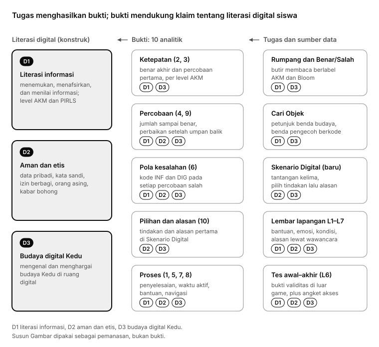

# Kamus Data Penelitian GELITA

**Judul penelitian:** *Pengembangan Game Edukasi Etnopedagogi Kedu Berbasis Analitik sebagai Model Asesmen Literasi Digital Peserta Didik Sekolah Dasar*

Per 26 Oktober 2026 · Bagian dari [revisi 10 analitik](01_REVISI_10_ANALITIK.md) · `kamus-1.0`, disetujui pemilik proyek 26 Oktober 2026 (daftar kerja no. 2); ambang jeda dan tebakan cepat masih sementara

Kamus ini membekukan **cara menghitung** setiap data penelitian: peta bukti, 10 analitik, butir yang dinilai, "dilewati", waktu aktif, data tersensor, tebakan cepat, kode, dan aturan menggabungkan log dengan lembar lapangan. Dokumen [01](01_REVISI_10_ANALITIK.md) menjelaskan *apa* yang diukur dan *kenapa*; kamus ini menjelaskan *bagaimana* angkanya didapat, sampai bisa dihitung ulang orang lain dari data mentah. Arti setiap kode tetap di [03](03_KODE_DAN_ARTI.md); di sini hanya aturan memakainya.

Kamus ini belum mengubah sistem. Nama kolom ditulis dalam bahasa Inggris karena nanti menjadi nama kolom di lapis data turunan dan ekspor peneliti (tahap 3, perubahan sistem no. 9 dan 14). Kolom yang **sudah ada** di sistem sekarang ditandai *(ada)*; sisanya baru. Keputusan pemilik proyek atas draf kamus ini dikumpulkan di [Keputusan pemilik proyek](#keputusan-pemilik-proyek).

## Ringkasan

1. **Data inti analisis adalah percobaan pertama di pengerjaan pertama**, yaitu pengerjaan yang memakai variasi buklet siswa. Pengerjaan ulang disimpan, tapi tidak dinilai.
2. **Butir tanpa percobaan adalah data hilang, bukan salah.** Butir yang belum berhasil setelah tiga kesempatan adalah data **tersensor**, bukan angka 3.
3. **"Dilewati" dihitung dalam tiga jenis terpisah:** (a) butir ditutup setelah kesempatan habis di tantangan yang kesempatannya per butir (Cari Objek dan Skenario Digital), (b) pengerjaan ditinggal dan tidak dilanjutkan di sesi lapangan yang sama, (c) tantangan yang sudah terbuka tapi tidak pernah dimulai.
4. **Waktu aktif** = waktu total dikurangi selang layar tersembunyi dan bagian jeda tanpa masukan yang melebihi ambang (sementara 3 menit). Narasi yang sedang diputar dihitung aktif.
5. **Setiap percobaan salah membawa tepat satu kode isi** dari bank soal. Tebakan cepat (NON-TEB) dan jawaban terakhir saat kesempatan habis (NON-HABIS) adalah penanda tambahan yang dihitung sistem, bukan pengganti kode di data mentah.
6. **Ambang masih sementara:** jeda 3 menit dan tebakan cepat di bawah 3 detik. Keduanya pengaturan yang mudah diubah tanpa mengubah sistem, ditetapkan ulang setelah uji coba, lalu dibekukan di gerbang G4 bersama pra-registrasi.

## Versi dan cara berubah

| Versi | Kapan | Isi |
| --- | --- | --- |
| Draf | 25 Oktober 2026 | Disusun Claude, dengan empat pertanyaan untuk pemilik proyek |
| `kamus-1.0` | 26 Oktober 2026, disetujui pemilik proyek | Semua definisi beku. Ambang jeda (3 menit) dan tebakan cepat (3 detik) masih sementara |
| `kamus-1.1` | Setelah uji coba (tahap 4), sebelum G4 | Ambang jeda dan tebakan cepat ditetapkan ulang, dan urutan alasan ditetapkan, dari data uji coba |
| Beku | Sejak G4 sampai analisis selesai | Tidak diubah selama pengambilan data utama. Kesalahan yang ketahuan kemudian dicatat sebagai penyimpangan, dan analisisnya dijalankan dengan aturan lama dan baru |

Setiap tabel data turunan menyimpan kolom `dictionary_version`, supaya angka di naskah bisa ditelusuri ke versi kamus yang dipakai. Setiap perubahan dicatat di [04](04_CATATAN_KEPUTUSAN.md).

## Peta bukti (beku)

Peta bukti menyambungkan klaim, bukti, dan tugas. Gambar di [01](01_REVISI_10_ANALITIK.md#kerangka-peta-bukti) sudah disesuaikan dengan kisi-kisi yang disetujui.

| Tugas | Butir yang dinilai | Skala | Analitik yang memakai |
| --- | --- | --- | --- |
| Isi Rumpang (`*-2`) | Setiap rumpang | D1 (D1a atau D1b) | 1–9 |
| Benar atau Salah (`*-3`), termasuk kartu jangkar `x` | Setiap pernyataan | D1 (D1a atau D1b) | 1–9 |
| Skenario Digital (`*-5`) | Setiap skenario: tindakan diskor, alasan dikode | D2 | 1–10 |
| Cari Objek babak 2 *Periksa Unggahan* (`*-4-a`, `*-4-b`) | Setiap petunjuk | D3 | 1–9 |
| Cari Objek babak 1 *Temukan Benda* (`*-4-x`) | Setiap petunjuk | PBK, skala pendamping | 1–9 |
| Skala sikap di Balai Refleksi | Setiap butir skala (daftar kerja no. 19) | `sikap`, skala pendamping | — |
| Susun Gambar (`*-1`) | Tidak ada | Pemanasan, tidak dinilai | 1, 5 |
| Pendaftaran akun | Metrik kata sandi | Bukti validitas luar D2, tidak masuk skor | 10 |
| Lembar L1–L7 | — | Penanda dan kovariat | Semua |
| Tes awal–akhir (L6) | Di luar game | Bukti validitas | — |

Setiap butir punya **tepat satu dimensi utama** (model *between-item*). Kode kesalahan tidak menentukan dimensi; dimensinya ikut butir. Karena itu DIG-HOX hanya D2 dan analitik 10 hanya D2 (03 disesuaikan).

## Istilah dasar

| Istilah | Arti di kamus ini | Kolom |
| --- | --- | --- |
| Peserta | Siswa yang punya kode peserta | `participant_code` (format `S03-A07`) |
| Sesi lapangan | Satu pertemuan satu rombel, dibuat P1 di panel peneliti; membawa token, wilayah yang dibuka, dan jam buka–tutup | `field_session_code` (format `S03-A-P1`) |
| Pertemuan | Pertemuan ke-1 sampai ke-5. Di kode sesi ditulis `P1`–`P5`; jangan tertukar dengan peran peneliti P1–P3 | `meeting_no` (1–5) |
| Sesi game | Satu sesi bermain di game, dimulai saat siswa masuk dan mengetik token. Satu sesi lapangan bisa berisi beberapa sesi game seorang siswa (misalnya setelah keluar dan masuk lagi) | `session_code` *(ada)* |
| Tantangan | Satu dari 15 tantangan, `tmg-1` sampai `wnb-5` | `node_ref` *(ada)* |
| Babak | Babak Cari Objek: 1 *Temukan Benda*, 2 *Periksa Unggahan* | `round` |
| Butir | Satuan yang dinilai: rumpang, pernyataan, petunjuk, atau skenario | `item_key` *(ada)* |
| Testlet | Kelompok butir yang berbagi bacaan, kartu, atau adegan | `testlet_key` |
| Pengerjaan | Satu kali tantangan dibuka sampai ditutup | `attempt_id`, `attempt_no` *(ada)* |
| Pengerjaan pertama | Pengerjaan dengan variasi buklet siswa, sampai tantangan itu tertutup untuk pertama kali. Satu-satunya pengerjaan yang dinilai | `is_scored_attempt` |
| Pengerjaan ulang | Setiap pengerjaan setelah tantangan tertutup. Disimpan, tidak dinilai | `is_retake` |
| Kesempatan | Batas percobaan, yaitu tiga. Dihitung per butir atau per tantangan, lihat tabel di bawah | `max_tries` *(ada)* |
| Percobaan | Satu jawaban yang dinilai server. Artinya per jenis tantangan ada di [Percobaan per jenis tantangan](#percobaan-per-jenis-tantangan) | `try_no` *(ada)* |
| Butir tertutup | Butir yang sudah benar, atau yang kesempatannya habis | `closed_at`, `closed_reason` |
| Tantangan tertutup | Semua butirnya tertutup | `completion_reason` *(ada)* |

### Percobaan per jenis tantangan

| Jenis | Satu percobaan adalah | Kesempatan dihitung per | Butir tertutup saat |
| --- | --- | --- | --- |
| Isi Rumpang, Benar atau Salah (termasuk kartu jangkar) | Satu kali **Cek**: setiap butir yang belum benar mendapat satu percobaan; butir yang sudah benar terkunci | Tantangan (tiga kali Cek) | Benar, atau Cek ketiga selesai |
| Cari Objek, kedua babak | Satu ketukan pada **bagian ketuk** (benda atau bagian unggahan) saat petunjuk itu aktif | Petunjuk | Ketukan benar, atau ketukan salah ketiga |
| Skenario Digital | Satu pilihan tindakan **dan** satu pilihan alasan | Skenario | Tindakan tepat dipilih, atau kesempatan ketiga selesai |
| Susun Gambar | Satu kali Cek | Tantangan | Tidak dinilai |

Ketukan di luar bagian ketuk mana pun **bukan percobaan** dan tidak memakai kesempatan (lihat NON-SEN di [Analitik 6](#analitik-6-pola-kesalahan)).

## Kunci penggabungan dan waktu

- **Kunci antartabel:** `participant_code`, `field_session_code`, `session_code`, `attempt_id`, `item_key`, `try_no`.
- **Kunci dengan lembar lapangan:** kode peserta, kode sesi lapangan, dan jam WIB.
- **Satu sesi game masuk tepat satu sesi lapangan**, lewat token yang diketik siswa. Setiap percobaan dan event ikut sesi lapangan dari sesi game-nya.
- **Waktu disimpan dalam WIB**, ISO 8601 dengan milidetik. Waktu percobaan adalah waktu server saat percobaan dinilai. Waktu event dari perangkat dikoreksi: `occurred_at_corrected = occurred_at + clock_offset_ms` *(ada)*. Semua selang waktu di kamus ini memakai waktu terkoreksi.
- **Jam lembar lapangan** diambil dari ponsel yang jamnya diatur otomatis dari jaringan, sampai detik (02). Selisih jam ponsel dan server dianggap kecil dibanding jendela pencocokan di bawah.
- **Data di luar sesi lapangan tidak ada**, karena game tertutup di luar sesi. Kalau tetap muncul (misalnya karena salah atur), datanya diberi `outside_session = 1` dan dikeluarkan dari semua analisis.

## Data yang dinilai

### Butir dan skor per dimensi

Per siswa di pengerjaan pertama (sesuai [06](06_KISI_KISI_BANK_SOAL.md#per-siswa-pengerjaan-pertama)):

| Skala | Butir per siswa | Skor per butir | Model |
| --- | --- | --- | --- |
| D1 Literasi informasi | 37 (26 D1a, 11 D1b; termasuk 6 butir jangkar) | 0–1 | Rasch dikotomus |
| D2 Aman dan etis | 12 skenario | 0–1–2 dari tindakan pertama | *Partial credit* |
| D3 Partisipasi dan representasi budaya Kedu | 12 petunjuk | 0–1 | Rasch dikotomus |
| Literasi digital | 61 | | Multidimensi *between-item*, dibandingkan dengan satu dimensi |
| PBK (pendamping) | 12 petunjuk | 0–1 | Rasch satu dimensi, terpisah; kovariat |
| `sikap` (pendamping) | Mengikuti instrumen no. 19 | Mengikuti instrumen | Terpisah, di luar skor literasi digital |

Bintang dan Serpihan Cahaya tidak dianalisis sebagai prestasi (01). Super-item testlet tidak dibuat di sistem; sistem cukup menyediakan `testlet_key`, dan keputusannya diambil di lapis analisis setelah uji Q3.

### Pengerjaan pertama

- Pengerjaan pertama adalah pengerjaan yang memakai **variasi buklet** siswa ([06](06_KISI_KISI_BANK_SOAL.md#desain-buklet-usulan)), dihitung sampai tantangan itu **tertutup untuk pertama kali**.
- **Pengerjaan pertama yang terputus dilanjutkan, bukan diulang.** Kalau siswa keluar sebelum tantangan tertutup, lalu membukanya lagi di sesi lapangan yang sama atau di pertemuan 5 (susulan), sistem melanjutkan pengerjaan yang sama: butir yang sudah tertutup tetap tertutup, dan nomor percobaan butir yang terbuka berlanjut. Ini syarat untuk mode penelitian di tahap 3 (perubahan sistem no. 16). Alasannya: kalau dibuat pengerjaan baru, percobaan pertama yang kedua sudah tercampur umpan balik dari yang pertama.
- **Aturan cadangan di lapis turunan.** Kalau data tetap memuat dua pengerjaan sebelum tantangan tertutup (misalnya karena gangguan sistem), percobaan setiap butir diurutkan menurut waktu lintas pengerjaan. Percobaan pertama adalah yang paling awal, dan hanya tiga percobaan pertama yang dipakai. Sisanya diberi `anomaly = 'extra_try'` dan tidak dinilai.
- **Pengerjaan ulang** baru terbuka setelah kelima tantangan wilayah pertemuan itu tuntas, hanya di dalam sesi (keputusan 25 Oktober 2026). Datanya disimpan dengan `is_retake = 1` dan hanya dipakai secara deskriptif.

### Data hilang

| Keadaan | Nilai di data turunan | Diperlakukan di analisis |
| --- | --- | --- |
| Butir punya minimal satu percobaan di pengerjaan pertama | Skor sesuai analitik | Data |
| Tantangan tidak pernah dimulai, atau tidak pernah terbuka | `first_try_score` kosong; `missing_reason` = `not_started` atau `locked` | Hilang (tidak diberikan) |
| Tantangan dimulai, tapi butir ini belum punya percobaan saat pengambilan data selesai | `first_try_score` kosong; `missing_reason = 'no_try'` | Hilang |
| Percobaan berasal dari perangkat yang dipakai bersama (L2) | Skor tetap ditulis; `shared_device = 1` | Lihat [Penanda untuk analisis](#penanda-untuk-analisis) |

Kosong selalu berarti "tidak ada data", tidak pernah 0.

### Penanda untuk analisis

Penanda tidak mengubah data mentah. Tiga penanda mengeluarkan data dari analisis (`consent_ok = 0`, `is_pilot = 1`, `outside_session = 1`); sisanya dipakai untuk menjalankan analisis utama dua kali, dengan dan tanpa data bertanda (01, *Rencana analisis singkat*), atau sebagai kovariat.

| Penanda | Satuan | Aturan | Sumber |
| --- | --- | --- | --- |
| `consent_ok` | Peserta | 1 kalau izin orang tua dan persetujuan siswa lengkap di L7, dan siswa tidak mengundurkan diri. Data dengan 0 tidak dianalisis dan diurus sesuai protokol | L7 |
| `is_pilot` | Peserta | 1 kalau kode sekolah berawalan `U`. Tidak masuk analisis utama | Kode peserta |
| `shared_device` | Percobaan | 1 kalau perangkat dipakai bersama di sesi itu (L2 "Pakai bareng: Ya") | L2 |
| `helped_content` | Percobaan | 1 kalau ada kejadian L3 berjenis ISI, STR, atau BHS untuk siswa itu, dari 1 menit sebelum sampai 2 menit sesudah jam kejadian (lihat [L3](#aturan-gabung-lembar-lapangan)) | L3 |
| `helped_technical` | Percobaan | Sama, untuk jenis TKN | L3 |
| `encouraged` | Percobaan | Sama, untuk jenis SMG | L3 |
| `disturbed` | Percobaan | Sama, untuk gangguan GG-* | L3 |
| `deviation_code` | Percobaan | Kode DEV-* L1 yang mengenai siswa itu pada jam percobaan | L1 |
| `rapid_guess` | Percobaan | Tebakan cepat, lihat [Analitik 6](#analitik-6-pola-kesalahan) | Log |
| `is_retake` | Pengerjaan | Pengerjaan ulang | Log |
| `outside_session` | Event | Data di luar sesi lapangan | Log |

Analisis utama yang dijalankan dua kali: tanpa dan dengan percobaan `helped_content = 1`, dan tanpa dan dengan `shared_device = 1` (01). Penanda `helped_technical`, `encouraged`, dan `disturbed` dipakai sebagai kovariat, tidak untuk mengeluarkan data. Percobaan `rapid_guess = 1` dipakai apa adanya di analisis utama; analisis kedua memperlakukannya sebagai data hilang (keputusan 26 Oktober 2026).

### Data siswa yang bisa dianalisis

Target sampel 300 siswa yang datanya bisa dianalisis ([06](06_KISI_KISI_BANK_SOAL.md#setengah-sampel-per-butir-variasi)) didefinisikan begini (keputusan 26 Oktober 2026):

- `analysable = 1` kalau `consent_ok = 1`, `is_pilot = 0`, dan siswa punya percobaan pertama yang **tidak** bertanda `shared_device` pada **sedikitnya 80% butir literasi digital** (49 dari 61).
- `complete = 1` kalau ke-61 butir punya percobaan pertama. Angka ini dilaporkan, tapi tidak menjadi syarat analisis, karena model Rasch bisa memakai data yang tidak lengkap.

## Sepuluh analitik

Setiap analitik di bawah memuat definisi, satuan, kolom keluaran di lapis turunan, dan sumber data mentahnya. Status di sistem dan alasan penelitiannya tetap di [01](01_REVISI_10_ANALITIK.md#10-analitik-versi-revisi).

### Analitik 1 Penyelesaian aktivitas

**Satuan:** peserta × tantangan (15), dirangkum per wilayah dan per pertemuan.

**Status penyelesaian** (`completion_status`), dinilai di akhir pengambilan data, dari pengerjaan pertama:

| Nilai | Arti |
| --- | --- |
| `solved` | Tantangan tertutup, semua butir benar |
| `exhausted` | Tantangan tertutup, minimal satu butir tidak benar setelah kesempatan habis |
| `unfinished` | Tantangan pernah dimulai, tapi tidak pernah tertutup |
| `not_started` | Tantangan sudah terbuka untuk siswa itu, tapi tidak pernah dimulai |
| `locked` | Tantangan tidak pernah terbuka, karena wilayahnya tidak dibuka untuk siswa itu atau tantangan sebelumnya belum tuntas (tantangan dalam satu wilayah terbuka berurutan) |

Tantangan **tuntas** = `solved` atau `exhausted`, sama dengan aturan Serpihan Cahaya sekarang. Wilayah tuntas = kelima tantangannya tuntas.

**Tiga jenis "dilewati"**, dihitung terpisah dan tidak saling meniadakan:

| Jenis | Kolom | Definisi | Satuan | Sumber |
| --- | --- | --- | --- | --- |
| (a) Ditutup setelah kesempatan habis | `skipped_failed_count` | Banyak butir yang ditutup tanpa jawaban benar setelah kesempatan ketiga, di tantangan yang kesempatannya per butir: petunjuk Cari Objek (kedua babak) dan skenario Skenario Digital | Peserta × tantangan | Event `clue_failed` *(ada)*; untuk skenario, event baru yang setara |
| (b) Ditinggal | `skipped_left_count` | Banyak kejadian pengerjaan pertama yang ditinggal (tombol Keluar, halaman ditutup, atau sesi berakhir) saat tantangan belum tertutup, **dan tidak dilanjutkan di sesi lapangan yang sama** | Peserta × tantangan × sesi lapangan | `challenge_abandoned` *(ada)* dan aktivitas pengerjaan sesudahnya |
| (c) Tidak dimulai | `completion_status = 'not_started'` | Tantangan sudah terbuka (wilayahnya dibuka token dan tantangan sebelumnya sudah tuntas) tapi tidak pernah dimulai sampai pengambilan data selesai. Tantangan yang tidak pernah terbuka diberi `locked`, bukan dilewati | Peserta × tantangan | Progres dan sesi lapangan |

Jenis (b) tetap terhitung walaupun tantangannya kemudian dilanjutkan dan tuntas di pertemuan 5; status akhirnya tetap `solved` atau `exhausted`. Di Isi Rumpang dan Benar atau Salah, butir yang salah setelah Cek ketiga **tidak** termasuk jenis (a); butir itu tercatat sebagai `exhausted` dan tersensor (Analitik 4).

**Kolom tambahan:** `closed_meeting_no` (pertemuan saat tantangan tuntas), `regions_completed` (0–3), `challenges_completed` (0–15), `scored_challenges_completed` (0–12).

### Analitik 2 Ketepatan jawaban

**Satuan:** peserta × butir, di pengerjaan pertama.

- `final_correct` = 1 kalau butir tertutup benar dalam tiga kesempatan, 0 kalau tertutup tidak benar, kosong kalau tidak ada percobaan. Untuk Skenario Digital, 1 berarti tindakan tepat dipilih di salah satu kesempatan.
- `final_score` untuk D2 = skor tindakan di percobaan terakhir (0–2); untuk butir lain sama dengan `final_correct`.
- **Ringkasan:** proporsi benar akhir per dimensi, sub-aspek (D1a, D1b), level AKM (L1–L3), wilayah, topik D2, dan jenis petunjuk D3. Penyebutnya butir yang punya percobaan.
- Ketepatan akhir sudah tercampur umpan balik, jadi hanya dipakai deskriptif. Ukuran kemampuan memakai Analitik 3.

### Analitik 3 Ketepatan percobaan pertama

**Satuan:** peserta × butir, di pengerjaan pertama. Ini data inti untuk Rasch.

| Jenis | Percobaan pertama | `first_try_score` |
| --- | --- | --- |
| Isi Rumpang | Kata di rumpang itu saat Cek pertama | 0–1 |
| Benar atau Salah, kartu jangkar | Pilihan Benar/Salah di kartu itu saat Cek pertama | 0–1 |
| Temukan Benda (PBK) | Ketukan pertama pada bagian ketuk saat petunjuk itu aktif | 0–1 |
| Periksa Unggahan (D3) | Sama | 0–1 |
| Skenario Digital (D2) | Tindakan di kesempatan pertama | 0, 1, atau 2 |

- `first_try_correct` = 1 kalau `first_try_score` maksimal (untuk D2 berarti skor 2). Dipakai untuk tabel deskriptif; Rasch D2 memakai skor 0–2.
- Percobaan pertama selalu **sebelum umpan balik** atas butir itu. Bantuan yang dibuka sebelumnya tidak membatalkan percobaan; perannya dicatat di Analitik 7.
- Di Cari Objek, siswa boleh berpindah petunjuk. Ketukan hanya dihitung untuk petunjuk yang aktif saat diketuk, seperti di game sekarang (`engines/cari.js`).
- Peluang tebakan Benar atau Salah tetap 50%; itu ditangani di analisis, bukan di kamus.

### Analitik 4 Jumlah percobaan

**Satuan:** peserta × butir, di pengerjaan pertama.

| Kolom | Arti |
| --- | --- |
| `tries_used` | Banyak percobaan yang dibuat untuk butir itu (1–3) |
| `solved_on_try` | Percobaan ke berapa butir benar (1, 2, 3); kosong kalau tidak pernah benar *(ada)* |
| `censored` | 1 kalau butir tidak pernah benar |
| `censor_reason` | `exhausted`: tiga percobaan dipakai tanpa benar. `left`: kurang dari tiga percobaan dan butir tidak pernah tertutup |

- Di Isi Rumpang dan Benar atau Salah, `solved_on_try` adalah nomor Cek saat butir pertama kali benar; butir yang sudah benar terkunci, jadi tidak punya percobaan lagi.
- Di Skenario Digital, `solved_on_try` adalah kesempatan saat tindakan tepat dipilih. Tindakan "kurang tepat" (skor 1) belum dihitung benar.
- **Data tersensor tidak pernah diisi angka 3** atau 4 (01). Analisisnya memakai model ordinal atau model kejadian waktu-diskret dengan sensor.

### Analitik 5 Waktu pengerjaan

**Satuan:** pengerjaan (utama), butir (Cari Objek dan Skenario Digital), dan sesi lapangan.

**Garis waktu satu pengerjaan.** Mulai = layar tantangan tampil (`challenge_opened` *(ada)*, sesudah kartu misi). Selesai = percobaan yang menutup tantangan, atau event terakhir pengerjaan itu kalau tantangan ditinggal. Kalau pengerjaan dilanjutkan di sesi lain, setiap potongan dihitung sendiri lalu dijumlahkan; selang di antara potongan tidak dihitung.

| Kolom | Rumus |
| --- | --- |
| `total_ms` | Jumlah (selesai − mulai) setiap potongan |
| `hidden_ms` | Jumlah selang `page_hidden` sampai `page_visible` berikutnya (atau sampai selesai) *(event ada)* |
| `idle_excess_ms` | Untuk setiap jeda tanpa masukan yang lebih panjang dari ambang **T_idle**, bagian yang melebihi T_idle (keputusan 26 Oktober 2026). Jeda 5 menit dengan T_idle 3 menit menyumbang 3 menit aktif |
| `active_ms` | `total_ms − hidden_ms − idle_excess_ms` |

**Aturan jeda tanpa masukan:**

- **Masukan** = sentuhan atau klik, tombol keyboard, gulir, dan seret. Gerakan tetikus tanpa klik tidak dihitung, supaya laptop dan tablet diperlakukan sama.
- Selang saat **narasi sedang diputar** tidak pernah dihitung jeda (siswa sedang mendengarkan).
- Selang yang sudah masuk `hidden_ms` tidak dihitung lagi sebagai jeda.
- **T_idle sementara 3 menit** (keputusan 26 Oktober 2026). Uji coba memeriksa nilainya, termasuk apakah layar dengan bacaan panjang butuh ambang lain.
- Supaya ambang bisa ditetapkan sesudah uji coba tanpa kehilangan data, sistem mencatat **setiap jeda masukan 20 detik atau lebih** (jam mulai dan jam akhir) di data mentah.
- **Ambang adalah pengaturan, bukan angka di kode.** T_idle dan T_teb disimpan di konfigurasi studi. Mengubahnya tidak butuh perubahan sistem: lapis turunan dihitung ulang dari data mentah, dan nilai ambang yang dipakai tercatat bersama `dictionary_version`.

**Waktu per butir:**

- Cari Objek: dari petunjuk aktif sampai butir tertutup. Kalau siswa berpindah petunjuk, yang dijumlahkan hanya selang saat petunjuk itu aktif. Ada versi total dan aktif.
- Skenario Digital: dari situasi tampil sampai skenario tertutup, total dan aktif.
- Isi Rumpang dan Benar atau Salah: butir berbagi satu layar, jadi waktu per butir hanya **perkiraan**: `first_input_ms` dan `last_input_ms` *(ada)*. Analisis waktu memakai tingkat pengerjaan.

**Sesi:** `session_active_ms` per peserta × sesi lapangan = jumlah `active_ms` semua pengerjaan ditambah waktu aktif di luar tantangan (cerita, peta, Pustaka) dengan aturan jeda yang sama. Kolom `game_sessions.duration_ms` *(ada)* memakai aturan denyut yang lain dan tidak dipakai untuk analisis.

**Kovariat:** `cumulative_active_ms` (waktu aktif kumulatif sampai pengerjaan dimulai) dan `meeting_no`, karena urutan wilayah tidak bisa diacak (01).

**Pelaporan:** waktu total dan waktu aktif selalu dilaporkan berdampingan, dengan median dan rentang antarkuartil.

### Analitik 6 Pola kesalahan

**Satuan:** percobaan salah.

**Kode isi** (`error_code`). Setiap percobaan salah membawa tepat satu kode dari bank soal. Server menurunkannya dari pilihan yang dipilih siswa saat percobaan dinilai, dan kode tidak pernah dikirim ke browser (perubahan sistem no. 1).

| Jenis | Kode diambil dari | Kode yang boleh |
| --- | --- | --- |
| Isi Rumpang | Sel rumpang × kata di matriks kode (`cloze_matrix`), dengan tiga aturan tetap di [08](08_DRAF_BANK_SOAL.md#cara-membaca) | INF-LIT, INF-KAT, INF-REL, INF-HUB, INF-GEN |
| Benar atau Salah, kartu jangkar | Kode jebakan pernyataan; dipakai setiap kali pernyataan itu dinilai keliru | D1a: INF-LIT, INF-KAT, INF-REL, INF-HUB. D1b: INF-SUM, INF-FOP, INF-GEN |
| Temukan Benda (PBK) | Kode benda pengecoh. Benda sasaran petunjuk lain = INF-LIT | INF-BUD, INF-LIT |
| Periksa Unggahan (D3) | Kode pengecoh utama di tabel petunjuk. Bagian ketuk lain, termasuk kunci petunjuk lain = kode jenis petunjuk itu (keputusan 26 Oktober 2026) | BUD-ATR, BUD-REP, BUD-IZN, BUD-ETK |
| Skenario Digital, tindakan | Kode pilihan tindakan dengan skor 0 atau 1 | DIG-PRI, DIG-SAN, DIG-IZN, DIG-ASG, DIG-HOX, DIG-ETK, DIG-PSF |
| Susun Gambar | Tidak dikode | — |

Kode `*-LAIN` tidak pernah ada di bank. Kode itu hanya diberikan saat pengodean manual (misalnya transkrip L5), dan disimpan di kolom terpisah `manual_code` supaya kode bank tidak tertimpa.

**Kode alasan** (`reason_code`): kode R-* dari pilihan alasan, dicatat di **setiap** percobaan Skenario Digital, termasuk yang tindakannya tepat.

**Penanda prosedural** (kolom sendiri, dihitung sistem, tidak mengganti `error_code` di data mentah):

| Kode | Kolom | Aturan |
| --- | --- | --- |
| NON-TEB | `rapid_guess` | 1 kalau **waktu putus** (`decision_ms`) kurang dari ambang **T_teb** (sementara 3 detik, keputusan 26 Oktober 2026; pengaturan yang ditetapkan ulang setelah uji coba). Dihitung untuk Benar atau Salah, kartu jangkar, Cari Objek, dan tindakan Skenario Digital. Untuk alasan Skenario Digital dicatat di `reason_rapid`. Tidak dihitung untuk Isi Rumpang, karena menyeret beberapa kata berturut-turut setelah membaca satu bacaan bukan keputusan yang terpisah |
| NON-HABIS | `last_try_exhausted` | 1 pada percobaan salah yang menghabiskan kesempatan terakhir butir itu |
| NON-SEN | `near_miss_count` (per butir) | Banyak ketukan di luar semua bagian ketuk, yang jaraknya paling jauh 24 dp dari bagian ketuk kunci petunjuk yang aktif. Bukan percobaan dan tidak memakai kesempatan. Ketukan kosong yang lebih jauh dihitung di `empty_tap_count` |

**Waktu putus** (`decision_ms`) = selang dari saat butir bisa dijawab sampai masukan yang dinilai:

- Cari Objek: dari petunjuk aktif (percobaan pertama) atau dari umpan balik ketukan sebelumnya selesai, sampai ketukan.
- Skenario Digital: dari pilihan tindakan tampil sampai tindakan dipilih; untuk alasan, dari pilihan alasan tampil sampai alasan dipilih.
- Benar atau Salah: semua pernyataan terlihat bersama, jadi waktu putus adalah **perkiraan**: selang dari masukan sebelumnya di pengerjaan itu (atau dari layar tampil, atau dari umpan balik Cek sebelumnya) sampai pilihan terakhir di kartu itu sebelum Cek. Kalau kartu yang salah tidak disentuh lagi sebelum Cek berikutnya, waktu putusnya kosong dan `rapid_guess` tidak dihitung.

**Kode untuk analisis pola** (`error_code_analysis`): sama dengan `error_code`, kecuali percobaan bertanda `rapid_guess` diberi NON-TEB, karena tebakan cepat tidak menunjukkan salah paham tertentu. `last_try_exhausted` hanya penanda; pola kesalahan dilaporkan dengan dan tanpa percobaan itu.

**Ringkasan utama** memakai kesalahan di **percobaan pertama** saja (satu kesalahan per siswa per butir), supaya siswa yang sering mencoba ulang tidak lebih berbobot. Kesalahan di semua percobaan dipakai di Analitik 9. Frekuensi dilaporkan per wilayah, dimensi, sub-aspek, dan level AKM.

**Validasi pengodean** tetap seperti di 01: dua pengode terpisah pada sampel 20% jawaban dan semua transkrip L5, Cohen's κ ≥ 0,70.

### Analitik 7 Penggunaan bantuan

**Satuan:** percobaan dan pengerjaan. Bantuan dihitung hanya kalau **dipilih siswa**; narasi yang berbunyi sendiri (*autoplay*) dicatat, tapi tidak dihitung bantuan.

| Jenis | Kolom | Definisi | Sumber |
| --- | --- | --- | --- |
| Tombol Bantuan 💡 | `hint_count` (pengerjaan) *(ada)* | Banyak Bantuan dibuka | `hint_opened` *(ada)* |
| | `hint_before` (percobaan) *(ada sebagai `hint_opened_before`)* | 1 kalau ada Bantuan dibuka di pengerjaan itu sebelum percobaan dinilai | Log |
| | `item_hint_before` (percobaan) | 1 kalau Bantuan khusus butir itu dibuka sebelum percobaan | Log |
| Narasi soal | `item_narration_before` (percobaan) | 1 kalau narasi butir itu diputar siswa sebelum percobaan: situasi Skenario Digital dan petunjuk *Periksa Unggahan* lewat tombol ▶, serta narasi petunjuk Temukan Benda | `audio_play`, `audio_replay` *(ada)* |
| Narasi instruksi | `instruction_replays` (pengerjaan) | Banyak instruksi tantangan diputar ulang siswa. Butuh kode konteks narasi instruksi yang baru (perubahan sistem no. 6) | Log |
| Lama mendengar | `listened_ms` *(ada)* | Milidetik narasi didengar | Log |
| Bantuan orang | `helped_content`, `helped_technical`, `encouraged` | Lihat [Penanda untuk analisis](#penanda-untuk-analisis) | L3 |
| Headset | `headset_share` (sesi lapangan) | Siswa memakai headset dibagi siswa bermain. L1 tidak mencatat headset per siswa, jadi ini kovariat sesi | L1 |

Bacaan dan pernyataan D1 tidak pernah dibacakan (keputusan media), jadi butir D1 tidak punya narasi soal.

### Analitik 8 Navigasi permainan

**Satuan:** sesi game dan pengerjaan.

| Kolom | Definisi | Sumber |
| --- | --- | --- |
| Urutan layar | Urutan `screen_viewed` per sesi game, dengan waktu terkoreksi | `screen_viewed` *(ada, hanya server)* |
| `material_returns` (pengerjaan) | **Kembali ke materi**: (a) membuka Pustaka wilayah saat pengerjaan belum tertutup, ditambah (b) membuka lagi bacaan di dalam tantangan setelah masukan pertama, misalnya membuka panel bacaan atau mengetuk label "Berdasarkan Teks" | `library_opened` *(ada)*; event baru untuk (b) |
| `exit_count` (pengerjaan) | Banyak kali siswa keluar dari tantangan sebelum tertutup (tombol Keluar, Kembali, atau halaman ditutup) | `challenge_abandoned` *(ada)* |
| `library_pages`, `library_ms` (sesi) | Halaman Pustaka yang dibuka dan lama aktifnya | `library_page_viewed` *(ada)* |
| `reading_max_pct` (pengerjaan) | Bagian bacaan terjauh yang tergulir, dalam persen | `reading_progress` *(ada)* |

Event yang ditandai "Dihapus" di 01 (`answer_changed`, `answer_selected`, `dialogue_advanced`, `audio_pause`) tidak dipakai. Hitungan perubahan jawaban per butir tetap disimpan (`change_count` *(ada)*).

### Analitik 9 Perubahan setelah umpan balik

**Satuan:** peserta × butir yang **salah di percobaan pertama**.

| Nilai `change_after_feedback` | Arti |
| --- | --- |
| `fixed` | Percobaan kedua benar (D2: tindakan tepat) |
| `same_error` | Percobaan kedua salah dengan `error_code` yang sama |
| `other_error` | Percobaan kedua salah dengan `error_code` lain |
| `no_second_try` | Tidak ada percobaan kedua (butir ditinggal) |

- `answer_unchanged` = 1 kalau jawaban percobaan kedua persis sama dengan percobaan pertama (penting di Isi Rumpang dan Benar atau Salah, tempat siswa bisa menekan Cek tanpa mengubah jawaban). Di Benar atau Salah, `same_error` selalu berarti jawaban tidak diubah.
- Untuk D2, perpindahan dinilai dari **pilihan tindakan**, bukan dari kodenya, karena di 08 dua pilihan bisa berbagi kode (misalnya pilihan skor 0 dan skor 1 di `tmg-5-a03` sama-sama DIG-IZN): tindakan tepat = `fixed`, pilihan yang sama dengan percobaan pertama = `same_error`, pilihan lain yang belum tepat = `other_error`. Perpindahan skor (misalnya 0 ke 1) dicatat di `score_change`.
- Perpindahan percobaan kedua ke ketiga dihitung dengan aturan yang sama di kolom `change_after_feedback_2`, dan dilaporkan sebagai pelengkap.
- Untuk tantangan lain, dasarnya `error_code` mentah, bukan `error_code_analysis`.

### Analitik 10 Pilihan dan alasan di Skenario Digital

**Satuan:** peserta × skenario (12), dari kesempatan pertama.

| Kolom | Arti |
| --- | --- |
| `first_action_key` | Kunci pilihan tindakan pertama (pilihan tepat tidak punya kode kesalahan, jadi kuncinya yang disimpan) |
| `first_action_score` | 0, 1, atau 2 |
| `first_action_code` | Kode DIG-* tindakan pertama; kosong kalau tepat |
| `first_reason_code` | Kode R-* alasan pertama |
| `action_reason_pattern` | Pola gabungan, tabel di bawah |

| `action_reason_pattern` | Aturan |
| --- | --- |
| `safe_expected` | Skor 2, alasan R-RISK atau R-ETIK |
| `safe_rule` | Skor 2, alasan R-ATUR ("tindakannya benar, alasannya dangkal") |
| `safe_wrong_reason` | Skor 2, alasan R-SOS atau R-ACAK |
| `partial` | Skor 1, alasan apa pun (alasannya tetap disimpan) |
| `risky` | Skor 0, alasan apa pun |

- **"Tindakannya benar, alasannya keliru"** di 01 = `safe_rule` + `safe_wrong_reason`, dan keduanya juga dilaporkan terpisah.
- Urutan alasan R-ACAK/R-SOS < R-ATUR < R-RISK/R-ETIK (`reason_level` 0–2) baru dipakai **setelah uji coba** (keputusan kisi-kisi 06, pertanyaan 3). Sampai saat itu alasan hanya dikode, tidak diskor.
- **Metrik kata sandi saat daftar**, bukti validitas luar D2 yang tidak masuk skor: `pw_first_submit_criteria` (0–5 syarat terpenuhi di kiriman pertama) dan `pw_weak_submit_count` (banyak penolakan karena sandi lemah) *(keduanya ada)*. Dengan token, pendaftaran terjadi di pertemuan 1.
- Transkrip L5 dikode dengan kode R-* yang sama dan dibandingkan dengan `first_reason_code` siswa itu.

## Variabel butir

Ekspor butir (perubahan sistem no. 3, 8, dan 20) memuat satu baris per butir.

| Kolom | Isi |
| --- | --- |
| `item_key`, `node_ref`, `round`, `variant` *(sebagian ada)* | Kode butir, tantangan, babak, variasi (`a`, `b`, `x`, dan `c`–`j` untuk Susun Gambar) |
| `booklet_shared` | 1 untuk butir `x` (dipakai semua buklet) |
| `dimension`, `subaspect` | D1, D2, D3, PBK; D1a, D1b |
| `akm_level`, `pirls_process`, `bloom_level` | Label pengembang dari 08, diganti hasil pelabelan buta setelah tahap 2. Kolom `akm_level_source` mencatat asalnya (`developer` atau `expert`) |
| `text_genre`, `testlet_key` | Genre teks dan kelompok testlet |
| `d2_topic`, `d3_clue_type` | Topik skenario; jenis petunjuk (atribusi, representasi, izin, menghargai tradisi) |
| `option_count`, `reason_option_count` | Banyak pilihan tindakan dan alasan (D2), atau bagian ketuk (Cari Objek) |
| Beban permukaan | `gap_count`, `distractor_word_count`, `passage_words`, `decoy_count`, `puzzle_grid` (perubahan sistem no. 8) |
| `review_status`, `reference_source` | `needs_verification` atau sudah divalidasi; sumber fakta |

**Panjang bacaan** (`passage_words`) = banyak kata teks yang tampil di layar bacaan atau kartu (judul, isi, nama akun, keterangan, dan komentar), dihitung sebagai potongan yang dipisah spasi dan memuat minimal satu huruf atau angka. Emoji tidak dihitung.

## Variabel peserta dan sesi

| Satuan | Kolom | Sumber |
| --- | --- | --- |
| Peserta | `participant_code`, `school_code`, `rombel`, `booklet` (B1–B4) | Sistem, token, L2 |
| | `age`, `gender`, `class_level` *(ada)* | Pendaftaran |
| | `consent_ok`, `is_pilot`, `analysable`, `complete` | L7, kode peserta, kamus |
| | `pw_first_submit_criteria`, `pw_weak_submit_count` *(ada)* | Pendaftaran |
| | `rapid_share` | Proporsi percobaan pertama bertanda `rapid_guess`; penanda kesungguhan, ambangnya diputuskan setelah uji coba |
| Sesi lapangan | `field_session_code`, `meeting_no`, `region_opened`, tanggal, jam buka dan tutup | Panel peneliti |
| | Internet, kebisingan, kehadiran guru, `headset_share`, menit tersedia dan dipakai | L1 |
| Sesi game | `session_code`, `locale` *(ada)* | Log |
| | `device_type`, `screen_size` *(ada)* | Log (kovariat). Nama dan versi OS dan peramban, serta mode dan pergantian paket aset, hanya untuk admin; rincian perangkat lain dihapus (01) |

Nama, nama pengguna, nama sekolah, dan NPSN tidak pernah masuk data peneliti (01, *Admin dan peneliti*).

## Aturan gabung lembar lapangan

| Lembar | Kunci | Aturan | Hasil di data turunan |
| --- | --- | --- | --- |
| L1 bagian atas | Kode sesi lapangan | Satu baris per sesi lapangan | Kovariat sesi |
| L1 penyimpangan | Kode sesi lapangan, jam | Mengenai siswa di kolom "Siswa terdampak" (nomor kursi dicocokkan ke kode peserta lewat L2; "semua" berarti semua siswa sesi itu) dari jam kejadian sampai 5 menit sesudahnya, atau sampai akhir lama kejadian kalau lamanya ditulis | `deviation_code` per percobaan |
| L2 | Kode peserta, kode sesi lapangan | Menghubungkan kursi, perangkat, dan buklet; jam pindah perangkat memotong jendela | `booklet`, `shared_device` |
| L3 | Kode peserta, jam | Percobaan siswa itu dari 1 menit sebelum jam kejadian sampai 2 menit sesudahnya. Kalau jam selesai ditulis (kejadian lebih dari 2 menit), jendelanya dari 1 menit sebelum jam mulai sampai 2 menit sesudah jam selesai. Baris untuk beberapa kursi berlaku untuk setiap siswa di kursi itu | `helped_content`, `helped_technical`, `encouraged`, `disturbed` |
| L4 | Kode peserta, jam | Satu pengamatan menutup 20 detik sejak jamnya, dipasangkan dengan pengerjaan dan butir yang aktif di selang itu | Kode perilaku dan emosi per pengamatan |
| L5 | Kode peserta, kode butir | Transkrip dikode dengan kode R-*, INF, DIG, atau BUD; `*-LAIN` untuk yang tidak cocok | `manual_code` |
| L6 | Kode peserta | Skor tes awal dan akhir, angket akses digital | Variabel peserta |
| L7 | Kode peserta | Menentukan `consent_ok`. Nama hanya ada di L7 | `consent_ok` |

## Yang harus disediakan sistem di tahap 3

Kamus ini menambah syarat data berikut ke [Catatan perubahan sistem](01_REVISI_10_ANALITIK.md#catatan-perubahan-sistem-untuk-tahap-nanti). Semuanya dikerjakan di tahap 3, setelah G2.

| Syarat | Untuk | Perubahan sistem di 01 |
| --- | --- | --- |
| `error_code`, `reason_code`, dan skor tindakan disimpan di setiap percobaan | Analitik 6, 9, 10 | no. 1, 2 |
| Pengerjaan pertama yang terputus dilanjutkan, bukan dibuat baru | Data inti | no. 16 |
| Setiap jeda masukan 20 detik atau lebih dicatat; selang narasi diputar bisa dibaca dari log | Analitik 5 | no. 5 |
| Saat butir bisa dijawab dicatat (petunjuk aktif, pilihan tindakan dan alasan tampil, kartu Benar atau Salah disentuh pertama) | Waktu putus, NON-TEB | no. 14 |
| Ketukan di luar bagian ketuk dicatat dengan jaraknya ke kunci petunjuk aktif | NON-SEN | no. 14 |
| Event membuka lagi bacaan di dalam tantangan | Analitik 8 | no. 14 |
| Event penutupan skenario setelah kesempatan ketiga (setara `clue_failed`) | Analitik 1 jenis (a) | no. 2 |
| Kode konteks narasi instruksi | Analitik 7 | no. 6 |
| Sesi game menyimpan `field_session_code` dan nomor pertemuan | Semua | no. 11 |
| Wilayah yang dibuka token terbuka untuk semua siswa sesi itu, walaupun wilayah sebelumnya belum tuntas; tantangan di dalam wilayah tetap terbuka berurutan | Analitik 1 (`locked`) | no. 11 |
| Ambang T_idle dan T_teb disimpan di konfigurasi studi dan bisa diubah tanpa mengubah kode; lapis turunan dihitung ulang dengan ambang baru | Analitik 5, 6 | no. 9, 16 |
| Lapis turunan menyimpan `dictionary_version` dan diuji otomatis dengan contoh data yang hasilnya dihitung tangan dari kamus ini | Semua | no. 9 |
| Lembar *Kamus Data* di ekspor peneliti diturunkan dari kamus ini | Semua | no. 14 |

## Penyesuaian di dokumen lain

Perubahan yang ikut dikerjakan bersama kamus ini:

- **03:** DIG-HOX hanya D2 (bukan "D2, D1"); analitik 8 berlaku untuk D1–D3, analitik 10 hanya D2. Alasannya model *between-item*: dimensi ikut butir, bukan kode.
- **Gambar peta bukti:** D3 memakai nama yang disetujui; Isi Rumpang dan Benar atau Salah hanya D1, Cari Objek babak 2 D3 dengan babak 1 sebagai PBK, Skenario Digital hanya D2; pola kesalahan menyebut kode BUD.
- **01:** analitik 3 tidak lagi menyebut Susun Gambar, yang tidak dinilai sejak kisi-kisi 06. Contoh data mentah mendapat kolom `rapid_guess` (kosong untuk Isi Rumpang) dan memakai kode bank. Catatan perubahan sistem no. 14 menyebut syarat data dari kamus ini.
- **06:** siswa yang belum selesai melanjutkan di pertemuan 5 (susulan), bukan "di pertemuan berikutnya", sesuai keputusan token (P5 untuk tantangan yang tertinggal).
- **08:** aturan kode *Periksa Unggahan* di *Cara membaca* tidak lagi memakai INF-REL: bagian ketuk lain diberi kode jenis petunjuknya, dan ketukan di tempat kosong dekat kunci = NON-SEN tanpa memakai kesempatan (keputusan 26 Oktober 2026).
- **01 dan 03:** ambang sementara jeda 3 menit dan tebakan cepat di bawah 3 detik (keputusan 26 Oktober 2026).

Penegasan yang menafsirkan dokumen sebelumnya. Tafsiran ini tidak dikoreksi pemilik proyek saat menyetujui kamus, jadi ikut berlaku:

- "Dilewati" jenis (a) juga mencakup skenario yang ditutup setelah kesempatan ketiga, karena aturan tiga kesempatannya sama dengan petunjuk Cari Objek (keputusan 25 Oktober 2026).
- "Dibantu" untuk analisis utama hanya bantuan isi (ISI, STR, BHS). Bantuan teknis, semangat, dan gangguan dicatat terpisah sebagai kovariat.
- Ketukan di tempat kosong tidak memakai kesempatan, seperti game sekarang, yang hanya mengirim ketukan pada benda.
- Benda sasaran petunjuk lain di Temukan Benda diberi INF-LIT, karena kisi-kisi hanya mengizinkan INF-BUD dan INF-LIT di babak 1.
- NON-TEB tidak dihitung untuk Isi Rumpang (01 dan 03 tidak menyebut pengecualian), karena kata-kata satu bacaan diseret berturut-turut dan selang antarseretan bukan waktu memutuskan. `rapid_guess` di Isi Rumpang dibiarkan kosong.
- Token yang membuka wilayah sebuah pertemuan juga melewati aturan buka berurutan antarwilayah, supaya siswa yang belum menuntaskan wilayah sebelumnya tetap bisa bermain bersama kelasnya; sisanya dikerjakan di pertemuan 5.

## Keputusan pemilik proyek

Empat pertanyaan di draf diputuskan pemilik proyek pada 26 Oktober 2026:

1. **Kode bagian lain di *Periksa Unggahan*: setuju dengan usulan.** Mengetuk bagian ketuk yang bukan kunci dan bukan pengecoh utama (termasuk kunci petunjuk lain) diberi kode jenis petunjuk itu: atribusi BUD-ATR, representasi BUD-REP, izin BUD-IZN, menghargai tradisi BUD-ETK. Mengetuk di luar bagian ketuk mana pun = NON-SEN dan tidak memakai kesempatan. 08 sudah disesuaikan.
2. **Jeda tanpa masukan: ambang sementara 3 menit.** Hanya bagian jeda yang melebihi ambang yang dipotong dari waktu aktif. Ambangnya harus mudah diubah, jadi disimpan sebagai pengaturan dan ditetapkan ulang setelah uji coba.
3. **Data siswa yang bisa dianalisis: setuju dengan usulan.** Izin lengkap, bukan sekolah uji coba, dan percobaan pertama yang bukan dari perangkat bersama pada sedikitnya 80% butir literasi digital (49 dari 61).
4. **Tebakan cepat: dipakai apa adanya di analisis utama**, dengan ambang sementara di bawah 3 detik. Analisis kedua memperlakukan tebakan cepat sebagai data hilang.
