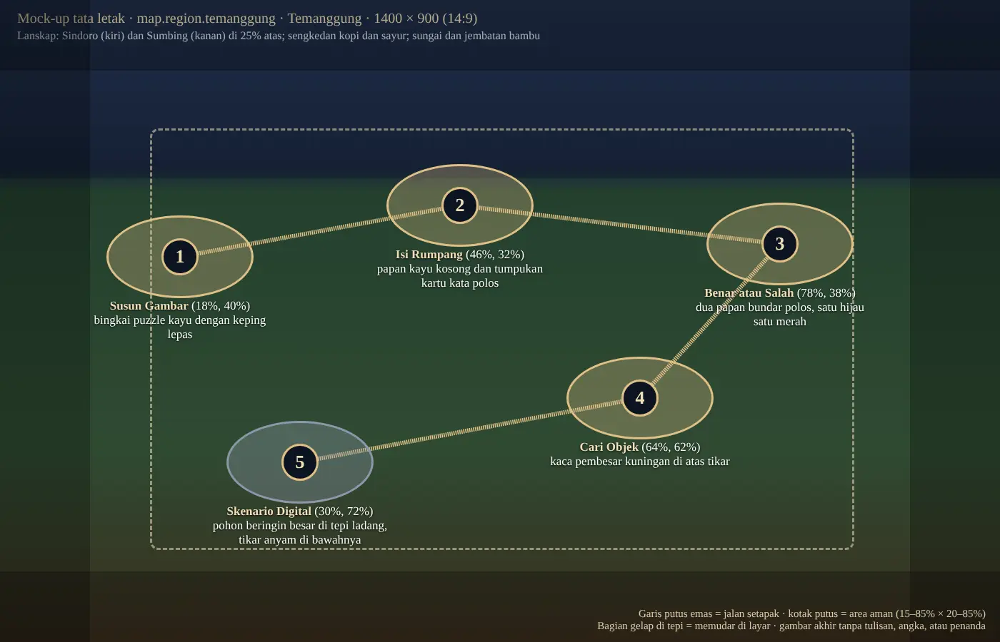

# Prompt Peta Wilayah Lima Tantangan, Kartu Skenario Digital, dan Latar Cerita Penghubung

**Judul penelitian:** *Pengembangan Game Edukasi Etnopedagogi Kedu Berbasis Analitik sebagai Model Asesmen Literasi Digital Peserta Didik Sekolah Dasar*

Per 8 November 2026 · Lampiran [32](32_IMPLEMENTASI_SKENARIO_DIGITAL.md) (tantangan kelima) dan [37](37_PROMPT_GAMBAR_SUSUN_DAN_CERITA.md) (latar cerita) · Status: `draf pengembang`, `asal: pengembang` (disusun AI atas permintaan pengembang)

Pengembang memutuskan (8 November 2026, [04](04_CATATAN_KEPUTUSAN.md)) bahwa letak tantangan kelima tidak ditebak di peta empat pos yang ada. Ketiga peta wilayah dibuat ulang untuk lima pos. Dokumen ini memuat mock-up tata letaknya dan prompt siap tempel ke ChatGPT (bahasa Inggris) untuk tujuh gambar yang masih ditunggu bagian 6:

| Kode | Gambar | Slot atau berkas | Pengganti sementara di repo |
| --- | --- | --- | --- |
| P-T, P-M, P-W | Peta wilayah lima tantangan, satu per wilayah | `map.region.{temanggung,magelang,wonosobo}` (1400 × 900) | Peta empat pos yang ada; tantangan kelima di posisi tebakan (60 %, 22 %) sampai peta baru dipasang |
| K-S | Kartu tantangan Skenario Digital | `public/assets/ui/node-card-skenario.webp` (640 × 360) | Mock-up gambar ponsel berkabut ([gambar](gambar/38/mockup-node-card-skenario.webp)), sudah terpasang |
| T-L1, M-L1, W-L1 | Latar cerita penghubung *Kabut di Layar* | `bg.cerita-layar-{wilayah}-01`–`06` (1920 × 1080) | Langit dan gunung peta wilayah di bawah kabut biru kelabu ([contoh](gambar/38/mockup-bg-cerita-layar-temanggung.webp)), di `gelita-katalog/mockup/gambar-mockup/cerita-layar/` |

Prompt T-L1, M-L1, dan W-L1 disalin apa adanya dari 37 supaya ketiga jenis gambar ada di satu berkas; bila salah satu diubah, ubah keduanya.

## Cara memakai

1. Buka percakapan baru di ChatGPT untuk setiap gambar. Lampirkan acuan gaya `reference.06` atau `reference.07` dari `gelita-katalog/assets/referensi/`. Untuk peta, lampirkan juga mock-up tata letak wilayahnya dan peta empat pos yang lama (`gelita-katalog/assets/peta/map.region.{wilayah}.webp`) sebagai acuan suasana, lalu tulis: *"Use the first image only for the positions of the five clearings and the path; use the second only for mood and finish."*
2. Tempel prompt di kotak kode apa adanya. Jangan menambah tokoh, tulisan, atau benda yang tidak disebut prompt.
3. Periksa hasilnya dengan [daftar periksa](#daftar-periksa-hasil). Kalau gagal, minta perbaikan di percakapan yang sama dengan menyebut butir yang gagal. Untuk peta, letak pos boleh meleset sedikit; yang penting kelima lapangan terlihat utuh, berurutan, dan berada di area aman.
4. Simpan sebagai WebP dengan nama di bagian *DELIVERY*, lalu pasang seperti [Setelah gambar dibuat](#setelah-gambar-dibuat).

## Tata letak lima pos

Sama untuk ketiga wilayah, supaya urutan dan jarak antarpos seragam; lanskapnya yang berbeda. Koordinat dalam persen lebar dan tinggi gambar, titik tengah lapangan (sama dengan `challenge_nodes.map_x`/`map_y`).

| Pos | Tantangan | x, y | Properti di lapangan |
| --- | --- | --- | --- |
| 1 | Susun Gambar | 18 %, 40 % | Bingkai puzzle kayu dan keping lepas |
| 2 | Isi Rumpang | 46 %, 32 % | Papan kayu kosong dan tumpukan kartu kata polos |
| 3 | Benar atau Salah | 78 %, 38 % | Dua papan bundar polos, hijau dan merah |
| 4 | Cari Objek | 64 %, 62 % | Kaca pembesar kuningan di atas tikar |
| 5 | Skenario Digital | 30 %, 72 % | Tempat cerita penghubung wilayahnya (pohon beringin, rumah baca, tepi Telaga Warna) dengan tablet tertutup dan sejumput Kabut Lupa |

- **Area aman:** 15–85 % lebar, 20–85 % tinggi. Halaman peta memudarkan 9 % kiri-kanan dan 11 % atas-bawah, dan gambar ditampilkan `object-fit: cover`.
- **Jalan setapak:** 1 → 2 → 3, turun ke 4, lalu ke 5, tanpa bersilangan. Game menggambar garis rute emas putus-putus di atasnya, jadi jalan di gambar cukup samar.
- **Pos 5** memakai tempat cerita penghubung (12, 37 T-L1/M-L1/W-L1), supaya peta, cerita penghubung, dan kartu tantangan kelima terasa satu tempat. Hanya pos 5 yang berkabut.
- **Tanpa tulisan dan penanda.** Game menggambar tombol, nomor, dan medali status di atas lapangan.



Mock-up [Magelang](gambar/38/mockup-peta-magelang-5-tantangan.webp) dan [Wonosobo](gambar/38/mockup-peta-wonosobo-5-tantangan.webp) memakai tata letak yang sama dengan keterangan lanskapnya sendiri.

## Aturan bersama

- Gaya: blok `GELITA ACTIVE VISUAL DIRECTION — 2026-10-11` dari katalog, kata per kata.
- Tanpa tulisan, angka, logo, ikon aplikasi, atau isi layar yang bisa dibaca. Ponsel dan tablet tampil tertutup, gelap, atau berkabut.
- Peta dan kartu tanpa orang. Latar cerita tanpa Jaka dan Mbah Kedu (aturan 37).
- **Tidak membocorkan butir.** Properti pos hanya menandai jenis kegiatan. Tidak ada benda, tanda bahaya, atau unggahan yang diuji butir wilayah itu.
- **Kabut Lupa** berwarna sama di semua gambar (#8C97AA–#5B6478), tidak membentuk huruf, menyeramkan tetapi tidak menakutkan.
- **Temanggung:** tanpa tanaman tembakau, rokok, atau asap rokok. **Wonosobo:** tanpa kawah, uap, asap, retakan, atau bencana.

## Prompt

### Peta wilayah

#### P-T · Peta wilayah Temanggung (lima tantangan)

Slot: `map.region.temanggung` (menggantikan berkas `gelita-katalog/assets/peta/map.region.temanggung.webp`, 1400 × 900). Mock-up tata letak: [mockup-peta-temanggung-5-tantangan.webp](gambar/38/mockup-peta-temanggung-5-tantangan.webp).

```text
GELITA ACTIVE VISUAL DIRECTION — 2026-10-11
Asset: map.region.temanggung
Premium stylized 3D animated adventure game for Indonesian children aged 8–14. Softly rounded dimensional forms, warm cinematic light, brass gold (#DFC087, #F0DFB8), deep navy (#0B1320, #1B2740), restrained turquoise, earthy browns and cream. Match GELITA reference.01 and reference.09 in finish and mood; keep the exact subject specified. No painted brush or paper texture.
Characters: do NOT draw Jaka, Mbah Kedu or any person — this is a landscape asset. Attached GELITA references are for render finish and mood only; never copy their characters, text or logo into the picture.

SUBJECT AND COMPOSITION
Overall layout: a high three-quarter bird's-eye view of a living regional landscape, like a storybook game map. The top 25% holds sky and the region's landmarks; the playable land with the five clearings fills the middle; the outer 9% on the left and right and 11% at the top and bottom hold only soft scenery (foliage, sky, terraces) because the game fades those edges out. No people, animals in focus, vehicles or buildings on the clearings themselves.
Place — Temanggung Regency, Central Java, Indonesia — cool tropical highland between the twin volcanoes Mount Sindoro (left, top-left quarter) and Mount Sumbing (right, top-right quarter) under a warm morning sky with soft clouds; dark, fertile volcanic soil; terraced vegetable and coffee fields with red coffee cherries, bamboo groves, banana plants, tall sengon trees and ferns; a clear stream with a small waterfall crossing the middle of the map; a few Javanese village houses with red clay-tile roofs far from the clearings. Do NOT show tobacco plants, cigarettes or smoking.
Stops — Five calm, flat, sunlit clearings of pale sandy earth (each about 14% of the image width and 12% of its height, gently oval, edged with low stones or grass) are linked in order by one continuous winding footpath of warm earth:
 1. clearing at 18% from the left, 40% from the top — a wooden picture-puzzle frame leaning on a rock, with three or four loose puzzle pieces beside it (the pieces show only soft landscape colours);
 2. clearing at 46% from the left, 32% from the top — a blank wooden notice board on two posts and a small stack of plain cream word cards held by a pebble;
 3. clearing at 78% from the left, 38% from the top — two round wooden signboards on short posts, one with a plain green face and one with a plain red face, no symbols;
 4. clearing at 64% from the left, 62% from the top — a large brass magnifying glass resting on a woven mat;
 5. clearing at 30% from the left, 72% from the top — a large shady banyan tree at the edge of a field with a woven pandan mat beneath it and a small wooden lectern holding a closed tablet in a brown case (screen dark); one faint ribbon of the Mist of Forgetting — cold desaturated blue-grey mist (#8C97AA to #5B6478) in soft layered bands, never forming letters, eerie but never scary — curls around the trunk, the only mist on the whole map.
The footpath runs 1 → 2 → 3, turns down to 4 and continues to 5 without crossing itself; small bridges where it crosses water. Keep every clearing fully visible, uncovered by leaves, and at least 6% apart from the next, because the game draws its own buttons on them.
Story safety — the props only hint at each activity; nothing on the map shows a sign, page, post, phone or screen with readable letters, numbers, icons or app layout. Nothing frightening.

DELIVERY
Target canvas 1400 × 900 pixels; aspect 14:9. Complete subject within canvas, proportional scaling only. Opaque background matching the scene brief. Deliver WebP for raster assets, named map.region.temanggung.webp.

CONSTRAINTS
No watermarks, signatures, numbers, labels, pins, arrows, buttons, icons or any unintended text; no readable screens; no extra limbs, duplicate subjects, cropped key features, blurry edges, neon colours, clutter, or fake checkerboard transparency. No painterly 2D, gouache, paper grain, or conflicting Jaka costume.
```

#### P-M · Peta wilayah Magelang (lima tantangan)

Slot: `map.region.magelang` (menggantikan berkas `gelita-katalog/assets/peta/map.region.magelang.webp`, 1400 × 900). Mock-up tata letak: [mockup-peta-magelang-5-tantangan.webp](gambar/38/mockup-peta-magelang-5-tantangan.webp).

```text
GELITA ACTIVE VISUAL DIRECTION — 2026-10-11
Asset: map.region.magelang
Premium stylized 3D animated adventure game for Indonesian children aged 8–14. Softly rounded dimensional forms, warm cinematic light, brass gold (#DFC087, #F0DFB8), deep navy (#0B1320, #1B2740), restrained turquoise, earthy browns and cream. Match GELITA reference.01 and reference.09 in finish and mood; keep the exact subject specified. No painted brush or paper texture.
Characters: do NOT draw Jaka, Mbah Kedu or any person — this is a landscape asset. Attached GELITA references are for render finish and mood only; never copy their characters, text or logo into the picture.

SUBJECT AND COMPOSITION
Overall layout: a high three-quarter bird's-eye view of a living regional landscape, like a storybook game map. The top 25% holds sky and the region's landmarks; the playable land with the five clearings fills the middle; the outer 9% on the left and right and 11% at the top and bottom hold only soft scenery (foliage, sky, terraces) because the game fades those edges out. No people, animals in focus, vehicles or buildings on the clearings themselves.
Place — Magelang, Central Java, Indonesia — the green Kedu plain; Borobudur small but recognisable on a low hill in the top-left quarter (grey-black andesite stone, stepped terraces with bell stupas, accurate silhouette); Mount Merapi and Mount Merbabu on the top-right horizon, the long Menoreh Hills along the left edge; rice paddies, coconut palms, banana and kapok trees; the Progo river with a small stone bridge crossing the lower middle; red-tiled village roofs far from the clearings. No other temple shapes, no religious ceremony.
Stops — Five calm, flat, sunlit clearings of pale sandy earth (each about 14% of the image width and 12% of its height, gently oval, edged with low stones or grass) are linked in order by one continuous winding footpath of warm earth:
 1. clearing at 18% from the left, 40% from the top — a wooden picture-puzzle frame leaning on a rock, with three or four loose puzzle pieces beside it (the pieces show only soft landscape colours);
 2. clearing at 46% from the left, 32% from the top — a blank wooden notice board on two posts and a small stack of plain cream word cards held by a pebble;
 3. clearing at 78% from the left, 38% from the top — two round wooden signboards on short posts, one with a plain green face and one with a plain red face, no symbols;
 4. clearing at 64% from the left, 62% from the top — a large brass magnifying glass resting on a woven mat;
 5. clearing at 30% from the left, 72% from the top — a small open village reading house (rumah baca) of teak wood with a red clay-tile roof and a wide front porch, bookshelves seen as plain coloured spines without letters, a closed tablet in a brown case on the porch bench (screen dark); one faint ribbon of the Mist of Forgetting — cold desaturated blue-grey mist (#8C97AA to #5B6478) in soft layered bands, never forming letters, eerie but never scary — drifts out of the doorway, the only mist on the whole map.
The footpath runs 1 → 2 → 3, turns down to 4 and continues to 5 without crossing itself; small bridges where it crosses water. Keep every clearing fully visible, uncovered by leaves, and at least 6% apart from the next, because the game draws its own buttons on them.
Story safety — the props only hint at each activity; nothing on the map shows a sign, page, post, phone or screen with readable letters, numbers, icons or app layout. Nothing frightening.

DELIVERY
Target canvas 1400 × 900 pixels; aspect 14:9. Complete subject within canvas, proportional scaling only. Opaque background matching the scene brief. Deliver WebP for raster assets, named map.region.magelang.webp.

CONSTRAINTS
No watermarks, signatures, numbers, labels, pins, arrows, buttons, icons or any unintended text; no readable screens; no extra limbs, duplicate subjects, cropped key features, blurry edges, neon colours, clutter, or fake checkerboard transparency. No painterly 2D, gouache, paper grain, or conflicting Jaka costume.
```

#### P-W · Peta wilayah Wonosobo (lima tantangan)

Slot: `map.region.wonosobo` (menggantikan berkas `gelita-katalog/assets/peta/map.region.wonosobo.webp`, 1400 × 900). Mock-up tata letak: [mockup-peta-wonosobo-5-tantangan.webp](gambar/38/mockup-peta-wonosobo-5-tantangan.webp).

```text
GELITA ACTIVE VISUAL DIRECTION — 2026-10-11
Asset: map.region.wonosobo
Premium stylized 3D animated adventure game for Indonesian children aged 8–14. Softly rounded dimensional forms, warm cinematic light, brass gold (#DFC087, #F0DFB8), deep navy (#0B1320, #1B2740), restrained turquoise, earthy browns and cream. Match GELITA reference.01 and reference.09 in finish and mood; keep the exact subject specified. No painted brush or paper texture.
Characters: do NOT draw Jaka, Mbah Kedu or any person — this is a landscape asset. Attached GELITA references are for render finish and mood only; never copy their characters, text or logo into the picture.

SUBJECT AND COMPOSITION
Overall layout: a high three-quarter bird's-eye view of a living regional landscape, like a storybook game map. The top 25% holds sky and the region's landmarks; the playable land with the five clearings fills the middle; the outer 9% on the left and right and 11% at the top and bottom hold only soft scenery (foliage, sky, terraces) because the game fades those edges out. No people, animals in focus, vehicles or buildings on the clearings themselves.
Place — Wonosobo and the Dieng Plateau, Central Java, Indonesia — cool highland above the clouds; the Arjuna temple group small and accurate in the top-left quarter (simple grey stone Hindu shrines on a grassy field); Mount Sindoro distant on the top-right horizon above a sea of clouds; steep terraced potato and cabbage fields, Tambi tea gardens, cypress (cemara) and pine trees, carica trees; Telaga Warna lake with green-turquoise water in the lower half. Do NOT show craters, steam vents, smoke, sulphur, cracks or any disaster.
Stops — Five calm, flat, sunlit clearings of pale sandy earth (each about 14% of the image width and 12% of its height, gently oval, edged with low stones or grass) are linked in order by one continuous winding footpath of warm earth:
 1. clearing at 18% from the left, 40% from the top — a wooden picture-puzzle frame leaning on a rock, with three or four loose puzzle pieces beside it (the pieces show only soft landscape colours);
 2. clearing at 46% from the left, 32% from the top — a blank wooden notice board on two posts and a small stack of plain cream word cards held by a pebble;
 3. clearing at 78% from the left, 38% from the top — two round wooden signboards on short posts, one with a plain green face and one with a plain red face, no symbols;
 4. clearing at 64% from the left, 62% from the top — a large brass magnifying glass resting on a woven mat;
 5. clearing at 30% from the left, 72% from the top — the shore of Telaga Warna with a short wooden jetty and a simple wooden bench, a closed tablet in a brown case lying on the bench (screen dark); one faint ribbon of the Mist of Forgetting — cold desaturated blue-grey mist (#8C97AA to #5B6478) in soft layered bands, never forming letters, eerie but never scary — rises gently from the water near the bench, the only mist on the whole map.
The footpath runs 1 → 2 → 3, turns down to 4 and continues to 5 without crossing itself; small bridges where it crosses water. Keep every clearing fully visible, uncovered by leaves, and at least 6% apart from the next, because the game draws its own buttons on them.
Story safety — the props only hint at each activity; nothing on the map shows a sign, page, post, phone or screen with readable letters, numbers, icons or app layout. Nothing frightening.

DELIVERY
Target canvas 1400 × 900 pixels; aspect 14:9. Complete subject within canvas, proportional scaling only. Opaque background matching the scene brief. Deliver WebP for raster assets, named map.region.wonosobo.webp.

CONSTRAINTS
No watermarks, signatures, numbers, labels, pins, arrows, buttons, icons or any unintended text; no readable screens; no extra limbs, duplicate subjects, cropped key features, blurry edges, neon colours, clutter, or fake checkerboard transparency. No painterly 2D, gouache, paper grain, or conflicting Jaka costume.
```

### Kartu tantangan

#### K-S · Kartu tantangan Skenario Digital

Slot: berkas `public/assets/ui/node-card-skenario.webp` (640 × 360, 16:9), dipakai kartu tantangan di peta wilayah dan tirai tantangan dalam bingkai syal hijau `node-card-frame.webp`, berwarna sepia sesuai status. Disamakan dengan empat kartu yang ada (`node-card-{puzzle,rumpang,boleh,cari}.webp`): meja kayu di depan jendela berlatar pemandangan Kedu, satu lambang besar di tengah. Pengganti sementara: [mockup-node-card-skenario.webp](gambar/38/mockup-node-card-skenario.webp).

```text
GELITA ACTIVE VISUAL DIRECTION — 2026-10-11
Asset: node-card-skenario
Premium stylized 3D animated adventure game for Indonesian children aged 8–14. Softly rounded dimensional forms, warm cinematic light, brass gold (#DFC087, #F0DFB8), deep navy (#0B1320, #1B2740), restrained turquoise, earthy browns and cream. Match GELITA reference.01 and reference.09 in finish and mood; keep the exact subject specified. No painted brush or paper texture.
Characters: do NOT draw Jaka, Mbah Kedu or any person — this is an object card. Attached GELITA references are for render finish and mood only; never copy their characters, text or logo into the picture.

SUBJECT AND COMPOSITION
Wide 16:9 game card illustration, same family as the GELITA challenge cards for image puzzle, fill-the-gap, true-or-false and hidden-object: a warm teak desk in the foreground, an open wooden window behind it with a soft Central Java landscape (green terraces, a distant volcano, a small Javanese temple silhouette), potted plants and a navy-and-cream batik cloth at the sides. In the centre, one large symbolic object fills about 45% of the height: a modern smartphone standing upright on a small wooden stand, with a polished brass-gold rim and a deep navy body; its screen shows three plain rounded chat bubbles (white, cream, white) with no letters, and a thin ribbon of cold blue-grey mist (#8C97AA to #5B6478) drifting out of the lower part of the screen, eerie but never scary. On either side float two rounded navy choice cards with gold borders and a single blank cream line on each (no letters), tilted slightly like options to pick. In the lower right, a small brass-and-cream shield with a green check-mark shape (a symbol, not text). Soft key light from the window, gentle depth of field on the landscape.
Keep the central phone and both choice cards fully inside the middle 80% of the width; the card is shown small (about 320 px wide) and in sepia, so shapes must read clearly by silhouette and value contrast, not by colour alone.
Story safety — the screen and cards carry no readable letters, numbers, icons, faces or app layout; no brand logos.

DELIVERY
Target canvas 640 × 360 pixels (generate at 1280 × 720 and scale down); aspect 16:9. Complete subject within canvas, proportional scaling only. Opaque background. Deliver WebP, named node-card-skenario.webp.

CONSTRAINTS
No watermarks, signatures, unintended text, extra limbs, duplicate subjects, cropped key features, blurry edges, neon colours, clutter, or fake checkerboard transparency. No painterly 2D, gouache, paper grain.
```

### Latar cerita penghubung

Dari [37 → Latar cerita wilayah](37_PROMPT_GAMBAR_SUSUN_DAN_CERITA.md#latar-cerita-wilayah). Satu gambar per wilayah dipakai keenam slide.

#### T-L1 · Kabut di Layar (Temanggung)

Slot: `bg.cerita-layar-temanggung-01`, `bg.cerita-layar-temanggung-02`, `bg.cerita-layar-temanggung-03`, `bg.cerita-layar-temanggung-04`, `bg.cerita-layar-temanggung-05`, `bg.cerita-layar-temanggung-06`. Anak-anak duduk di bawah pohon besar memandang tablet; kabut tipis keluar dari layar.

```text
GELITA ACTIVE VISUAL DIRECTION — 2026-10-11
Asset: bg.cerita-layar-temanggung-01
Premium stylized 3D animated adventure game for Indonesian children aged 8–14. Softly rounded dimensional forms, warm cinematic light, brass gold (#DFC087, #F0DFB8), deep navy (#0B1320, #1B2740), restrained turquoise, earthy browns and cream. Match GELITA reference.01 and reference.09 in finish and mood; keep the exact subject specified. No painted brush or paper texture.
Characters: do NOT draw Jaka, Mbah Kedu or any narrator — the game places them over this background. Attached GELITA references are for render finish and mood only; never copy their characters, text or logo into the picture.

SUBJECT AND COMPOSITION
wide 16:9 cinematic composition, main subject inside the central 75% of the width and the central 80% of the height, lower third calm and slightly darker for text panels, top 8% free of important detail, mid-tone exposure that stays readable under a dark navy overlay of 35% at the top to 75% at the bottom, no people in the foreground. Three village children sit on a mat under a large shady tree at the edge of a field, an adult relative sitting nearby, looking down at a tablet; a thin ribbon of the Mist of Forgetting: cold desaturated blue-grey mist (#8C97AA to #5B6478) drifting in soft layered bands, faint abstract wisps that never form readable letters, eerie but never scary curls out of the tablet screen (the screen shows no readable content); the rest of the scene is clear and sunny, so the mist on the screen stands out.
Place — Temanggung Regency, Central Java, Indonesia — cool tropical highland between the twin volcanoes Mount Sindoro and Mount Sumbing; dark, fertile volcanic soil; terraced vegetable and coffee fields; bamboo groves, banana plants, tall sengon trees and ferns; Javanese village houses with red clay-tile roofs and plastered walls. Do NOT show tobacco plants, cigarettes or smoking.
People — Stylized like the GELITA references but anatomically correct: Javanese Indonesians of mixed ages in modest local clothing, calm and friendly, never looking at the camera; no real or famous person; no brand logos; children only with adults and only doing safe things.
Story safety — show only what this brief names. Every sign, board, banner, page, phone, tablet or screen carries no readable letters, numbers, icons or app layout: blank boards, soft blurred shapes or a faint mist only. Nothing frightening: no disaster, smoke plume, eruption, cracked ground, injury or crying.

DELIVERY
Target canvas 1920 × 1080 pixels; aspect 16:9. Complete subject within canvas, proportional scaling only. Opaque background matching the scene brief. Deliver WebP for raster assets, named bg.cerita-layar-temanggung-01.webp.

CONSTRAINTS
No watermarks, signatures, unintended text, extra limbs, duplicate subjects, cropped key features, blurry edges, neon colours, clutter, or fake checkerboard transparency. No painterly 2D, gouache, paper grain, or conflicting Jaka costume.
```

#### M-L1 · Ponsel yang Terus Berbunyi

Slot: `bg.cerita-layar-magelang-01`, `bg.cerita-layar-magelang-02`, `bg.cerita-layar-magelang-03`, `bg.cerita-layar-magelang-04`, `bg.cerita-layar-magelang-05`, `bg.cerita-layar-magelang-06`. Rumah baca di ujung jalan desa; kabut tipis keluar dari layar ponsel anak-anak di dalamnya.

```text
GELITA ACTIVE VISUAL DIRECTION — 2026-10-11
Asset: bg.cerita-layar-magelang-01
Premium stylized 3D animated adventure game for Indonesian children aged 8–14. Softly rounded dimensional forms, warm cinematic light, brass gold (#DFC087, #F0DFB8), deep navy (#0B1320, #1B2740), restrained turquoise, earthy browns and cream. Match GELITA reference.01 and reference.09 in finish and mood; keep the exact subject specified. No painted brush or paper texture.
Characters: do NOT draw Jaka, Mbah Kedu or any narrator — the game places them over this background. Attached GELITA references are for render finish and mood only; never copy their characters, text or logo into the picture.

SUBJECT AND COMPOSITION
wide 16:9 cinematic composition, main subject inside the central 75% of the width and the central 80% of the height, lower third calm and slightly darker for text panels, top 8% free of important detail, mid-tone exposure that stays readable under a dark navy overlay of 35% at the top to 75% at the bottom, no people in the foreground. A small village reading house (rumah baca) with an open veranda at the end of a lane: shelves of books, a mat, and a few children sitting inside with an adult volunteer, holding phones; thin ribbons of the Mist of Forgetting: cold desaturated blue-grey mist (#8C97AA to #5B6478) drifting in soft layered bands, faint abstract wisps that never form readable letters, eerie but never scary rise from the phone screens (no readable content); the lane in front is quiet in late-afternoon light.
Place — Magelang, Central Java, Indonesia — the green Kedu plain around Borobudur; Mount Merapi and Mount Merbabu on the eastern horizon, the long Menoreh Hills to the south; rice paddies, coconut palms, banana and kapok trees; grey-black andesite temple stone with patches of lichen and moss; red-tiled village roofs.
People — Stylized like the GELITA references but anatomically correct: Javanese Indonesians of mixed ages in modest local clothing, calm and friendly, never looking at the camera; no real or famous person; no brand logos; children only with adults and only doing safe things.
Story safety — show only what this brief names. Every sign, board, banner, page, phone, tablet or screen carries no readable letters, numbers, icons or app layout: blank boards, soft blurred shapes or a faint mist only. Nothing frightening: no disaster, smoke plume, eruption, cracked ground, injury or crying.

DELIVERY
Target canvas 1920 × 1080 pixels; aspect 16:9. Complete subject within canvas, proportional scaling only. Opaque background matching the scene brief. Deliver WebP for raster assets, named bg.cerita-layar-magelang-01.webp.

CONSTRAINTS
No watermarks, signatures, unintended text, extra limbs, duplicate subjects, cropped key features, blurry edges, neon colours, clutter, or fake checkerboard transparency. No painterly 2D, gouache, paper grain, or conflicting Jaka costume.
```

#### W-L1 · Layar Terakhir

Slot: `bg.cerita-layar-wonosobo-01`, `bg.cerita-layar-wonosobo-02`, `bg.cerita-layar-wonosobo-03`, `bg.cerita-layar-wonosobo-04`, `bg.cerita-layar-wonosobo-05`, `bg.cerita-layar-wonosobo-06`. Tepi Telaga Warna berkabut; di desa seberang, layar-layar kecil di rumah dan sekolah memancarkan kabut tipis.

```text
GELITA ACTIVE VISUAL DIRECTION — 2026-10-11
Asset: bg.cerita-layar-wonosobo-01
Premium stylized 3D animated adventure game for Indonesian children aged 8–14. Softly rounded dimensional forms, warm cinematic light, brass gold (#DFC087, #F0DFB8), deep navy (#0B1320, #1B2740), restrained turquoise, earthy browns and cream. Match GELITA reference.01 and reference.09 in finish and mood; keep the exact subject specified. No painted brush or paper texture.
Characters: do NOT draw Jaka, Mbah Kedu or any narrator — the game places them over this background. Attached GELITA references are for render finish and mood only; never copy their characters, text or logo into the picture.

SUBJECT AND COMPOSITION
wide 16:9 cinematic composition, main subject inside the central 75% of the width and the central 80% of the height, lower third calm and slightly darker for text panels, top 8% free of important detail, mid-tone exposure that stays readable under a dark navy overlay of 35% at the top to 75% at the bottom, no people in the foreground. The misty shore of Telaga Warna at dusk, seen from a different side than before: across the water a village and a small school building, where many tiny screens glow in windows and each releases a thin ribbon of the Mist of Forgetting: cold desaturated blue-grey mist (#8C97AA to #5B6478) drifting in soft layered bands, faint abstract wisps that never form readable letters, eerie but never scary (no readable content); the flat stone seat by the shore in front; calm but serious mood.
Place — Wonosobo and the Dieng Plateau, Central Java, Indonesia — cool highland at about 2,000 m; steep terraced potato and cabbage fields, cypress (cemara) and pine trees, carica (mountain papaya) trees; houses with zinc or clay-tile roofs; people in thick jackets, knitted beanies and sarongs over their shoulders.
People — Stylized like the GELITA references but anatomically correct: Javanese Indonesians of mixed ages in modest local clothing, calm and friendly, never looking at the camera; no real or famous person; no brand logos; children only with adults and only doing safe things.
Story safety — show only what this brief names. Every sign, board, banner, page, phone, tablet or screen carries no readable letters, numbers, icons or app layout: blank boards, soft blurred shapes or a faint mist only. Nothing frightening: no disaster, smoke plume, eruption, cracked ground, injury or crying.

DELIVERY
Target canvas 1920 × 1080 pixels; aspect 16:9. Complete subject within canvas, proportional scaling only. Opaque background matching the scene brief. Deliver WebP for raster assets, named bg.cerita-layar-wonosobo-01.webp.

CONSTRAINTS
No watermarks, signatures, unintended text, extra limbs, duplicate subjects, cropped key features, blurry edges, neon colours, clutter, or fake checkerboard transparency. No painterly 2D, gouache, paper grain, or conflicting Jaka costume.
```

## Setelah gambar dibuat

1. **Peta.** Ganti `gelita-katalog/assets/peta/map.region.{wilayah}.webp` (kode dan entri `data.json` tetap; perbarui `prompt` entrinya dengan prompt di atas), lalu `node build.mjs` di katalog. Ukur titik tengah kelima lapangan di gambar baru dan tulis sebagai baris baru `CatalogImporter::MAP_STOPS` (sha256 berkas baru → wilayah, pos 1–5). `gelita:katalog:impor` lalu memindahkan kelima tombol, termasuk tantangan kelima. Tes `CatalogImportTest` ikut diperbarui.
2. **Kartu.** Ganti `public/assets/ui/node-card-skenario.webp` (640 × 360). URL berversi (`asset_url_versioned()`) memastikan peramban mengambil gambar baru.
3. **Latar cerita penghubung.** Tim katalog menambah entri `bg.cerita-layar-{wilayah}-01`–`06` di `data.json` (berkas di `assets/latar/`). Entri `data.json` mengalahkan pengganti sementara di `mockup/gambar-mockup/cerita-layar/`; folder itu boleh dihapus setelahnya.
4. Pemasangan memakai `php spark gelita:katalog:impor`, tidak pernah di server produksi tanpa izin pengembang.

## Daftar periksa hasil

Semua gambar:
- [ ] Tidak ada tulisan, angka, logo, ikon aplikasi, atau isi layar yang terbaca.
- [ ] Tidak ada orang di peta dan kartu; tidak ada Jaka atau Mbah Kedu di latar.
- [ ] WebP, ukuran sesuai, nama berkas sama dengan kode aset.

Peta:
- [ ] Lima lapangan terlihat utuh, berurutan 1–5 sepanjang satu jalan setapak, tidak tertutup daun, semuanya di area aman.
- [ ] Properti pos 1–4 sesuai tabel; pos 5 di tempat cerita penghubung wilayahnya dengan tablet tertutup; Kabut Lupa hanya di pos 5.
- [ ] Penanda wilayah tepat: Sindoro–Sumbing (Temanggung), Borobudur, Merapi, Merbabu (Magelang), Candi Arjuna dan Telaga Warna (Wonosobo); tanpa tembakau di Temanggung, tanpa kawah atau asap di Wonosobo.

Kartu:
- [ ] Satu ponsel di tengah dengan gelembung polos dan kabut tipis, dua kartu pilihan kosong, perisai kecil; tetap terbaca dalam warna sepia pada lebar 320 px.

Latar cerita penghubung: daftar periksa latar cerita di [37](37_PROMPT_GAMBAR_SUSUN_DAN_CERITA.md#daftar-periksa-hasil).

## Kebijakan perubahan

- Prompt dan mock-up ini `draf pengembang`. Gambar yang dihasilkan juga `draf pengembang` sampai dicek pengembang; pemeriksaan budaya (B.7) tetap berlaku untuk penanda wilayah.
- Bila tata letak pos berubah, tabel di atas, mock-up, dan ketiga prompt peta diubah bersama.
- Setelah versi dikunci di G4, gambar yang sudah dipakai siswa tidak diganti selama pengambilan data utama.
