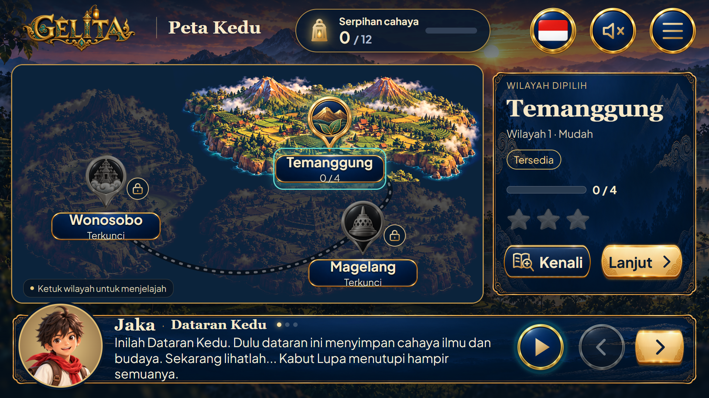
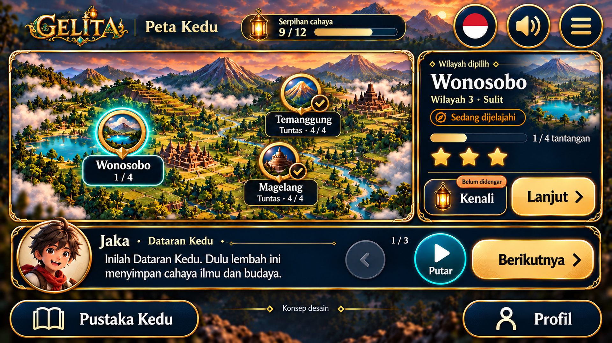

# Mockup Peta Kedu — kandidat dan preview

## Terbaru: kandidat 04 interaktif — 15 Oktober 2026

[Buka preview](revisi-04/preview.html) · [Paket dan spesifikasi 04](revisi-04/README.md) · [Galeri katalog](../../../index.html#mockups).

Pustaka/Profil masuk menu; cerita lebih lebar dengan efek ketik, dot kecil dan kontrol ikon tanpa teks. Diorama baru terdiri dari tiga lapisan yang dapat diredupkan masing-masing; jalur putus menghubungkan wilayah. Kenali memakai ikon buku/kaca pembesar baru. Panel dan tombol menggunakan skin katalog ui.result-* langsung.

Empat render04 dan riwayat01–03 kini dapat dipilih di galeri. Preview04 dapat dicoba langsung di katalog. Status tetap kandidat belum dipilih, bukan integrasi web asli. [Pemeriksaan browser DOM](../../../reports/peta-kedu-04-browser-check.json) mengukur target sentuh aktual pada preview640×360/854×480; berbeda dari pemeriksaan rencana03.

## Riwayat kandidat 03 — 14 Oktober 2026

Bagian berikut merekam kondisi kandidat03 sebelum revisi04, termasuk footer dan rencana targetnya.

Dibuat 14 Oktober 2026 (Asia/Bangkok) atas permintaan pengguna. **Kandidat 03 tersedia; belum dipilih pengguna.** Permintaan terbaru mengizinkan perombakan bebas mockup, ukuran/posisi ikon dan usulan diorama baru untuk HP siswa; pengguna akan menyesuaikan kode aplikasi sendiri. Izin ini menggantikan pembatasan revisi terbatas pada kandidat 02. Kanvas tetap 16:9 landscape.

[Buka gambar 1920 × 1080](kandidat/mockup-peta-kedu-kandidat-03-16-9.webp) · [Panduan sentuh/pengelompokan](spesifikasi-sentuh-03.md) · [Prompt aktual](prompt-detail.md) · [Keterangan](keterangan-mockup.md) · [Posisi titik](posisi-titik.md) · [Pemetaan awal](kebutuhan-aset.md) · [Manifest 03](../../../provenance/peta-kedu-mockup-03-20261014.json).

UI dikelompokkan menjadi HUD, peta dengan tiga pin besar, satu panel detail wilayah terpilih, cerita Jaka dan navigasi bawah. Panel contoh memilih Wonosobo; mengetuk kota lain diarahkan untuk mengganti konteks panel, bukan menambah panel duplikat. Lentera Kenali menjadi bagian satu tombol lebar; bintang/cek merupakan status noninteraktif. Play/Putar berwarna teal berbentuk bulat, Berikutnya emas memanjang, dan Sebelumnya abu-abu. Dialog/avatar dinaikkan agar terpisah dari Pustaka Kedu.

HUD mengikuti Tantangan selesai: bahasa, speaker dan menu besar. Menu menampung profil/beranda/fullscreen/keluar pada implementasi; fungsinya tidak dihilangkan. Pustaka Kedu/Profil tetap di footer. Jaka mengikuti reference.01 dengan syal merah.

State 9/12 serpihan, Temanggung/Magelang Tuntas 4/4, dan Wonosobo Sedang dijelajahi 1/4 mengikuti contoh halaman yang dibaca pada kandidat 02. Diorama kini merupakan **usulan gambar baru**, tertanam pada mockup full UI; background terpisah belum dibuat dan aset katalog map.kedu tidak diganti. Koordinat/titik baru masih usulan untuk komposisi ini, bukan konfigurasi web yang sudah disimpan.

Gambar 03 dibuat melalui tiga panggilan built-in ImageGen: generasi, koreksi ukuran/bintang, dan koreksi jarak dialog/footer. Acuan awal kandidat 02, mockup hasil pilihan dan reference.01. Dua draf disimpan sebagai provenance. Native final 1672 × 941 disimpan sebagai WebP lossless; final dinormalisasi proporsional menjadi 1920 × 1080 dengan crop tengah sangat kecil. Normalisasi tidak menambah detail AI.

[Tampilan pemeriksaan 640 × 360](../../../review/mockup-peta-kedu-03-640x360.webp) dan [854 × 480](../../../review/mockup-peta-kedu-03-854x480.webp) adalah salinan skala untuk review visual. [Rencana area sentuh](target-sentuh-03.json) berisi 14 target; perhitungan lulus minimum 44 px pada kedua ukuran tanpa overlap target rencana. Angka ini berlaku pada geometri yang diusulkan untuk kode, bukan pengukuran piksel raster, DOM atau uji sentuh perangkat nyata.

Preview HTML dan state interaktif Peta Kedu belum dibuat. Pemecahan aset, teks ID/EN, hit area dan navigasi mengikuti peninjauan/pemilihan komposisi saat pengguna mengimplementasikan kode. Cerita pada gambar merupakan cuplikan teks bagian pertama; jangan menghapus/mengubah urutan naskah narasi asli saat integrasi. Gambar ini bukan peta geografis terverifikasi, pengesahan budaya/lisensi, atau bukti integrasi game. Tidak menambah slot pada data.json, mengubah audio/web atau menyimpan progres.

Daftar berkas terbaru:

- kandidat/mockup-peta-kedu-kandidat-03-16-9.webp — ekspor full UI.
- kandidat/mockup-peta-kedu-kandidat-03-native.webp — native RGB identik keluaran tool.
- kandidat/prompt-aktual-03.txt — prompt generasi.
- kandidat/prompt-koreksi-03.txt — koreksi ukuran/bintang.
- kandidat/prompt-koreksi-jarak-03.txt — koreksi dialog/footer.
- target-sentuh-03.json dan spesifikasi-sentuh-03.md — rencana implementasi sentuhan.

[Kandidat 01](kandidat/mockup-peta-kedu-kandidat-01-16-9.webp) dan [02](kandidat/mockup-peta-kedu-kandidat-02-16-9.webp), native/prompt serta [manifest 01](../../../provenance/peta-kedu-mockup-20261014.json) dan [02](../../../provenance/peta-kedu-mockup-02-20261014.json) tetap disimpan sebagai riwayat.

[Brief asal](../../persiapan/peta-kedu/README.md) · [Galeri katalog](../../../index.html#mockups).
