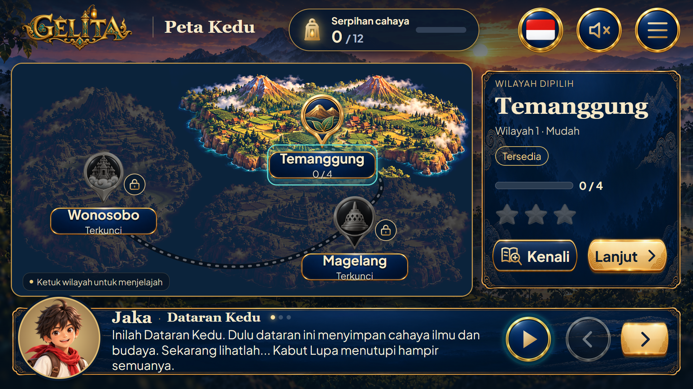

# Peta Kedu — kandidat 04 interaktif

15 Oktober 2026, Asia/Bangkok. **Kandidat belum dipilih pengguna.** Preview lokal tetap1920×1080, landscape16:9, memakai teks/kontrol HTML hidup dan gambar tombol katalog. Tidak mengubah web asli.

[Buka preview interaktif](preview.html) · [Katalog dan riwayat](../../../../index.html#mockups) · [Prompt diorama](prompt-diorama.txt) · [Spesifikasi](spesifikasi.md) · [Browser check](../../../../reports/peta-kedu-04-browser-check.json).

## Keputusan komposisi

- Pustaka Kedu dan Profil berada di menu, bersama Peta Kedu, fullscreen dan keluar. Keduanya bukan aksi utama peta; footer dihapus sehingga bidang cerita dan peta lebih lega.
- Previous/Next berdampingan tanpa tulisan. Play terpisah di sebelah kiri keduanya, juga tanpa tulisan; nama aksesibel tetap tersedia. Next emas menggunakan ui.result-button-primary; Play/Previous memakai ui.result-hud-control.
- Tiga dot kecil di kanan judul cerita menggantikan angka1/3. Dot aktif bercahaya, yang lain meredup. Bukan target klik kecil.
- Cerita mendapat ruang lebih lebar, mengetik bertahap, dapat dijeda/diputar ulang dan diganti bagian. Reduced-motion menampilkan teks langsung.
- Kenali memakai SVG baru buku terbuka/kaca pembesar, bukan lentera. Lentera hanya penanda serpihan HUD. Ikon kandidat mengikuti keluarga SVG emas; belum menambah kode slot resmi.

## Diorama tiga wilayah

[Master diorama](aset/diorama.kedu-tiga-wilayah.webp) dibuat melalui satu panggilan ImageGen:1774×887 RGB/opak, rasio2:1. Master dipakai tiga lapisan dengan ukuran/posisi identik, dipotong melalui clip-path polygon: Wonosobo kiri, Temanggung kanan atas, Magelang kanan bawah. Filter redup diterapkan per lapisan. Blend lighten terhadap navy mengurangi bidang hitam tajam di celah air.

Jalur SVG putus mengikuti urutan Temanggung→Magelang→Wonosobo. Jalur terkunci abu-abu, jalur terbuka emas. Jalur/pin/label/UI tidak tertanam di master sehingga dapat disesuaikan dalam kode.

Menu memiliki tombol untuk berpindah **contoh awal perjalanan** (hanya Temanggung terbuka,0/12) dan **contoh progres9/12** (ketiganya terbuka). Ini dua fixture visual, bukan implementasi aturan unlock/hadiah yang disahkan. Pilihan tidak disimpan ke akun/localStorage/database.

## Teks, audio dan batas integrasi

Bagian peta01/02 dan pengantar Kenali memakai teks ID/EN dari update/naskah-cerita/naskah-cerita.md. Bagian peta03 **diadaptasi hanya dalam preview** agar menyebut tombol Kenali, menggantikan instruksi ikon lentera. Sumber naskah dan88 brief narasi tidak diubah. Play mengendalikan efek ketik; belum memutar rekaman narasi karena rekamannya tidak tersedia. Speaker baru memainkan musik map/click/lock yang telah ada setelah tindakan pengguna; mute/keluar/iframe ditutup menghentikan bunyi.

Pustaka/Profil/Lanjut/Keluar merupakan aksi demonstrasi, tanpa navigasi akun/game asli. Beranda memilih Temanggung dalam preview. Kenali membuka kutipan teks lokal; bukan rekaman baru Mbah Kedu.

Skin dipakai langsung melalui jalur relatif assets/antarmuka/ui.result-*; panel memakai border-image agar ornamentasi tidak dipipihkan saat rasio panel berubah. Gambar halaman penuh adalah **hasil render kode**, bukan desain yang sudah dipilih atau generasi AI full UI. Diorama ilustratif, belum validasi geografi/budaya/lisensi.

## Berkas

- preview.html/css/js: UI, tata letak, interaksi/efek ketik.
- aset/diorama.kedu-tiga-wilayah.webp: master baru.
- aset/icon.kenali.svg dan ikon arah: kontrol vektor kandidat.
- variasi-ui/: empat render1920×1080, terkunci/progres/menu/English.
- [Manifest](../../../../provenance/peta-kedu-mockup-04-20261015.json): input, prompt, ukuran/hash dan reuse skin.
- [Pemeriksa](../../../../scripts/verify-peta-kedu-04.cjs): render dan pengukuran DOM nyata di640×360/854×480.

[Riwayat kandidat01–03](../README.md).
